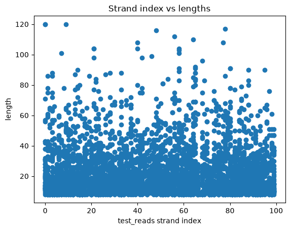
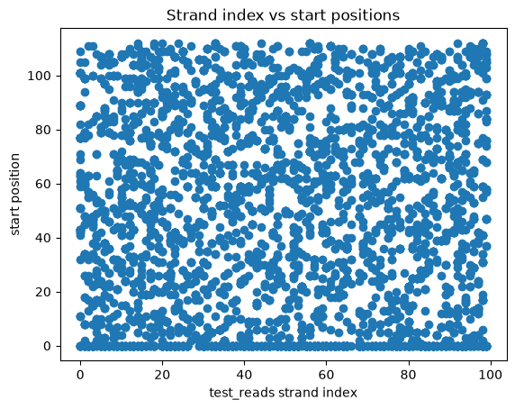
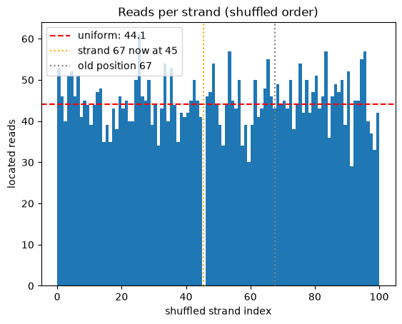
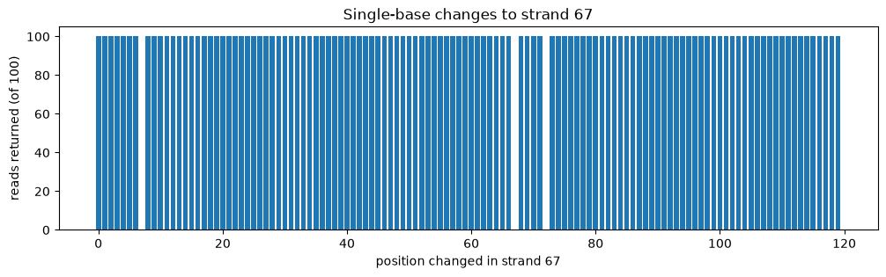
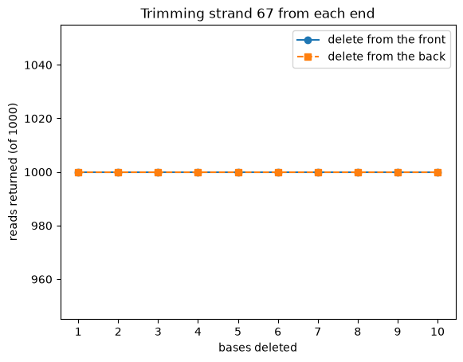
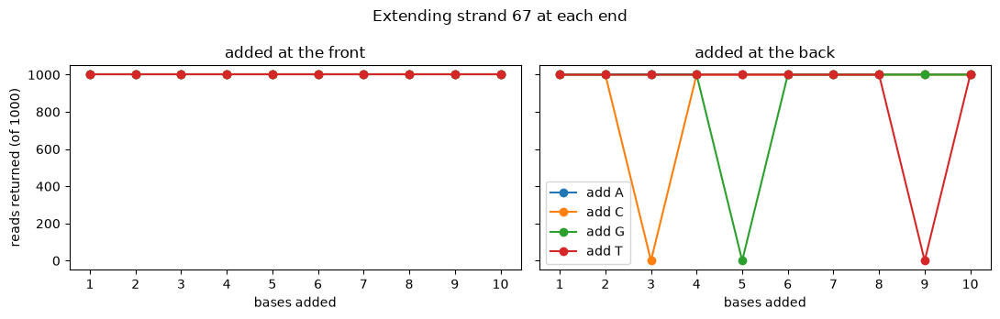
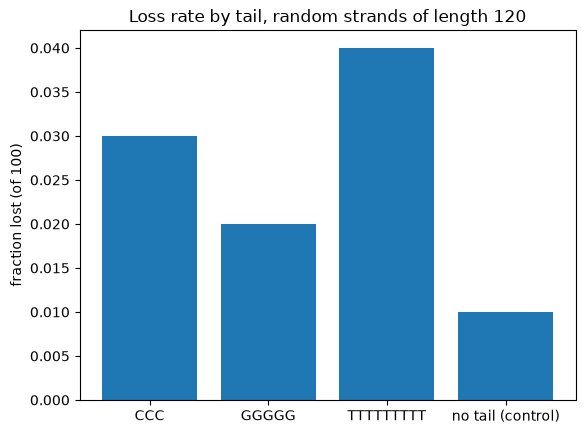
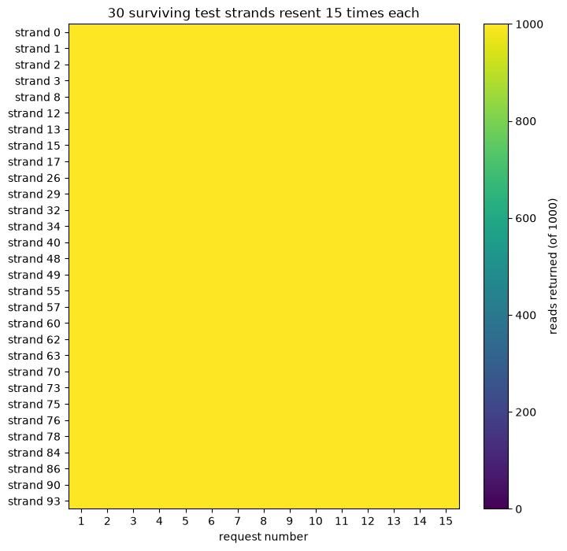
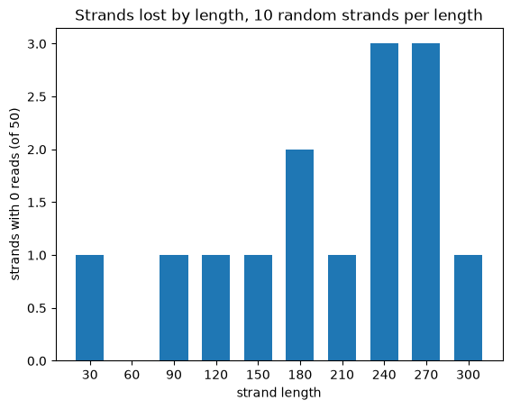

# ENGS 27 Final Project Notes: Storing Text in DNA

A running notebook for this project. Newer sections go just before the Findings log.

**Sources:** The primary source is the course notes, `ENGS_27_Notes (10).pdf`, cited as *(Notes §section, p. page)* using the printed page numbers. Anything marked ⚠️ **Not from the lecture notes** comes from somewhere else, and that source is named.

---

## 1. Overall summary

### Goal
Store English text in DNA (strings of A, C, G, T) so it can be recovered after the DNA is "sequenced." Sequencing doesn't return whole strands. It returns random fragments of them, called **reads**.

- The notes list "storing data in DNA" as an application of information and redundancy, tied to Lecture 15 *(Notes §0.4, p. 3)*.
- ⚠️ **Not from the lecture notes:** the claim that one gram of DNA can hold hundreds of petabytes comes from the project notebook.

### Deliverables
1. **`solution.py`**, with two functions:
   - `encode(text)` takes a string and returns a list of DNA strands.
   - `decode(reads)` takes a list of random fragments of those strands and returns the text.
   - It's generated by the `%%writefile solution.py` cell in the notebook (Part 2). Everything the code needs must live inside that file.
2. **A one-page write-up** (one side, 12-pt font) covering:
   - what I learned about the channel
   - how my design responds to it
   - the evidence for both

### Key constraint
`decode` gets **only the reads**. It doesn't see the original text, its length, or any settings used in encoding. Anything the decoder needs, like the text length, a Huffman tree or strand ordering, has to be written into the DNA itself.

### Grading
- The code runs on 3 unseen passages: short, medium and long. The grade is the average over the three.
- For each passage, the decoder gets exactly **4 reads per character** of text (for example, 4,000 reads for a 1,000-character passage).
- Each read is a random piece of a randomly chosen strand. Some strands get read many times, others rarely or never.

$$\text{density} = \frac{8 \times \text{characters}}{\text{bases stored}}, \qquad
e = \frac{\text{edit distance}}{\text{characters}}, \qquad
\text{score} = \text{density} \times \bigl(1 - H(e)\bigr)$$

- **Density** is bits of text per base, so fewer bases is better.
- **e** is the error rate, measured with edit distance. Dropping one character costs one character and doesn't throw off the alignment of everything after it.
  - ⚠️ **Not from the lecture notes:** edit distance is defined in the project notebook. The notes define **Hamming distance** *(Notes §3.3.2, p. 58)*. They mention deletions and Levenshtein only in passing, noting that deletions are "the dominant error mode in DNA storage" *(Notes §3.3.5, p. 61)*. Edit distance is never developed.
- **H** is binary entropy: H(p) = −p log₂ p − (1−p) log₂(1−p) *(Notes §3.1.3 Entropy, p. 46)*.
- ⚠️ **Not from the lecture notes:** the scoring formula itself, density × (1 − H(e)), is the project's own definition.

### Things to keep in mind about the scoring
- **Density and accuracy pull against each other.** Tighter strands (no redundancy, long strands, heavy compression) raise density but make recovery harder.
- **H(e) is steep near 0.** Even small error rates cost a lot. *(To do: compute H(0.01) and H(0.05) to get a feel for it. See the plot in Notes §3.1.3, p. 46.)*
- **The read budget is tied to characters, not bases.** Think about how coverage per base changes as the encoding changes. Coverage is defined in *(Notes §2.4.5 Collecting Everything, p. 36)*.

### Notebook structure
- **Part 1:** Explore the real channel to learn how it breaks strands.
- **Part 2:** A working but wasteful baseline `solution.py`, to beat.
- **Part 3:** `evaluate()`, which scores the solution the way the grader will. The grading passages are different, so test on other passages too.
- **"Doing better":** A list of improvement directions, each tied to a lecture. Where each one is in the notes:

| Direction (notebook) | Notes section |
|---|---|
| Compress, e.g. Huffman (Lec 9, 10) | §3.2 Compression, p. 50; §3.2.5 Huffman Coding, p. 54 |
| Choose the strand length (Lec 7, 23) | §2.4.2 Geometric, p. 34; §2.4.3 Approximating Many Failures, p. 35; possibly §7.1, p. 123 *(the Lec 23 match is inferred)* |
| Assemble overlapping reads, de Bruijn graph (Lec 15) | §5.1.7 De Bruijn Graphs, p. 85 (which mentions stitching short reads of a genome) |
| Avoid repeats (Problem Set 6) | ⚠️ **Not from the lecture notes.** PS6 covers Markov chains, Lectures 18–20 *(Notes §0.3, p. 2)*, but the problem set itself isn't in the repo |
| Avoid what breaks, constrained code (Lec 18) | §6.1.4 Counting Writable Strings, p. 99 |
| Add redundancy, parity (Lec 11) | §3.3 Error Correction, p. 57; §3.3.3 Parity Checks, p. 59 |
| Plan coverage, coupon collector (Lec 6, 7) | §2.4.5 Collecting Everything, p. 36 |

---

## 2. Part 1: Explore the channel

### Tools
- **`Channel()`** is the real server. It's unlimited, so experiment freely.
- **`LocalChannel()`** is a fake for offline debugging. Its breaks are independent with a fixed probability (default 0.03), and it throws away pieces shorter than 8. **It is not the real channel.** Figuring out how the real one differs is the point of Part 1.
- **Starter experiment:** 100 random strands of length 120, 5000 reads, and a histogram of read lengths.
- **`locate(reads, strands)`** returns `(strand index, start, length)` for each read that matches exactly one strand. With that, I know exactly where the molecule broke:
  - a break just before `start`
  - a break just after `start + length - 1`, unless the read runs to the end of the strand

### Question 1: What does the read-length distribution look like? Is it geometric?
- If every position broke independently with probability p (like `LocalChannel`), fragment lengths would be **geometric** *(Notes §2.4.2 Geometric, p. 34; independence: §2.2.2, p. 25)*.
- The notes approximate the geometric tail as (1−p)ⁿ ≈ e^(−np) *(Notes §2.4.3, p. 35)*.
- Task: check whether the real data fits that model.
- Things to think about:
  - What does a geometric distribution look like on a log-scale y-axis?
    - ⚠️ **Not from the lecture notes:** using a log-scale plot to test whether a distribution is geometric is a general data-analysis technique. It follows from the formulas above, but the notes don't present it.
  - Do reads that touch a strand's end behave differently from interior pieces?
  - Is there a minimum read length?

### Question 2: Does the chance of a break depend on the nearby bases? On how many?
- This asks whether certain sequences are "fragile." In probability terms, it's asking whether P(break | nearby bases) differs from P(break) *(Notes §2.2.1 Conditional, Joint, and Marginal Probability, p. 24)*.
- Approach: use `locate` to collect the bases on either side of each break point. Compare how often each pattern appears at breaks with how often it appears in the strands overall.
- "How many" means the width of the context window that matters: 1 base, a pair, a triple, and so on.
  - Related: the notes describe "sequences that remember their last few letters" (Lec 19) *(Notes §0.4, p. 3)* and the Markov property *(Notes §6.2.1, p. 100)*.
- After random strands, **design strands on purpose** to test a specific hypothesis.

### Question 3: How often does a read cover a whole strand of length L?
- Send strands of several lengths and measure what fraction of reads are the complete strand.
- I want this as a **curve against L**.
- Relevant tools: §2.4.2 Geometric (p. 34) and §2.4.3 Approximating Many Failures (p. 35).

### Why these matter (links to design decisions)
- **Q1 and Q3** tell me how long strands can be, and whether I can rely on whole-strand reads or need to stitch overlapping fragments together *(Notes §5.1.7, p. 85)*.
- **Q2** tells me whether it's worth avoiding certain sequences: a constrained code *(Notes §6.1.4 Counting Writable Strings, p. 99)*.

### Also check
- The starter prints `located X of Y reads`. Why aren't all reads located? Is it only ambiguity, or do reads contain **errors** (the "Doing better" section hints at this)? Reads with errors would make this a noisy channel *(Notes §3.3.1 Noisy Channels, p. 57)*.

### Write-up reminder
**Save plots and numbers from Part 1 as I go.** The write-up needs evidence.

---

## 3. What "sequencing" means and the full pipeline

### Sequencing in the real world
Sequencing means **reading DNA back**. A machine takes DNA molecules and reports their bases (A, C, G, T) in order, as a text string.

- **What the notes cover:** shotgun sequencing, through the Lander–Waterman model *(Notes §2.4.5 Collecting Everything, p. 36)*. The machine can't read a long sequence end to end, so the sample is **chopped into fragments** and each fragment is read separately. A **read** is one such fragment. The notes use this to ask how many reads it takes to cover every base, which is a twist on the coupon collector problem.

The steps below are general background. ⚠️ **Not from the lecture notes.**
1. **Synthesis (writing).** Order DNA strands with exact sequences I chose. The lab builds many physical copies of each.
2. **Storage.** The molecules sit in a tube.
3. **Sequencing (reading).** A sequencer reads the molecules and outputs strings of bases.

The catch is that the output is an **unordered pile of fragments**, and nothing says which strand each one came from or where in that strand it sat.

### Sequencing in this project
The course server simulates the process. For each of the `n` reads, `Channel().reads(strands, n)`:
1. picks one of my strands **at random** (some get picked often, some rarely or never),
2. **breaks** it into pieces according to its hidden rules,
3. returns **one piece** as a string.

So sequencing here is a black-box function, `reads = channel(my_strands)`. Part 1 is about figuring out what's inside the box.

- **Difference from the notes' model:** in Lander–Waterman, reads have a fixed length L and start at uniformly random positions *(Notes §2.4.5, p. 36)*. In this project, read lengths come from wherever the strand breaks, and that's unknown. Don't assume the notes' model applies without testing it.

### What the decoder does NOT know
`decode` receives a shuffled bag of substrings, and that's all it gets. It doesn't know:
- which strand each read came from
- where in the strand each read starts
- how many strands there were
- whether every strand was read at all

Anything that helps answer those has to be **built into the strands by `encode`**. That's why the baseline puts an index at the start of every strand. (The index scheme comes from the project notebook's baseline.)

**Info-theory framing:** encoder = transmitter, server = **noisy channel** (it corrupts the message by fragmenting it), decoder = receiver *(Notes §3.3.1 Noisy Channels, p. 57)*. ⚠️ **Not from the lecture notes:** the notes' noisy channels flip bits. Fragmentation and loss is a different kind of noise, closer to the deletions mentioned in §3.3.5 (p. 61).

### The full pipeline (English → DNA → English)

Example values use the text `"Hi"` and the baseline's 2-bits-per-base mapping (A=00, C=01, G=10, T=11). Steps marked *(optional)* are design choices from the "Doing better" list. They're not part of the baseline.

```
 ═══════════════════════  ENCODE  (my code: solution.encode)  ═══════════════════════

   ┌─────────────────────────┐
   │  English text           │      "Hi"
   └────────────┬────────────┘
                ▼
   ┌─────────────────────────┐
   │  Text → bytes → bits    │      'H'=0x48, 'i'=0x69  →  01001000 01101001
   │  (optional: compress,   │      (compression = fewer bits for the same text;
   │   e.g. Huffman)         │       the decoder must also learn the code)
   └────────────┬────────────┘
                ▼
   ┌─────────────────────────┐
   │  Add what the decoder   │      length of text, code tables, ...
   │  needs (header/metadata)│
   │  (optional: redundancy) │      parity / extra strands to survive losses
   └────────────┬────────────┘
                ▼
   ┌─────────────────────────┐
   │  Bits → bases           │      01 00 10 00 | 01 10 10 01
   │                         │       C  A  G  A |  C  G  G  C   →  "CAGACGGC"
   └────────────┬────────────┘
                ▼
   ┌─────────────────────────┐
   │  Split into strands,    │      [index][payload]  [index][payload] ...
   │  add an index to each   │      strand length = key design choice
   └────────────┬────────────┘
                ▼
          list of strands        ← density is measured HERE (total bases)

 ═══════════════════════  CHANNEL  (the server, a black box)  ═════════════════════════

   ┌──────────────────────────────────────────────────────────────┐
   │  "Synthesize" strands  →  molecules break  →  "sequence"      │
   │                                                              │
   │   strand:  AAACAGACGGCTTAG...                                │
   │   breaks:  AAAC | AGACGG | CTT | AG...                       │
   │   read  =  one random piece of one random strand             │
   │                                                              │
   │   repeated (4 × number of characters) times                  │
   └──────────────────────────────┬───────────────────────────────┘
                                  ▼
          shuffled bag of reads  (fragments: no order, no labels,
                                  some strands never seen)

 ═══════════════════════  DECODE  (my code: solution.decode)  ═══════════════════════

   ┌─────────────────────────┐
   │  Figure out where each  │      use indices, full-length reads, and/or
   │  read belongs           │      stitch overlapping fragments together
   └────────────┬────────────┘
                ▼
   ┌─────────────────────────┐
   │  Rebuild each strand    │      combine many reads per strand
   │  (vote / reconcile)     │      (handles disagreements / errors)
   └────────────┬────────────┘
                ▼
   ┌─────────────────────────┐
   │  Put strands in order,  │      "CAGACGGC"
   │  fix missing ones if    │
   │  there's redundancy     │
   └────────────┬────────────┘
                ▼
   ┌─────────────────────────┐
   │  Bases → bits → bytes   │      C A G A C G G C → 01001000 01101001
   │  (undo compression)     │
   └────────────┬────────────┘
                ▼
   ┌─────────────────────────┐
   │  Read header, trim to   │      "Hi"
   │  length, → English text │
   └─────────────────────────┘
                                 ← accuracy (edit distance) is measured HERE
```

**Takeaway:** every DECODE step undoes an ENCODE step, in reverse order, using only what's in the reads.

**Sources for the diagram:**

| Step | Source |
|---|---|
| Text → bytes (UTF-8, ASCII codes like 'H'=0x48) | ⚠️ **Not from the lecture notes.** General computing; the project notebook's baseline uses it |
| Bits → bases at 2 bits per base | ⚠️ **Not from the lecture notes.** Project notebook baseline. (Why 4 symbols carry 2 bits each: entropy of a uniform choice among 4, *Notes §3.1.3, p. 46*) |
| Compression / Huffman | *Notes §3.2.5, p. 54* |
| Header / metadata, index per strand | ⚠️ **Not from the lecture notes.** Project notebook baseline |
| Redundancy / parity | *Notes §3.3.3 Parity Checks, p. 59* |
| Strands break into random fragments | *Notes §2.4.5, p. 36* (shotgun sequencing); the project's actual break rules are unknown |
| Stitching overlapping fragments | *Notes §5.1.7 De Bruijn Graphs, p. 85* |
| Voting across multiple reads | *Notes §3.3.2, p. 59* (send three times, take a majority vote position by position) |
| Edit distance (accuracy) | ⚠️ **Not from the lecture notes.** Project notebook |

---

## 4. How to log a finding

These rules cover every entry in the Findings log below. The local site (`site/serve.py`) builds its step-by-step timeline from that log, so the heading format and the indentation rules are what make an entry show up correctly.

### When to add an entry
- **One experiment, one entry.** Each experiment gets its own `###` entry, even when it follows up on an earlier one.
- **Add entries at the end of the log.** The log is chronological, oldest first, and the site numbers the steps in that order.
- **Don't extend an old entry with new experiments.** Refer back to it by its title instead ("explanation (2) from the shuffle test").
- **Correct an old entry in place only when it's wrong.** Add a dated bullet, such as `- **Correction (2026-11-20):** …`, and leave the original text so the record of what was believed stays intact.
- **Log null results too.** "Tested X, saw no effect" rules something out, and the write-up needs that as evidence.
- **Close each step with a summary entry** titled `### Where things stand after Step N`, with no date. It lists what is established, what is still open, and what changed about earlier findings.

### The heading
Write it as `### YYYY-MM-DD · Part N, Step N: Title`.
- **Date:** the day the experiment was run, in ISO form.
- **Part and step:** which part of the project notebook the experiment belongs to. Keep this label under 40 characters.
- **Title:** state the result, not the activity. Write "Split test, both halves of strand 67 survive", not "Split test".

### The body
Use bold-labelled bullets, in this order. Leave out any that don't apply.

| Label | What goes in it |
|---|---|
| **Setup** | What was sent and how: strands, lengths, number of reads, random seeds, which channel, and the control. Name the notebook cell by its helper function or its first comment line, not by its number, because cell numbers shift. |
| **Result** | What came back, as numbers. Use a table when two or more cases are compared. Embed every plot the experiment produced (see Plots below). |
| **Conclusion** or **What it means** | What the result establishes and what it rules out. Keep it to what the numbers support, and say so when something is only a hint. |
| **Side observation** | Anything noticed that wasn't the point of the experiment. |
| **Practical note** | Pitfalls in running the experiment, such as a call that hangs. |
| **Still open** | Explanations the experiment could not tell apart. |
| **Next (to do)** | The experiment this one points to. |

### Numbers
- **Copy numbers from the notebook's saved output.** Don't retype them from memory or round them differently from the output.
- **Give the sample size with every number,** for example "900 of 1000 reads" or "N = 4367".
- **Record what makes the run repeatable:** the seed, the number of strands, the strand length and the number of reads.
- **Use 0-based base positions,** as the notebook does: "bases 0–59".

### Plots
**Every entry captures every plot its experiment produced.** If the experiment's cell drew a plot, the entry embeds it. An entry has no plot only when the experiment drew none.

To capture a plot:
1. Run the cell and **save the notebook**. The site only sees the saved file.
2. On the site's Lab notebook page, click **Copy embed** under the plot.
3. Paste the line directly under the bullet it supports, indented to line up with that bullet's text.

Without the browser, run `.venv/bin/python site/build.py`. It saves each plot to `site/figures/`, named by the plot's title plus a short hash. Then write the embed by hand: ``.

- **Capture in the same session as the experiment,** before the cell is re-run. Each embed points to a snapshot in `site/figures/` that is never overwritten, so the plot keeps matching the numbers in the entry. A plot that was never snapshotted is lost when the cell is re-run or its output is cleared.
- **Before finishing an entry, check its cell on the Lab notebook page.** Every plot shown there for that experiment should appear in the entry.
- **A cell that serves several findings:** each plot goes in the entry whose claim it supports. A plot that supports no logged finding yet waits for the entry that will use it.
- **A plot that can no longer be captured:** say so in the entry with a bullet such as `- **Plot not captured:** the cell's output was cleared before it was saved.` Re-running the cell gives new random reads, so a fresh plot would not match the logged numbers.
- **The caption says what is plotted and the sample size.** The conclusion belongs in the bullets.

### Sequences
- **Short sequence in a sentence:** put it in backticks. The site colours any inline code that is only A, C, G and T.
- **A whole strand, a cut point, or a strand compared with a read:** use a fenced `dna` block. Further rows are compared with the first row and mismatches are boxed.
- **Options, one per line at the top of the block:** `@cut 60` draws a bar before base 60, `@mark 30-89` underlines that range, and `@start 60` sets the coordinate of the first base shown.

### Citations
The citation rules in `CLAUDE.md` apply to every entry.
- **Cite the course notes by section and printed page:** *(Notes §2.4.2 Geometric, p. 34)*. Check the PDF before citing.
- **Flag anything that isn't from the notes, in place,** starting the bullet with ⚠️ **Not from the lecture notes:** and naming the source.

### Markdown the site can read
- **Nest lists by 2 spaces,** or 3 spaces under a numbered item.
- **Tables and fenced blocks inside a bullet** need a blank line before them and the same indent as the bullet's text.
- **No raw HTML.**

### Hypotheses
Hypotheses live in section 5, "Hypotheses", not in the Findings log.
- **Number each one,** as `### Hypothesis N: The claim in a few words`. Numbers are never reused or changed, so references stay valid.
- **A new hypothesis** gets these bullets, in this order: **Status**, **Proposed** (date and the step that prompted it), **Statement**, **What would disprove it**, **Evidence**, **Caveats**, **Tests (to do)**.
- **After every experiment that bears on a hypothesis,** add one bullet to its **Evidence** list, at the end:
  - Start it with **Supports:**, **Against:** or **Neutral:**.
  - Link the step and copy the headline number from that Findings entry.
- **Update the rest in place:**
  - Add a dated `- **Update (YYYY-MM-DD):** …` bullet under any caveat the experiment addresses.
  - Mark progress next to the test it advances.
  - Revise **Status** when the balance of evidence changes.
- **A rejected or retired hypothesis stays in the section.** Set its **Status** to rejected or retired, with the date and the step that decided it.
- **The Findings entry names the hypothesis** in its Conclusion, for example "supports Hypothesis 1".

### Template
````markdown
### YYYY-MM-DD · Part N, Step N: The result in a few words
- **Setup:** what was sent, how many reads, seeds, which cell, and the control.
- **Result:** the headline number, with its sample size.
  

  | case | reads | … |
  |---|---|---|
  | … | … | … |

- **Conclusion:** what this establishes and what it rules out *(Notes §…, p. …)*.
- **Still open:** what it could not tell apart.
- **Next (to do):** the experiment this points to.
````

---

## Appendix A: Logging-rule violations

Places where the Findings log does not meet the rules in "How to log a finding". Audited on 2026-11-14 against the notebook as saved that day. When one is fixed, mark its row as resolved with the date instead of deleting it.

### Plots that were not captured
Rule: every entry captures every plot its experiment produced (see Plots in "How to log a finding").

Each cell below draws a plot, but the notebook has no saved output for it, and no snapshot exists in `site/figures/`. The numbers in the entries are unaffected.

| Entry | Cell (first comment line) | Plot that is missing | Status |
|---|---|---|---|
| Split test, both halves of strand 67 survive | `# Split strand 67 into two halves` | "Read lengths: halves of strands 67 and 66" | open |
| Middle-third test, strand 67's middle survives too | `# Middle third (bases 40-79) of strand 67` | "Read lengths: middle third of strands 67 and 66" | open |
| Single-base scan, almost any change brings strand 67 back | `# Single-base scan` | "Single-base changes to strand 67" | resolved 2026-11-14: the cell was run and saved, and the plot is embedded (`single-base-changes-to-strand-67-056ea3.png`) |

- **How to resolve:** these plots can't be recovered as they were. Re-running a cell draws new random reads, so a fresh plot would not match the logged numbers. Either add a `- **Plot not captured:**` bullet to each entry, or re-run the experiment and log it as a new entry with its plot and its new numbers.

### Experiment with no saved cell
Rule: Setup names the notebook cell and records what makes the run repeatable.

| Entry | What is missing | Status |
|---|---|---|
| Strand 67's sequence features are ordinary | The code that computed the four features is not in the notebook, so the table can't be reproduced from the saved files. | open |
| Single-base scan, almost any change brings strand 67 back | The scan itself had no saved output. Resolved 2026-11-14: the scan cell was run and saved, and its output matches the entry (117 of 120; still lost at 7, 67 and 72). Still missing: the follow-up (→A, →C, →G at bases 7, 67 and 72) was run outside the notebook. | partly open |
| Appendix B: Strands the channel deletes | The 1000-read recheck of all four deleted strands (2026-11-14) was run outside the notebook. | open |

- **How to resolve:** add a cell that computes the four features for all 100 test strands, check its output against the table in the entry, and name the cell in the entry's Setup.

### Checked, not violations
- **"Strand 67 sent alone returns nothing" has no plot.** Its cell only draws a plot when reads come back, and none did.
- **Two plots from the Part 1 analysis cell are not embedded anywhere:** "Strand start positions" and "Strand start positions vs lengths". Both are snapshotted in `site/figures/`. They bear on the still-open question of whether position within a strand matters, and no finding on that has been logged yet. They go in that entry when it is written.

---

## Appendix B: Strands the channel deletes

Every strand confirmed to come back with **no reads at all** when sent to `Channel()`. Use these as known-bad test cases, and check a new design's strands against this list.

### What counts as confirmed
- The strand was sent **alone** in a single direct request (the way `solo_test` does it), and the server returned **0 reads** to a request of **at least 1000 reads**.
- It returned 0 reads in **at least two separate requests**.
- A strand that only shows few *located* reads in a mixed batch doesn't count. Errors or ambiguity can explain that.
- **Adding a strand:** add a row to the table, put its full sequence in the sequences block, and link the Findings log entry that found it. Set its `deleted` to `True` in the bank of tested strands (Appendix C).

### Confirmed deleted strands

| # | Sequence | How it was made | Requests that returned 0 reads |
|---|---|---|---|
| 1 | `CGAGACCTGGAACGGTAGAGGCTATCTTTGTCTGATTCGGCACCTATGGGTAAAGGTCTCAAGATGGTCGTATGGGACTCCATCACGAGCCAGTAGAAGAATTTGGACGCATAAAACGTT` | `test_strands[67]`, from 100 random strands of length 120 made with `random.Random(0)` | 20, 1000, 1000 (solo); 100 (scan control); 1000 (recheck) |
| 2 | `CGAGACCAGGAACGGTAGAGGCTATCTTTGTCTGATTCGGCACCTATGGGTAAAGGTCTCAAGATGGTCGTATGGGACTCCATCACGAGCCAGTAGAAGAATTTGGACGCATAAAACGTT` | row 1 with base 7 changed from T to A | 100 (scan); 100 (follow-up); 1000 (recheck) |
| 3 | `CGAGACCTGGAACGGTAGAGGCTATCTTTGTCTGATTCGGCACCTATGGGTAAAGGTCTCAAGATGGACGTATGGGACTCCATCACGAGCCAGTAGAAGAATTTGGACGCATAAAACGTT` | row 1 with base 67 changed from T to A | 100 (scan); 100 (follow-up); 1000 (recheck) |
| 4 | `CGAGACCTGGAACGGTAGAGGCTATCTTTGTCTGATTCGGCACCTATGGGTAAAGGTCTCAAGATGGTCGTAAGGGACTCCATCACGAGCCAGTAGAAGAATTTGGACGCATAAAACGTT` | row 1 with base 72 changed from T to A | 100 (scan); 100 (follow-up); 1000 (recheck) |
| 5 | `CGAGACCTGGAACGGTAGAGGCTATCTTTGTCTGATTCGGCACCTATGGGTAAAGGTCTCAAGATGGTCGTATGGGACTCCATCACGAGCCAGTAGAAGAATTTGGACGCATAAAACGTTCCC` | row 1 with `CCC` added at the back (123 bases) | 1000 (my run); 1000 (saved notebook run) |
| 6 | `CGAGACCTGGAACGGTAGAGGCTATCTTTGTCTGATTCGGCACCTATGGGTAAAGGTCTCAAGATGGTCGTATGGGACTCCATCACGAGCCAGTAGAAGAATTTGGACGCATAAAACGTTGGGGG` | row 1 with `GGGGG` added at the back (125 bases) | 1000 (my run); 1000 (saved notebook run) |
| 7 | `CGAGACCTGGAACGGTAGAGGCTATCTTTGTCTGATTCGGCACCTATGGGTAAAGGTCTCAAGATGGTCGTATGGGACTCCATCACGAGCCAGTAGAAGAATTTGGACGCATAAAACGTTTTTTTTTTT` | row 1 with `TTTTTTTTT` added at the back (129 bases) | 1000 (my run); 1000 (saved notebook run) |
| 8 | `CATCGTTTACCGACCCCGACACATACGGAGCTCCGTCCCGCTGGCTGCTAAACGTTTCATCTTATCGCAACTGCTGGTTCCATAGGTATTCCGCTCTGCCCGTTTCCACGATTGGCTCCC` | random strand 20 of the `CCC` group in the tail test (`random.Random(2)`) | 1000 (my run); 1000 (saved notebook run) |
| 9 | `TTATAACGTTAGGGCGGGCGAGGTCGTGAGGTGCAGGCAGAAACTGCCCCATTATACTCTACATAGGGTTCTCACTCCAAGTATCCAGGAGCAGACAAGGTACCTATGGGCTCTCCACCC` | random strand 32 of the `CCC` group in the tail test (`random.Random(2)`) | 1000 (my run); 1000 (saved notebook run) |
| 10 | `TGTGGCGCGGTTGCACGTGGATAGCAGCCTACTAGGCGTTAGGGGTCGCTCTCAATTCCGGCCCGGCCTCTCGGGATACCTGAGTCAGGGCGCTACGTCGCAGCTATACTTTGCTAACCC` | random strand 40 of the `CCC` group in the tail test (`random.Random(2)`) | 1000 (my run); 1000 (saved notebook run) |
| 11 | `CGTTCCGGTCCGAGCTCCAATACCGAGACGCTACATCAGGCCGCACAAGTCGACATGAGAGGACGTGCGGCGCCGGCTTAGAGACTGTCCGGACGGACAAACAGCAAGAGGTAGTGGGGG` | random strand 37 of the `GGGGG` group in the tail test (`random.Random(2)`) | 1000 (my run); 1000 (saved notebook run) |
| 12 | `AGTTTTAAGGTGAGAAGAGGATAAAGTGCGATGCCTCTACTCCAGAAAGGATCATTTGCCTTCGGTTGGAACTTATACGCGTCCAATGTCTGTTCACCATCAGTGGCTGTACGATGGGGG` | random strand 51 of the `GGGGG` group in the tail test (`random.Random(2)`) | 1000 (my run); 1000 (saved notebook run) |
| 13 | `CTCACATCATCGTGTTGCTACATCAGTGGTTGGGTTCGGTCAGGTCAGCGCGGTAAGCCTTGGCGGGCACACGGACGGAATTTCACTAGTGTTTAACTACTCTGCGAGTTGTTTTTTTTT` | random strand 46 of the `TTTTTTTTT` group in the tail test (`random.Random(2)`) | 1000 (my run); 1000 (saved notebook run) |
| 14 | `CCCGCGATAACGGGGACCTCGATCCGCCCTTTCCAGAGTTGGCCCGATCGGGAGATTAGATCAAGACGGGCCGATTGCCTTTACTGCCGGCTATCATGGTCGGTTGCATAGTTTTTTTTT` | random strand 74 of the `TTTTTTTTT` group in the tail test (`random.Random(2)`) | 1000 (my run); 1000 (saved notebook run) |
| 15 | `TTGTGATGAATACCACAGTTTTCACAGGCAACGTCATCAGATACAGCCCCGGATACCCGTCGGCTCATGGTAATGAAGGCGCATTTGACATTTGTCCCCTCGGATCACGGGTTTTTTTTT` | random strand 77 of the `TTTTTTTTT` group in the tail test (`random.Random(2)`) | 1000 (my run); 1000 (saved notebook run) |
| 16 | `AGGGTACGTTAAAGCCTACGAAACTACGTGACGCGTTAAGTGGCGAGTAGCAATCGTCCACTGGGAAGGCTGATCTATCAGGCGCCGCCCTGGCCCATCCGCTCCGTCTGCTTTTTTTTT` | random strand 97 of the `TTTTTTTTT` group in the tail test (`random.Random(2)`) | 1000 (my run); 1000 (saved notebook run) |
| 17 | `AATTCACTACCGGCACTGGCGGACTTGTCGATAGAAGGTAAACTATTGAGTTCACTTTCTCAGCCTGATCGTATTGTCAGGCATATGATACACTTTATCTCACCTAGGTAAGTTAGTTTT` | random strand 96 of the no-tail control group in the tail test (`random.Random(2)`) | 1000 (my run); 1000 (saved notebook run) |
| 18 | `GTAACTATTACCATTCCGAGAAGGTGTCGA` | random strand 20 of the length-30 group in the length test (`random.Random(3)`, 30 bases) | 1000 (length test); 1000 (retest) |
| 19 | `TCGCAATGGGGTACCAAACAGTAAGCTGCCAGAACCGGCTGACGAAACGAGTTGATCTGGTGTACTCTGCCTAATCGTTATTACGTCCCC` | random strand 19 of the length-90 group in the length test (`random.Random(3)`, 90 bases) | 1000 (length test); 1000 (retest) |
| 20 | `AATAGCGACTTAATGTGAGGCGTGCTTCACGTGTGCTGAACGGACCAAATCAGTCATTCGGGAATCGTAGTTTGAGTAATTTTCAGGGAAGGTGGTCTGGTAAATCTACCAGTATACATG` | random strand 6 of the length-120 group in the length test (`random.Random(3)`, 120 bases) | 1000 (length test); 1000 (retest) |
| 21 | `ATTAGCCTACGCACCCTATATTGAATAGCACGTGGTTCTAAGGACTCCCCATCTGTAGGGCGGCGGTAACGGGAGAACAAACGCGTTCAGGAACAGTCATCAGTTGCTTAGGTATTTCTAATGCGCGCCATAGACCTAGGATCCACCGCA` | random strand 43 of the length-150 group in the length test (`random.Random(3)`, 150 bases) | 1000 (length test); 1000 (retest) |
| 22 | `CGCCAAACGCGTAACCTTAATTTCCGGTCGAAAGTACTGTTGCGCAGGCTCGCGTTATACTACAAGTATAGCCATGGGCGTCCACAAAATGCTATGTTGAAAGAGCTTCTATTAAGCTTCAAACTGATCATCTATAATAGTGGAAGATCCGTCTATTGTTCTGTAGAAACAGTGCTATAA` | random strand 23 of the length-180 group in the length test (`random.Random(3)`, 180 bases) | 1000 (length test); 1000 (retest) |
| 23 | `GACCACCGGCTGATTGATCTGTCTCACCTCAATTTGCACTAGGCAGGGGGCAAAGATCGTGTAGTAGGCTACGGGTCTGCTGGGTCATTCTGTTGCTCAGATGGCGTCCCTTAGATTTGCACAATGGAGGCTGTACACAACAGTTTGATGGGGTCCCGAGGGACTAATCTGAGGGGTCCC` | random strand 37 of the length-180 group in the length test (`random.Random(3)`, 180 bases) | 1000 (length test); 1000 (retest) |
| 24 | `TAGCGTATAAGAGGACATGGGGACGCGGTAACAGCTTACCAGTTGACCTTGTGCTATCTAGCGGGACAAATAGATCAGCGCAGCCAGATATGGTTAGAACAGTTACACGCAACTCTCCAACTATGGGTCCCCCAGCTCCGACTGCAGGGTACCACCCGCAACCCTAGGAGAAGCGGGGGTCGTTCTATTCTATCGAGGCCGATATTCTGA` | random strand 31 of the length-210 group in the length test (`random.Random(3)`, 210 bases) | 1000 (length test); 1000 (retest) |
| 25 | `TACGTAGGCGTCAGCGCTCATACTCTTTGGTTGTTGGGCGCTCGGAGCCCCCGTTCAGTGGCGATTCACGACCTAAGTTCTTGCGGCTCTCCCGCCCGCATAGTACGCCTATGATTTATTGAGAGCTCTTAGACCTGTACTCCCAGTGACACGCGTTTTCGGCTCCAAGCGGGCTATTATGACTACGTTGGATCTAACTAAATTAAGCGGGGGTCCAGCGCGTCGGGCAAAACGAAAGCG` | random strand 7 of the length-240 group in the length test (`random.Random(3)`, 240 bases) | 1000 (length test); 1000 (retest) |
| 26 | `CCCAACGATGACCCCTCTTCGATGCACGATGCCAGAGCAGTCTTAGTATACGAAAGTTCTTAGAATAGTTTCTGGATCCGCGTAACTCAGCCCGTTCGAAAGACACTGTTTAGTCCTGAAAGCGCAACTCGTCCCGCGATGAAATGAAAACGCTTCGAGCACACCTATTCATTTAGGTTATCTGCACCAAAAGCTGGCTAACTGCATCGCATAAGGTTTGGGAGCCTAGACCCTTTCCGG` | random strand 12 of the length-240 group in the length test (`random.Random(3)`, 240 bases) | 1000 (length test); 1000 (retest) |
| 27 | `GATCAGAGTTCGAGTCCACAGTAAGTCCCAGGAGGGTGACTATCTTTTGGGAATTCGTATTAGATCTATTACGAGGCTGGTATTCCATCGTCAGATGCATTTCACGTTGGCAGCGGTGTGCTCCATGACGTCGCTGTGCCCATAGACTAAATTTATGGGTCTCCGGTCGATGAATACCCTGGATGAGAGCAGTGCGCCACTCACGTGACGGAGCTCGGTTTGACTAACAGCGGAAAGCGG` | random strand 27 of the length-240 group in the length test (`random.Random(3)`, 240 bases) | 1000 (length test); 1000 (retest) |
| 28 | `ACCCTCTTTGGTCGGCCCTATTCGCTTGCGTAAGCCCAATCCAAATGGCTCCTTTATCCGCGCCGGCCCGCGAAGACGCCTTTGGCGTGATATCTGTCACGTTCTACAGATTCTCTGCGGCCGGAGCGCGTTGTATGACGGAAAATGTACGAACTATACCAGAGCCACTACTCAATAATTGATTACACTGGAATCTCGGTCCAAATCCGCGTGTTTACCTGGAGCTCCAATCATCAAGTAGACTCCTCTGCGGGACTCTGAGACTGGTGC` | random strand 4 of the length-270 group in the length test (`random.Random(3)`, 270 bases) | 1000 (length test); 1000 (retest) |
| 29 | `TAGTTGTTTTACTACTCGAGGATCTTCGTTCGACCGCGGCTACAGACGTTTTGTGTAGATACAGGCAAGCACTAGTACATGAATCTCTCAGGAGTTCATGACCCCTCGCTACCTGGGCCGTGGTACTCGAGACCGTGCTTTTCTGTACCGTAGATTCGATAGCGACCTTTTTTTGGACTGTAGTCACACCTGTTCCACGACCGGGCGTCAACGACGGACAGATCTCCGGGCGATCTTAGCAGTCGGTTCGGCATGCGTCGAGGGTGCGTT` | random strand 21 of the length-270 group in the length test (`random.Random(3)`, 270 bases) | 1000 (length test); 1000 (retest) |
| 30 | `CCATCGGGATCCGTCTAAAGTTTGTCTCCCCACTGCGTCCCCGACAGTCTCTTTGGGGTGTCCATAATGCTCTAACTTTAGGCCTTACGGTCCACCTGGAAATTGGAGGAACCGGTTTTATCGCAAACAACAATTTGATCATGACAGGACGTATAGCCGGGCGAGCTACGGCATATATGGAGTCCTCGGGTGCACCCGCCAGGGGACACAGCCCACGTCCTAACCTCGTTACCGTACCAGGTTTACCCCTTACGACAAAGCTGGCGTATT` | random strand 45 of the length-270 group in the length test (`random.Random(3)`, 270 bases) | 1000 (length test); 1000 (retest) |
| 31 | `TAGTAGGAAGAATACAGGTAACCCGTGTTAGTTAATTCGCACTAGGTCTGGGGTTACGCACCGGACAATTCCCATTATAGAGAGAATTCCAAGAGGCCTGCGTACTTTGACCGACTCAATCGGCTCGGATGATGCCCATAGGTGACCGGGCTCGGAAGTGTTGATCCCATGAGCCGATGCAGATCACCCTTGTATAGAACCTAGTAGGCGGGTGGAATGCATTTGGGATCCACGGGCGACGTAACCAGGCCAGGTGAGGGGGATGTAGTGATTCAAGGCGCGGGTCGTGTAGTGTTTCGG` | random strand 16 of the length-300 group in the length test (`random.Random(3)`, 300 bases) | 1000 (length test); 1000 (retest) |

- Rows 1–4 and 8–17 are 120 bases long; rows 5–7 are 123, 125 and 129. Positions are 0-based.
- Rows 1–7 all come from strand 67. Rows 8–17 are unrelated random strands; one of them, row 17, has no forced tail.
- Rows 18–31 are unrelated random strands from the length test, 30 to 300 bases long. Their full sequences are in the table; the sequences blocks below cover only the strand 67 family.

### Where each strand came from
Each link opens that step of the Findings log on the site. Cells are named by their first line.

| # | First flagged | Confirmed deleted | Notebook cell that confirms it |
|---|---|---|---|
| 1 | [Step 2: Reads per strand look uniform, except strand 67](index.html#step-2). It had 1 located read of 4367 in the starter run. [Step 3: Shuffle test](index.html#step-3) showed the dip follows its sequence. | [Step 4: Strand 67 sent alone returns nothing](index.html#step-4): 0 reads to requests of 20 and 1000 | `# Send the original strand 67 ALONE` |
| 2 | [Step 8: Single-base scan](index.html#step-8): 0 of 100 reads at position 7 | Step 8, follow-up table: →A gives 0 of 100, →C and →G give 100 of 100 | `# Single-base scan` (scan only; the follow-up was run outside the notebook) |
| 3 | [Step 8: Single-base scan](index.html#step-8): 0 of 100 reads at position 67 | Step 8, follow-up table: same pattern as row 2 | `# Single-base scan` (scan only; the follow-up was run outside the notebook) |
| 4 | [Step 8: Single-base scan](index.html#step-8): 0 of 100 reads at position 72 | Step 8, follow-up table: same pattern as row 2 | `# Single-base scan` (scan only; the follow-up was run outside the notebook) |
| 5 | [Step 11: Extension test](index.html#step-11): 0 of 1000 reads with `CCC` added at the back | Step 11: 0 of 1000 in two separate runs | `# Extension test` |
| 6 | [Step 11: Extension test](index.html#step-11): 0 of 1000 reads with `GGGGG` added at the back | Step 11: 0 of 1000 in two separate runs | `# Extension test` |
| 7 | [Step 11: Extension test](index.html#step-11): 0 of 1000 reads with `TTTTTTTTT` added at the back | Step 11: 0 of 1000 in two separate runs | `# Extension test` |
| 8 | [Step 12: Tail test](index.html#step-12): 0 of 1000 reads, strand 20 of the `CCC` group | Step 12: 0 of 1000 in two separate runs | `# Tail test` |
| 9 | [Step 12: Tail test](index.html#step-12): 0 of 1000 reads, strand 32 of the `CCC` group | Step 12: 0 of 1000 in two separate runs | `# Tail test` |
| 10 | [Step 12: Tail test](index.html#step-12): 0 of 1000 reads, strand 40 of the `CCC` group | Step 12: 0 of 1000 in two separate runs | `# Tail test` |
| 11 | [Step 12: Tail test](index.html#step-12): 0 of 1000 reads, strand 37 of the `GGGGG` group | Step 12: 0 of 1000 in two separate runs | `# Tail test` |
| 12 | [Step 12: Tail test](index.html#step-12): 0 of 1000 reads, strand 51 of the `GGGGG` group | Step 12: 0 of 1000 in two separate runs | `# Tail test` |
| 13 | [Step 12: Tail test](index.html#step-12): 0 of 1000 reads, strand 46 of the `TTTTTTTTT` group | Step 12: 0 of 1000 in two separate runs | `# Tail test` |
| 14 | [Step 12: Tail test](index.html#step-12): 0 of 1000 reads, strand 74 of the `TTTTTTTTT` group | Step 12: 0 of 1000 in two separate runs | `# Tail test` |
| 15 | [Step 12: Tail test](index.html#step-12): 0 of 1000 reads, strand 77 of the `TTTTTTTTT` group | Step 12: 0 of 1000 in two separate runs | `# Tail test` |
| 16 | [Step 12: Tail test](index.html#step-12): 0 of 1000 reads, strand 97 of the `TTTTTTTTT` group | Step 12: 0 of 1000 in two separate runs | `# Tail test` |
| 17 | [Step 12: Tail test](index.html#step-12): 0 of 1000 reads, strand 96 of the no-tail control group | Step 12: 0 of 1000 in two separate runs | `# Tail test` |
| 18 | [Step 16: Length test](index.html#step-16): 0 of 1000 reads, strand 20 of the length-30 group | [Step 17: Retest](index.html#step-17): 0 of 1000 again | `# Length test`, then `# Retest` |
| 19 | [Step 16: Length test](index.html#step-16): 0 of 1000 reads, strand 19 of the length-90 group | [Step 17: Retest](index.html#step-17): 0 of 1000 again | `# Length test`, then `# Retest` |
| 20 | [Step 16: Length test](index.html#step-16): 0 of 1000 reads, strand 6 of the length-120 group | [Step 17: Retest](index.html#step-17): 0 of 1000 again | `# Length test`, then `# Retest` |
| 21 | [Step 16: Length test](index.html#step-16): 0 of 1000 reads, strand 43 of the length-150 group | [Step 17: Retest](index.html#step-17): 0 of 1000 again | `# Length test`, then `# Retest` |
| 22 | [Step 16: Length test](index.html#step-16): 0 of 1000 reads, strand 23 of the length-180 group | [Step 17: Retest](index.html#step-17): 0 of 1000 again | `# Length test`, then `# Retest` |
| 23 | [Step 16: Length test](index.html#step-16): 0 of 1000 reads, strand 37 of the length-180 group | [Step 17: Retest](index.html#step-17): 0 of 1000 again | `# Length test`, then `# Retest` |
| 24 | [Step 16: Length test](index.html#step-16): 0 of 1000 reads, strand 31 of the length-210 group | [Step 17: Retest](index.html#step-17): 0 of 1000 again | `# Length test`, then `# Retest` |
| 25 | [Step 16: Length test](index.html#step-16): 0 of 1000 reads, strand 7 of the length-240 group | [Step 17: Retest](index.html#step-17): 0 of 1000 again | `# Length test`, then `# Retest` |
| 26 | [Step 16: Length test](index.html#step-16): 0 of 1000 reads, strand 12 of the length-240 group | [Step 17: Retest](index.html#step-17): 0 of 1000 again | `# Length test`, then `# Retest` |
| 27 | [Step 16: Length test](index.html#step-16): 0 of 1000 reads, strand 27 of the length-240 group | [Step 17: Retest](index.html#step-17): 0 of 1000 again | `# Length test`, then `# Retest` |
| 28 | [Step 16: Length test](index.html#step-16): 0 of 1000 reads, strand 4 of the length-270 group | [Step 17: Retest](index.html#step-17): 0 of 1000 again | `# Length test`, then `# Retest` |
| 29 | [Step 16: Length test](index.html#step-16): 0 of 1000 reads, strand 21 of the length-270 group | [Step 17: Retest](index.html#step-17): 0 of 1000 again | `# Length test`, then `# Retest` |
| 30 | [Step 16: Length test](index.html#step-16): 0 of 1000 reads, strand 45 of the length-270 group | [Step 17: Retest](index.html#step-17): 0 of 1000 again | `# Length test`, then `# Retest` |
| 31 | [Step 16: Length test](index.html#step-16): 0 of 1000 reads, strand 16 of the length-300 group | [Step 17: Retest](index.html#step-17): 0 of 1000 again | `# Length test`, then `# Retest` |

- **Step numbers** follow the order of entries in the Findings log. They stay valid as long as new entries are added at the end, as the logging rules require.
- **The 1000-read recheck** of rows 1–4 was run on 2026-11-14, outside the notebook (see Appendix A, "Experiment with no saved cell").
- **Repeat test (2026-11-14):** every row 1–17 was resent 15 more times in each of two runs (mine and the saved notebook run), 1000 reads per request, and returned 0 reads every time. That's on top of the requests listed in the table. See "Repeat test, all 17 lost strands return 0 reads in 255 of 255 requests".
- **Batch test (2026-11-14):** all 17 rows sent together in one batch returned 0 of 17000 requested reads. See "Batch test, the 17 lost strands sent together return 0 of 17000 reads".
- **Rows 18–31 (2026-11-14)** were confirmed by the retest, not by the repeat or batch tests, so each has exactly two requests with 0 reads. See "Retest, all 14 length-test strands return 0 reads again".

### Sequences
Rows 2–4 are compared with row 1, so the changed base is boxed.

```dna
strand 67:   CGAGACCTGGAACGGTAGAGGCTATCTTTGTCTGATTCGGCACCTATGGGTAAAGGTCTCAAGATGGTCGTATGGGACTCCATCACGAGCCAGTAGAAGAATTTGGACGCATAAAACGTT
7 T→A:       CGAGACCAGGAACGGTAGAGGCTATCTTTGTCTGATTCGGCACCTATGGGTAAAGGTCTCAAGATGGTCGTATGGGACTCCATCACGAGCCAGTAGAAGAATTTGGACGCATAAAACGTT
67 T→A:      CGAGACCTGGAACGGTAGAGGCTATCTTTGTCTGATTCGGCACCTATGGGTAAAGGTCTCAAGATGGACGTATGGGACTCCATCACGAGCCAGTAGAAGAATTTGGACGCATAAAACGTT
72 T→A:      CGAGACCTGGAACGGTAGAGGCTATCTTTGTCTGATTCGGCACCTATGGGTAAAGGTCTCAAGATGGTCGTAAGGGACTCCATCACGAGCCAGTAGAAGAATTTGGACGCATAAAACGTT
```

Rows 5–7 are row 1 plus bases added at the back. The bar marks where the added bases start (base 120).

```dna
@cut 120
strand 67:   CGAGACCTGGAACGGTAGAGGCTATCTTTGTCTGATTCGGCACCTATGGGTAAAGGTCTCAAGATGGTCGTATGGGACTCCATCACGAGCCAGTAGAAGAATTTGGACGCATAAAACGTT
+CCC:        CGAGACCTGGAACGGTAGAGGCTATCTTTGTCTGATTCGGCACCTATGGGTAAAGGTCTCAAGATGGTCGTATGGGACTCCATCACGAGCCAGTAGAAGAATTTGGACGCATAAAACGTTCCC
+GGGGG:      CGAGACCTGGAACGGTAGAGGCTATCTTTGTCTGATTCGGCACCTATGGGTAAAGGTCTCAAGATGGTCGTATGGGACTCCATCACGAGCCAGTAGAAGAATTTGGACGCATAAAACGTTGGGGG
+TTTTTTTTT:  CGAGACCTGGAACGGTAGAGGCTATCTTTGTCTGATTCGGCACCTATGGGTAAAGGTCTCAAGATGGTCGTATGGGACTCCATCACGAGCCAGTAGAAGAATTTGGACGCATAAAACGTTTTTTTTTTT
```

### Not deleted (for contrast)
- **The other 99 starter strands** all returned reads in the shuffle test.
- **Pieces of strand 67** come back normally: bases 0–59, 60–119 and 40–79.
- **117 of 120 single-base changes** to strand 67 come back with 100 of 100 reads. So do the T→C and T→G changes at bases 7, 67 and 72.
- **Strand 67 with 1–10 bases deleted** from the front or from the back comes back with 1000 of 1000 reads every time.
- **77 of 80 extensions of strand 67** (1–10 copies of A, C, G or T added at either end) come back with 1000 of 1000 reads. See "Extension test, 77 of 80 longer strands survive, 3 new ones are lost". See "Trimming test, deleting one end base brings strand 67 back".
- **390 of 400 random strands in the tail test** came back with 1000 of 1000 reads: 97 of 100 ending in `CCC`, 98 ending in `GGGGG`, 96 ending in `TTTTTTTTT` and 99 with no fixed tail. See "Tail test, the lost-strand tails don't kill other strands".
- **30 starter strands resent 15 times each** came back with 1000 of 1000 reads in all 450 requests. See "Survivor repeat test, 30 surviving strands return reads in 450 of 450 requests".
- **486 of 500 random strands of length 30–300** in the length test came back with 1000 of 1000 reads. See "Length test, 14 of 500 random strands of length 30–300 return 0 reads".

---

## Appendix C: Bank of tested strands

An ongoing record of every sequence sent to the live channel, kept as evidence and for later analysis: loss rates, sequence features of lost vs. surviving strands, and checks on new hypotheses. It grows with every experiment.

### Where it lives
- **File:** `tested_strands.ipynb`, in the repo root. Its code cell defines `tested_strands`, a Python list with one item per unique sequence.
- **Load it** in the project notebook with `%run tested_strands.ipynb`.
- **The sequences live only in that file.** They are too many to copy here (1232 so far), and one copy can't drift out of step with another.

### What each item holds

| Field | Meaning |
|---|---|
| `sequence` | The bases sent, as a string of A, C, G and T. |
| `deleted` | `True` only if the strand is confirmed deleted by Appendix B's rule: sent alone, 0 reads to at least two separate requests of at least 1000 reads. Otherwise `False`. |
| `length` | `len(sequence)`. |

### Adding to it
- **Every experiment that sends a new sequence to the live channel adds it,** in the same session. The rule is also in `CLAUDE.md` and in the "Record every strand you test" cell at the start of Part 1 in the project notebook.
- **One item per sequence, no duplicates.** If a sequence is already there, change `deleted` only when a new result changes it, and log that in the Findings log.
- **Copy sequences from code or saved output,** never by hand. Strands sent only to `LocalChannel` don't go in.
- **Keep it in step with Appendix B.** The `True` items and Appendix B's confirmed strands must be the same set.
- **Update the table below** when strands are added.

### Contents (2026-11-14)
Built from the notebook's seeds and saved outputs, and checked against Appendix B: the `True` items match its confirmed strands exactly (17 on the first build, 31 after the length-test retest).

| Source (Findings log entry) | Sequences | Lengths | Deleted |
|---|---|---|---|
| Starter strands, `random.Random(0)` ("Breakage doesn't depend on strand index") | 100 | 120 | 1 (strand 67) |
| Halves of strands 67 and 66 ("Split test, both halves of strand 67 survive") | 4 | 60 | 0 |
| Middle thirds of strands 67 and 66 ("Middle-third test, strand 67's middle survives too") | 2 | 40 | 0 |
| Single-base changes to strand 67, plus the follow-up at bases 7, 67 and 72 ("Single-base scan, almost any change brings strand 67 back") | 126 | 120 | 3 |
| Strand 67 trimmed by 1–10 bases at either end ("Trimming test, deleting one end base brings strand 67 back") | 20 | 110–119 | 0 |
| Strand 67 extended by 1–10 bases at either end ("Extension test, 77 of 80 longer strands survive, 3 new ones are lost") | 80 | 121–130 | 3 |
| Random strands with and without fixed tails, `random.Random(2)` ("Tail test, the lost-strand tails don't kill other strands") | 400 | 120 | 10 |
| Random strands of length 30–300, `random.Random(3)` ("Length test, 14 of 500 random strands of length 30–300 return 0 reads" and "Retest, all 14 length-test strands return 0 reads again"), added 2026-11-14 | 500 | 30–300 | 14 |
| **Total** | **1232** | 30–300 | **31** |

- The 30 strands in "Survivor repeat test, 30 surviving strands return reads in 450 of 450 requests" are starter strands, so they are already counted once.
- **Pending (resolved 2026-11-14):** the length test's 14 strands that returned 0 reads were held out until confirmed. The retest gave 0 reads again for all 14, so they are now in the bank as `True` and in Appendix B as rows 18–31.

### Caveats for analysis
- **Evidence differs by source.** Most `False` items returned 1000 of 1000 reads when sent alone. The 70 starter strands not in the survivor repeat test are `False` only because reads were located to them in mixed batches. That's weaker evidence.
- **The middle-third pieces** have no saved notebook output. Their status comes from the logged result.
- **The bank is not a random sample.** 232 items are near-copies of strand 67, a strand already known to be lost. For a loss-rate estimate, use only the independently random strands: the starter and tail-test strands (11 of 500 deleted) and the length-test strands (14 of 500 deleted). Together that's 25 of 1000.

---

## 5. Hypotheses

Claims about the channel that experiments are testing. Each one is numbered, and evidence is added under it as experiments come in, by the rules in "How to log a finding", subsection "Hypotheses". Each evidence link opens that step of the Findings log on the site.

### Hypothesis 1: Whether a strand is lost is deterministic
- **Status:** open, strongly supported. No experiment has gone against it. Both halves of the prediction now hold in repeated tests: lost strands stay lost and survivors keep coming back.
- **Proposed:** 2026-11-14, after the second run of the [Step 12: Tail test](index.html#step-12) lost exactly the same strands as the first.
- **Statement:** each exact sequence is either *always* dropped or *always* returned, and the deletion rate is **2.5%**, with a 95% interval of **1.6%–3.7%**. Everything else the channel does is random: where strands break, which strand each read comes from, and read errors. So the channel as a whole is **not** deterministic; only the lost-or-returned outcome would be.
  - **Sample:** 25 of the **1000** independently random strands tested so far are confirmed deleted: 1 of 100 starter strands, 10 of 400 in the tail test and 14 of 500 in the length test (see [Step 17: Retest](index.html#step-17)). The rate uses only these 1000. The bank of tested strands holds 1232 sequences in all (31 deleted), but the rest are near-copies of strand 67 or pieces of tested strands, so they aren't a random sample.
  - **Model:** each random strand is deleted independently with the same probability *p*, so the number deleted out of 1000 is binomial *(Notes §2.4.1 Bernoulli and Binomial, p. 33)*.
  - ⚠️ **Not from the lecture notes:** the interval is an exact binomial (Clopper–Pearson) interval. It doesn't assume a Gaussian: it gives the values of *p* for which 25 or more deleted (for the lower end), or 25 or fewer (for the upper end), would have probability at least 2.5% each. The Gaussian approximation, 2.5% ± 1.96 × 0.49%, gives a similar 1.5%–3.5%. That approximation is justified by the Central Limit Theorem *(Notes §7.2.6 The Central Limit Theorem, p. 134)*, but it's less accurate when *p* is this small.
- **What would disprove it:** a lost strand that returns reads in any request, or a surviving strand that returns 0 reads.
- **Evidence** (one bullet per experiment, oldest first):
  - **Supports:** [Step 4: Strand 67 sent alone returns nothing](index.html#step-4). Strand 67 returned 0 reads to requests of 20 and 1000. Counting earlier sends too, it has returned 0 reads in about 7 separate requests, alone and in a mixed batch.
  - **Supports:** [Step 8: Single-base scan](index.html#step-8). The three T→A changes (bases 7, 67, 72) returned 0 reads in 3 requests each.
  - **Supports:** [Step 11: Extension test](index.html#step-11). The three extended versions (`CCC`, `GGGGG`, `TTTTTTTTT` added at the back) returned 0 of 1000 reads in 2 separate runs each.
  - **Supports:** [Step 12: Tail test](index.html#step-12). Two runs lost exactly the same 10 of 400 strands, and no others. If loss were a fresh 2.5% chance per request, two runs would share only about 400 × 0.025² = 0.25 lost strands on average, so an exact match of all 10 is essentially impossible by chance. Every surviving strand returned all of its requested reads, so there is no partial loss.
  - **Supports:** [Step 13: Repeat test](index.html#step-13). All 17 Appendix B strands, sent alone 15 times each, returned 0 reads in 255 of 255 requests, and again in a second run of 255. Each lost strand has now returned 0 in at least 32 requests in a row.
  - **Supports:** [Step 14: Batch test](index.html#step-14). The 17 Appendix B strands sent together returned 0 of 17000 requested reads. The repeat test, re-run in the same cell just before, again gave 255 of 255 empty requests.
  - **Supports:** [Step 15: Survivor repeat test](index.html#step-15). 30 randomly picked surviving starter strands, sent alone 15 times each, returned 1000 of 1000 reads in 450 of 450 requests. A fresh 2.5% chance per request would have emptied about 11 of them.
  - **Supports:** [Step 17: Retest](index.html#step-17). The 14 length-test strands that returned 0 reads once returned 0 of 1000 again, 14 of 14. They span lengths 30 to 300, so the result isn't limited to length 120.
- **Caveats:**
  1. **Few repeats.** Most lost strands were tested only twice. Two matching runs of 400 strands make the claim very likely, not proven.
     - **Update (2026-11-14):** resolved for lost strands. The repeat test gives each at least 32 empty requests in a row. Still open for survivors, which haven't been repeated beyond the tail test's two runs.
     - **Update (2026-11-14):** resolved for survivors too. 30 surviving starter strands returned reads in 450 of 450 requests, 15 each (survivor repeat test).
  2. **One possible counterexample.** In the starter run, 1 read was located to strand 67 (see [Step 2: Reads per strand look uniform, except strand 67](index.html#step-2)). If strand 67 is always dropped, that read must have come from another strand: a read with an error, or a short piece that happened to match strand 67 uniquely. That's plausible but unconfirmed, and the read wasn't saved.
  3. **Short time span.** All tests ran on 2026-11-14. Whether the lost set stays the same over days, or after a server restart, is untested.
  4. **Mostly tested alone.** Apart from strand 67, every lost strand was confirmed by sending it on its own. Whether a strand that is lost alone is also lost inside a large mixed batch has only been checked for strand 67.
     - **Update (2026-11-14):** all 17 sent together with no survivors returned 0 of 17000 reads (batch test). Still untested with survivors in the same batch.
  5. **The mechanism is unknown.** Nothing in a strand's content predicts loss, so the decision behaves like a fixed coin flip per sequence. That rests on the absence of a found pattern, not on a known rule.
- **Tests (to do):**
  1. **Repeat:** re-send all 17 strands in Appendix B several more times, plus a sample of survivors, and check that none switches. *(Done: lost strands returned 0 reads in 2 × 255 requests, and 30 survivors returned reads in 450 of 450 requests.)*
  2. **Over time:** re-run the same check on a later day.
  3. **Mixed batch:** send the 17 lost strands mixed in with known survivors, using `locate` with many reads, and check that none of the 17 is ever located. *(Lost strands alone as one batch done: 0 of 17000 reads. With survivors not yet done.)*
  4. **Starter read:** re-run the starter experiment and see whether any read is uniquely located to strand 67 again. If one is, look at it for errors. *(Partly: a re-run before the survivor repeat test located reads to 99 of 100 strands. The one missing strand isn't named in the saved output.)*

---

## 6. Findings log

*(One entry per experiment, written by the rules in "How to log a finding" above.)*

### 2026-11-14 · Part 1, Step 1: Breakage doesn't depend on strand index
- **Setup:** the starter experiment (the cell that starts `channel = Channel()`). 100 random strands of length 120 from `random.Random(0)`, 5000 reads from `Channel()`, mean read length 25.0. `locate` placed 4367 of the 5000 reads. **Channel: live server** (`Channel()`).
  
- **Result:** from the Part 1 analysis cell (the cell that starts `# located: (strand index, start, length)`):
  - **Strand index vs. read length:** every strand's column shows the same spread of lengths.
    
  - **Strand index vs. start position:** every strand's column shows the same spread of start positions.
    
  - **Correlation check** (`corr_with_perm_test`, N = 4367 located reads, 10,000 shuffles):

    | Pair | r | permutation p |
    |---|---|---|
    | strand index vs. read length | −0.0025 | 0.864 |
    | strand index vs. start position | +0.0150 | 0.329 |

  - ⚠️ **Not from the lecture notes:** the correlation coefficient r = Cov/(σₓσᵧ) and the permutation test are general statistics.
- **Conclusion:** breakage behaves the same no matter which strand it happens on. The channel treats every test strand the same way.
  - Both correlations are effectively zero, and shuffled data does as well or better most of the time. That's consistent with the scatter plots.
  - Covariance and "uncorrelated" are covered in *(Notes §2.5.2 Covariance and Sums, p. 39)*. The notes stress that uncorrelated is weaker than independent: r only rules out a *linear* trend.
- **What it means:** P(break | strand index) = P(break). Strand identity is independent of where breaks happen *(Notes §2.2.1, p. 24; §2.2.2 Independence, p. 25)*. So break statistics from all strands can be **pooled** for Q1 and Q2.

### 2026-11-14 · Part 1, Step 1: Reads per strand look uniform, except strand 67
- **Setup:** the same run and the same analysis cell as the entry above. Located reads are counted per strand: N = 4367 located reads over 100 strands. To check for lookalike strands, I rebuilt the strands from `random.Random(0)`. **Channel: live server** (`Channel()`).
- **Result:** min 1, max 63, mean 43.7, std 8.7, and every strand had at least one located read.
  
  - **Baseline:** if strands were picked uniformly, each count would be roughly binomial with variance np(1−p) *(Notes §2.5.2, Prop. 2.5.9, p. 39)*. That gives std ≈ √(4367 · 0.01 · 0.99) ≈ 6.6.
  - **Outlier:** one strand has just **1 located read**. Every other strand has 26 or more. `counts.argmin()` confirms it is exactly **strand 67**.
  - The outlier drives most of the extra spread. Rough estimate: without it, the std is about 7.6, close to the 6.6 baseline.
  - **Lookalike check:** strands 66–68 have normal base composition. None is a duplicate of another or contained in another. The longest substring each shares with any other strand is only 9–11 bases.
- **Conclusion:** uniform picking can't plausibly explain strand 67's count. "Its reads were ambiguous because it looks like another strand" is unlikely.
- **Still open:** three possible explanations, not yet tested:
  1. The channel rarely *picks* that strand.
  2. The strand is picked normally, but its reads can't be located (errors in the reads, or very short pieces).
  3. Something about its *content* (for example, a fragile pattern) makes it break into pieces too small to locate, which links to Q2.

### 2026-11-14 · Part 1, Step 1: Shuffle test, the dip follows strand 67's content
- **Setup** (the cell that starts `# Shuffle test`): the same 100 strands, shuffled with `random.Random(1)`. Strand 67 moved to position 45. 5000 new reads from `Channel()`; 4413 located. **Channel: live server** (`Channel()`).
- **Result:**
  

  | | located reads |
  |---|---|
  | strand 67 at its new position (45) | **0** |
  | the strand now at old position 67 | 43 (normal) |
  | all strands: min / max / mean / std | 0 / 61 / 44.1 / 7.6 |

  - Strand 67 is the lowest again, and the only strand never located.
  - The other strands look roughly uniform. The std of 7.6 is close to the ≈ 6.6 binomial baseline *(Notes §2.5.2, Prop. 2.5.9, p. 39)*.
- **Conclusion:** the problem goes with **strand 67's sequence**, not its position in the list. Explanation (1) from the reads-per-strand entry, "the position is rarely picked," is ruled out.
- **Still open:** which of the other two explanations holds:
  - (2) its reads come back but can't be located, for example because they contain errors, vs.
  - (3) something in its content, such as a fragile pattern, breaks it into pieces too short to locate, or the strand is otherwise lost.

### 2026-11-14 · Part 1, Step 1: Strand 67 sent alone returns nothing
- **Setup** (the cell that starts `# Send the original strand 67 ALONE`): strand 67 sent **alone** with a single direct request, so every read must come from it. Strand 66 alone is the control. **Channel: live server**, through a direct `requests.post` to `SERVER_URL` instead of `channel.reads`. Strand 67:

  ```dna
  CGAGACCTGGAACGGTAGAGGCTATCTTTGTCTGATTCGGCACCTATGGGTAAAGGTCTCAAGATGGTCGTATGGGACTCCATCACGAGCCAGTAGAAGAATTTGGACGCATAAAACGTT
  ```
- **Result:** the server returns **no reads at all**: `{"reads": []}` with HTTP 200, for requests of both 20 and 1000 reads. Strand 66 alone returned 20 reads normally.
- **Conclusion:** strand 67 is **lost entirely**, not misread. Its reads aren't "unlocatable"; they don't exist. That rules out explanation (2) from the shuffle test.
  - One read was located for strand 67 in the first run. Either the strand is very occasionally read, or that read was a short piece that also happened to match strand 67 by chance.
- **Practical note:** `Channel.reads` loops until it has `n` reads, so it **hangs forever** on a strand set that yields nothing. Use a single direct request (the `solo_test` helper in the split-test cell) when testing suspicious strands.
- **Still open (Q2):** what in strand 67's sequence makes the channel lose it?

### 2026-11-14 · Part 1, Step 1: Split test, both halves of strand 67 survive
- **Setup** (the cell that starts `# Split strand 67 into two halves`): each half of strand 67 sent alone, 1000 reads each, with strand 66's halves as a control. **Channel: live server**, through `solo_test`, which posts directly to `SERVER_URL`. The cut is before base 60:

  ```dna
  @cut 60
  CGAGACCTGGAACGGTAGAGGCTATCTTTGTCTGATTCGGCACCTATGGGTAAAGGTCTCAAGATGGTCGTATGGGACTCCATCACGAGCCAGTAGAAGAATTTGGACGCATAAAACGTT
  ```
- **Result:**

  | piece (60 bases) | reads | exact | mean length | full-length reads |
  |---|---|---|---|---|
  | strand 67, bases 0–59 | 1000 | 900 | 21.2 | 10 |
  | strand 67, bases 60–119 | 1000 | 896 | 22.6 | 35 |
  | strand 66, bases 0–59 (control) | 1000 | 873 | 27.5 | 44 |
  | strand 66, bases 60–119 (control) | 1000 | 905 | 18.6 | 3 |

- **Conclusion:** **both halves of strand 67 come back normally.** Neither half alone triggers the loss.
  - The test didn't detect "shatters everywhere," because the halves' read lengths look like the control.
- **Side observation:** full-length reads vary a lot between 60-base pieces of the *same* length: 3 to 44 out of 1000. That hints that how often a piece survives whole depends on its content. This is relevant to Q2 and Q3.
- **Still open:** why neither half triggers the loss. Possible reasons:
  - (a) the cause **straddles the cut at base 60**, or
  - (b) it needs pieces from **both halves together**, for example something that depends on the whole strand.

### 2026-11-14 · Part 1, Step 1: Middle-third test, strand 67's middle survives too
- **Setup** (the cell that starts `# Middle third (bases 40-79) of strand 67`): bases 40–79, which span the split test's cut at base 60, sent alone, 1000 reads each. The same section of strand 66 is the control. **Channel: live server**, through `solo_test`.
- **Result:**

  | piece (40 bases) | reads | exact | mean length | full-length reads |
  |---|---|---|---|---|
  | strand 67, bases 40–79 | 1000 | 921 | 18.3 | 21 |
  | strand 66, bases 40–79 (control) | 1000 | 912 | 18.9 | 62 |

- **Conclusion:** the middle third of strand 67 also survives. This rules out (a) from the split test. All three windows tested (0–59, 60–119, 40–79) come back normally, so a short local "bad spot" is now unlikely.

### 2026-11-14 · Part 1, Step 1: Strand 67's sequence features are ordinary
- **Setup:** four sequence features, computed for all 100 test strands. The check isn't saved in a notebook cell. **Channel: none.** This is a calculation on the sequences; nothing was sent.
  - ⚠️ **Not from the lecture notes:** repeats, reverse-complement self-matches, homopolymer runs and GC content are general sequence-analysis checks.
- **Result:** strand 67 is **typical** on all four:

  | feature | strand 67 | others: min / median / max |
  |---|---|---|
  | longest repeat inside the strand | 6 | 4 / 6 / 8 |
  | longest reverse-complement self-match | 7 | 5 / 6 / 14 |
  | longest run of one base | 4 | 3 / 4 / 7 |
  | number of G or C | 58 | 44 / 60 / 71 |

- **What it means:** working hypothesis, not yet tested: the loss is a property of the **whole, exact strand**, not of any short pattern in it. For example, the channel might drop a small fraction (~1 in 100) of strands outright, picked by something tied to the exact sequence. The notebook's "Doing better" list warns that "some may be lost entirely."
- **Next (to do):**
  1. Change **one base** of strand 67 at a few positions. If any single change brings it back, the loss is tied to the exact sequence.
  2. Trim a few bases off each end (bases 0–114 and 5–119).
  3. Send a fresh batch of random strands and count how many vanish, to estimate the loss rate.

### 2026-11-14 · Part 1, Step 1: Single-base scan, almost any change brings strand 67 back
- **Setup** (the cell that starts `# Single-base scan`): for each position 0–119, change **only that base** of strand 67 to the next base in ACGT order (A→C, C→G, G→T, T→A). Send each mutant alone, 100 reads each. Unchanged strand 67 is included as a control: 0 reads, as before. **Channel: live server**, through `solo_test`. The follow-up on bases 7, 67 and 72 also went to the live server, but from outside the notebook.
- **Result:** **117 of 120** single-base changes bring strand 67 back, with 100 of 100 reads returned. Only the changes at positions **7, 67 and 72** leave it lost.
  
  - **Follow-up on those three:** all three are T→A changes. At each, I also tried the other two bases. The table gives reads returned out of 100:

    | position | context | →A | →C | →G |
    |---|---|---|---|---|
    | 7 | GACC**T**GGAA | 0 | 100 | 100 |
    | 67 | ATGG**T**CGTA | 0 | 100 | 100 |
    | 72 | CGTA**T**GGGA | 0 | 100 | 100 |

  - The other 26 T→A changes in the scan *did* bring the strand back. So "T→A never helps" isn't the rule.
- **Conclusion:** strand 67 isn't lost because of one fragile spot. The loss depends on the **exact strand as a whole**, and almost any single change undoes it. This supports the working hypothesis from the sequence-features entry.
  - The three holdouts suggest the rule isn't purely random per sequence. It may be something like a whole-strand score with a cut-off, where a few changes don't move the score enough. That's a guess, not tested.
- **Next (to do):** estimate how often strands are lost. Send a large batch of fresh random strands, each alone or in small groups, and count how many return 0 reads. That rate matters for how much redundancy a design needs *(Notes §3.3 Error Correction, p. 57)*.

### 2026-11-14 · Part 1, Step 1: Reads contain errors
- **Setup:** no new experiment. This entry collects the read errors seen in the strand 66 control reads and in the split and middle-third tests. **Channel: live server**, since all of those reads came from it.
- **Result:**
  - **Example:** one strand-66 read had a single C→T substitution:

    ```dna
    strand 66: TGATCCTACT
    read:      TGATCTTACT
    ```
  - **Rate:** in the split and middle-third tests, about **10% of reads are not exact** substrings of the piece sent (873–921 of 1000 are exact) in every piece.
- **Conclusion:** read errors are common, not rare.
- **What it means:** errors are part of why not every read was located in the first run. This is the noisy-channel setting *(Notes §3.3.1 Noisy Channels, p. 57)*.

### 2026-11-14 · Part 1, Step 1: Trimming test, deleting one end base brings strand 67 back
- **Setup** (the cell that starts `# Trimming test`): strand 67 shortened from each end. "Front" deletes the first *k* bases (`s67[k:]`), and "back" deletes the last *k* bases (`s67[:-k]`), for *k* = 1–10. Each shortened strand was sent alone with `solo_test`, 1000 reads each. Unchanged strand 67 was the control: 0 of 1000 reads. **Channel: live server**, through `solo_test`.
- **Result:** every shortened strand came back with **1000 of 1000 reads**, from both ends, starting at a single deleted base.
  

  | bases deleted | front: reads (of 1000) | bases removed (front) | back: reads (of 1000) | bases removed (back) |
  |---|---|---|---|---|
  | 0 (control) | 0 | none | 0 | none |
  | 1 | 1000 | `C` | 1000 | `T` |
  | 2 | 1000 | `CG` | 1000 | `TT` |
  | 3 | 1000 | `CGA` | 1000 | `GTT` |
  | 4 | 1000 | `CGAG` | 1000 | `CGTT` |
  | 5 | 1000 | `CGAGA` | 1000 | `ACGTT` |
  | 6 | 1000 | `CGAGAC` | 1000 | `AACGTT` |
  | 7 | 1000 | `CGAGACC` | 1000 | `AAACGTT` |
  | 8 | 1000 | `CGAGACCT` | 1000 | `AAAACGTT` |
  | 9 | 1000 | `CGAGACCTG` | 1000 | `TAAAACGTT` |
  | 10 | 1000 | `CGAGACCTGG` | 1000 | `ATAAAACGTT` |

- **Conclusion:** deleting a single base from either end (`C` at the front or `T` at the back) is enough to bring strand 67 back. Nothing near either end has to be removed. This agrees with "Single-base scan, almost any change brings strand 67 back": the channel loses only the exact 120-base strand, and almost any edit undoes it.
- **Still open:** what about the exact whole strand triggers the loss. The three T→A changes that stay lost (bases 7, 67, 72) are still the only clue.

### 2026-11-14 · Part 1, Step 1: Extension test, 77 of 80 longer strands survive, 3 new ones are lost
- **Setup** (the cell that starts `# Extension test`): *k* copies of one base added to strand 67, for each base A, C, G, T and *k* = 1–10. "Front" is `b*k + s67`; "back" is `s67 + b*k`. That makes 80 strands, each sent alone with `solo_test`, 1000 reads each. Unchanged strand 67 was the control: 0 of 1000 reads. **Channel: live server**, through `solo_test`.
- **Result:** **77 of 80** extended strands came back with 1000 of 1000 reads. All 40 front extensions came back. Three back extensions returned **0 of 1000**:
  

  | added at the back | new length | reads (of 1000) |
  |---|---|---|
  | `CCC` | 123 | 0 |
  | `GGGGG` | 125 | 0 |
  | `TTTTTTTTT` | 129 | 0 |

  - Every other back extension returned 1000, including `CC`, `CCCC`, `GGGG`, `GGGGGG`, `TTTTTTTT` and `TTTTTTTTTT`.
  - My own run of the same cell, just before yours, gave identical numbers. So each of the three has returned 0 to two separate 1000-read requests, and all three are added to Appendix B.
- **Conclusion:** adding bases usually brings strand 67 back, just as deleting or changing one does. But a few of the new sequences are lost too. They follow no visible rule: different bases, different lengths, and neighbours one base longer or shorter survive.
- **Side observation:** across the edits tested so far, a similar small fraction of new sequences is lost:
  - 3 of 120 single-base changes
  - 0 of 20 trimmed strands
  - 3 of 80 extensions
  - 1 of the original 100 random strands

  Together that's 7 of 321 sequences, about 2%.
- **Still open:** whether the loss is effectively random per exact sequence, with each sequence lost with some fixed small probability. The rate seems similar whether the sequence is random or a near-copy of a lost one, which fits that idea. It's a hint, not a test.
- **Next (to do):** send a large batch of fresh random strands, each alone, and count how many return 0 reads. That estimates the loss rate directly, and the design needs that number for redundancy *(Notes §3.3 Error Correction, p. 57)*.

### 2026-11-14 · Part 1, Step 1: Tail test, the lost-strand tails don't kill other strands
- **Setup** (the cell that starts `# Tail test`): 400 new random strands of length 120 from `random.Random(2)`, in four groups of 100:
  - ending in `CCC`, `GGGGG` or `TTTTTTTTT`, the three tails that made extended strand 67 vanish in "Extension test, 77 of 80 longer strands survive, 3 new ones are lost";
  - a control group with no fixed tail.

  The base just before each tail is forced to differ from it, so each tail is a run of exactly that length (`…ACCC`, never `…CCCC`). Each strand was sent alone with `solo_test`, 1000 reads each. **Channel: live server**, through `solo_test`.
- **Result:** every group lost only a few strands, about as many as the control:
  

  | group (100 strands, 120 bases) | lost (0 of 1000 reads) | reads per surviving strand |
  |---|---|---|
  | ends in `CCC` | 3 | 1000 every time |
  | ends in `GGGGG` | 2 | 1000 every time |
  | ends in `TTTTTTTTT` | 4 | 1000 every time |
  | no tail (control) | 1 | 1000 every time |

  - My own run of the same cell, just before yours, lost the same 10 strands. So each has returned 0 to two separate 1000-read requests, and all 10 are added to Appendix B as rows 8–17.
- **Conclusion:** the tails `CCC`, `GGGGG` and `TTTTTTTTT` are **not** generally fatal. Strand 67 plus one of them was lost, but random strands ending in them are lost about as rarely as strands with no fixed tail. With 100 strands per group, the spread (1–4 lost) is within what chance alone gives.
- **Side observations:**
  - **Loss is all or nothing.** All 390 surviving strands returned exactly 1000 of 1000 reads. A strand is either dropped completely or comes back fully.
  - **The overall loss rate is about 2.5%:** 10 of 400 here. That's close to the 7 of 321 (about 2%) from the strand 67 edits, and 1 of 100 in the starter run.
- **Still open:** what decides which exact sequences are dropped. Nothing found so far in the content predicts it, so it behaves like a random ~2–3% chance per exact sequence.
- **Next (to do):** fold this loss rate into the design. With *p* ≈ 0.025 per strand, a message of *n* strands loses about *np* of them on average, so the design needs redundancy across strands *(Notes §3.3 Error Correction, p. 57)*. ⚠️ **Not from the lecture notes:** the ~2.5% rate is this project's own measurement.

### 2026-11-14 · Part 1, Step 1: Repeat test, all 17 lost strands return 0 reads in 255 of 255 requests
- **Setup** (the cell that starts `# Repeat test`): every strand in Appendix B (rows 1–17), copied into the cell from the appendix, sent **alone** 15 times each with `solo_test`, 1000 reads per request. That's 255 requests. No survivors were included as controls. **Channel: live server**, through `solo_test`.
- **Result:** **255 of 255 requests returned 0 reads.** No strand returned a read even once.
  

  | Appendix B rows | strands | requests each | requests with 0 reads |
  |---|---|---|---|
  | 1–4 (strand 67 and its T→A changes) | 4 | 15 | 60 of 60 |
  | 5–7 (strand 67 with tails added) | 3 | 15 | 45 of 45 |
  | 8–17 (random strands from the tail test) | 10 | 15 | 150 of 150 |

  - My own run of the same cell, just before yours, also gave 255 of 255. So each strand has now returned 0 reads in at least 32 requests in a row.
- **Conclusion:** strongly supports Hypothesis 1, that loss is deterministic (see section 5, "Hypotheses"). If each request instead lost a strand with a fresh 2.5% chance, 15 losses in a row would have probability 0.025¹⁵ ≈ 10⁻²⁴ for each strand.
- **Still open:** the other half of the prediction, that surviving strands *always* come back, wasn't tested here. The tail test's two runs, where the same 390 strands survived both times, cover it partly.
- **Next (to do):** the remaining tests listed under Hypothesis 1: survivors repeated, a later day, mixed batches, and the stray starter read.

### 2026-11-14 · Part 1, Step 1: Batch test, the 17 lost strands sent together return 0 of 17000 reads
- **Setup** (the block that starts `# Batch test`, at the end of the repeat-test cell): all 17 Appendix B strands (rows 1–17) sent **together** as one batch, asking for 1000 reads per strand, 17000 in total. The server caps a request at 5000 reads, so the batch went out as 4 direct posts (5000, 5000, 5000 and 2000 reads), each tried once. There were no survivors in the batch. **Channel: live server**, through direct posts to `SERVER_URL`.
- **Result:** **0 of 17000 requested reads came back.** All 4 requests returned an empty list.

  | request | reads asked for | reads returned |
  |---|---|---|
  | 1 | 5000 | 0 |
  | 2 | 5000 | 0 |
  | 3 | 5000 | 0 |
  | 4 | 2000 | 0 |

  - This block drew no plot. The heatmap in the same cell belongs to the repeat test.
- **Conclusion:** the strands are lost together just as they are lost alone. Sending them in a group doesn't rescue any of them, which fits the idea that loss is a property of each exact sequence and not of how it is sent. Supports Hypothesis 1.
- **Side observation:** the repeat test in the same cell ran again before this block and again gave 255 of 255 empty requests, with no row switching.
- **Still open:** this batch held *only* lost strands, so it doesn't settle caveat 4 under Hypothesis 1. The open question is whether a lost strand also vanishes when it sits among strands that do come back.
- **Next (to do):** the mixed-batch test. Send the 17 lost strands together with known survivors, ask for many reads, and use `locate` to check that none of the 17 is ever located.

### 2026-11-14 · Part 1, Step 1: Survivor repeat test, 30 surviving strands return reads in 450 of 450 requests
- **Setup** (the cell that starts `# Survivor repeat test`): survivors are the original `test_strands` (100 strands of length 120 from `random.Random(0)`) with at least one located read in the starter run. The starter cell had just been re-run: 5000 new reads, 4380 located, and **99 of 100** strands had a located read. From those 99, 30 were picked with `random.Random(1)`: strands 0, 1, 2, 3, 8, 12, 13, 15, 17, 26, 29, 32, 34, 40, 48, 49, 55, 57, 60, 62, 63, 70, 73, 75, 76, 78, 84, 86, 90 and 93. Each was sent **alone** 15 times with `solo_test`, 1000 reads per request, for 450 requests in all. **Channel: live server**, through `solo_test`.
- **Result:** **450 of 450 requests returned reads, each exactly 1000 of 1000.** No strand returned 0 reads even once.
  
- **Conclusion:** this is the other half of Hypothesis 1's prediction: surviving strands *always* come back, and they come back in full. Supports Hypothesis 1.
  - If every request instead dropped a strand with a fresh 2.5% chance, about 450 × 0.025 ≈ 11 of these requests would have come back empty. The chance of none would be 0.975⁴⁵⁰ ≈ 1 × 10⁻⁵, treating requests as independent *(Notes §2.2.2 Independence, p. 25)*.
  - Together with the repeat test (0 reads in 255 of 255 requests for lost strands), each of the 47 strands tested has given the same outcome every time.
- **Side observation:** one starter strand had no located read in the re-run of the starter experiment. That's probably strand 67, but the saved output doesn't name it. This bears on test 4 under Hypothesis 1 (the stray starter read), but doesn't settle it: the first run located 1 read to strand 67, and this run apparently located none.
- **Still open:** survivors were only tested alone. Whether they still come back in a batch with lost strands is the mixed-batch test.
- **Next (to do):** the mixed-batch test, and the same checks on a later day.

### 2026-11-14 · Part 1, Step 1: Length test, 14 of 500 random strands of length 30–300 return 0 reads
- **Setup** (the cell that starts `# Length test`): 50 new random strands at each length n = 30, 60, 90, …, 300, which makes 500 strands, from `random.Random(3)`. Each strand was sent **alone once** with `solo_test`, 1000 reads per request. **Channel: live server**, through `solo_test`.
- **Result:** **14 of 500 strands returned 0 reads** (2.8%). Every other strand returned 1000 of 1000.
  

  | length | 30 | 60 | 90 | 120 | 150 | 180 | 210 | 240 | 270 | 300 |
  |---|---|---|---|---|---|---|---|---|---|---|
  | 0 reads (of 50) | 1 | 0 | 1 | 1 | 1 | 2 | 1 | 3 | 3 | 1 |

  - **Shorter half vs. longer half:** 4 of 250 strands of length 30–150 returned 0 reads, against 10 of 250 of length 180–300.
  - **Mean length:** 199 for the 14 lost strands, 165 for all 500. In 100,000 random reshuffles of which strands count as lost, the mean was at least 199 in 7.3% of them (one-sided p = 0.073, two-sided 0.145).
  - ⚠️ **Not from the lecture notes:** the permutation test is a general statistics method.
  - The 14 sequences are in the cell's saved output.
- **Conclusion:** strands of every length tested, from 30 to 300, can be lost. Loss isn't special to length 120.
  - The overall rate, 14 of 500 (2.8%), is close to the 2.5% from the tail test.
  - There's a **hint** that longer strands are lost more often, but it isn't significant at this sample size. With about 1.4 lost strands expected per length, a count of 3 of 50 happens about 16% of the time by chance alone, under a binomial with p = 0.028 *(Notes §2.4.1 Bernoulli and Binomial, p. 33)*.
  - This doesn't bear on Hypothesis 1 directly, because each strand was sent only once.
- **Practical note:**
  - **Wrong plot title:** the cell was run with `n_per_len = 50`, but its plot title still said "10 random strands per length". The saved plot and its file name carry that wrong title. The cell now builds the title from `n_per_len`.
  - **Not confirmed:** the 14 strands were each sent only once, so none meets Appendix B's rule for a confirmed deletion. They aren't in Appendix B, and they're held out of the bank of tested strands (Appendix C) until confirmed. The 486 that returned reads are in the bank.
- **Still open:** whether the loss rate rises with length. That matters for choosing the strand length *(Notes §2.4.2 Geometric, p. 34)*, along with how often a read covers a whole strand (Q3).
- **Next (to do):**
  - Re-send the 14 strands alone to confirm them for Appendix B and the bank.
  - To test the length trend, use more strands at a few lengths far apart (for example 30 and 300). Telling 1.6% from 4% apart needs several hundred strands per group.
  - The reads from this run are still in `len_reads` and can be used for Q3 without sending anything new.

### 2026-11-14 · Part 1, Step 1: Retest, all 14 length-test strands return 0 reads again
- **Setup** (the cell that starts `# Retest`): the 14 strands that returned 0 reads in "Length test, 14 of 500 random strands of length 30–300 return 0 reads", each sent **alone once more** with `solo_test`, 1000 reads per request. Their sequences are copied into the cell from the length test's saved output. **Channel: live server**, through `solo_test`.
- **Result:** **14 of 14 returned 0 of 1000 reads again.** None came back.

  | length | 30 | 90 | 120 | 150 | 180 | 210 | 240 | 270 | 300 |
  |---|---|---|---|---|---|---|---|---|---|
  | strands retested | 1 | 1 | 1 | 1 | 2 | 1 | 3 | 3 | 1 |
  | 0 reads again | 1 | 1 | 1 | 1 | 2 | 1 | 3 | 3 | 1 |

  - The cell draws no plot.
- **Conclusion:** all 14 now meet Appendix B's rule for a confirmed deletion. They're added to Appendix B as rows 18–31 and to the bank of tested strands (Appendix C) as `deleted: True`, which brings the confirmed total to 31. Supports Hypothesis 1: a strand that was lost once was lost again, at every length from 30 to 300. Every lost strand tested so far has stayed lost.
  - **Loss rate:** with these confirmed, the 1000 independently random strands tested (starter, tail test, length test) give 25 of 1000 deleted, or 2.5%.
- **Still open:** these 14 have only two requests each, against at least 32 for rows 1–17.
- **Next (to do):** the mixed-batch test, the same checks on a later day, and a larger test of the length trend.

### Where things stand after Step 1
- **Channel:** every result in Step 1 comes from the **live server** (`Channel()` or direct posts to `SERVER_URL`). `LocalChannel` was used only to check that new code ran, and none of its output is logged. The sequence-features check sent nothing.
- **Established:**
  - Break lengths and start positions don't depend on which strand a read comes from, so they can be pooled.
  - Strand 67 is lost entirely: sent alone, it returns no reads.
  - The loss goes with the exact whole strand. Each window tested alone (0–59, 60–119, 40–79) comes back, and 117 of 120 single-base changes bring the strand back. Deleting one base from either end brings it back too, and so do 77 of 80 extensions.
  - Some edited versions of strand 67 are lost as well, with no visible pattern: 7 of 321 sequences tested so far, about 2%.
  - Loss isn't special to strand 67. 10 of 400 fresh random strands were lost too (about 2.5%), and the tails that killed extended strand 67 don't raise the rate. Loss is all or nothing: every surviving strand returned all its requested reads.
  - About 10% of reads are not exact substrings of what was sent.
- **Changed:** "all test strands are treated the same" holds for the *shape* of breakage: lengths and start positions. It does **not** hold for whether a strand comes back at all, because strand 67 is lost entirely.
- **Hypothesis proposed:** whether a strand is lost is deterministic. It is now **Hypothesis 1** in section 5, "Hypotheses", which holds its statement, evidence, caveats and tests.
- **Still open:**
  - Whether position within a strand matters (Q1's "reads that touch the end" question).
  - The loss rate, more precisely. About 2.5% so far: 10 of 400 fresh random strands, and 17 confirmed lost strands overall.
