# ENGS 27 Final Project Notes: Storing Text in DNA

A running notebook for this project. Newer sections go just before the Findings log.

**Sources:** The primary source is the course notes, `ENGS_27_Notes (10).pdf`, cited as *(Notes §section, p. page)* using the printed page numbers. Anything marked ⚠️ **Not from the lecture notes** comes from somewhere else, and that source is named.

---

## 1. Overall summary

### Goal
Store English text in DNA (strings of A, C, G, T) so it can be recovered after the DNA is "sequenced." Sequencing doesn't return whole strands. It returns random fragments of them, called **reads**.

- The notes list "storing data in DNA" as an application of information and redundancy, tied to Lecture 15 *(Notes §0.4, p. 3)*.
- ⚠️ **Not from the lecture notes:** the claim that one gram of DNA can hold hundreds of petabytes comes from the project notebook.

### Deliverables
1. **`solution.py`**, with two functions:
   - `encode(text)` takes a string and returns a list of DNA strands.
   - `decode(reads)` takes a list of random fragments of those strands and returns the text.
   - It's generated by the `%%writefile solution.py` cell in the notebook (Part 2). Everything the code needs must live inside that file.
2. **A one-page write-up** (one side, 12-pt font) covering:
   - what I learned about the channel
   - how my design responds to it
   - the evidence for both

### Key constraint
`decode` gets **only the reads**. It doesn't see the original text, its length, or any settings used in encoding. Anything the decoder needs, like the text length, a Huffman tree or strand ordering, has to be written into the DNA itself.

### Grading
- The code runs on 3 unseen passages: short, medium and long. The grade is the average over the three.
- For each passage, the decoder gets exactly **4 reads per character** of text (for example, 4,000 reads for a 1,000-character passage).
- Each read is a random piece of a randomly chosen strand. Some strands get read many times, others rarely or never.

$$\text{density} = \frac{8 \times \text{characters}}{\text{bases stored}}, \qquad
e = \frac{\text{edit distance}}{\text{characters}}, \qquad
\text{score} = \text{density} \times \bigl(1 - H(e)\bigr)$$

- **Density** is bits of text per base, so fewer bases is better.
- **e** is the error rate, measured with edit distance. Dropping one character costs one character and doesn't throw off the alignment of everything after it.
  - ⚠️ **Not from the lecture notes:** edit distance is defined in the project notebook. The notes define **Hamming distance** *(Notes §3.3.2, p. 58)*. They mention deletions and Levenshtein only in passing, noting that deletions are "the dominant error mode in DNA storage" *(Notes §3.3.5, p. 61)*. Edit distance is never developed.
- **H** is binary entropy: H(p) = −p log₂ p − (1−p) log₂(1−p) *(Notes §3.1.3 Entropy, p. 46)*.
- ⚠️ **Not from the lecture notes:** the scoring formula itself, density × (1 − H(e)), is the project's own definition.

### Things to keep in mind about the scoring
- **Density and accuracy pull against each other.** Tighter strands (no redundancy, long strands, heavy compression) raise density but make recovery harder.
- **H(e) is steep near 0.** Even small error rates cost a lot. *(To do: compute H(0.01) and H(0.05) to get a feel for it. See the plot in Notes §3.1.3, p. 46.)*
- **The read budget is tied to characters, not bases.** Think about how coverage per base changes as the encoding changes. Coverage is defined in *(Notes §2.4.5 Collecting Everything, p. 36)*.

### Notebook structure
- **Part 1:** Explore the real channel to learn how it breaks strands.
- **Part 2:** A working but wasteful baseline `solution.py`, to beat.
- **Part 3:** `evaluate()`, which scores the solution the way the grader will. The grading passages are different, so test on other passages too.
- **"Doing better":** A list of improvement directions, each tied to a lecture. Where each one is in the notes:

| Direction (notebook) | Notes section |
|---|---|
| Compress, e.g. Huffman (Lec 9, 10) | §3.2 Compression, p. 50; §3.2.5 Huffman Coding, p. 54 |
| Choose the strand length (Lec 7, 23) | §2.4.2 Geometric, p. 34; §2.4.3 Approximating Many Failures, p. 35; possibly §7.1, p. 123 *(the Lec 23 match is inferred)* |
| Assemble overlapping reads, de Bruijn graph (Lec 15) | §5.1.7 De Bruijn Graphs, p. 85 (which mentions stitching short reads of a genome) |
| Avoid repeats (Problem Set 6) | ⚠️ **Not from the lecture notes.** PS6 covers Markov chains, Lectures 18–20 *(Notes §0.3, p. 2)*, but the problem set itself isn't in the repo |
| Avoid what breaks, constrained code (Lec 18) | §6.1.4 Counting Writable Strings, p. 99 |
| Add redundancy, parity (Lec 11) | §3.3 Error Correction, p. 57; §3.3.3 Parity Checks, p. 59 |
| Plan coverage, coupon collector (Lec 6, 7) | §2.4.5 Collecting Everything, p. 36 |

---

## 2. Part 1: Explore the channel

### Tools
- **`Channel()`** is the real server. It's unlimited, so experiment freely.
- **`LocalChannel()`** is a fake for offline debugging. Its breaks are independent with a fixed probability (default 0.03), and it throws away pieces shorter than 8. **It is not the real channel.** Figuring out how the real one differs is the point of Part 1.
- **Starter experiment:** 100 random strands of length 120, 5000 reads, and a histogram of read lengths.
- **`locate(reads, strands)`** returns `(strand index, start, length)` for each read that matches exactly one strand. With that, I know exactly where the molecule broke:
  - a break just before `start`
  - a break just after `start + length - 1`, unless the read runs to the end of the strand

### Question 1: What does the read-length distribution look like? Is it geometric?
- If every position broke independently with probability p (like `LocalChannel`), fragment lengths would be **geometric** *(Notes §2.4.2 Geometric, p. 34; independence: §2.2.2, p. 25)*.
- The notes approximate the geometric tail as (1−p)ⁿ ≈ e^(−np) *(Notes §2.4.3, p. 35)*.
- Task: check whether the real data fits that model.
- Things to think about:
  - What does a geometric distribution look like on a log-scale y-axis?
    - ⚠️ **Not from the lecture notes:** using a log-scale plot to test whether a distribution is geometric is a general data-analysis technique. It follows from the formulas above, but the notes don't present it.
  - Do reads that touch a strand's end behave differently from interior pieces?
  - Is there a minimum read length?

### Question 2: Does the chance of a break depend on the nearby bases? On how many?
- This asks whether certain sequences are "fragile." In probability terms, it's asking whether P(break | nearby bases) differs from P(break) *(Notes §2.2.1 Conditional, Joint, and Marginal Probability, p. 24)*.
- Approach: use `locate` to collect the bases on either side of each break point. Compare how often each pattern appears at breaks with how often it appears in the strands overall.
- "How many" means the width of the context window that matters: 1 base, a pair, a triple, and so on.
  - Related: the notes describe "sequences that remember their last few letters" (Lec 19) *(Notes §0.4, p. 3)* and the Markov property *(Notes §6.2.1, p. 100)*.
- After random strands, **design strands on purpose** to test a specific hypothesis.

### Question 3: How often does a read cover a whole strand of length L?
- Send strands of several lengths and measure what fraction of reads are the complete strand.
- I want this as a **curve against L**.
- Relevant tools: §2.4.2 Geometric (p. 34) and §2.4.3 Approximating Many Failures (p. 35).

### Why these matter (links to design decisions)
- **Q1 and Q3** tell me how long strands can be, and whether I can rely on whole-strand reads or need to stitch overlapping fragments together *(Notes §5.1.7, p. 85)*.
- **Q2** tells me whether it's worth avoiding certain sequences: a constrained code *(Notes §6.1.4 Counting Writable Strings, p. 99)*.

### Also check
- The starter prints `located X of Y reads`. Why aren't all reads located? Is it only ambiguity, or do reads contain **errors** (the "Doing better" section hints at this)? Reads with errors would make this a noisy channel *(Notes §3.3.1 Noisy Channels, p. 57)*.

### Write-up reminder
**Save plots and numbers from Part 1 as I go.** The write-up needs evidence.

---

## 3. What "sequencing" means and the full pipeline

### Sequencing in the real world
Sequencing means **reading DNA back**. A machine takes DNA molecules and reports their bases (A, C, G, T) in order, as a text string.

- **What the notes cover:** shotgun sequencing, through the Lander–Waterman model *(Notes §2.4.5 Collecting Everything, p. 36)*. The machine can't read a long sequence end to end, so the sample is **chopped into fragments** and each fragment is read separately. A **read** is one such fragment. The notes use this to ask how many reads it takes to cover every base, which is a twist on the coupon collector problem.

The steps below are general background. ⚠️ **Not from the lecture notes.**
1. **Synthesis (writing).** Order DNA strands with exact sequences I chose. The lab builds many physical copies of each.
2. **Storage.** The molecules sit in a tube.
3. **Sequencing (reading).** A sequencer reads the molecules and outputs strings of bases.

The catch is that the output is an **unordered pile of fragments**, and nothing says which strand each one came from or where in that strand it sat.

### Sequencing in this project
The course server simulates the process. For each of the `n` reads, `Channel().reads(strands, n)`:
1. picks one of my strands **at random** (some get picked often, some rarely or never),
2. **breaks** it into pieces according to its hidden rules,
3. returns **one piece** as a string.

So sequencing here is a black-box function, `reads = channel(my_strands)`. Part 1 is about figuring out what's inside the box.

- **Difference from the notes' model:** in Lander–Waterman, reads have a fixed length L and start at uniformly random positions *(Notes §2.4.5, p. 36)*. In this project, read lengths come from wherever the strand breaks, and that's unknown. Don't assume the notes' model applies without testing it.

### What the decoder does NOT know
`decode` receives a shuffled bag of substrings, and that's all it gets. It doesn't know:
- which strand each read came from
- where in the strand each read starts
- how many strands there were
- whether every strand was read at all

Anything that helps answer those has to be **built into the strands by `encode`**. That's why the baseline puts an index at the start of every strand. (The index scheme comes from the project notebook's baseline.)

**Info-theory framing:** encoder = transmitter, server = **noisy channel** (it corrupts the message by fragmenting it), decoder = receiver *(Notes §3.3.1 Noisy Channels, p. 57)*. ⚠️ **Not from the lecture notes:** the notes' noisy channels flip bits. Fragmentation and loss is a different kind of noise, closer to the deletions mentioned in §3.3.5 (p. 61).

### The full pipeline (English → DNA → English)

Example values use the text `"Hi"` and the baseline's 2-bits-per-base mapping (A=00, C=01, G=10, T=11). Steps marked *(optional)* are design choices from the "Doing better" list. They're not part of the baseline.

```
 ═══════════════════════  ENCODE  (my code: solution.encode)  ═══════════════════════

   ┌─────────────────────────┐
   │  English text           │      "Hi"
   └────────────┬────────────┘
                ▼
   ┌─────────────────────────┐
   │  Text → bytes → bits    │      'H'=0x48, 'i'=0x69  →  01001000 01101001
   │  (optional: compress,   │      (compression = fewer bits for the same text;
   │   e.g. Huffman)         │       the decoder must also learn the code)
   └────────────┬────────────┘
                ▼
   ┌─────────────────────────┐
   │  Add what the decoder   │      length of text, code tables, ...
   │  needs (header/metadata)│
   │  (optional: redundancy) │      parity / extra strands to survive losses
   └────────────┬────────────┘
                ▼
   ┌─────────────────────────┐
   │  Bits → bases           │      01 00 10 00 | 01 10 10 01
   │                         │       C  A  G  A |  C  G  G  C   →  "CAGACGGC"
   └────────────┬────────────┘
                ▼
   ┌─────────────────────────┐
   │  Split into strands,    │      [index][payload]  [index][payload] ...
   │  add an index to each   │      strand length = key design choice
   └────────────┬────────────┘
                ▼
          list of strands        ← density is measured HERE (total bases)

 ═══════════════════════  CHANNEL  (the server, a black box)  ═════════════════════════

   ┌──────────────────────────────────────────────────────────────┐
   │  "Synthesize" strands  →  molecules break  →  "sequence"      │
   │                                                              │
   │   strand:  AAACAGACGGCTTAG...                                │
   │   breaks:  AAAC | AGACGG | CTT | AG...                       │
   │   read  =  one random piece of one random strand             │
   │                                                              │
   │   repeated (4 × number of characters) times                  │
   └──────────────────────────────┬───────────────────────────────┘
                                  ▼
          shuffled bag of reads  (fragments: no order, no labels,
                                  some strands never seen)

 ═══════════════════════  DECODE  (my code: solution.decode)  ═══════════════════════

   ┌─────────────────────────┐
   │  Figure out where each  │      use indices, full-length reads, and/or
   │  read belongs           │      stitch overlapping fragments together
   └────────────┬────────────┘
                ▼
   ┌─────────────────────────┐
   │  Rebuild each strand    │      combine many reads per strand
   │  (vote / reconcile)     │      (handles disagreements / errors)
   └────────────┬────────────┘
                ▼
   ┌─────────────────────────┐
   │  Put strands in order,  │      "CAGACGGC"
   │  fix missing ones if    │
   │  there's redundancy     │
   └────────────┬────────────┘
                ▼
   ┌─────────────────────────┐
   │  Bases → bits → bytes   │      C A G A C G G C → 01001000 01101001
   │  (undo compression)     │
   └────────────┬────────────┘
                ▼
   ┌─────────────────────────┐
   │  Read header, trim to   │      "Hi"
   │  length, → English text │
   └─────────────────────────┘
                                 ← accuracy (edit distance) is measured HERE
```

**Takeaway:** every DECODE step undoes an ENCODE step, in reverse order, using only what's in the reads.

**Sources for the diagram:**

| Step | Source |
|---|---|
| Text → bytes (UTF-8, ASCII codes like 'H'=0x48) | ⚠️ **Not from the lecture notes.** General computing; the project notebook's baseline uses it |
| Bits → bases at 2 bits per base | ⚠️ **Not from the lecture notes.** Project notebook baseline. (Why 4 symbols carry 2 bits each: entropy of a uniform choice among 4, *Notes §3.1.3, p. 46*) |
| Compression / Huffman | *Notes §3.2.5, p. 54* |
| Header / metadata, index per strand | ⚠️ **Not from the lecture notes.** Project notebook baseline |
| Redundancy / parity | *Notes §3.3.3 Parity Checks, p. 59* |
| Strands break into random fragments | *Notes §2.4.5, p. 36* (shotgun sequencing); the project's actual break rules are unknown |
| Stitching overlapping fragments | *Notes §5.1.7 De Bruijn Graphs, p. 85* |
| Voting across multiple reads | *Notes §3.3.2, p. 59* (send three times, take a majority vote position by position) |
| Edit distance (accuracy) | ⚠️ **Not from the lecture notes.** Project notebook |

---

## 4. How to log a finding

These rules cover every entry in the Findings log below. The local site (`site/serve.py`) builds its step-by-step timeline from that log, so the heading format and the indentation rules are what make an entry show up correctly.

### When to add an entry
- **One experiment, one entry.** Each experiment gets its own `###` entry, even when it follows up on an earlier one.
- **Add entries at the end of the log.** The log is chronological, oldest first, and the site numbers the steps in that order.
- **Don't extend an old entry with new experiments.** Refer back to it by its title instead ("explanation (2) from the shuffle test").
- **Correct an old entry in place only when it's wrong.** Add a dated bullet, such as `- **Correction (2026-11-20):** …`, and leave the original text so the record of what was believed stays intact.
- **Log null results too.** "Tested X, saw no effect" rules something out, and the write-up needs that as evidence.
- **Close each step with a summary entry** titled `### Where things stand after Step N`, with no date. It lists what is established, what is still open, and what changed about earlier findings.

### The heading
Write it as `### YYYY-MM-DD · Part N, Step N: Title`.
- **Date:** the day the experiment was run, in ISO form.
- **Part and step:** which part of the project notebook the experiment belongs to. Keep this label under 40 characters.
- **Title:** state the result, not the activity. Write "Split test, both halves of strand 67 survive", not "Split test".

### The body
Use bold-labelled bullets, in this order. Leave out any that don't apply.

| Label | What goes in it |
|---|---|
| **Setup** | What was sent and how: strands, lengths, number of reads, random seeds, which channel, and the control. Name the notebook cell by its helper function or its first comment line, not by its number, because cell numbers shift. |
| **Result** | What came back, as numbers. Use a table when two or more cases are compared. Embed every plot the experiment produced (see Plots below). |
| **Conclusion** or **What it means** | What the result establishes and what it rules out. Keep it to what the numbers support, and say so when something is only a hint. |
| **Side observation** | Anything noticed that wasn't the point of the experiment. |
| **Practical note** | Pitfalls in running the experiment, such as a call that hangs. |
| **Still open** | Explanations the experiment could not tell apart. |
| **Next (to do)** | The experiment this one points to. |

### Numbers
- **Copy numbers from the notebook's saved output.** Don't retype them from memory or round them differently from the output.
- **Give the sample size with every number,** for example "900 of 1000 reads" or "N = 4367".
- **Record what makes the run repeatable:** the seed, the number of strands, the strand length and the number of reads.
- **Use 0-based base positions,** as the notebook does: "bases 0–59".

### Plots
**Every entry captures every plot its experiment produced.** If the experiment's cell drew a plot, the entry embeds it. An entry has no plot only when the experiment drew none.

To capture a plot:
1. Run the cell and **save the notebook**. The site only sees the saved file.
2. On the site's Lab notebook page, click **Copy embed** under the plot.
3. Paste the line directly under the bullet it supports, indented to line up with that bullet's text.

Without the browser, run `.venv/bin/python site/build.py`. It saves each plot to `site/figures/`, named by the plot's title plus a short hash. Then write the embed by hand: ``.

- **Capture in the same session as the experiment,** before the cell is re-run. Each embed points to a snapshot in `site/figures/` that is never overwritten, so the plot keeps matching the numbers in the entry. A plot that was never snapshotted is lost when the cell is re-run or its output is cleared.
- **Before finishing an entry, check its cell on the Lab notebook page.** Every plot shown there for that experiment should appear in the entry.
- **A cell that serves several findings:** each plot goes in the entry whose claim it supports. A plot that supports no logged finding yet waits for the entry that will use it.
- **A plot that can no longer be captured:** say so in the entry with a bullet such as `- **Plot not captured:** the cell's output was cleared before it was saved.` Re-running the cell gives new random reads, so a fresh plot would not match the logged numbers.
- **The caption says what is plotted and the sample size.** The conclusion belongs in the bullets.

### Sequences
- **Short sequence in a sentence:** put it in backticks. The site colours any inline code that is only A, C, G and T.
- **A whole strand, a cut point, or a strand compared with a read:** use a fenced `dna` block. Further rows are compared with the first row and mismatches are boxed.
- **Options, one per line at the top of the block:** `@cut 60` draws a bar before base 60, `@mark 30-89` underlines that range, and `@start 60` sets the coordinate of the first base shown.

### Citations
The citation rules in `CLAUDE.md` apply to every entry.
- **Cite the course notes by section and printed page:** *(Notes §2.4.2 Geometric, p. 34)*. Check the PDF before citing.
- **Flag anything that isn't from the notes, in place,** starting the bullet with ⚠️ **Not from the lecture notes:** and naming the source.

### Markdown the site can read
- **Nest lists by 2 spaces,** or 3 spaces under a numbered item.
- **Tables and fenced blocks inside a bullet** need a blank line before them and the same indent as the bullet's text.
- **No raw HTML.**

### Hypotheses
Hypotheses live in section 5, "Hypotheses", not in the Findings log.
- **Number each one,** as `### Hypothesis N: The claim in a few words`. Numbers are never reused or changed, so references stay valid.
- **A new hypothesis** gets these bullets, in this order: **Status**, **Proposed** (date and the step that prompted it), **Statement**, **What would disprove it**, **Evidence**, **Caveats**, **Tests (to do)**.
- **After every experiment that bears on a hypothesis,** add one bullet to its **Evidence** list, at the end:
  - Start it with **Supports:**, **Against:** or **Neutral:**.
  - Link the step and copy the headline number from that Findings entry.
- **Update the rest in place:**
  - Add a dated `- **Update (YYYY-MM-DD):** …` bullet under any caveat the experiment addresses.
  - Mark progress next to the test it advances.
  - Revise **Status** when the balance of evidence changes.
- **A rejected or retired hypothesis stays in the section.** Set its **Status** to rejected or retired, with the date and the step that decided it.
- **The Findings entry names the hypothesis** in its Conclusion, for example "supports Hypothesis 1".

### Template
````markdown
### YYYY-MM-DD · Part N, Step N: The result in a few words
- **Setup:** what was sent, how many reads, seeds, which cell, and the control.
- **Result:** the headline number, with its sample size.
  

  | case | reads | … |
  |---|---|---|
  | … | … | … |

- **Conclusion:** what this establishes and what it rules out *(Notes §…, p. …)*.
- **Still open:** what it could not tell apart.
- **Next (to do):** the experiment this points to.
````

---

## Appendix A: Logging-rule violations

Places where the Findings log does not meet the rules in "How to log a finding". Audited on 2026-11-14 against the notebook as saved that day. When one is fixed, mark its row as resolved with the date instead of deleting it.

### Plots that were not captured
Rule: every entry captures every plot its experiment produced (see Plots in "How to log a finding").

Each cell below draws a plot, but the notebook has no saved output for it, and no snapshot exists in `site/figures/`. The numbers in the entries are unaffected.

| Entry | Cell (first comment line) | Plot that is missing | Status |
|---|---|---|---|
| Split test, both halves of strand 67 survive | `# Split strand 67 into two halves` | "Read lengths: halves of strands 67 and 66" | open |
| Middle-third test, strand 67's middle survives too | `# Middle third (bases 40-79) of strand 67` | "Read lengths: middle third of strands 67 and 66" | open |
| Single-base scan, almost any change brings strand 67 back | `# Single-base scan` | "Single-base changes to strand 67" | resolved 2026-11-14: the cell was run and saved, and the plot is embedded (`single-base-changes-to-strand-67-056ea3.png`) |

- **How to resolve:** these plots can't be recovered as they were. Re-running a cell draws new random reads, so a fresh plot would not match the logged numbers. Either add a `- **Plot not captured:**` bullet to each entry, or re-run the experiment and log it as a new entry with its plot and its new numbers.

### Experiment with no saved cell
Rule: Setup names the notebook cell and records what makes the run repeatable.

| Entry | What is missing | Status |
|---|---|---|
| Strand 67's sequence features are ordinary | The code that computed the four features is not in the notebook, so the table can't be reproduced from the saved files. | open |
| Single-base scan, almost any change brings strand 67 back | The scan itself had no saved output. Resolved 2026-11-14: the scan cell was run and saved, and its output matches the entry (117 of 120; still lost at 7, 67 and 72). Still missing: the follow-up (→A, →C, →G at bases 7, 67 and 72) was run outside the notebook. | partly open |
| Appendix B: Strands the channel deletes | The 1000-read recheck of all four deleted strands (2026-11-14) was run outside the notebook. | open |

- **How to resolve:** add a cell that computes the four features for all 100 test strands, check its output against the table in the entry, and name the cell in the entry's Setup.

### Strands sent but not banked
Rule: every strand sent to the live channel goes into the bank of tested strands (`CLAUDE.md`, Appendix C).

| What was sent | When | Status |
|---|---|---|
| The 113 baseline strands for `SAMPLE`, sent by the notebook's first `evaluate(SAMPLE, Channel())` run | before 2026-11-15; the date wasn't recorded | resolved 2026-11-23: tested for deletion and added (see "Baseline strands, 2 of 113 are deleted") |

### Checked, not violations
- **"Strand 67 sent alone returns nothing" has no plot.** Its cell only draws a plot when reads come back, and none did.
- **Two plots from the Part 1 analysis cell are not embedded anywhere:** "Strand start positions" and "Strand start positions vs lengths". Both are snapshotted in `site/figures/`. They bear on the still-open question of whether position within a strand matters, and no finding on that has been logged yet. They go in that entry when it is written.

---

## Appendix B: Strands the channel deletes

Every strand confirmed to come back with **no reads at all** when sent to `Channel()`. Use these as known-bad test cases, and check a new design's strands against this list.

### What counts as confirmed
- The strand was sent **alone** in a single direct request (the way `solo_test` does it), and the server returned **0 reads** to a request of **at least 1000 reads**. *(Exception, 2026-11-15: row 83 was confirmed with two requests of 200 reads, in a run where every other strand returned all 200. See the note under the table.)*
- It returned 0 reads in **at least two separate requests**.
- A strand that only shows few *located* reads in a mixed batch doesn't count. Errors or ambiguity can explain that.
- **Adding a strand:** add a row to the table, put its full sequence in the sequences block, and link the Findings log entry that found it. Set its `deleted` to `True` in the bank of tested strands (Appendix C).

### Confirmed deleted strands

| # | Sequence | How it was made | Requests that returned 0 reads |
|---|---|---|---|
| 1 | `CGAGACCTGGAACGGTAGAGGCTATCTTTGTCTGATTCGGCACCTATGGGTAAAGGTCTCAAGATGGTCGTATGGGACTCCATCACGAGCCAGTAGAAGAATTTGGACGCATAAAACGTT` | `test_strands[67]`, from 100 random strands of length 120 made with `random.Random(0)` | 20, 1000, 1000 (solo); 100 (scan control); 1000 (recheck) |
| 2 | `CGAGACCAGGAACGGTAGAGGCTATCTTTGTCTGATTCGGCACCTATGGGTAAAGGTCTCAAGATGGTCGTATGGGACTCCATCACGAGCCAGTAGAAGAATTTGGACGCATAAAACGTT` | row 1 with base 7 changed from T to A | 100 (scan); 100 (follow-up); 1000 (recheck) |
| 3 | `CGAGACCTGGAACGGTAGAGGCTATCTTTGTCTGATTCGGCACCTATGGGTAAAGGTCTCAAGATGGACGTATGGGACTCCATCACGAGCCAGTAGAAGAATTTGGACGCATAAAACGTT` | row 1 with base 67 changed from T to A | 100 (scan); 100 (follow-up); 1000 (recheck) |
| 4 | `CGAGACCTGGAACGGTAGAGGCTATCTTTGTCTGATTCGGCACCTATGGGTAAAGGTCTCAAGATGGTCGTAAGGGACTCCATCACGAGCCAGTAGAAGAATTTGGACGCATAAAACGTT` | row 1 with base 72 changed from T to A | 100 (scan); 100 (follow-up); 1000 (recheck) |
| 5 | `CGAGACCTGGAACGGTAGAGGCTATCTTTGTCTGATTCGGCACCTATGGGTAAAGGTCTCAAGATGGTCGTATGGGACTCCATCACGAGCCAGTAGAAGAATTTGGACGCATAAAACGTTCCC` | row 1 with `CCC` added at the back (123 bases) | 1000 (my run); 1000 (saved notebook run) |
| 6 | `CGAGACCTGGAACGGTAGAGGCTATCTTTGTCTGATTCGGCACCTATGGGTAAAGGTCTCAAGATGGTCGTATGGGACTCCATCACGAGCCAGTAGAAGAATTTGGACGCATAAAACGTTGGGGG` | row 1 with `GGGGG` added at the back (125 bases) | 1000 (my run); 1000 (saved notebook run) |
| 7 | `CGAGACCTGGAACGGTAGAGGCTATCTTTGTCTGATTCGGCACCTATGGGTAAAGGTCTCAAGATGGTCGTATGGGACTCCATCACGAGCCAGTAGAAGAATTTGGACGCATAAAACGTTTTTTTTTTT` | row 1 with `TTTTTTTTT` added at the back (129 bases) | 1000 (my run); 1000 (saved notebook run) |
| 8 | `CATCGTTTACCGACCCCGACACATACGGAGCTCCGTCCCGCTGGCTGCTAAACGTTTCATCTTATCGCAACTGCTGGTTCCATAGGTATTCCGCTCTGCCCGTTTCCACGATTGGCTCCC` | random strand 20 of the `CCC` group in the tail test (`random.Random(2)`) | 1000 (my run); 1000 (saved notebook run) |
| 9 | `TTATAACGTTAGGGCGGGCGAGGTCGTGAGGTGCAGGCAGAAACTGCCCCATTATACTCTACATAGGGTTCTCACTCCAAGTATCCAGGAGCAGACAAGGTACCTATGGGCTCTCCACCC` | random strand 32 of the `CCC` group in the tail test (`random.Random(2)`) | 1000 (my run); 1000 (saved notebook run) |
| 10 | `TGTGGCGCGGTTGCACGTGGATAGCAGCCTACTAGGCGTTAGGGGTCGCTCTCAATTCCGGCCCGGCCTCTCGGGATACCTGAGTCAGGGCGCTACGTCGCAGCTATACTTTGCTAACCC` | random strand 40 of the `CCC` group in the tail test (`random.Random(2)`) | 1000 (my run); 1000 (saved notebook run) |
| 11 | `CGTTCCGGTCCGAGCTCCAATACCGAGACGCTACATCAGGCCGCACAAGTCGACATGAGAGGACGTGCGGCGCCGGCTTAGAGACTGTCCGGACGGACAAACAGCAAGAGGTAGTGGGGG` | random strand 37 of the `GGGGG` group in the tail test (`random.Random(2)`) | 1000 (my run); 1000 (saved notebook run) |
| 12 | `AGTTTTAAGGTGAGAAGAGGATAAAGTGCGATGCCTCTACTCCAGAAAGGATCATTTGCCTTCGGTTGGAACTTATACGCGTCCAATGTCTGTTCACCATCAGTGGCTGTACGATGGGGG` | random strand 51 of the `GGGGG` group in the tail test (`random.Random(2)`) | 1000 (my run); 1000 (saved notebook run) |
| 13 | `CTCACATCATCGTGTTGCTACATCAGTGGTTGGGTTCGGTCAGGTCAGCGCGGTAAGCCTTGGCGGGCACACGGACGGAATTTCACTAGTGTTTAACTACTCTGCGAGTTGTTTTTTTTT` | random strand 46 of the `TTTTTTTTT` group in the tail test (`random.Random(2)`) | 1000 (my run); 1000 (saved notebook run) |
| 14 | `CCCGCGATAACGGGGACCTCGATCCGCCCTTTCCAGAGTTGGCCCGATCGGGAGATTAGATCAAGACGGGCCGATTGCCTTTACTGCCGGCTATCATGGTCGGTTGCATAGTTTTTTTTT` | random strand 74 of the `TTTTTTTTT` group in the tail test (`random.Random(2)`) | 1000 (my run); 1000 (saved notebook run) |
| 15 | `TTGTGATGAATACCACAGTTTTCACAGGCAACGTCATCAGATACAGCCCCGGATACCCGTCGGCTCATGGTAATGAAGGCGCATTTGACATTTGTCCCCTCGGATCACGGGTTTTTTTTT` | random strand 77 of the `TTTTTTTTT` group in the tail test (`random.Random(2)`) | 1000 (my run); 1000 (saved notebook run) |
| 16 | `AGGGTACGTTAAAGCCTACGAAACTACGTGACGCGTTAAGTGGCGAGTAGCAATCGTCCACTGGGAAGGCTGATCTATCAGGCGCCGCCCTGGCCCATCCGCTCCGTCTGCTTTTTTTTT` | random strand 97 of the `TTTTTTTTT` group in the tail test (`random.Random(2)`) | 1000 (my run); 1000 (saved notebook run) |
| 17 | `AATTCACTACCGGCACTGGCGGACTTGTCGATAGAAGGTAAACTATTGAGTTCACTTTCTCAGCCTGATCGTATTGTCAGGCATATGATACACTTTATCTCACCTAGGTAAGTTAGTTTT` | random strand 96 of the no-tail control group in the tail test (`random.Random(2)`) | 1000 (my run); 1000 (saved notebook run) |
| 18 | `GTAACTATTACCATTCCGAGAAGGTGTCGA` | random strand 20 of the length-30 group in the length test (`random.Random(3)`, 30 bases) | 1000 (length test); 1000 (retest) |
| 19 | `TCGCAATGGGGTACCAAACAGTAAGCTGCCAGAACCGGCTGACGAAACGAGTTGATCTGGTGTACTCTGCCTAATCGTTATTACGTCCCC` | random strand 19 of the length-90 group in the length test (`random.Random(3)`, 90 bases) | 1000 (length test); 1000 (retest) |
| 20 | `AATAGCGACTTAATGTGAGGCGTGCTTCACGTGTGCTGAACGGACCAAATCAGTCATTCGGGAATCGTAGTTTGAGTAATTTTCAGGGAAGGTGGTCTGGTAAATCTACCAGTATACATG` | random strand 6 of the length-120 group in the length test (`random.Random(3)`, 120 bases) | 1000 (length test); 1000 (retest) |
| 21 | `ATTAGCCTACGCACCCTATATTGAATAGCACGTGGTTCTAAGGACTCCCCATCTGTAGGGCGGCGGTAACGGGAGAACAAACGCGTTCAGGAACAGTCATCAGTTGCTTAGGTATTTCTAATGCGCGCCATAGACCTAGGATCCACCGCA` | random strand 43 of the length-150 group in the length test (`random.Random(3)`, 150 bases) | 1000 (length test); 1000 (retest) |
| 22 | `CGCCAAACGCGTAACCTTAATTTCCGGTCGAAAGTACTGTTGCGCAGGCTCGCGTTATACTACAAGTATAGCCATGGGCGTCCACAAAATGCTATGTTGAAAGAGCTTCTATTAAGCTTCAAACTGATCATCTATAATAGTGGAAGATCCGTCTATTGTTCTGTAGAAACAGTGCTATAA` | random strand 23 of the length-180 group in the length test (`random.Random(3)`, 180 bases) | 1000 (length test); 1000 (retest) |
| 23 | `GACCACCGGCTGATTGATCTGTCTCACCTCAATTTGCACTAGGCAGGGGGCAAAGATCGTGTAGTAGGCTACGGGTCTGCTGGGTCATTCTGTTGCTCAGATGGCGTCCCTTAGATTTGCACAATGGAGGCTGTACACAACAGTTTGATGGGGTCCCGAGGGACTAATCTGAGGGGTCCC` | random strand 37 of the length-180 group in the length test (`random.Random(3)`, 180 bases) | 1000 (length test); 1000 (retest) |
| 24 | `TAGCGTATAAGAGGACATGGGGACGCGGTAACAGCTTACCAGTTGACCTTGTGCTATCTAGCGGGACAAATAGATCAGCGCAGCCAGATATGGTTAGAACAGTTACACGCAACTCTCCAACTATGGGTCCCCCAGCTCCGACTGCAGGGTACCACCCGCAACCCTAGGAGAAGCGGGGGTCGTTCTATTCTATCGAGGCCGATATTCTGA` | random strand 31 of the length-210 group in the length test (`random.Random(3)`, 210 bases) | 1000 (length test); 1000 (retest) |
| 25 | `TACGTAGGCGTCAGCGCTCATACTCTTTGGTTGTTGGGCGCTCGGAGCCCCCGTTCAGTGGCGATTCACGACCTAAGTTCTTGCGGCTCTCCCGCCCGCATAGTACGCCTATGATTTATTGAGAGCTCTTAGACCTGTACTCCCAGTGACACGCGTTTTCGGCTCCAAGCGGGCTATTATGACTACGTTGGATCTAACTAAATTAAGCGGGGGTCCAGCGCGTCGGGCAAAACGAAAGCG` | random strand 7 of the length-240 group in the length test (`random.Random(3)`, 240 bases) | 1000 (length test); 1000 (retest) |
| 26 | `CCCAACGATGACCCCTCTTCGATGCACGATGCCAGAGCAGTCTTAGTATACGAAAGTTCTTAGAATAGTTTCTGGATCCGCGTAACTCAGCCCGTTCGAAAGACACTGTTTAGTCCTGAAAGCGCAACTCGTCCCGCGATGAAATGAAAACGCTTCGAGCACACCTATTCATTTAGGTTATCTGCACCAAAAGCTGGCTAACTGCATCGCATAAGGTTTGGGAGCCTAGACCCTTTCCGG` | random strand 12 of the length-240 group in the length test (`random.Random(3)`, 240 bases) | 1000 (length test); 1000 (retest) |
| 27 | `GATCAGAGTTCGAGTCCACAGTAAGTCCCAGGAGGGTGACTATCTTTTGGGAATTCGTATTAGATCTATTACGAGGCTGGTATTCCATCGTCAGATGCATTTCACGTTGGCAGCGGTGTGCTCCATGACGTCGCTGTGCCCATAGACTAAATTTATGGGTCTCCGGTCGATGAATACCCTGGATGAGAGCAGTGCGCCACTCACGTGACGGAGCTCGGTTTGACTAACAGCGGAAAGCGG` | random strand 27 of the length-240 group in the length test (`random.Random(3)`, 240 bases) | 1000 (length test); 1000 (retest) |
| 28 | `ACCCTCTTTGGTCGGCCCTATTCGCTTGCGTAAGCCCAATCCAAATGGCTCCTTTATCCGCGCCGGCCCGCGAAGACGCCTTTGGCGTGATATCTGTCACGTTCTACAGATTCTCTGCGGCCGGAGCGCGTTGTATGACGGAAAATGTACGAACTATACCAGAGCCACTACTCAATAATTGATTACACTGGAATCTCGGTCCAAATCCGCGTGTTTACCTGGAGCTCCAATCATCAAGTAGACTCCTCTGCGGGACTCTGAGACTGGTGC` | random strand 4 of the length-270 group in the length test (`random.Random(3)`, 270 bases) | 1000 (length test); 1000 (retest) |
| 29 | `TAGTTGTTTTACTACTCGAGGATCTTCGTTCGACCGCGGCTACAGACGTTTTGTGTAGATACAGGCAAGCACTAGTACATGAATCTCTCAGGAGTTCATGACCCCTCGCTACCTGGGCCGTGGTACTCGAGACCGTGCTTTTCTGTACCGTAGATTCGATAGCGACCTTTTTTTGGACTGTAGTCACACCTGTTCCACGACCGGGCGTCAACGACGGACAGATCTCCGGGCGATCTTAGCAGTCGGTTCGGCATGCGTCGAGGGTGCGTT` | random strand 21 of the length-270 group in the length test (`random.Random(3)`, 270 bases) | 1000 (length test); 1000 (retest) |
| 30 | `CCATCGGGATCCGTCTAAAGTTTGTCTCCCCACTGCGTCCCCGACAGTCTCTTTGGGGTGTCCATAATGCTCTAACTTTAGGCCTTACGGTCCACCTGGAAATTGGAGGAACCGGTTTTATCGCAAACAACAATTTGATCATGACAGGACGTATAGCCGGGCGAGCTACGGCATATATGGAGTCCTCGGGTGCACCCGCCAGGGGACACAGCCCACGTCCTAACCTCGTTACCGTACCAGGTTTACCCCTTACGACAAAGCTGGCGTATT` | random strand 45 of the length-270 group in the length test (`random.Random(3)`, 270 bases) | 1000 (length test); 1000 (retest) |
| 31 | `TAGTAGGAAGAATACAGGTAACCCGTGTTAGTTAATTCGCACTAGGTCTGGGGTTACGCACCGGACAATTCCCATTATAGAGAGAATTCCAAGAGGCCTGCGTACTTTGACCGACTCAATCGGCTCGGATGATGCCCATAGGTGACCGGGCTCGGAAGTGTTGATCCCATGAGCCGATGCAGATCACCCTTGTATAGAACCTAGTAGGCGGGTGGAATGCATTTGGGATCCACGGGCGACGTAACCAGGCCAGGTGAGGGGGATGTAGTGATTCAAGGCGCGGGTCGTGTAGTGTTTCGG` | random strand 16 of the length-300 group in the length test (`random.Random(3)`, 300 bases) | 1000 (length test); 1000 (retest) |
| 32 | `AGGGAGTAGGGATATGAGGGTTAGCTTCATGATGAACTTTTACGCTTAATCACACCCACGCTGGACGATGACTTCTGTTCCTTCTACAGCCGGCGGTTAATTTAATGGTTAACTAAAATGTCACATTCAAGAGTTTAGTACCAACACTCTCACACTTGGTTGGTAAGACGGAAGACACGATTCTACCACAAGCTATGGGCCAGGAGAGGTTACATTTAGGACGGGCAAGTCGCGTGGTATCGTGTTGTATCTACCGATCAAGCGTCCCGAAGGCAAGACGGGACCATGATGAATACAGCGTTCTCCAGCCCAGTTGGTCTATGATAAAGAATGAAACGAACTGCGGAGGGCCCGCCGAGCCTCTCCGAACAAATGCTTTCCCTTAAGCACTGGAGACAACTAAACCGCAGAGCCTTGAGCTGTGGATATATCTTATCGGTGCGAGACGCACAATACTTCAATTATGCGGCCATCTGACCGATCGACCGGTATAAATCTGC` | random strand 25 of the length-500 group in the long length test (`random.Random(4)`, 500 bases) | 1000 (long length test); 1000 (long retest) |
| 33 | `TTGCTTGGTCCGGAAGCCGTGTCACGCTCGTTCACACGTGAAACCCGCTCTAGCGCTACCCTATATATCTGAGAGGCAGTTCAGCAGAACTGTAATGACGTCTTCACGATGCGTCCAGAGTACGCTCTCGTGGTCACGCAAGAGATGGTTTACGTAAGTGACTCACTCAAACAGCCGAAAAGGGGCGGGATGATCATTCTCGGGCACTAGAAGCCACCGCAGGTATCTCCCTCTACGCCTCCGCGTCGGGAGGCCTCCAGCAGGTTTAAGACCTCGATTGACGAAGTTGTGGTCGAAGTCTGCGGTCAGCCCACTACAACTGCGAGGGAGGGCCGACCTACCTCGCACTGACGACGTCCGGATACCTCAACACGCTTCTTTGCTAGTAATAGCCAACGGGTCTATCAAGGTACGTTCCTACGCTTGAAAGATACAGTACAGTGTAAGGAAAAGGTTAGCGCCCTGCTAAAAGTCATTAGAACCCGGGTGTCTGTGTGGACCGATGGCTGGACTTAAGCCGGATGTAAATAATGATAGGTCTCCACCAACCTACACGAAGTCAGAGACATCTAAACGCCTAGCGAGATTTGGATGCTGGCTGGGCCTACTTTGGAGGCAGCAGCCACTACCACCATAAGAGGACGAAGCAGCACGGCTGATAATGCAGGTAGCAGCAGGGAGCATCTGTTTATAGAAGCCTCTTCGGCGGCTCTGTCTAATACAATCCACTCTCCCGGCTCCTTCGACTCCTAAAACAGTCGGTTCACAGACTCGTCATGAGTCCCAGTATCCGCGTTCTATTGTGGGCGCCGCTCAAGCTCTCGTCGATTTAATCCCTCTAAATACCGGCAGAAAGCCGAGTCGTTTACTATGGCGAAGTCTTAAACTTAGGGGGTAAAA` | random strand 27 of the length-900 group in the long length test (`random.Random(4)`, 900 bases) | 1000 (long length test); 1000 (long retest) |
| 34 | `TATCAGTACTTACATCGCGGCTAACCGCTTTAGATACAGCGCGCTCTCCATTGCAGGCATGGCTTGTGTTATTTATGGCGCGAGTTTGCTAGCCGCCAAGCCGGACGGCTTGAAGCTACCTCATAGTTGGTCGCTCTACTTAGGTTTCTGCGTTAAGAGGTCGCCGGCTTAGTACTCAGAGACAGATGAAGTACGGCACAGTACTGTTCTGCCGTAACTCGGTAATTGTATTGAGAGCCACAACAACGGTAAGGTACAACTCTAATGTGGCCGTATCCTCCGTGGTATCCCCAGCCGTCTCGAACCTCATTGCGTGATAACAGCCAGTAATAAGGGTGGAACTGTGTACCACAACCCCTTAGCGAGACTATTCGAACCACAGGGTGAAGAATGCGTTTATTGTAAATTATTCCACATGATGGGGGACTGATCCGAGCCCACCCAGATGGTCGGGTGGTGAGCCGCGTCAACTACATTCCTCTTTTGGGTTTTTTATCGATCAACCGTGGAGCGCGAGGGTGTGTTCTCAAGCAATCCCGTGAAGCATGCCTTATCCAGGTCTCCCCTGTCGATGTTCTAGGCTAAGGCGGTCATTTTGATAGTTGATCTTGATGCCGTATGCTAAGACAATACCGAACTGGCATGCTGGACGGAACGATTATCAAATAAGCGGGCCCCTCAATCAATTAGAAGGAGCGGAGGGGCAACAGGGCGTGAGTCAATCCTAGTCACAGAACCTGAGTTATCGGATCTATAGGCTTAACATTGTTCCGTCCCAATACACGTGCATCGTTCGCGGATGTAACTCCGGACCGTCCAAGACAATCAACAAACACTACGTTTATAAGATGAGCACCCGCAGCTGTCGAGGCTGCTGTCGCTTGTGCCTGGAGCGTAAGG` | random strand 31 of the length-900 group in the long length test (`random.Random(4)`, 900 bases) | 1000 (long length test); 1000 (long retest) |
| 35 | `GGGGAGTCGGCCAGATCGACAAACTATAAAGGTAACTGCTTAACAAGCCAAGCCCTAACCTGATTCTTGCTGGCGCCATACATCACTCAGTTCTGAAGTATGCCCAACGGCATCCATGTTTTCAGGTATACCGTGCGGTGGAGACAGTCAGTGAAACAACAAGTGCCTGTCCCCGCTGGAATGTCCGGAGTCTGTATCAATTCGGATAGGTCAATTGTTACCTTAGCTGTCACGGTGGACCACATAAGAACCCACGGATCATGTCGTCTTCGACTTCTTTGCTGTTTATAGACAGGCTGTTCTTTCAAACACGACGCTGTAGAGTGAGTCCTGTTCGCACGACATTCACGTGGGGAACGTCAAAAGCGTTTGCGAACTCCAGGTCCTCTTCCTTTACATGCGATACAAACCATGTTCTCTTCTTCAATCACGGTGGTTTACATTGCAGTCCTTACCTAGGCGCCGCTAACTCTATGTCAAGGCTACCAGTAGCTAGCTTGCGTTATTAGGTAAGGGAGCATACTTAGCGATGGCATTGCTATAACAATTGTTTTGGAGATTGTGCCACTTTTATCCCAATACGTGATCACTGTGCGACGTCGGATGATTTCTCGGCTGCGATTCAAGTACGCTGTGTAAGTCGGACGAGACCACAATGGTCTTTTCTTCACGCTACCCCATGTGTGCCCTCAAACATCAACCTCCTGACCTGAGCTAAAGTAGGGCAAGTTTGTTCAGTCCTACCTAGTTTTTAGTGATCCCTTGAATTATCAGGGGACATAGGTATGTGGTCCGTCAGGGATTCCTACTAGATAGTCCGCCCGTACGAGTTTGGACGTGTCTGGGCCATGTGGGATGGAAAAACGACCACTTTCGGAAAGCATATTAAAGGTTAATAATCAACAATGTGCGCAAGATGGTATACGGGTTCCTACCCCAATCTGTTCGATGCTGGCAGTAACTAGCTGATATGACGATTATCACTTGCTCAACGCAAGAG` | random strand 6 of the length-1000 group in the long length test (`random.Random(4)`, 1000 bases) | 1000 (long length test); 1000 (long retest) |
| 36 | `CGTCCAAATAACATCTGGTTGATTTAGTAGCGAGGAAGCCACGACGGGATATGGTCTCTAAACACAAACTGAGGGAACCGGTGGTCAGCAGACTCGTCGTTCCGGGCAGAAGCGTTACTTCGGATAATCAAGAGGGGAGCTTGATAGGCGATCTGCCGTTCAAGTGCGGGATTTGGGGTTAGACCGGGTTTACCGCAAGTCTAGAAAACTACTGACAAACCGGCCTATGGATGATTATTGTGTTGGTGGGACAGTTAACCACTCTGATAATCTATAAAATAGTACGAAAATCTTAGTTACGTGTCAGTACTGGCGACACCTGTGTTACAAGGCACAGCTTGCTAGGTCTTTAAACGAATTCATACTGGCTACCCGGATATTCGAGCGCGCGGAAGGACAAAGGACACCCGTCCCGTCTTTTTTGCCCGTGCCTTGGGGGCATCGCCCGGCGATACGAAGCCGTGCGGTCCAGACTGTCCTGTTCTATACTAAAGCGCCTTCCCCCAGCAACGCGCGGCCACATATTGTACTTTGATTTGCTGGAGCTTCCTAGGTGCGGCGGGCTGATGACCAGCCCATCTAAGAATAAAGCTAAAGAGGCGAAGCATCACCAATCGGGGTACATCAGTATCAGGTTGTTTTCTCAAGTGACATACGCCTGATTGCCATACTAACTCCCCTTGTCCACCTGATGCCGCCGATTGTGAAGACTGGCTCCCGGGATAAACGAAAACCCTTGAGACTCCGTCTGATAACGATTGACAGAATGTGGAATCGATTCGACGCGTGTGGTTATGCAGCTCCCGACGGTTAGAATCATACGATTGAGTCTCGGATACTGGATGAATGTCCCTACGCAGACGCCAACATATTCTCTAACAAACGTGGATCCGTCGTGTCAACATATACGGAGTCACAGGAACCTTCCATTAATCGGGAAGCCTTCCGTGGGATGCCGAAGCGTTCGGGACCACGGAATATGACTCGTGAAACTCCACGA` | random strand 17 of the length-1000 group in the long length test (`random.Random(4)`, 1000 bases) | 1000 (long length test); 1000 (long retest) |
| 37 | `TCCGGTGCTTCTAATTTGTACCGCGTCCTTGACACGAGCGTCTTTGCGTAAGAGACGTATAATCGCCCACTCTAGCCCGCCTTATAATCGTCCGGTCCGTATATTTGGTCCGCGGGACGCTTGTCTACGGACCGAGATTCATGAGACGTGCTCCCGCTGCGACTTGCCGTTCCGCGCTGTGATGGGGGAGCGCATTAAGAACAGTGACAATCCGCACGAGAGCGGTTTTACGCGTCAGTCAAGGAGAAACTTTACAGCACCTGCTTGAGGCACGCACGTTGAGATATCTAAGGCACTCATAAACTTGTAGTTCGGGAGGATCTGTGTGCGAGTGCTGCGATGATAAGGGCATGTCAGATAACGGGCGAGTAGACATGGCCCACGGTGTCCTCTATCGTTCGCGACTGAAGGAAACTATGCTACGGTGGCCACGGCGCAATTTAGTGCTGTCCGTCAAAATATCAGACATGAACCAGCTACGCCCATGCGTGATACTCTTTCCGGTCTAGTGTCGGCCAACTATTTGCGTATAGCATGAGAGCAGGATCCCATTAATGGGACGCGAAGGCCCTTCAGACTGGGGGAGTGCTTGAGAACTCCATCCGTACTCAACACTCAGCACTAACGTCGCATAGGAGTCTTGTATCTAGACTGCAAGAATGCAATGCATTTAGCCTGACATACAGATCTAGACCGCGGTGTAAATACGCAAAGAGGCCCGGACATCGGCGAATCAAGGTTGTTGTGCGTACAGCCCCGTATTTAGTTCCTTCATATGTTACAGTCGTCTTGTCGGTCCTTTTCAACGTGAATTACGAACTTTACGCGGCGCGGCTCCTCCGGGAAGACCATAAGTGTGCTTACTAGTTTATGTTTCTTCGCTCGAAATTCAAGATGGCATGGATCAGTCGAGGGGTATCTCCATAACTTTCCAGACGATCAAACTAGTATGTAGTCTTATCTTCAAATGAATTCAGAGTAACAAAAAGGAGCGCTTGCT` | random strand 34 of the length-1000 group in the long length test (`random.Random(4)`, 1000 bases) | 1000 (long length test); 1000 (long retest) |
| 38 | `TTTGGGCCTTCATATTCACCACTGGCCAATATTTCGATAACAGCACCCGTTAGTTTTTAAGCCGAAAAGGGGGTGCGCAGGAGGAGCGCGTGTCGCATCGATTGAAACTAGATCAACGGTATACATAAAATGGAGAGCGTATAGAGCGACCGGCGATGGCAGGATATGGGTTAGACACCTCGAATCGAGTGCAATGCTGGGGACCTTGGATATCTCGTGCGTCAAGATTAACAGCTCCGCTCGATGGCGAACCATATGACTTAGTATGGGACCGACTCAATGACCAAAACCCTAATAGACACTCGCTCCTCGCAGAGATCATTAGGAGACGTAGTCAATAGAGAAGCACCTGGCGGAACTGAGTCTTTACTGAACGTTAAGCACATTTTATGCATTCTACGACCGCTTTACACACTCGGAGACGCCCAGCAGACCCTCTCCTCCCAGCCGAAACACACCGGGGAGGGCGCATAATGTGGACCTTGGGCGCCACCATCTCAATAAGCTCTTCTAACAACGCCCAACAGGCGCTTGTGCTTCAGGCTATTGTATTTTTGCCCTGTCCTGTACCCGGGTAGGGGACTGTTTCGTTCTTCAAGAGATTCGCACGCGCCTAGGAGATAGGGTATGCAGACCTCTGCTATGTTCGGAAAACCTGGAGCGCTGCGACCCCGGGTCGCCCCGACTCCGGCGTGCGGATTGTCGGTGTATGAATCATTGATCGCTGCTGCATTAACCGGAAAATTATCCTGGCTGACAAGGCATTCACGTCTAGGTGTTATAGCAGGTCCGAAAGGTTAAACTGCCGGGACTATCTCACAACACGCCAGGAGGAGGTTCAGAAATTAGATTGGGTTTTTCATCATAGTGGGGCCGCGATCTTGCATGGGGCGCCAGTCGTCCGCCAGTGAGTCGACGCTGTCAGGTGTTATTCAAAACCCGAGGTATG` | random strand 39 of 400 in the mixed-batch test (`random.Random(5)`, 949 bases) | 1000, 1000 (mixed-batch follow-up, sent alone) |
| 39 | `TAATAAAGTCATCGCTAACGAGTTCGAGATAGGGGTAACCTGATAATGTGAGATGTGAGAGAATTGGCAAACGGGGGATAGTGGTATAGTAATCAGAGAGAAGTTGGGAAATTGCCCAAGGGTCTACTGATTACAAGCGGGACGAAGTCCGTACTGAACACATGGTGTGCCCGAAGGCCAAATAGTAATCACATAGATCAGTCTTTAGTGGGTAACCAGATCCTGATGTGTCTACTTCAGGGGTCTTTAACTCTCGGTGCCAGGAGTGGTGAACATGTTGAAACGGCACGTGCATGGAGCGTCTGCAAGAATCTACTAAAGCGATAGTTCCACATCTGCGCAGCAACTAAGATCATAACGCTCCTTTGAACCTTACACGTCATGAACACTTGTTACACGCCCAT` | random strand 41 of 400 in the mixed-batch test (`random.Random(5)`, 404 bases) | 1000, 1000 (mixed-batch follow-up, sent alone) |
| 40 | `TAATCAAATCGCGAGCGAAAACAACGAGCGGAATATAAGAAGTAGGCACTAAATTTTACTTCCTAGGCACGCTGGTAACTACCGGCCAAAATCCTTGGTATTGGACCTATCACCTCGATTGATTCTCTCGAAATCCCCGCATTTAGCTACAGTCCTGGGCTGCACGGCGACTGGCGGTTTAGTCAGATCCGTACGTGGTCACGTAATTTGGGTCATTATTCACACGATTGGAGCCGAGCTTCTTGCTGAGTTAAGCGTTCACAAACTACCAATTACACGACTACCCCATCGAGTGCGCCCATTAGAATAC` | random strand 85 of 400 in the mixed-batch test (`random.Random(5)`, 310 bases) | 1000, 1000 (mixed-batch follow-up, sent alone) |
| 41 | `GAGGTGACCCCGGATGTTCGACCTTCTTACCTGCTTGCCTACGAGATAGAATATTTACACCAATCAACATCTGGCCTATTGCGGTCAACGCATTGTTTACTCTTAATTAAAGTAGACGCAGTGAGGTGCCCGCTCTGCTTTTCAACCCCGATGCACTGGCATTTTCCAACTCTGGAAAACTCGGCGTGATAGCGCGACAGAACCAATTCGCCCTTCGCAGGACTCACCAATTCCTTAACTATAAGGCTACTAAATACTCTCCGTGGATAGAGGTGCCGTTCGAAGGGCTTCTTGCGTCCGGCAGAGGGCAGGAAGACGCCCATACCACGTGCCAAGAATT` | random strand 115 of 400 in the mixed-batch test (`random.Random(5)`, 340 bases) | 1000, 1000 (mixed-batch follow-up, sent alone) |
| 42 | `CTCGTCACCCTGAATCACACCCGTGAAGCCGCACTAGCGATCCCTTTGGCCTGTGTCCTTTATGCACTCCAAGGGTCCGTAATCTATATCCGACCAGCTAGGCTTCCCCGCCCGAACCCCTCACTAGATTAGTCGGATTCGGATCGCATAACGAGGAGGTACCTTTACTTCCCTCATAAAGAATTCTACTTTACAGCCGGCCTGCTTATCGAGATCTCTCGGAGCGACAGCCGGCGAGCCGTTCTATGAATGGGGCGGTCTATCCGCTGAAGTAGGTCAGAAGTCTGCACAGGTTTTAATTAACCGCTTGTTCCATACCACTTCGTTGTACCTGATTACGGGTCTGTCACTCACTTAGCATGTTCGTGCAAGATGTGCGTAGCGCGTACATAAAGAGCATCCCTAACTGTCACCGCTTTCGTAATAGACTTCAGCTTCGTTCGCGC` | random strand 131 of 400 in the mixed-batch test (`random.Random(5)`, 446 bases) | 1000, 1000 (mixed-batch follow-up, sent alone) |
| 43 | `TGCTGTTTCAAACCATCGCCGCTCATGATTGCGCCTCCGTAGTTGAGACAACTCAGCTCCCGCCGTGCTCCCTCTTCTACTAACCATTGTTGAAGGGGAACGACATGCAGCTGCCCTTCCCTTTAGCTCGCAGATGGAGGATCACATATACTGATTACCCGGTAGGTAAGTAGACAGTATACTGGTGATATGCCGGTTCGTTTGTCGATCCGGTATCTTGTTTGCAAACATTAGATAGAGTGATATCTTACCATGCGGCTAGCTAAATTGCACCACGGGATTCACGTATGTTCAGCCTAACAACTGAGTAGGATGGAGCAGTCGGTAATGAAGTACGGTGGGAGTATTCATGCCACTATGGAGGGGAAAGAATAACATTTGATTTACAGATGTCGCCGGCATGCATGTTGCCAATACGTGTCAAATCGAGTAAACGCCGGAATAATTGACCATTTCTATCCGTTCGGGCACAAAGAAGCGTCATCTGTATGACATGCCGGGGCGCTTTTCCCTGGAGACTCTG` | random strand 164 of 400 in the mixed-batch test (`random.Random(5)`, 523 bases) | 1000, 1000 (mixed-batch follow-up, sent alone) |
| 44 | `ACCCCGCACTCATTATCAGAGCAGGAGAGAAGTTATCCCCGCGGGGGACCCAGGGTTCTTCATCATGAAGTTGTTCTAGCAAACCACGAAATAGGAGAATCTGAGTCGTATTCTCCAGTACCCCAATCGCCTTCGATGAACATCCTGTGGACCATACATTTGGGCCTCTGTCTGTGGGAAAAAAAACGACTGGGTCTGGCATAGTGTATTGAGTAACCCATTGATTCCGAGCGACGTATGGTTCTTCGCAGACGAACGCCGTACCGGGTAAAGAGCGGAACGTCGGGTCGCCTAAATGTTTAATTGCTGAGGGCCAAGATGAGGTTGTCATTCATATTCGTACAGGCAGATTTACACCCTACAAGTACGAGCACTCCACGACTGTGTGACCTGCGAACGCGCCTCGGTAAAGTTCGGATGCGCGCGTGGCCCTCGGCTCGAGCTCCTGCTAGTCGAGTATGGCGCTCCTCCTACGCGTTAAGGGCCCCCGTAAACACTTTTATGACTGGTTAGGGGCTATTGACACGACCGTATACTGGGCGCTGCCGTGCACACGTTTCTCTGCATCAGCTCTGTACTTGCAACAGATTGAAAGTAGCGGTCTAAATCATAGTGAGTCAGGCGAGAGACTACCAAGGTCTCGGGCCCTGGACACGAAAAGCATCTGGGATGCGTGGGAAAAACCGCTCGTTAGTCTACACACTGGGTCGAGAATGTGAGGAGCCCAAAGATGAAATCACGACCCGTTTCGTTGCACGAAATTATTAGGCAATGATAGGCGCAAGAGGTAGTGGTGCGACGGCACTCACTGCAGAACTTGGACCACAGCAGGCGAGTTAACTGCGGCGGTCTCTGAGTTATTGCAGTGACCTCTTAACATTACATCACTGCTGAGTCGTTTTCTTCCAGGGGGGCGAAACCCTATTT` | random strand 193 of 400 in the mixed-batch test (`random.Random(5)`, 927 bases) | 1000, 1000 (mixed-batch follow-up, sent alone) |
| 45 | `CTCAAATCACTGGGAGTCATTCTTTCCCCCCGGCGACTCATCAAATTCAGGTGTAGCGATCTATGGCTTAGTTACTCACATCGAAGACGGAAGCGCTAGGTAAATATAGCACACAAACAAGACAGTCCGTGGTTGTCTAGGGCCCCTATCGCGTCTGTTAGAACTTACAAACTCACGACGGTCGTGAGTCGGTACAGTGCCGACAACCTACAGACCCATGCCATGAGTACCTCCCCCTGTTTTCCCGAAGATGTGTACAAATGTAACGGCACGAGCTGTGCCATGCGACCGCCATGCTAAAGATTCCAGATGTTGCCGCGGAAGACTATCTCATGTCTCGAGGTCCAGACGAGATCCGCGACATTTTCAATAATCTGGAACCCCCAGTAACAGCTTCCCCGCAGCTCTGTACGGTCGGAGTTAGTAATTGGTGGTCCCTTTGAGTACATCACAATCTACCTTCGTCATCGTTAACCTGTCTTGGATCGCCTGGCCTGTCGTCAATAGAACCACGGACTGCATAGTGA` | random strand 205 of 400 in the mixed-batch test (`random.Random(5)`, 527 bases) | 1000, 1000 (mixed-batch follow-up, sent alone) |
| 46 | `TTTACCCGCCCCTGCGCCAGTCAACCGAACAATACTCCAGGCACCTACTGGCAAGTAGGGAAATCTGATTAGCTCACTCGCCAAGGCACTTAACTGCCACAAACTTAACTTTCGGATTCGTTTAGCGGATGTATAATCAACGGCCATTCATCTGGAATCTAGGGCATCGGCTTGCGCTTCCTTCTACCAAGATTCGTGGCTGCAAGGGCCAATGTCTTATTGACCCTCCGCTGCCAAACTTCTTCCACGGACCCTATGTCCCGTTAGTAAACCCTATCAGATATCATTCTATTTCCTAAGGGCTCATAAACCTTCAATCTCGCTGCCGGCGTAGTAGGTGGGGTGCCTAATAGAACCACTAACCTACGTTCCTTTTTGCATTTCAGAATGAAGCGCGATTGGTTGACTCGGGATTAACGTATTCCCGCAAGCGGGTTCTCCGGCTTGGCATGTATTATCTAACAGGTATCAAGCAGACTCTTGGAACTGCAACTTTGTACTAAGCCTGTAGTTTATTGCCATTGACTTTTAGTGAGTTGTCTCCCCGTCTAGCGAAGTACCTCAACCGGCAGATAAGGAGCTGTCAAGCTAGTTCAAAAAAGAGTGCCGAACCGCTGCCCGTACTGGTACCCCGTCGAGCGCACCATACAAGAAATGTGGTGTTTCCGATCCTGTGTGTTCTGTACTGGAACACAGAGAGACAGGCCATATCTATCAGGATCTCGTAAGGCCTTCCACCGCAATGGATCCGAATATTGACAGGTGGGTACAACAAGGGAGACAGAAGGCTACTCACTTCTGATGCACGCTGCCACCACGCAACAAGTGTACAGGATGCGGTGTTTGCAATATCAGTCGACATATATCTCGCTATTGTAATATTTGGGGACCTTCTAAATGAACCTGTCGCCAATGGCGCTCA` | random strand 217 of 400 in the mixed-batch test (`random.Random(5)`, 922 bases) | 1000, 1000 (mixed-batch follow-up, sent alone) |
| 47 | `GAGCTGCTAGTAACAAAAATAGTGTGCAAGATGTATACGCACTTTGGGAGGCATTTAGGCTTGCAGGTACTTCCCGACGGGGGCTTTGCGGAGTAGGGAGAATGAGTGAGTTTGACTCAAAGACGGCAGGTTTGTCACCTCTATCTATGATTCTCGGCTCGTTGGATGAGCCTGGCATCCGCTAGAAGATAAGTTACTCACGGCTCACGCGCATGCTGCAAGGCTGTCTGCTTACTCACAGTCAGCTCTAGGCCACGGTTGCACCTGCATGATTGCTAGGGCCGCCCTTGCAACCTTTCCGTTCAATTTGTCGATCCGTCACT` | random strand 254 of 400 in the mixed-batch test (`random.Random(5)`, 323 bases) | 1000, 1000 (mixed-batch follow-up, sent alone) |
| 48 | `TGAAGGAAGAGGCAGGGTAAATTCTTACAATTAGGTACCGGGTCGTCAGACGCGTGGGCCTGTCATGGGGTGTTCTCGTGAGTTTCGCAACATACCAGTAGCTCGAAAGATCGCAGATCGTCTTCAGCCGAACAGAATGGTTATGAGTTTGTGAACTAGGCAAAGCTGTCTCAGTGTGGACAAAACTCATTGCAGTTAAACTGTCTAGGGTCAGAAAGCCACCCGTAAAGTTTCATCGGTCGCAAATTCCCCAAGAAAAGGTCTGCATAAGGCATAAGCCCCAATATGTAATCAGGCAACGTTATTTTAAAAAATTCTGCGGTGTCTGGCCAGCTGGGAAGCATCCGCAGTTAGCGCATTGCCACACACCGGCCTGACTAATACCGAAAGTGACACGAGAAAAGTTGAGAAGCTGGGGTGAGTAATTACCCTAGGTAGCTGTGTTGAACGTAAGGTCGTGAGATCTTCACTTATCCAGTGATACTAAGACATGCGAATACTGACTGCGTGCAAGAGGGGTTTCGATTCGGTAATGCACCTGGCTCGTCAGTTCCCTCTTTACATAGTTTTACCCACGGCGAGTCGGCAAACTAATCATTGTCTGGTAATGTCGCCCATTGATCTCAGACCAGTGGAGACCCGTGGAATTATCCTGGAAGAGGAATTGTTAGCCTCGCACCCTGCAGAAGTTTGCTATAGTTCTTAAAAAGTAACAGGAGGATAAGCTGTAATTAAACACTATCAGCTGGTATGCCCAGATATCGTGTGTACATATCGATGGTTTTTTCAAGCACCGGAGGTTCGTTCACAATCCGTATAACTTAGCTCGAGACGTTAGCATAGGGCTATATTCCCGGGCGTAACGTACTCGATCACCTCAGCCGGAGGCGTGAAGCGAT` | random strand 298 of 400 in the mixed-batch test (`random.Random(5)`, 899 bases) | 1000, 1000 (mixed-batch follow-up, sent alone) |
| 49 | `ACGAAATGTATGAATGTTCGCCTTCATCTAGCATATTTTGACCCGGCAGCATAGGAAGGTGGAGAGTATACCTTCACGGTGGGAGCGTTTCCAGATGTGTAACCCCGCGGTCATACAATCCAGCTGCCAACGGAAGATATATAAATCAGCGCGTAGCGAGGAACGATTAACCATCCAGCTTTAGGGATAATATGACAGATACGTTGGCCCTAAAGTAGGTGCGTACTATGCACCCCATTCATAGACGCGAGGGTTAGGGCTCCATGGGACTTAGGGATTCGGAGGTCTATAGATGCGCGGCGACGTGTGCGGTAAGGCATTCATCTCTAAGTTTATAATACCGTTGTTCACGGGCAATGTTCACCCTATCCAGGGCCGGCCAGTAGGTTGCTCGCCTCGATCTTCACGTACGAAGGAGCTTCAATTTGAGCTAATAGTGGTCGTTCTTATTTGCCAGTTAGGGAGCTATGTGA` | random strand 355 of 400 in the mixed-batch test (`random.Random(5)`, 473 bases) | 1000, 1000 (mixed-batch follow-up, sent alone) |
| 50 | `CACAAAAAGGCGGGCGGGAAATCATTCCAATGAAGCCCACCCATTTAGCTCATTCTTGCCATTTAAAATAAAGACGCGAGAACCGTTGCGCGGCAGTATATGCAGACACCTTGGTCGCAATTCACCGTTAGTTAGAATTTGGTATACTTTACTCCTCGGGTCGGCGGCGTCTATAACGCTTCGCGGCTCTCCCACCAGGATCTATTTATGCTAGACAAATAAACTAGGTTTGGCAGGCAGAATAGATCGTACCTAAACGCCATAAAATAGGAGTACACTAAGGTACATTCCTTTCACTAGGGGCCCCTTGCCTCAGTGACGCGGTATTACCAATGAACAGCTGTAGGAGTCAATAAAGCTTGTACTGGGTATGCCAACGGACTCTCAGCTCGCCTGCTAGAACACGAGGCATGCGAACTCCTTAGAGGCAGCCGGCTGGCGCAATCCACCAGTAATGTCGCATCAT` | random strand 358 of 400 in the mixed-batch test (`random.Random(5)`, 466 bases) | 1000, 1000 (mixed-batch follow-up, sent alone) |
| 51 | `GTAGCGTGAAGATGCACGTCGGCCTTGGAGGGAAGCACCATGCCATGGTGTGAAGTCACATTGAAGAAGTTAGACAGACGGGGGAAACCAAGGAGGCTCGAAGGAGGGTTTCGGTTAGCTGTCTACAAAGAGGTATGCACTGTTTTAGTTCGGTTCGTAATTGCACTTGGCTTTTATGCGGCGGGCGGTCGATCATTCACCATCGCAAGATGTACTAGGTGATTCCACTGTTGATGTAGGTTCGCCGTACTTCAAGCTAGCGACGGTTACTTATAACTTGCTTACCTTGTGTTGTTGTGCCATCAGTTAACTAAGTCTATACAACATGAATTATACGAAATATCAGACCCATTTTTAAAAAACACTCTGAACACATTTGAAAGCCTTTCGAAGTGTTCGTAGGGTCCGTTGAAGCATCTTCTCCAAACACTAATGGTATTGACCGCTCTCAGACTAAGCGCACGGAGATCACCCAATTATGAAGAAGCATGGCGGCTCACTAGGGACTAGTCGCGTCTCCGAACCTGAGTTTACCCCAGTAGCGGACACGCGTCCGCCAGAAACGTGTCAATCCGAGCTAGGTCCCTTGTACGAGGCATCCAGTGGGGCCTAGAAGAGTAGCATCCGGCGAACAAATGGCCCTCGACAGCAATGTTCTGCCTATTACCCGCTACGAGTACATTTAGCTTGAATAGGAAAGAATTACTAGCTG` | random strand 390 of 400 in the mixed-batch test (`random.Random(5)`, 712 bases) | 1000, 1000 (mixed-batch follow-up, sent alone) |
| 52 | `ATTCGGATTCAGGACGCACTTTCAGGGTGATGAGAGAAGCCGTTTTTTTAATTCTAGGAGAGCAGTTAGTAGCCGGGTGTGTGGTCATTTTGCCCTGTGTTTTCCAAATGGCGCGACACGACGATGAACAGTTCGCGAGATGGTTCGCATCCTGGGCCTGATTAGAATAGCCCCTATGGAAAATATTATTTCGCACGTGTGGAGTACTTGATAGACCCTCAACTATTTGTATTGTCAGCCTCCGGGTAAAGCGTAAACGTCTGTGCCAGTCTCTTAACAATGCTACCTGAGGGTATACGGACGTGAAAACAAAATTTGGCTGGATTATCGGCTCAAGTAAGAGCATAGAGGAACGGATCGGGAGACCGAACCCGCAATTGTTCTCCGGCGGAATGAGCTCTCCATCCGATTGTTCCCTGAGGGGTTTTACAGATGTAAGTATTTTCGGTGTCTCCCGGACGCGCCTAAGGCTAGGCAGGTCAAGCTGCGCCAACGGTTCCATTCAC` | random strand 395 of 400 in the mixed-batch test (`random.Random(5)`, 506 bases) | 1000, 1000 (mixed-batch follow-up, sent alone) |
| 53 | `CTCTCCCTCGGTTGAAGACCCCCGTCGGCGGCGGGAGAACTCTTGCACCTTGTCCAAATGCTGGTCAATTTTTGGTCACTTGTCATATCATAGGACTGCG` | new random strand of length 100 (`random.Random(8)`), a candidate original in the same-length breakage-context test | 1000, 1000 (same-length solo retest) |
| 54 | `ATAACGGATCCAAACGATCGGAGGCAAGACGAGCCAATAGACCCTTGTTCCTGTATCCTCTATGCGTAACAGAGGAGTTCTCGTGGCCAAAGATTGAGCT` | companion 7 of 480 in the same-length breakage-context test, L = 100 (`random.Random(9)`) | 1000, 1000 (same-length solo retest) |
| 55 | `TTTCTCTGTCGATACTACGCTGTCGCCAATGTCGTAGTCGTTAAGGCTAACCTGACCCTACGATTACCCGTCACCCTCCCGGGTTGGATGGCCCCCAGCT` | companion 135 of 480 in the same-length breakage-context test, L = 100 (`random.Random(9)`) | 1000, 1000 (same-length solo retest) |
| 56 | `AGAACAATGGCATCAGGCCGCGTGGCCCCACACGCAGGCTGAGAGGGGATTGGAACGCTGCATCGGCGGCCAGCCCTGTTCCATTGTGATGCTTTCACGG` | companion 185 of 480 in the same-length breakage-context test, L = 100 (`random.Random(9)`) | 1000, 1000 (same-length solo retest) |
| 57 | `ATCCTACACCTGCCTTGCGTGGACTCACCGTCTCCGAAATTGGCCAATAAGCCACTGGTATATCCGGCTATAAGGCTCCGCATCATCTTGTATGTCAATA` | companion 222 of 480 in the same-length breakage-context test, L = 100 (`random.Random(9)`) | 1000, 1000 (same-length solo retest) |
| 58 | `AGGTCTTAGATACTCTCGCAATTTTTTGTTGGCAATCTTATCAATCACGCGCAGGGGATACGCGTAGCATGCGAGTTGCAAAAGTCACCTCTCGGAGAGG` | companion 324 of 480 in the same-length breakage-context test, L = 100 (`random.Random(9)`) | 1000, 1000 (same-length solo retest) |
| 59 | `TCATCATCCCAAGGAGTTGAACCTTGTCATTGGTTCAACAGAGACAACCTTCGACCTGGCCAATAACCGTCATCTGTATACGGGCGGCCAACTACTCGAC` | companion 359 of 480 in the same-length breakage-context test, L = 100 (`random.Random(9)`) | 1000, 1000 (same-length solo retest) |
| 60 | `AATCGGGTCTAATTTAGACGGTACCAAGAAATGGTGCCGGTATTTCGCTCGGATTGGCACTCAGCATGTCGAGGCTAAAAACCCAATATAGCGGTATTTC` | companion 389 of 480 in the same-length breakage-context test, L = 100 (`random.Random(9)`) | 1000, 1000 (same-length solo retest) |
| 61 | `TAGTACGGTGGCAAGCCGCCGTCCTATGGGAATATCACATAGAGGCGCGTTGGGTCAAGTCTGGATGGCATATGCCGTGAGTTGTAACTCGAGAGTTTTC` | companion 425 of 480 in the same-length breakage-context test, L = 100 (`random.Random(9)`) | 1000, 1000 (same-length solo retest) |
| 62 | `AAGAGACAACAGTGACTAAGCTCTCTTGTTCGGACCAACGAACCGCTATGGGCGGTACCTTTTAGTCTGTGTTCATTATCCAAACCCCTCAGGCAGCACAGGAACACTGCAGAGATGCTTCTTCCCAACTAATGGGGCTGCTCACGTCTCCAACTATCTTAATCGCCCCGTGACAGCCGGTTCCCCGCCCATTTACACAATATGCAAGTCTGCCGCATTCGCATGGTTGCAGCTGTGCAGCCTGAATGTAGAACTGGAATATTGAAACGAGGCTACTATAGCCGAGATCCATAAGTACTCGGATTACACTTCAATTTATTTACGAAGAATGCAAGAAGAACTCGTATCGGTGCTGGGTCCATTTCATCGCTTTGGATCTCGCAGCAAGTTGCAGTGCTTTGCTCGATTATCAGTCGGACTTTACTCGCTTAGTACTTTGACTGGTCGCACACGTAAGGAGGGAACGGGGTGCTTAACGAGCGAATATCTCTCCGGTTTCTAACCCGTAGATGCTGGAACTGCTTGGAGTCAGGATTCTGTGAGAGGCAGTAGCGTTCACATGTGGACTCATTGGGGGCAGTAACAGCATGCACGCACAGAGCCGGATGGTGTCGGCCGTCGTGTTAATTCGGGAATTTGTATCCATCTTCACTTCGGCATCCGATTTTGGATAGGCTCTGACTGCGGTACCCCTGTTTCTGATACTGCCCCTGAACGTACTGGATCACGGAGATGCTGAGTCTGTACTGGGTCGAACGTTTACGGACTTGCAAAAGCTGGACTGGCAGGCATTAGTCTGAAACGTGCTTTACTTTAGGAAGTATTACATGCACTGTCCATTATAATAGTTATCTCGAGTACTTGCGGTTATTTGAAAGCTACTAACGACACACGAACACTATCATTAAAGCTTAACAACAGAGACATCTTTTCCAAAGGTCACTACCAATGTGATAACTAGAGGCAACGCCGCATGAGCGGAAGTTAATAGTTAAGCTGT` | companion 28 of 480 in the same-length breakage-context test, L = 1000 (`random.Random(11)`) | 1000, 1000 (same-length solo retest) |
| 63 | `CGGTGGCGTTTGGAGAGAGCCGTTATAGATCGTTAACCAATATTCAGGCTACTGTAAGGTGGGAATGCTATTACCGCTCTGGTGCCGCTCCCCTTAGCACATTCCCTTCTATTAATCGATGCGCCGGTTTGTGTAGAACTCAGTGCCCATTCCTCCGGACATACATCGACCGATCTCATTACGTCCGGGCGCGGGCTAGTTTTTCGTTCTATACTCGCGAGGTTTTTGCCGCCTCCCATCGATACGCTGCCTCCCATAGTTGGTCTCGCACAATTATTAGCCGGTTGGCAAGGCACACCCGAGGGAGAAAATAACTCCACATGAAACTTGCCTCATAAACTACAAGTCACCGGAGCACGGCTGCTGTCTATGTATTAGTAATGTTGAGCTAGGGGCTATGTGATAATCGCGTGGCGACGCCTGTCGAGACGTCTGACATGTCGCCCTTGGAGTCAGCAAGGTTAAAGCAGCCTGTTGCACCTAGGGCAAACAATAATGACACACCCACCTAGGATATCAAAATTTCTCAAACTGCGGAGGAGGTTCGAGACGTATATGGAATCGATCCCCCAAGCCAGCTGTTGCCGCGTTAGTCTCACTAATTAATTCTGGCGTTGCCGTTTGCGATCTCTGCGGCCTGAATCGAATAGGAGTTAGCTACTCCGGGATCCTCAATTCTGCCAAGTGAGTTCTATAGGGCCTCGTTATTAGTCGACCACGTTTACGACCGGGAAAGCTGAGGAGTCACCGGGACGCCATAACCACAACAGAATAAGTGGATGGTCCAATAGGGATATCCCTAGTGAAAGCCGTTCGAGCACCCTATGCGCCCTGTGACTCCCCAAATCGCTATTCAGTCTAGACCGTAAAGCCCACTTAACAGATGCGTCGGACTAATGCCCTCCAGGCAGACAACTATGGATGACAGGCAAAGCTTCGCATCTCGACGTGGGTGTAATTGTCAGGGGATTACTATGGCGTCGTTTCGCCGTTAAATCAC` | companion 140 of 480 in the same-length breakage-context test, L = 1000 (`random.Random(11)`) | 1000, 1000 (same-length solo retest) |
| 64 | `TACCGGTATGTTTATGTCTACATGCTCGGACTACCCACTACCTTCTTCCTCAGCAACCAGTCGAATTGTGACATGCCGGACACGCCATTCAAACTGGCAGTATGTTCCTTATAATCCCTCTCCCGAGGTTCGGTGTATTAAGGTATAATCACGGTTGGGATGATGCTGGATGACGGACGCCACGTAACATCTCACGCCTACGCTCGATCCTTCATTTAGCTATACGGGTCAGCTTTGTAATGCGTTGAAGGGTGCAGATGAATCACCCATGGTTAATCAGGTGGCATTCTGCGGGCACTCAGTGAGATTGGGTAACATGAGGTTAGAGGATCTATGTGTTTTCGGCTGTGGCTTGGTACTGGTGTTTGTTCTTTTCAAGGGGCTTATGAGACCTCAGGCCCTGTATGACAGATAACAGTAAAGGCGCAGACCAAGCGTGGTTAGGGTCTGCAGAGTAGCCCTTCCTAGATCGCTACGAATGGGTGAAGACGCTGCTGGCGAGTCTGACTGGTTAAGCCTTTGCGCATGATGTCCAAACGGCGGCGGTGTTGGGAAAGGAAGATCTAAGGAGTACTACATAGCGGATCTGCTGCCTAGTTAAGCGCAGACTGAATATGTGATAAAAATGTCGCCATTTTGCAGGGTGACTGATGATTGTATACAATTAGTCAAATGTAGCAAGGCCGTTACTTAGCGGGTGACCCGAGTCACCTAATTTCTGACAGTCTGGCATCGGCGCAACGGTGGGGTCAGTGAAGCCATTTCTCACTACCATAGCGTTAGTACGACCCGTGGTGACGGCCATTTCGAGGACTGGACGACGGAACCATAGACATCGTATCATATTCACGATTCGAGCTTTGGGCCTCGCTAAGGGGACGTCCCATCCGCCTTACGGCCTTATGCCGTCCAAATAGTCAGTATCACTTCTATATTTTACATTGAACAGACGGTTTACGGTTGCCACCGACCGTCGTGTAATTAAAAGTTTCGTAAAGAT` | companion 143 of 480 in the same-length breakage-context test, L = 1000 (`random.Random(11)`) | 1000, 1000 (same-length solo retest) |
| 65 | `GCGCACAACGCCTATCCTGGCGATGTGTAGCGCGTCGCTAAGCCCACCCCTACGCGCCCACGAGTCGAGTAGAATATTTAACTCGTCTGGCCTATGTACCGGTGGTCACGGGAACCATTTAGTTGGTCGAAATCTTTATACCTTGAAGGTGGTTACATATAACGGATGCCCGGTAGCGGTGGCGTTAGAGGTGTGGATATGCGAACGCGCTCGTAACTAACGATCACAGCGAGCAGGGCGGTCTGAAGTCCCGAATTGGCTACCAGCTCTGGGGAAATGATTTTCACAATCCATCTGAAGTGCGGTGACTTATAGCGATAGCAGGCGGGGTGCGGAACCTTCCCCCGTTGGACGACACCCGCACTGTGGTTCCCTCCGCCCGAGCACGTTACCGGCCTAATCCTGGTGCCGCCCGGGCCAGAGTGTCTTCGACGCTTCCCTGCATGATTACTTATTTAAGCTAATCCAATCCCTGGGTCTGGATCAGGGCCTATAGCCGGTACAGGGTTTGGGTCACTTTGTTGGTGTTTAAGAGATAATAATTGTGCATGAAACGACACAAGTAAAACGCCGCCCCGGGTCCTCTGATGGATCGCCGAACTGTGGCGTCGACTGTTCCGACTAGCGAACAGCACAAGCTTTGAAACCAAACCGTGCCGAGCCGCGCATAGTGAGGATTTCCCGACCGAGTGAGCTGCGGTTAACCGGGCATCAGGATCATCAAGGAAAGCGATCGAGTCATAGTTAACCCCGACTCGACCACAGCATTCGTCTTATTGGCTAGTGAGTCGAACCATCAATCCTGGACATCAACGGCGCGATTTTAACGAGTCATAATTATCTAGGGGGAAGGACGTGCGGCTTCCCCGAACCAAGCAGGAATGTTCGAATCGCTGATCTTATAGAGGGAACCCTTAGGCTTTGTAAGACAATCCTATCCACGTTTTTCGTGAGTTGTCAGGGGACGGAAGGGAATAAGCAAGACTCCGTATAGTGGTGT` | companion 168 of 480 in the same-length breakage-context test, L = 1000 (`random.Random(11)`) | 1000, 1000 (same-length solo retest) |
| 66 | `GGTCAACCCCATACGGACAGTCTACTACATTAAGTTAGCCAAGGACATTATCTACCGGAGACGGAGGGTTCTGAGCGCAAATCGGCTCTGTAATATGCCTCGGAGCTTTATGAGAGGAATGATTCTGAAGCTTTTGGAGCGGAAATTCCTGCACTTTACTGCGCATAATCCCCGGCACCTATCACTTATACTAGGTATGATCTCACACGTGAGGGCCTCGCCACTCAGATCTAAACACCCGCCACACGCTCTATTATGTATCGTAGGGTTGCAGGCCCCGATTCGATTTTTATCCACTCCAAGTTTGCCCAGGGCCCAGTCAAAAGCTGTGATATTCGGATCTACATCAAAGCCTCTTCAACAAGGCTGTTATGATGCACCATCAGAAGGACTATGGGGCGTTATTCGTGTGTAGTTTGCCTGACATTGGTTACAGGCGTACTTTAACAAGCCCAGGGTTCTAAGCGTGTCTGACGAGTGCTGTCGATATTCTGCTAGCGCCCTATCAGGTAATTAGACTTAGAATCATGCTTGCAGCTACTTATTAGCCAATATATGCCGAAGGTCAGATACGCGTACAGGGCTCACCTAGAACAAGGTCGATGAAAACGGTTGCTTGAATGACGGCGTAAGGGTGTGTCGTTACCTTGGTAATCCCACGTAACCAGGCAGAATATCCACCCCTACGCCCGCCTTCAACAGCGCTGACGCGAACTTCGAGATTAGTAGAACCAACCGGTTCAGCACAACCCCGACGACTTTGAGTTCTATCACGAACGGGCTTCCTATTGTACGGGATGTATCCGGGATCGACTCGGCTGTGGTCAACTGGGCACGAATGGGGTGACCTAGGACAAAAAGGCTAATTGCAAATGTTCGGCGTCACCTCAGCTGTTACATCACACTACTACCCCATTCCACAAAGCACGGATCTTGCGCTGTTATAGGATACTGGCACTACAGACTCAGGCGTCGGCGGTATCAGAATAGACAGTAAAGT` | companion 183 of 480 in the same-length breakage-context test, L = 1000 (`random.Random(11)`) | 1000, 1000 (same-length solo retest) |
| 67 | `TCAACCGCTGAACGTCTCAACTTTAATTGTAACCTTCACATCGGCCTATGGGGAATGGGACCCGTCACGAACGAGTGATCGAACTCATCCACGAAACGATTTCACTGTGATTAGTGCAAGCCTGGGTGACACACGATAAGTGCTAAGCCAACTGCATTGCTAGAGCGAAGTCTTCGTAATGGACCGACCGTTCTGTCCGGACTAGTGAATCGCTGTACAAGTCCGAGGCATCAAGGACTAGTAACACCAACGGGCGTTGGAGTACCCGACGTACTGGCGCAGCACACGTCTCGTTGTGATGGCGACCGTTACCGGTTCGATGTAGGGTGGGGCATTATATTAACAACGTCTTATGTCAGCTTCATCTTAAAGTACCGCAAAGCGGCCTCGCTTCCAGGAACTGTTATGAGTCATATGTGCGGAAAAGCCTAATTCCGGGTGTTACTTATGCAAAACGGCGCCCTAAAGTGATACATGTACCATGCTATTGACCTCAGAGCCTATACCTCCACTATAGCGAGCATTAGTGCTCACACTTCGACACTGTCACCACTTGGGGAAAGACTCCTAGAGTAAGTCTCTCCGCCTTGATACAAAATTACATAGACTTCCGTACGAAGCACGAATCTGTAGCGTCATAGTTACAGATATGTTTCCGGTTGTGGGCATGTCAATTACCTTGTCGAAGACATTGGGAGGTCTACTAGCCGCATACGGTATACCTTGCGAATAATTGATCTACCTCCCGTATGCATGTACACTTGCGTCATCCGCTAGGGGGCCCGTTTCGGTTTTTATATCTTCTCTCAGGCAGGTCGTGTTAACCGGACCAGAAACTGTGACGCACACTCTAGCGGTATTTTATGCAATGTCCTGACGTGTGAAGCCTTGTCGTACATCGTGCGCATGATACAACTGCATGTGGATGTTGCGGATTGCCGAACCCAGACTCATAGAGAGGTTCTTACTCGGCAAAGTGAAATGAGCATCTGTAACAGGT` | companion 196 of 480 in the same-length breakage-context test, L = 1000 (`random.Random(11)`) | 1000, 1000 (same-length solo retest) |
| 68 | `CTTAGCAAGCTTTCTAGCGGGCTTGCATGTGGTAGAGACCAGTTAGTATAATCACCGGGATTGGCCCTAAGGGCCAAGGAAATACTTGGATCGCGATGGCGGCCACTCATCTGGACTATAGTTCCCGTATAGCAAGTTTTAACGACCGTAGCATAAAAGAAGAGATTTGGATTTAAATAATATTGACACCGTCATCCGCTCTCAACCGGTGGACCGAAGATTACCCACGCAACGAAGCAGTATTGGGTAGGCTAGATCCTTCAGCTTATTCTGATTCCCGAAGTTAATCGCTAGCAATCCGTGGTGAGTATCCCCATCATAATAAGGGCGCGTCTTCGGGAGTGGCGAGTTCGCCGACCATGCGCAATGGGCACATGTTGTTGCCCCCAATGCGACGCCTGCTTCTTCTGACATGGTGTGTAGAGTTTAATGTACGACGGCTAGACGTTCTGTAATGCGGAGGGCACGTAAGCGTCGACTGATTGGTTGGCATATGAATAGTCCACTTCAAGATTAAGGGTTAGAACAACTTAGGTACAAACCTGAAGCTCGCGCTTTGTTGTCAGAACACCAGATTTTGTTACGGGCTCGTGCGCCCATAGTACAGGTCCATCAGACGTGTATGGTGCATATCTTAATGCTCGCCCGTGCTTCAACTCTAGCACAGAGATAACCCCACCCTAAGTGACGGGATTCGGTTCTCAAACTGCGTACCGTAGAGCGTAAGAGGATAACCTCAAGAGCCGATCAAGTACCAAAAGACACCTTGCCTACGATCGAGAAGACTCTCACGCATTGAACTTCATCGTGTGCCAGCGGAATAGCGAAGTCAGTACAATCATCATGGGTAAGGGACGAGTGCGAGGTGGGCTTGTAGTGCTAGTACGTATCTTTGGCTAATAAAACACGCTAGGCAGGTAGCCAGAATTCATACCTGCCCGGGATAGCTTGCGCATCATTTAGCATATGTTTAAATTTATTTATCCCGAATCGGGATCAC` | companion 227 of 480 in the same-length breakage-context test, L = 1000 (`random.Random(11)`) | 1000, 1000 (same-length solo retest) |
| 69 | `AGTTATTAGAATGATTGAGCGTAGCCGACTCGCTCTCCGAGTCTGGCACTGGCATAGCGGTACAAGCGCACCTAGGCGGATTTGCACCATGTTAGTAGACACTATCAGTCTCTGACCTGCGCCGTAGGGGGACACAGACTTTCCTATTATACTATAAAAGAAGATGCCGTGAAATATACACGTCACGTAGTTGCAAAGAGTCAATGAAGCGGTAGACGGACGCACGCCGCACCTAATACTTCGCGAGCATCCTCTAGTCAAAGCAATTAGTCTGTAGGGGGCCAGGGCTGTGACATCTGAGCATCCCATCAGATATTAGAGGGGCGTCCTCGCAAATTGGCACCATGCTTCAATTCTGCTTACCTTTGCAATTAGAGTCATACACTGGAAATGCCTCGCAAGAGGTTCTTATGATAGCAGGCAGCTGTCGGGGCGCGCTATCTGGGGGCAGACGCGACAACTTTCCTCCCTTCACCCCTCGTTATCTGGGCGATTAGACGTCTTTCATCACAAAAATGGTAGTAAATGAACTGCATCCGCAGCCCGGCCCCATCTCGGCCGTTCGTGGCTGGCCTGGGACCTTGAGCCAACCGATCGGTATGTCTCGTCTTAGAATCGGGTTTCCACCACTTTCAGCCATTCAATCGTAACTATTCAGTGTGTCGTTCAGATACCCTCTCAACGTATATAGTAAGGACCGGGTGGTGATCCGGTTGCCGCATATACGGAAGTGCGCCAATGTGCCGCATGTGTAGCTCGCAAGATATGTGTGGTTTGACTTTGTTCCTTTGACGTGAGGTGTTTGACTAGGGTGTCATTTCGAATCCGGTTCACTCGCCTCTGGACAACTCAAGGAGTTATTCCTATATACGCGAACTTAAAATTACCACAGGCGGTATGCAGGGCGGGCACTAAATTCTGCAGTGCTAGGCTCGAACACATTAACTTGTGGGATATGGATAAGTACCATTCATGGACGGTGCCGGGTCAAAAGAGTCCC` | companion 229 of 480 in the same-length breakage-context test, L = 1000 (`random.Random(11)`) | 1000, 1000 (same-length solo retest) |
| 70 | `TAAGATGATGATTTTGACCCGTTATAATATGTCCGGGAATGCATCAATCGCTGAGCACTAAATAACGCCTATGGCTTGATGAGTGCGCATTCGACAGCTCAACAGGTTGCATCAATTTCCACAGATTTGTATCCCCGCTCCGGCCAGCTGAGTAGCAACTTTGCTGGATACCCCACAAACGTACCCGGTAAAAAAGTCTCAGAGTGCTGCTATTTTCAAGTGTACAGGTTCCGTGTTTCACGGTGGCATTCCGGTAGCTCTAACTCTCAACGACTCTCGCAACACTCCAGGGTAGCGATGGTCAGACCATCCCGTTCGGCAATCGGACGCCGAACGGCCTCAGCTAGCTTCCAGCTTGTATTAATGCACGCAGAGCATGTGCGGGAAGGCGCACTATTCTCTAGCGTGGGGTGCGTATCTGCTCTACCTTTGAAGCGAAATGGATGATTATTCCGCGGACACCTTCGCGGGACAGCTAGAAGTCAGTTAGGCGATAGGTGTTTTTATAAGAGTCCCTTGCAGCCTAGTACTCTTGTCTCAGAGATTATGCCCCTCTCGCCGTTGTGAGCCCCTCCACAAACACCCTTCTATCGTTACTCGGCCGAGCACACTTGCCGTAAGCGGTCATGCATCCCGGTCCACCTAACTTATTCGTTGAGGTTAAAGGCCGCCATCTAGCTTAGACAGTGTTGACTGGGCGTACGGTCTATTTCTAGTGTTGTCTATAAGTCGAGGTTACGGGATCACACTACTTAATCTGATCTGATCATGTGTAATACGCCAGTTATAAATCGAGTACAAGCCTTAGTCTTTGACCTCTTTCCGGTGTTGTTAACACGTAGATGTTGGGAACCATCCGATCAGACGGTTAGTGCAGAGCCATTAGGAATTACTTGGGAGGTAGAAGTGGGTATGGCCTAAAACATGCCAGTAGCAGGCCCGCCGAGCACAATACTCGGGAATTGGTACAAACAACGCGCGCCCGGCTCCCCCGGTGAAC` | companion 236 of 480 in the same-length breakage-context test, L = 1000 (`random.Random(11)`) | 1000, 1000 (same-length solo retest) |
| 71 | `TAGCAGTGCAACGCATGCTCACCGCTTAGCATTCCTGTTAACACCGTCGGTGGCCGATCAGTCAAATACTGCACGCAAGTCTGCGTGGTTCAACTGCAGCAAAAGCTCTAAGTCCAAATCGCTGAGAGGGGGTTCATTCAGCATCGGACCATAAATTATACCCTACCGTGACCTCCTCATGCATGATTGTATGGGCGGATAGTCTGTAGGCTAGTCGATCTTTAACCGCGAAGACTGCATATGCAATAGTTATCATCTCTAACGCAGACTTAATAAAAGTCACGCTCGGCGTTCTCAACACCGCACCCAAACAATGGTTCAGCGTTCGTTTGTCCCTAACTTGACATATCGATTTAGTCTACCGTTAAATTAAGTCACAAATACGAGACGAGCCTGGTAATGAATAGTTACGATGCAGCCAACCGAGTACTCTACAGCCGATAATGCCTGCGTTTATGGACGCCAAACCCCTTACCGATCGTCCTACCGCGCTACGAAAGTTTTGGGACCATGTCGTCCGGAACGGGTACCACGAGCCTACGCCTAAGGATGAACTACGGATTTTGGGGTCTCCAAAACCGCGTCGCCACAAGGGCGAGTTTGTATCTATGTTGGGCCACCCTAGTTTGAGAACGACGTTTCATTATATGGATATGTCACAGCTTTACGTTCCACGACGTTTACGACGTCCTAGCATCTATTGTACCGTTTAAGTATTATCACGTTGCCTAAAGCTTAAATGCCGCATACTTAAGTGTCGTAGGGGGGTGAGGCTTCAGACCTGAGCGAATGTAATGGCACTGACAAGGCACCTTTGGGGAGTGGACTCACCGATGGGCTGCAGGGCAGACAATAGCCAATAACACTCTGGACGCGTTCGGGTTAACACTCATGTATTGCATGGACTTCGTTCTCGGCTGACATGTGTAAGCTCTAGACTCTTGACACCTCCGTCATTGAGCCTTTGACAGTACCACTGTATTCTATAGGTATTGCTCGG` | companion 259 of 480 in the same-length breakage-context test, L = 1000 (`random.Random(11)`) | 1000, 1000 (same-length solo retest) |
| 72 | `TGGGGCGGGTAGCAGCTTGTCAATGAAGCCTGTCAGTAGGTCTCGTGTTACAGACGGTTCCCTAGCGTATATAAGAGCGTATAGCCCTTGCGGGATTCATCAATGACCAGAACCGGATCCCTTGGGAGAGTTAGGACGATATGTTGGTACCTATTCGAACTATACCTTCGTTGGTTTCAATATGTTCCGGATCGAATACGCGGTTATTCAGGCGGCCTGAGTGTATTAACAGGGCCAATAGACCTCAGCCAGTAGACATTGAGGGCGCTGGGAGGTTAATTTAAGGTAGACAAAGTAGAATCGCTGCAGGCTGTCTCTATCGCGCATGAATAACAAGATCCGACTATCGGAGCGAGTCATGAGTCAGGCTTCCAACATGAAGCCTCAGTTGTTATAGCTAAGACCAATGACATAATGTCCAATGCACGTTCGACCGCCAACTTCAGGGGTACCAAATTAGGTAAGAACGTGAGAGATAGAGTAGCCTATGATGACCGATCTCTATACTAAAGTCCTGCGTTCGTGAAGGGTGTTGTAGGTCACTTCTGTATAAAGGCATCCCATATTGACAACCTAGCAGAATGAAGGGTAACGCAGTGGTGTATTACTGTGGGTTGCTGCTAAGCACCCTAGCGAATAAACCCCGATCCGAGTAATCGCTCACCGCAACCGTCTCTGTGGCCCAATTTGGCAATGTTCACCTGTTCAATGGCGAAGTTCCGTCTGGGGTCCCCCATTGGTTGTTAGCCCGGGGCTCGATTCACATTTCTCACTTGGCTGCCTCATATTCGTGTTTAACCTTCTCGTAGGTAGGGCGGAGTTGTGACATTAGCATAAGGGACACACAGGAGGCCCGGATATCGTTACCCCGAAACTAGCCATCCATTTCAGAGATGGGAGCATACAACAGCGACGCGTGGGGCAATCACCTGGTTAGAGAGAGATGCGGTCTGTCTTATTACGTCATCTATTTTCGTAATTCGCTGCGTGGCCTGCCGTA` | companion 294 of 480 in the same-length breakage-context test, L = 1000 (`random.Random(11)`) | 1000, 1000 (same-length solo retest) |
| 73 | `AGGTCCAGCCTAGTGGCCATTGCAGCCAAATTATAGGAATCACTTAGCGCCCGCGGTAAAGATCCGAAGCCCTGTGATTGAGAAGCTACGCACAAAAGTCATCTGAGAACGTGACCCTTAATTCCGCGTTCAGACCTGGCGGCGCGCCGGGTGCCTGTGTTTAATTGTACACCGGGATTAAGTGTACCTTACTTTTGATACGAGTGCAGGAAAGAATAGTCAGGGGCGCAGTACGTCAGACCAGCGAGAGTCGCGCGAATCCGCATATAACTGCTTTATTAGACTCGCGCGCGTGAGCTAGCCGGAAGTAGCACTGAGGTCGGCAGGAATTACCCGACGGCCGACCGTTCAGATCGCGCTTGGGCTAATCCTTGACCCAGCGTCCCGTCATGCGTTATCGCACGTCGGCGGCGGCAGGCGAAATAAGAACATACAAGAATATCTCCCCAACCATTTGCATCCTCGTAGTAGGGGACTACCGACTAGTTCTGTTTCTACCGTCGTAATGGCGTGCCGCTAGTGATAGGTTCAACCATCCGTTGCCAACGGCGGCACTTTCCGTAGCATAAAGGGTGTTACGTTAACAGTTCGCGACGGCCGCACTTTTAAGTCTCCTTATGCGCTAAAGGAAACCACCGGTCGTGCCACTCTGTGGAATCGAGTTCCCAGGAGTAACCTTCATGCATCCGCCAAACTCCGGCCTCTGGGATCGCCTGCACGGTCACCCCCTAGCCAATCCGCAAACGTTCCCGGGCCCCTCGGGAGGGCTACATCTCAACGGTACACTATGTATCCGGCCTGCCCAAGCGTAGGTCCTCGTGGCACCCAGCCACTGATCCAAGTATGGCCTCCTGGTCGACTAATGTATCTAGAATCGGCCCTCTAGGCTAGCGGTGAGTTGACGGCGACTACCAAATTGATCTTATGTCATATTTCCTAATATTCGTGGTAGTTTTCCCGACTATCGATTCGCCATAAAAGGCAGACCAGTCAGATAAGG` | companion 302 of 480 in the same-length breakage-context test, L = 1000 (`random.Random(11)`) | 1000, 1000 (same-length solo retest) |
| 74 | `GTCCCCATGGCGTGATTTATTTGGCCGTTTTGTTGATATACTGGTCGGTCGATGCCTCCATTCCCTCATTGACATTCACGCGGTTGGCCAATTCGCCAGTCTTCAAGTTGATCTTCAGATGGCATTCCTGGGGGATAGCTTCTCTGCATGGGTACATCTGGGCTCTTCAAATAAGTTTTTTGTCTCCACGGGAAACCTTGTGACGAAAAAGCAGCCCTGAAGTTCGTCACGGCGTGACTAATTTGTATCCTCGTTGATTGCATTTGAGCTCGGCCCCACCTTGACACACCGAAGGTGCTTGGAACCGCCGGGCCATCCAATGGGGGTGGCTCATTTGAGCCACATGCAGGTGGACGTCCAAAGTTGGGCGAGAGCAGACGACGGATACAATATTGGTCCTTCAGTCCATGATGCGAGCCCGTATAGCGTTCGGGCATAAGATCACCCAGGTATGCTCTCTTCATATCGGCGCTTTAGCATAACCGGCCAATATGGCGGTTCCACAATCCTTAATGCGCTGTGTCATGCATCTGGGCTGAGTCCGGCATGCCGGGAGAGCGTGGTATGAACACGCGCACATTGGTAAGCAAAGAACCGAGATCGCTTGCTTGGCCAGGGTCTATGATGGTCGGCCCGAACACTTTCGATATAATCATGTCGCATCGATATCGCCCCTACGAAACCCGCAGCCAGATGTACTTTCGCAGACATTGGCTGGGGAACCCTTTCATACCCCAAGCGAGTGTATACTATTCGACGTTGATAAGGTAGCGTGCAATCGTTGTTGCTCACCGCCTTGCCATGCTGGCTGCAAGGGTAGATTCATGAGAAAACTCCTATTTAGTCCTCGTGACTCCTAACCTCATGGGTACTACTTCTGCCGAGGGATTTACTCTCCCGCTCTAATTGTAGGGGTTGATGCTTAGGATATGTTTTTAATAGGGCTACTTGGTGGCTATTGGACTGTTCGCCGCTTCGATTGATTAATTAACGAAGCGGG` | companion 320 of 480 in the same-length breakage-context test, L = 1000 (`random.Random(11)`) | 1000, 1000 (same-length solo retest) |
| 75 | `ATTTCGTTCTCCGACGACCCAAATCGTCCGTGCACATTTCGTGTTCTGGATGATTGCTGTTAAATTCATAAAAGCGCCTACATATTCCCACATTTCGTCA` | companion 119 of 480 in the same-length breakage-context test, L = 100 (`random.Random(9)`) | 1000, 1000 (low-count retest) |
| 76 | `CTGCGCGGTAGAATCCTGGGTCAGTGTAATTGTAGCCTAGCCGACACCGACAGGCTGTAGGTACCCGGGAGCCTAGACAATTCGCTCCCTGGCCTAGCTT` | companion 149 of 480 in the same-length breakage-context test, L = 100 (`random.Random(9)`) | 1000, 1000 (low-count retest) |
| 77 | `CCGGGCGCTCCACATGCTTCAGGCTCGTGTAAGCTAACGGTAAGGTTTCTGATACACCCCCCATCGCATAATTGGTCAGCACCACCCCCCCGAATATCCC` | companion 310 of 480 in the same-length breakage-context test, L = 100 (`random.Random(9)`) | 1000, 1000 (low-count retest) |
| 78 | `AGGAACATCATTTATATCATGCTGTATCGCTGTCTGCGGATATCTGTAGCGCGCCTTAGCAGCGAGGCCATACAAGCCTAGCGCGCAAGGTCAATGAGTT` | companion 471 of 480 in the same-length breakage-context test, L = 100 (`random.Random(9)`) | 1000, 1000 (low-count retest) |
| 79 | `ACGTCTGGACGGCAAGTCCCATAAACGATTTTACACCAACGCGCGATCTTCAGAGCTCAATGACTGTAGAACACAAGACACAGCACGCGCGTAGAAGGAGCTGAACGTCTCCATCTTCGTTTAGGCGCTCGGGACAGATCCAGGTGGAATAGTTCCGATTTCTCGGCCTGTGGATATGGGCACAGTTGCGATAGTGGCGAAGATGTATCTTTAACTTGGGCCGACTAAAGCCGTCTCCTCTATCACTTATCTTGTGGAGGGATAAGGGGAGAACCTCGCCCACGCCCTACTTCAGCTTGGCCACCACTAAATAGTATATTCGGACTTAATCCTTTACCGATTAACTTTCGGATATCTGTAAGATACCGCAGATGGAGCTGTAAGATTCGATCAATGTACTTGCACCACTAGTCCCGGATGACTCCACGTGAATATTGCTGACTACTGCTCATCGTTGAATAGAAACCAAGTATGGATCGTGTGTTCCCGCGTAGGGAGCTTAAGATCGTCGAATGACAGGTATAAACAACTTGAGCATATTACGCTGTTGACGCCTGCTTATTTATTATGGGTCCTTCTAACCATGAGCCTGGATTCTGTTAACCGAGCGTAAGTATTACCATTCGGGGAGCTGAGTGGCTACTGGCTGTCCAAGAGCTCGGAAGAAGTTGTGAAGGGCTTGCGAGGCGCGCAGGTTGCTGGCGGAGTGCCAGTCATGGAGCGATCCAGTTCTGACTAGACATTGTAGCTCAATCAATCTTACCCTAGTGCAGGTCCAAGGGTTGTACTTCTCCGCTGCTTGTCGCCTCTACGGCGTCGTCCATGGGAGCAGGCCCGCGAAACGATCCCACTAGCGACCAGACCCGAATCTGTGAATACCTTACGTCTCGCAGAAAGAGCGCAGTCATCACGGGGCTGAGAGGGTTCATTATGTTAGCACAACTTGATTTCTTAGCATAGTATTTGGTAGTGGATTGGTGATCCTTGGCGGAGTCGTTGC` | companion 167 of 480 in the same-length breakage-context test, L = 1000 (`random.Random(11)`) | 1000, 1000 (low-count retest) |
| 80 | `CTCTTGCGTTGAGCAAGTGATAATCGTCATATCAGCTAGTTACTGCCAGCATCGAACAGATTGGGGTAGGAACCCGTATACCATCTTGCGCACATTGTTGATTATTAACCTTTAATATGCTTTCCGAAAGTGGTCGTTTTTCCATCCCACATGGCCCAGACACGTCCAAACTCGTACGGGCGGACTATCTAGTAGGAATCCCTGACGGACCACATACCTATGTCCCCTGATAATTCAAGGGATCACTAAAAACTAGGTAGGACTGAACAAACTTGCCCTACTTTAGCTCAGGTCAGGAGGTTGATGTTTGAGGGCACACATGGGGTAGCGTGAAGAAAAGACCATTGTGGTCTCGTCCGACTTACACAGCGTACTTGAATCGCAGCCGAGAAATCATCCGACGTCGCACAGTGATCACGTATTGGGATAAAAGTGGCACAATCTCCAAAACAATTGTTATAGCAATGCCATCGCTAAGTATGCTCCCTTACCTAATAACGCAAGCTAGCTACTGGTAGCCTTGACATAGAGTTAGCGGCGCCTAGGTAAGGACTGCAATGTAAACCACCGTGATTGAAGAAGAGAACATGGTTTGTATCGCATGTAAAGGAAGAGGACCTGGAGTTCGCAAACGCTTTTGACGTTCCCCACGTGAATGTCGTGCGAACAGGACTCACTCTACAGCGTCGTGTTTGAAAGAACAGCCTGTCTATAAACAGCAAAGAAGTCGAAGACGACATGATCCGTGGGTTCTTATGTGGTCCACCGTGACAGCTAAGGTAACAATTGACCTATCCGAATTGATACAGACTCCGGACATTCCAGCGGGGACAGGCACTTGTTGTTTCACTGACTGTCTCCACCGCACGGTATACCTGAAAACATGGATGCCGTTGGGCATACTTCAGAACTGAGTGATGTATGGCGCCAGCAAGAATCAGGTTAGGGCTTGGCTTGTTAAGCAGTTACCTTTATAGTTTGTCGATCTGGCCGACTCCCC` | reverse complement of Appendix B row 35 (1000 bases), in the reverse-complement test | 1000, 1000 (reverse-complement test) |
| 81 | `ACACCACTATACGGAGTCTTGCTTATTCCCTTCCGTCCCCTGACAACTCACGAAAAACGTGGATAGGATTGTCTTACAAAGCCTAAGGGTTCCCTCTATAAGATCAGCGATTCGAACATTCCTGCTTGGTTCGGGGAAGCCGCACGTCCTTCCCCCTAGATAATTATGACTCGTTAAAATCGCGCCGTTGATGTCCAGGATTGATGGTTCGACTCACTAGCCAATAAGACGAATGCTGTGGTCGAGTCGGGGTTAACTATGACTCGATCGCTTTCCTTGATGATCCTGATGCCCGGTTAACCGCAGCTCACTCGGTCGGGAAATCCTCACTATGCGCGGCTCGGCACGGTTTGGTTTCAAAGCTTGTGCTGTTCGCTAGTCGGAACAGTCGACGCCACAGTTCGGCGATCCATCAGAGGACCCGGGGCGGCGTTTTACTTGTGTCGTTTCATGCACAATTATTATCTCTTAAACACCAACAAAGTGACCCAAACCCTGTACCGGCTATAGGCCCTGATCCAGACCCAGGGATTGGATTAGCTTAAATAAGTAATCATGCAGGGAAGCGTCGAAGACACTCTGGCCCGGGCGGCACCAGGATTAGGCCGGTAACGTGCTCGGGCGGAGGGAACCACAGTGCGGGTGTCGTCCAACGGGGGAAGGTTCCGCACCCCGCCTGCTATCGCTATAAGTCACCGCACTTCAGATGGATTGTGAAAATCATTTCCCCAGAGCTGGTAGCCAATTCGGGACTTCAGACCGCCCTGCTCGCTGTGATCGTTAGTTACGAGCGCGTTCGCATATCCACACCTCTAACGCCACCGCTACCGGGCATCCGTTATATGTAACCACCTTCAAGGTATAAAGATTTCGACCAACTAAATGGTTCCCGTGACCACCGGTACATAGGCCAGACGAGTTAAATATTCTACTCGACTCGTGGGCGCGTAGGGGTGGGCTTAGCGACGCGCTACACATCGCCAGGATAGGCGTTGTGCGC` | reverse complement of Appendix B row 65 (1000 bases), in the reverse-complement test | 1000, 1000 (reverse-complement test) |
| 82 | `CCTTTCGATTAACGCCTAAGTTTTACATTGCGTGATAAATCTAATTCGTTCTTACAGAGACGTATCTCGCGGACACATGGGTAAATATTAATATACAATACCAATATCATTTTGCGGTCGACAGCCAACTCTTTATTTAAGAACCATTAGCGTTTCCTTTCCCTCGGCACCCATAAATCCTGTACTCATTCCGTCAGCGAGGTTAAGTACAGGGTGCCTTCGTCCAGAACGTAAAACCCT` | reverse complement of a surviving length-test strand (240 bases), a control in the reverse-complement test | 1000, 1000 (reverse-complement test) |
| 83 | `ACCGAGTCTAGGTCCCATCTAGCCCTAGCTCGCCCCGTTTGGATTTTATCACAGAATTACGAATACTCCTTCAGCGAAATAAGCCCAGGGATGCTGCCTAACGTTCCCTACTTCCCCCCATTGCCTGTTAAGCCGGTGCCGCACACTCTCACTCACGAACACCACCGCGTGACAACGAGTACTGTAACCAACGGGAAATCTGGAACACATACTTCTGTCCCGTCA` | random strand 292 of 400 in the mixed-batch test (`random.Random(5)`, 225 bases) | 200, 200 (break-context survey, sent alone) |
| 84 | `GCACGATCAGCAGTTCGCTTGTGAGTCTTCGCGTGTCTCGCATTTATACTTGCTGCGCTCAAGCGCACATATGAACGATGATGAAGCTTCGATCGTCGTCGCGTCGTAGTTAAAAGCTTTGAGTCAAGCGTGAGCAGTTTAGCAGCACATGAGCACTCTAAACGTGCGAGAACAAGAGTCGAAAGTTTTGCTGAAGCGTC` | strand 0 of 500 in the G-run test, control (no CC or GG) group (`random.Random(13)`, 200 bases) | 200, 1000, 1000 (G-run test, sent alone) |
| 85 | `ATGTAGCTTCTCTTATTCTCAAATTTCTATTTAAATCAATCTTATACGTCACAGCTCTACATAAATCAATCTGCTCATCTTCGTAATTCGATCGACTGCTATGACAGTAAAAGACTTATAGATTACGCACATGTGTCTCATGAAGTCTAATATGCAGAGTACGAGTATCTAGCGTCGTCAAGCACGTGAACGACATTTGA` | strand 2 of 500 in the G-run test, control (no CC or GG) group (`random.Random(13)`, 200 bases) | 200, 1000, 1000 (G-run test, sent alone) |
| 86 | `GAACTGACGACGTGACGTTATCTACTGAGTGAATTGACACTGCTAATAAAGCTAAACGTTGCTCTTTGCGTAGCGCGATTCGCATTTGAGCTGACGACTTTGCAGCATAAACACTGTTGCGTCGAGACAGATTCTCATTTTTTTATTCTTTCAACATTATATGTAGACACGCAGCTGTATCGTTTCGCATTATTAATCGT` | strand 33 of 500 in the G-run test, control (no CC or GG) group (`random.Random(13)`, 200 bases) | 200, 1000, 1000 (G-run test, sent alone) |
| 87 | `GCTCGTTAAAACACTAAGCGTGAGTCATGTTACAATCAACAAGCAACGTAGCAGTTAAGACGCGCGCACATGATCTTACAGAATGAACGAAACTTGAGTGTTATCTATTCAATAGAAGAGATATTGTGAAAGTCTTTTCTTCGACTAACAAATGCTCGAATCGACGATTCGTTTTAAGCTTCGAGTCAGTTGCTGCTGTG` | strand 40 of 500 in the G-run test, control (no CC or GG) group (`random.Random(13)`, 200 bases) | 200, 1000, 1000 (G-run test, sent alone) |
| 88 | `CTCGCGAGCAACTTGAAAGCAAGTGCGCTCATCGACTAACTCGATTGAGAATTCGCGCACTCGAGAAATATGTCGAAGTATCTTCACGACTCTATAGAAGGACTAGAGTATGTAGTTCTCTAAAGAAGCAGAATACAGACGACAATAAGACGCTTTACAAAACTGTGTATGCTGACGCTTCAGCGAGCTGCTTGCGACAT` | strand 120 of 500 in the G-run test, `GG` run group (`random.Random(13)`, 200 bases) | 200, 1000, 1000 (G-run test, sent alone) |
| 89 | `TTCTAGAACGTAATTCGTTTAGTACTGAAACATACTAGTGACAGCGCAACACTCAGAAGTGTCGTTTTTGAAAAAGCGAGTCTCGATCTATAGCTACTCGGATGTTTTGTCTGTACTCATACTTGTGCATGTAATTCGCGAGTCTGCGCAGCGACACTCATAGACTAAGACTCAAAGTCGCTCTCTCGTATTATACAAAT` | strand 122 of 500 in the G-run test, `GG` run group (`random.Random(13)`, 200 bases) | 200, 1000, 1000 (G-run test, sent alone) |
| 90 | `ACGCGCTTCGCAAGCGATTCTCAACTTGCATAACGTGCTGTGTGCTCATGAAGTTGCGAGCAAGAGAAAAACGCAGACGACTTCAAGTGCATGTAAATCGGATAGTTTATGAGTCACTATCGCAAATACTGTTAGTGACTACAGTTAGAAGAGAGTTCGCATGTCGTATCGATGAGCTATCGAACAGCAAAGTTACACGA` | strand 185 of 500 in the G-run test, `GG` run group (`random.Random(13)`, 200 bases) | 200, 1000, 1000 (G-run test, sent alone) |
| 91 | `TTCGAATCAACGCAAGAACAGAATTCGCTTGATGAGAACGTTGTTGCGATCGAGCACAGCTGACGTAGCTAGTCGAGTAGTGTAAGCAGACGTGATATCGGTGAGCATTACACAGTTCTAACTGCGCGAAGACGATACTTTGCGATGAAGCACGAAGCTCTGAGCGTTTTCATTTGTTTCTAGTCGCACAATTGCTTCTA` | strand 189 of 500 in the G-run test, `GG` run group (`random.Random(13)`, 200 bases) | 200, 1000, 1000 (G-run test, sent alone) |
| 92 | `CTAGTCAGCGTCGCAAATGAACGCTCGAGCAGCAAGAGCGTTTTCGACAAACTCGTGACGTGACTACGAACACTACGTACGCTGACTCGATCTGATGCGGGAGCGACTGTTAACATACTGCGAGACAAAATCGAAAACGCACGCAGCTTCACATATGCGCTCTTCACATTGCTCAAAGTCTGAACAATCATATCAGCAGA` | strand 200 of 500 in the G-run test, `GGG` run group (`random.Random(13)`, 200 bases) | 200, 1000, 1000 (G-run test, sent alone) |
| 93 | `TAGTCTTGTAAGTTCTTACGTTCTTTCACATGACGTCGATGACGCGAACGATGCTTAAGAAAATCGTTCTATTGTAGTCGCAGTCGAAGCTGCGTATCGGGTCACTGCGATCGCAGAATGATTTAAATCTGCGTCATACTCACTCTGCAGCACGATCTTAGAGCGAGCTGTGTGTCATTGTTATCTGTTGTCGATTTGAG` | strand 213 of 500 in the G-run test, `GGG` run group (`random.Random(13)`, 200 bases) | 200, 1000, 1000 (G-run test, sent alone) |
| 94 | `ATAAGCTTATGTGCTAGTACGCGCACTCTATGTGACATGTAGCGATCTGTGATACGATAGCAATGATAGTTTCTTCATGACGAGTCAAAATCGTGAATGGGCGAACTATGAAATTCAAGCGATCAATGAACTTGATAGTGCGTGATAAAATCTCACGAGAGTGCTTACATCGTATGTTCTCGCTTTGTTGAGTCTCTCAT` | strand 224 of 500 in the G-run test, `GGG` run group (`random.Random(13)`, 200 bases) | 200, 1000, 1000 (G-run test, sent alone) |
| 95 | `GCTCGCAGCTTCATAGTGTATGATTAGCAACGATTCGTGTTCGAATCACAGCGTAGCGCGCTTCTGAAGCACTCTGTCAGTCGTCATTAAGTTTCAGTGGGCGCAATGCTGCACAATGCGTAGAATCGAACGTTCGCGTCGAAGAAAAGTAAGATCTTGCGTATGTCTTCAAATCACATTTGTATCTCTGAATTTTTAGA` | strand 273 of 500 in the G-run test, `GGG` run group (`random.Random(13)`, 200 bases) | 200, 1000, 1000 (G-run test, sent alone) |
| 96 | `TCAAATAGTTACTGCACTATGTTTTATATTTTAGAGATCATAAGATAACGAACAACTATGTTAAGTCTGTCAAGATAACTTAGATCTACTCGAAAGCGGGGGGCGAAGCATTGATTCGCGCACGTGTGTGTTATGAGCTTTGCAAGTATGATGATACATAAAATCAACAATGCTCTGACTCTAAAACAATTAATTTGCTG` | strand 338 of 500 in the G-run test, `GGGGGG` run group (`random.Random(13)`, 200 bases) | 200, 1000, 1000 (G-run test, sent alone) |
| 97 | `TACTATTTCTCGTCAGCAATTCTGTGCAGAGCGTCGCTAAAGCAGCTGCAATGATCAGTTCACTATGCGCGTGTTTTATGTGAAGAGTAGCATGAATGGGGGGTTCGTTTGAGCTAAATAATGAGTTAATAGAGCTGCAGAATATCGAGCACTCGCTCATTCTTTCTTCTTAAAACTCACGCACGAGATAATATCATCAG` | strand 384 of 500 in the G-run test, `GGGGGG` run group (`random.Random(13)`, 200 bases) | 200, 1000, 1000 (G-run test, sent alone) |
| 98 | `CTACAAGAATCTAGTCGTAAGCTCACTCTCATGCGTGATTCGAAAGTGTGTAGCGTTTCGCACGCATGCTAATCATATCGCTGCGCACGTTGAGCGGGGGGGGGGAGTTTGTATATTATCACGAGATAAAGACGTATAAGTTAGTTCGACTCTATGTGCTGTGAATCTATCAGTGTGAATGAGTTTCAATAGTACAATCT` | strand 418 of 500 in the G-run test, `GGGGGGGGGG` run group (`random.Random(13)`, 200 bases) | 200, 1000, 1000 (G-run test, sent alone) |
| 99 | `ATGCTTACACACTAAAATGACAATTTAATCGTTTATGTAACAACATGACGATCAACGCGCATGTTGTTATCGATCGTCTGCAATGTGATGTCGTCGGGGGGGGGGACTATAAGCTGCTGTGACTTTTGCATAGATAACTAGATTAACAGTGTCAATTTAACTAGCGATGCAGTAGACGATGAACGTTTAGTTGTTCACAT` | strand 421 of 500 in the G-run test, `GGGGGGGGGG` run group (`random.Random(13)`, 200 bases) | 200, 1000, 1000 (G-run test, sent alone) |
| 100 | `GATTCAACATTTCACAGTTTCAACTTTGCGTTACATGCGTCGTCTTAATTTCGATGTAGTAAGTATCGCGTAAAATCGAGCGCGACACTCGCTGCGGGGGGGGGGCTGAACTCAGAGCGCTACTTCGTGTTAAAATTACGAAGTCATGCGTACACAAGAGTGAGTCGCGTGCACTCTAAGTTGCATCTCATTGCTGCAGA` | strand 454 of 500 in the G-run test, `GGGGGGGGGG` run group (`random.Random(13)`, 200 bases) | 200, 1000, 1000 (G-run test, sent alone) |
| 101 | `GCGTGAGTTCAGTACAGTCAAGCGAGAATGATATGATGAAATCGCATCGTATTTACAGTCATGTTTAACACGTTCGCAATCGTGCTATGCTATTCGGGGGGGGGGAGTGTTTGTGCACGTAGCAAGTGATGAATGAGTCTGCAAGCGTGTATTGTTTACACACGCAGTAGCACTCGTGCTGCAACTAGTTAGATATTTTC` | strand 458 of 500 in the G-run test, `GGGGGGGGGG` run group (`random.Random(13)`, 200 bases) | 200, 1000, 1000 (G-run test, sent alone) |
| 102 | `CACACGATGACTAGAATAAAAAGTCACGTCATGATGTTACGTCAAAGACTACTCGCGCATTGTGCTCAACTACGCAAGTCAGCGATCTTCACGCTGGGGGGGGGGTCTCGTTCTAATTAGCTTTTATGAGCGAAGATAGTATACGTGCTTTTTACAGTTCAGTCTTTTTACTCGTTTTCGACTTAACAGCATTAACGACT` | strand 482 of 500 in the G-run test, `GGGGGGGGGG` run group (`random.Random(13)`, 200 bases) | 200, 1000, 1000 (G-run test, sent alone) |
| 103 | `TCTAATCATGTTGCTGATTGTAGTTATCGCTTCGCTTGATCGACTCAAGACGTGATAGCGAGACAGAGACGTACAGCTTGACGATCGACTTCACAGCGCGCGCGCAGCTCAAACTGTCGTACTAGCTGTTGTTTGCAACGTGTGCATCAATCGCGCTGCTCGTAATGCTATCTATTCGTTAGTCGCTCGAGAAGCAAGCG` | strand 45 of 500 in the C-run test, control (no CC or GG) group (`random.Random(14)`, 200 bases) | 200, 1000, 1000 (C-run test, sent alone) |
| 104 | `CTGACAAGCACGATCTCGCGTTTAAGTCTGACACTGTATAAACATGCGACAAGACAGCAAAGAACAATCGAAATGCAACGCTCGAGAGACACACAGAGTCCTGAACTATGTAGCACAAGCAACAGAGCTAATCTTTAAGACGTCGCACGTCAAGAGTGAAGATCTGCAGTAGCGTTGACTTGACAAGTCAGCTCATCGCA` | strand 102 of 500 in the C-run test, `CC` run group (`random.Random(14)`, 200 bases) | 200, 1000, 1000 (C-run test, sent alone) |
| 105 | `TTGTTGCAATCGTTCAGCACGAGCTCAAGTGAAAACTTGCGTGTGTTGCTCTGTAAGTACGAAATCGCAAGATTGCATAAGTCTGCTTGCACAGCAAATCCGTAATCTCAAACTTTCTGTCGTACGAGTGTACATTGACTTAAGTCTTAATTCTTTAGTAAGATAGAATAATAACAATCTCAATACGACTTAATGCAACG` | strand 150 of 500 in the C-run test, `CC` run group (`random.Random(14)`, 200 bases) | 200, 1000, 1000 (C-run test, sent alone) |
| 106 | `CTTCAACTGCGTATTTTGATGTTTGATGATTACGTGACAAATGTTTGTTCACGAGTTATTCGAAATCTCTACTCGCACATCAGCAGAGTATTGATCGAACCTTTCAGCAGTGAGATACAAGAGTGTTAGCTTATGCTACATCACATAACAAACGTTGTAGTCATACTCATAGCATAGTTACTAGTTACGACAAGCGAACG` | strand 157 of 500 in the C-run test, `CC` run group (`random.Random(14)`, 200 bases) | 200, 1000, 1000 (C-run test, sent alone) |
| 107 | `TGTCTAAGTGCACGCGTCTTCTTAATCAAGTCGATGAGCGCATCTGAGACATTCGCTTTCTCGTGCGTTCTGCTTGAAATGTTCAGCGCAAGAGTATCTCCGCGAGTGCACGTTCGCTCAGTGAATAATCGACTCGCACAGCACTTCGTGTATGCGTAGCACTATATCTGAGTCAGTTGAGCGTAGACGACTTGATGCTT` | strand 171 of 500 in the C-run test, `CC` run group (`random.Random(14)`, 200 bases) | 200, 1000, 1000 (C-run test, sent alone) |
| 108 | `ATCATGAAGACAGCAACTCATGAGTCGACACGTAAGCGTCGTCGCGTTACACGCACACGTCGCACGCTCAGATTCAACGACTGACTACACGCAGTTAGCCCTTTAATCTCTGCATGAAACGAGCGCGATCTTCGCGATGAGTTGTTACAGAGTCGATAAGAAGCAATAATAAAATTATTCGCAGATAATATGCGATGAAT` | strand 203 of 500 in the C-run test, `CCC` run group (`random.Random(14)`, 200 bases) | 200, 1000, 1000 (C-run test, sent alone) |
| 109 | `GAAATGAGTTTAAGTGTGAGAAGCGCGATGCGCGTTCGCAAGCGCTTACATGAAATGAATATCGTGTCATCACGTCTGTACACAAATGCACACTATCGCCCGAGTCGCGCGCTCGAGATGCATAGTGTACGACTGACTTCGAATTGCAGCACGTTATTGCATACGCGTCGAATCGAGACATCAAACGCAAGACGTAGTGA` | strand 215 of 500 in the C-run test, `CCC` run group (`random.Random(14)`, 200 bases) | 200, 1000, 1000 (C-run test, sent alone) |
| 110 | `CTTTTTCTGAGAAGTCTAACGCACGCTCTCGTACGCAACGCACAGTGCTATGTGCAAGCGTGAATATGCATTAGCACGCTCGTGACACTTTGCGAGTGCCCTGTTACTCAATGACTTCACTCAACGAATACTGTCAACATAATTTTTCAGCACACTGCTAAGTGACATAGTTCTGTGTCGAGCATGCAATGCTGCAGTAT` | strand 221 of 500 in the C-run test, `CCC` run group (`random.Random(14)`, 200 bases) | 200, 1000, 1000 (C-run test, sent alone) |
| 111 | `CTGACGAGTGCTTAATTTATTGCACGCGCATCTTAGTTGCACTTGATCTCAAGAGAACACACAGAGCAAACTGTTTCTGTGCGCAAAGCAAGTATTCTCCCGCGCAGAATGTTGCACGTGACATCTACTATTCAAGCTGCTAAGTTGCGTCATAACTGAGTCAGTCTTCGTGACACTCAAGTAGAGTCGACAATTTTTCT` | strand 272 of 500 in the C-run test, `CCC` run group (`random.Random(14)`, 200 bases) | 200, 1000, 1000 (C-run test, sent alone) |
| 112 | `GTCATAGTGCAGAGCATCAAAGAGTGTGAAGATCGTGCTCGCGCGTGAAGACACTAATAGAATAGACAAAGTGTCTACTGACAGAAGTTGTGAGCTTCCCCCCTCGAGTAGCTAATTGCATATCACGTCGAGTTAGCATTCAATTCTGACTCAGAGTATTCATCGAACAAAGACGCTGCACGTATCACGTTGAACATTAA` | strand 310 of 500 in the C-run test, `CCCCCC` run group (`random.Random(14)`, 200 bases) | 200, 1000, 1000 (C-run test, sent alone) |
| 113 | `GCACAGTCGTCGAGTCACGCGAGTTATTGTAACGAAACGAACGCAAATTCTTTTGTCACGCTTCTATGCTCGCTCAATGCGCTACTCAACACAAGCGCCCCCCGCGTATATACAGAAGCTATGTCGTGCTCACGTTTTTAGCTGTCTTACACTAGATGTAAGCAATCAGATCGTTGTAACGCACTTAATGACAAAACGAG` | strand 363 of 500 in the C-run test, `CCCCCC` run group (`random.Random(14)`, 200 bases) | 200, 1000, 1000 (C-run test, sent alone) |
| 114 | `CGCTGTACGAACGCGAAATATAGTGCTGCAATAAGATATAAAACTCATGCTTGCATTCTCTTGCGTTGCGCTTATCGTTGAGCGAAAGCGACAGACTCCCCCCTCATCTCGCAATGCAAAACGAGTCGCGCACGAAGCATCGCACGCGCTTCAGACGACTACGCATGAGTTCTACGAGACGAGAGCATTCACTACAAGAT` | strand 379 of 500 in the C-run test, `CCCCCC` run group (`random.Random(14)`, 200 bases) | 200, 1000, 1000 (C-run test, sent alone) |
| 115 | `GTCGATTATACAGATTGACTATTTGAGAGCTCGCTTATAAAAGCTTTTACTTAAGACATGCGTGTGAAGCGATAAGTTCATACAATATTAAGCGCAGCCCCCCAACAGTTGCAGCATTGTTACATGCATTGACACTAGCTGTCGCTAGACTGCAATCACATGACAGTTGTAGTATGATCGTGCAACGCGCGCATTCAGTG` | strand 394 of 500 in the C-run test, `CCCCCC` run group (`random.Random(14)`, 200 bases) | 200, 1000, 1000 (C-run test, sent alone) |
| 116 | `TCGCGACTCATGACACTGTCTTAACTACATTTCGAAGCGCTTATTTTCTCACTCATATAACATAGATAAGTGATGCGTTATGACACGCTACGCGACCCCCCCCCCTGACTAGCACTCTATACTGTCATCATCACGCAATAGACGCAGCGTCACGAAGTCAAAGTCTATAGCACTGCTAAATTCGCAGTCGCTAGCTTAGC` | strand 416 of 500 in the C-run test, `CCCCCCCCCC` run group (`random.Random(14)`, 200 bases) | 200, 1000, 1000 (C-run test, sent alone) |
| 117 | `GTCAGATTGACGAACAAAGAGATAATGACGCTCACTTATATAGCAAGAAGCTTGACTTGATGACGTGCACTACAGTTCTCACTAACTTCAAAGCGCCCCCCCCCCTGCGCTACAGATTGTGTGCTCAGTGCACTGTTTTTCGCACAACGTGTCGAAACGCAGTGCAGTTCGAGATTGCTATGTCATAACTAATAGTTAAC` | strand 457 of 500 in the C-run test, `CCCCCCCCCC` run group (`random.Random(14)`, 200 bases) | 200, 1000, 1000 (C-run test, sent alone) |
| 118 | `GAGTACGTACAAATCAAAGTTTATTATCTCGTGCTACGAGTTTCGTTCTACGTGTCGCGCATACGTATAACACGATCTAGTGACTAATCGTATTACCCCCCCCCCTGTCGTTGTTCTAAGAGAGTCATCGTAGAAGTCTGAGCGTCGTCACACTAGACTCAGCAGACGAATCACGCTTGAACACTGTGTGCGTATAAAAC` | strand 469 of 500 in the C-run test, `CCCCCCCCCC` run group (`random.Random(14)`, 200 bases) | 200, 1000, 1000 (C-run test, sent alone) |
| 119 | `TTGTGATGTGAACTGCATGTATCGCTAGTTGAGCGAGCTGAAATCTAATTTGCTATGTCAGAAGCTTACACGCAGCGTATTAGTAATTACTTTGTCCCCCCCCCCGTATAAGCAGTGTTTCAGCGCACGTTGCGTCACTCTCGAAAGTAATCGCAGAAACGTACGTGTGCATGCATGCACTTAGAAGCACGTCGACAGTG` | strand 485 of 500 in the C-run test, `CCCCCCCCCC` run group (`random.Random(14)`, 200 bases) | 200, 1000, 1000 (C-run test, sent alone) |
| 120 | `AAAGAGCGCCCGCCCTAGCTAT` | strand 34 of the 113 the baseline (`example_solution.py`) makes for `SAMPLE` (22 bases) | 1000, 1000 (baseline low-count check, sent alone) |
| 121 | `AACATGCTAGCGGCCTCACGGC` | strand 78 of the 113 the baseline makes for `SAMPLE` (22 bases) | 1000, 1000 (baseline low-count check, sent alone) |

- Rows 1–4 and 8–17 are 120 bases long; rows 5–7 are 123, 125 and 129. Positions are 0-based.
- Rows 1–7 all come from strand 67. Rows 8–17 are unrelated random strands; one of them, row 17, has no forced tail.
- Rows 18–31 are unrelated random strands from the length test, 30 to 300 bases long, rows 32–37 are from the long length test, 500 to 1000 bases long, rows 38–52 are from the mixed-batch test, 310 to 949 bases long, rows 53–74 are from the same-length breakage-context test, 9 of length 100 and 13 of length 1000, rows 75–79 are from the same test, 4 of length 100 and 1 of length 1000, rows 80–82 are reverse complements from the reverse-complement test, row 83 is from the mixed-batch test, found later, rows 84–102 are from the G-run test, and rows 103–119 from the C-run test, 200 bases each. Their full sequences are in the table; the sequences blocks below cover only the strand 67 family.
- Rows 120–121 are 22 bases long, the baseline's strand length: a 6-base index followed by a 16-base payload. They're the shortest deleted strands so far.

### Where each strand came from
Each link opens that step of the Findings log on the site. Cells are named by their first line.

| # | First flagged | Confirmed deleted | Notebook cell that confirms it |
|---|---|---|---|
| 1 | [Step 2: Reads per strand look uniform, except strand 67](index.html#step-2). It had 1 located read of 4367 in the starter run. [Step 3: Shuffle test](index.html#step-3) showed the dip follows its sequence. | [Step 4: Strand 67 sent alone returns nothing](index.html#step-4): 0 reads to requests of 20 and 1000 | `# Send the original strand 67 ALONE` |
| 2 | [Step 8: Single-base scan](index.html#step-8): 0 of 100 reads at position 7 | Step 8, follow-up table: →A gives 0 of 100, →C and →G give 100 of 100 | `# Single-base scan` (scan only; the follow-up was run outside the notebook) |
| 3 | [Step 8: Single-base scan](index.html#step-8): 0 of 100 reads at position 67 | Step 8, follow-up table: same pattern as row 2 | `# Single-base scan` (scan only; the follow-up was run outside the notebook) |
| 4 | [Step 8: Single-base scan](index.html#step-8): 0 of 100 reads at position 72 | Step 8, follow-up table: same pattern as row 2 | `# Single-base scan` (scan only; the follow-up was run outside the notebook) |
| 5 | [Step 11: Extension test](index.html#step-11): 0 of 1000 reads with `CCC` added at the back | Step 11: 0 of 1000 in two separate runs | `# Extension test` |
| 6 | [Step 11: Extension test](index.html#step-11): 0 of 1000 reads with `GGGGG` added at the back | Step 11: 0 of 1000 in two separate runs | `# Extension test` |
| 7 | [Step 11: Extension test](index.html#step-11): 0 of 1000 reads with `TTTTTTTTT` added at the back | Step 11: 0 of 1000 in two separate runs | `# Extension test` |
| 8 | [Step 12: Tail test](index.html#step-12): 0 of 1000 reads, strand 20 of the `CCC` group | Step 12: 0 of 1000 in two separate runs | `# Tail test` |
| 9 | [Step 12: Tail test](index.html#step-12): 0 of 1000 reads, strand 32 of the `CCC` group | Step 12: 0 of 1000 in two separate runs | `# Tail test` |
| 10 | [Step 12: Tail test](index.html#step-12): 0 of 1000 reads, strand 40 of the `CCC` group | Step 12: 0 of 1000 in two separate runs | `# Tail test` |
| 11 | [Step 12: Tail test](index.html#step-12): 0 of 1000 reads, strand 37 of the `GGGGG` group | Step 12: 0 of 1000 in two separate runs | `# Tail test` |
| 12 | [Step 12: Tail test](index.html#step-12): 0 of 1000 reads, strand 51 of the `GGGGG` group | Step 12: 0 of 1000 in two separate runs | `# Tail test` |
| 13 | [Step 12: Tail test](index.html#step-12): 0 of 1000 reads, strand 46 of the `TTTTTTTTT` group | Step 12: 0 of 1000 in two separate runs | `# Tail test` |
| 14 | [Step 12: Tail test](index.html#step-12): 0 of 1000 reads, strand 74 of the `TTTTTTTTT` group | Step 12: 0 of 1000 in two separate runs | `# Tail test` |
| 15 | [Step 12: Tail test](index.html#step-12): 0 of 1000 reads, strand 77 of the `TTTTTTTTT` group | Step 12: 0 of 1000 in two separate runs | `# Tail test` |
| 16 | [Step 12: Tail test](index.html#step-12): 0 of 1000 reads, strand 97 of the `TTTTTTTTT` group | Step 12: 0 of 1000 in two separate runs | `# Tail test` |
| 17 | [Step 12: Tail test](index.html#step-12): 0 of 1000 reads, strand 96 of the no-tail control group | Step 12: 0 of 1000 in two separate runs | `# Tail test` |
| 18 | [Step 16: Length test](index.html#step-16): 0 of 1000 reads, strand 20 of the length-30 group | [Step 17: Retest](index.html#step-17): 0 of 1000 again | `# Length test`, then `# Retest` |
| 19 | [Step 16: Length test](index.html#step-16): 0 of 1000 reads, strand 19 of the length-90 group | [Step 17: Retest](index.html#step-17): 0 of 1000 again | `# Length test`, then `# Retest` |
| 20 | [Step 16: Length test](index.html#step-16): 0 of 1000 reads, strand 6 of the length-120 group | [Step 17: Retest](index.html#step-17): 0 of 1000 again | `# Length test`, then `# Retest` |
| 21 | [Step 16: Length test](index.html#step-16): 0 of 1000 reads, strand 43 of the length-150 group | [Step 17: Retest](index.html#step-17): 0 of 1000 again | `# Length test`, then `# Retest` |
| 22 | [Step 16: Length test](index.html#step-16): 0 of 1000 reads, strand 23 of the length-180 group | [Step 17: Retest](index.html#step-17): 0 of 1000 again | `# Length test`, then `# Retest` |
| 23 | [Step 16: Length test](index.html#step-16): 0 of 1000 reads, strand 37 of the length-180 group | [Step 17: Retest](index.html#step-17): 0 of 1000 again | `# Length test`, then `# Retest` |
| 24 | [Step 16: Length test](index.html#step-16): 0 of 1000 reads, strand 31 of the length-210 group | [Step 17: Retest](index.html#step-17): 0 of 1000 again | `# Length test`, then `# Retest` |
| 25 | [Step 16: Length test](index.html#step-16): 0 of 1000 reads, strand 7 of the length-240 group | [Step 17: Retest](index.html#step-17): 0 of 1000 again | `# Length test`, then `# Retest` |
| 26 | [Step 16: Length test](index.html#step-16): 0 of 1000 reads, strand 12 of the length-240 group | [Step 17: Retest](index.html#step-17): 0 of 1000 again | `# Length test`, then `# Retest` |
| 27 | [Step 16: Length test](index.html#step-16): 0 of 1000 reads, strand 27 of the length-240 group | [Step 17: Retest](index.html#step-17): 0 of 1000 again | `# Length test`, then `# Retest` |
| 28 | [Step 16: Length test](index.html#step-16): 0 of 1000 reads, strand 4 of the length-270 group | [Step 17: Retest](index.html#step-17): 0 of 1000 again | `# Length test`, then `# Retest` |
| 29 | [Step 16: Length test](index.html#step-16): 0 of 1000 reads, strand 21 of the length-270 group | [Step 17: Retest](index.html#step-17): 0 of 1000 again | `# Length test`, then `# Retest` |
| 30 | [Step 16: Length test](index.html#step-16): 0 of 1000 reads, strand 45 of the length-270 group | [Step 17: Retest](index.html#step-17): 0 of 1000 again | `# Length test`, then `# Retest` |
| 31 | [Step 16: Length test](index.html#step-16): 0 of 1000 reads, strand 16 of the length-300 group | [Step 17: Retest](index.html#step-17): 0 of 1000 again | `# Length test`, then `# Retest` |
| 32 | [Step 18: Long length test](index.html#step-18): 0 of 1000 reads, strand 25 of the length-500 group | [Step 19: Long retest](index.html#step-19): 0 of 1000 again | `# Long length test`, then `# Long retest` |
| 33 | [Step 18: Long length test](index.html#step-18): 0 of 1000 reads, strand 27 of the length-900 group | [Step 19: Long retest](index.html#step-19): 0 of 1000 again | `# Long length test`, then `# Long retest` |
| 34 | [Step 18: Long length test](index.html#step-18): 0 of 1000 reads, strand 31 of the length-900 group | [Step 19: Long retest](index.html#step-19): 0 of 1000 again | `# Long length test`, then `# Long retest` |
| 35 | [Step 18: Long length test](index.html#step-18): 0 of 1000 reads, strand 6 of the length-1000 group | [Step 19: Long retest](index.html#step-19): 0 of 1000 again | `# Long length test`, then `# Long retest` |
| 36 | [Step 18: Long length test](index.html#step-18): 0 of 1000 reads, strand 17 of the length-1000 group | [Step 19: Long retest](index.html#step-19): 0 of 1000 again | `# Long length test`, then `# Long retest` |
| 37 | [Step 18: Long length test](index.html#step-18): 0 of 1000 reads, strand 34 of the length-1000 group | [Step 19: Long retest](index.html#step-19): 0 of 1000 again | `# Long length test`, then `# Long retest` |
| 38 | [Step 20: Mixed-batch test](index.html#step-20): no located read among 5000 reads in its batch | [Step 21: Mixed-batch follow-up](index.html#step-21): 0 of 1000 in two requests, sent alone | `# Mixed-batch test`, then `# Mixed-batch follow-up` |
| 39 | [Step 20: Mixed-batch test](index.html#step-20): no located read among 5000 reads in its batch | [Step 21: Mixed-batch follow-up](index.html#step-21): 0 of 1000 in two requests, sent alone | `# Mixed-batch test`, then `# Mixed-batch follow-up` |
| 40 | [Step 20: Mixed-batch test](index.html#step-20): no located read among 5000 reads in its batch | [Step 21: Mixed-batch follow-up](index.html#step-21): 0 of 1000 in two requests, sent alone | `# Mixed-batch test`, then `# Mixed-batch follow-up` |
| 41 | [Step 20: Mixed-batch test](index.html#step-20): no located read among 5000 reads in its batch | [Step 21: Mixed-batch follow-up](index.html#step-21): 0 of 1000 in two requests, sent alone | `# Mixed-batch test`, then `# Mixed-batch follow-up` |
| 42 | [Step 20: Mixed-batch test](index.html#step-20): no located read among 5000 reads in its batch | [Step 21: Mixed-batch follow-up](index.html#step-21): 0 of 1000 in two requests, sent alone | `# Mixed-batch test`, then `# Mixed-batch follow-up` |
| 43 | [Step 20: Mixed-batch test](index.html#step-20): no located read among 5000 reads in its batch | [Step 21: Mixed-batch follow-up](index.html#step-21): 0 of 1000 in two requests, sent alone | `# Mixed-batch test`, then `# Mixed-batch follow-up` |
| 44 | [Step 20: Mixed-batch test](index.html#step-20): no located read among 5000 reads in its batch | [Step 21: Mixed-batch follow-up](index.html#step-21): 0 of 1000 in two requests, sent alone | `# Mixed-batch test`, then `# Mixed-batch follow-up` |
| 45 | [Step 20: Mixed-batch test](index.html#step-20): no located read among 5000 reads in its batch | [Step 21: Mixed-batch follow-up](index.html#step-21): 0 of 1000 in two requests, sent alone | `# Mixed-batch test`, then `# Mixed-batch follow-up` |
| 46 | [Step 20: Mixed-batch test](index.html#step-20): no located read among 5000 reads in its batch | [Step 21: Mixed-batch follow-up](index.html#step-21): 0 of 1000 in two requests, sent alone | `# Mixed-batch test`, then `# Mixed-batch follow-up` |
| 47 | [Step 20: Mixed-batch test](index.html#step-20): no located read among 5000 reads in its batch | [Step 21: Mixed-batch follow-up](index.html#step-21): 0 of 1000 in two requests, sent alone | `# Mixed-batch test`, then `# Mixed-batch follow-up` |
| 48 | [Step 20: Mixed-batch test](index.html#step-20): no located read among 5000 reads in its batch | [Step 21: Mixed-batch follow-up](index.html#step-21): 0 of 1000 in two requests, sent alone | `# Mixed-batch test`, then `# Mixed-batch follow-up` |
| 49 | [Step 20: Mixed-batch test](index.html#step-20): no located read among 5000 reads in its batch | [Step 21: Mixed-batch follow-up](index.html#step-21): 0 of 1000 in two requests, sent alone | `# Mixed-batch test`, then `# Mixed-batch follow-up` |
| 50 | [Step 20: Mixed-batch test](index.html#step-20): no located read among 5000 reads in its batch | [Step 21: Mixed-batch follow-up](index.html#step-21): 0 of 1000 in two requests, sent alone | `# Mixed-batch test`, then `# Mixed-batch follow-up` |
| 51 | [Step 20: Mixed-batch test](index.html#step-20): no located read among 5000 reads in its batch | [Step 21: Mixed-batch follow-up](index.html#step-21): 0 of 1000 in two requests, sent alone | `# Mixed-batch test`, then `# Mixed-batch follow-up` |
| 52 | [Step 20: Mixed-batch test](index.html#step-20): no located read among 5000 reads in its batch | [Step 21: Mixed-batch follow-up](index.html#step-21): 0 of 1000 in two requests, sent alone | `# Mixed-batch test`, then `# Mixed-batch follow-up` |
| 53 | [Step 23: Same-length breakage-context test](index.html#step-23): 0 of 1000 reads, sent alone | [Step 24: Same-length solo retest](index.html#step-24): 0 of 1000 in two requests, sent alone | `# Same-length breakage-context test`, then `# Same-length solo retest` |
| 54 | [Step 23: Same-length breakage-context test](index.html#step-23): no located read in its batch | [Step 24: Same-length solo retest](index.html#step-24): 0 of 1000 in two requests, sent alone | `# Same-length breakage-context test`, then `# Same-length solo retest` |
| 55 | [Step 23: Same-length breakage-context test](index.html#step-23): no located read in its batch | [Step 24: Same-length solo retest](index.html#step-24): 0 of 1000 in two requests, sent alone | `# Same-length breakage-context test`, then `# Same-length solo retest` |
| 56 | [Step 23: Same-length breakage-context test](index.html#step-23): no located read in its batch | [Step 24: Same-length solo retest](index.html#step-24): 0 of 1000 in two requests, sent alone | `# Same-length breakage-context test`, then `# Same-length solo retest` |
| 57 | [Step 23: Same-length breakage-context test](index.html#step-23): no located read in its batch | [Step 24: Same-length solo retest](index.html#step-24): 0 of 1000 in two requests, sent alone | `# Same-length breakage-context test`, then `# Same-length solo retest` |
| 58 | [Step 23: Same-length breakage-context test](index.html#step-23): no located read in its batch | [Step 24: Same-length solo retest](index.html#step-24): 0 of 1000 in two requests, sent alone | `# Same-length breakage-context test`, then `# Same-length solo retest` |
| 59 | [Step 23: Same-length breakage-context test](index.html#step-23): no located read in its batch | [Step 24: Same-length solo retest](index.html#step-24): 0 of 1000 in two requests, sent alone | `# Same-length breakage-context test`, then `# Same-length solo retest` |
| 60 | [Step 23: Same-length breakage-context test](index.html#step-23): no located read in its batch | [Step 24: Same-length solo retest](index.html#step-24): 0 of 1000 in two requests, sent alone | `# Same-length breakage-context test`, then `# Same-length solo retest` |
| 61 | [Step 23: Same-length breakage-context test](index.html#step-23): no located read in its batch | [Step 24: Same-length solo retest](index.html#step-24): 0 of 1000 in two requests, sent alone | `# Same-length breakage-context test`, then `# Same-length solo retest` |
| 62 | [Step 23: Same-length breakage-context test](index.html#step-23): no located read in its batch | [Step 24: Same-length solo retest](index.html#step-24): 0 of 1000 in two requests, sent alone | `# Same-length breakage-context test`, then `# Same-length solo retest` |
| 63 | [Step 23: Same-length breakage-context test](index.html#step-23): no located read in its batch | [Step 24: Same-length solo retest](index.html#step-24): 0 of 1000 in two requests, sent alone | `# Same-length breakage-context test`, then `# Same-length solo retest` |
| 64 | [Step 23: Same-length breakage-context test](index.html#step-23): no located read in its batch | [Step 24: Same-length solo retest](index.html#step-24): 0 of 1000 in two requests, sent alone | `# Same-length breakage-context test`, then `# Same-length solo retest` |
| 65 | [Step 23: Same-length breakage-context test](index.html#step-23): no located read in its batch | [Step 24: Same-length solo retest](index.html#step-24): 0 of 1000 in two requests, sent alone | `# Same-length breakage-context test`, then `# Same-length solo retest` |
| 66 | [Step 23: Same-length breakage-context test](index.html#step-23): no located read in its batch | [Step 24: Same-length solo retest](index.html#step-24): 0 of 1000 in two requests, sent alone | `# Same-length breakage-context test`, then `# Same-length solo retest` |
| 67 | [Step 23: Same-length breakage-context test](index.html#step-23): no located read in its batch | [Step 24: Same-length solo retest](index.html#step-24): 0 of 1000 in two requests, sent alone | `# Same-length breakage-context test`, then `# Same-length solo retest` |
| 68 | [Step 23: Same-length breakage-context test](index.html#step-23): no located read in its batch | [Step 24: Same-length solo retest](index.html#step-24): 0 of 1000 in two requests, sent alone | `# Same-length breakage-context test`, then `# Same-length solo retest` |
| 69 | [Step 23: Same-length breakage-context test](index.html#step-23): no located read in its batch | [Step 24: Same-length solo retest](index.html#step-24): 0 of 1000 in two requests, sent alone | `# Same-length breakage-context test`, then `# Same-length solo retest` |
| 70 | [Step 23: Same-length breakage-context test](index.html#step-23): no located read in its batch | [Step 24: Same-length solo retest](index.html#step-24): 0 of 1000 in two requests, sent alone | `# Same-length breakage-context test`, then `# Same-length solo retest` |
| 71 | [Step 23: Same-length breakage-context test](index.html#step-23): no located read in its batch | [Step 24: Same-length solo retest](index.html#step-24): 0 of 1000 in two requests, sent alone | `# Same-length breakage-context test`, then `# Same-length solo retest` |
| 72 | [Step 23: Same-length breakage-context test](index.html#step-23): no located read in its batch | [Step 24: Same-length solo retest](index.html#step-24): 0 of 1000 in two requests, sent alone | `# Same-length breakage-context test`, then `# Same-length solo retest` |
| 73 | [Step 23: Same-length breakage-context test](index.html#step-23): no located read in its batch | [Step 24: Same-length solo retest](index.html#step-24): 0 of 1000 in two requests, sent alone | `# Same-length breakage-context test`, then `# Same-length solo retest` |
| 74 | [Step 23: Same-length breakage-context test](index.html#step-23): no located read in its batch | [Step 24: Same-length solo retest](index.html#step-24): 0 of 1000 in two requests, sent alone | `# Same-length breakage-context test`, then `# Same-length solo retest` |
| 75 | [Step 23: Same-length breakage-context test](index.html#step-23): only 1 located read in its batch, likely chance matches (found when re-analysing for Hypothesis 3) | [Step 25: Low-count retest](index.html#step-25): 0 of 1000 in two requests, sent alone | `# Same-length breakage-context test`, then `# Low-count retest` |
| 76 | [Step 23: Same-length breakage-context test](index.html#step-23): only 1 located read in its batch, likely chance matches (found when re-analysing for Hypothesis 3) | [Step 25: Low-count retest](index.html#step-25): 0 of 1000 in two requests, sent alone | `# Same-length breakage-context test`, then `# Low-count retest` |
| 77 | [Step 23: Same-length breakage-context test](index.html#step-23): only 3 located reads in its batch, likely chance matches (found when re-analysing for Hypothesis 3) | [Step 25: Low-count retest](index.html#step-25): 0 of 1000 in two requests, sent alone | `# Same-length breakage-context test`, then `# Low-count retest` |
| 78 | [Step 23: Same-length breakage-context test](index.html#step-23): only 2 located reads in its batch, likely chance matches (found when re-analysing for Hypothesis 3) | [Step 25: Low-count retest](index.html#step-25): 0 of 1000 in two requests, sent alone | `# Same-length breakage-context test`, then `# Low-count retest` |
| 79 | [Step 23: Same-length breakage-context test](index.html#step-23): only 2 located reads in its batch, likely chance matches (found when re-analysing for Hypothesis 3) | [Step 25: Low-count retest](index.html#step-25): 0 of 1000 in two requests, sent alone | `# Same-length breakage-context test`, then `# Low-count retest` |
| 80 | [Step 26: Reverse-complement test](index.html#step-26): 0 of 1000 reads, sent alone | Step 26: 0 of 1000 again in a second solo request | `# Reverse-complement test` |
| 81 | [Step 26: Reverse-complement test](index.html#step-26): 0 of 1000 reads, sent alone | Step 26: 0 of 1000 again in a second solo request | `# Reverse-complement test` |
| 82 | [Step 26: Reverse-complement test](index.html#step-26): 0 of 1000 reads, sent alone | Step 26: 0 of 1000 again in a second solo request | `# Reverse-complement test` |
| 83 | [Step 27: Break-context survey](index.html#step-27): 0 of 200 reads, sent alone. In the mixed-batch test it had located reads, which were chance matches, so it went into the bank as `False` | Step 27: 0 of 200 again in a second solo request | `# Break-context survey` |

- **Step numbers** follow the order of entries in the Findings log. They stay valid as long as new entries are added at the end, as the logging rules require.
- **The 1000-read recheck** of rows 1–4 was run on 2026-11-14, outside the notebook (see Appendix A, "Experiment with no saved cell").
- **Repeat test (2026-11-14):** every row 1–17 was resent 15 more times in each of two runs (mine and the saved notebook run), 1000 reads per request, and returned 0 reads every time. That's on top of the requests listed in the table. See "Repeat test, all 17 lost strands return 0 reads in 255 of 255 requests".
- **Batch test (2026-11-14):** all 17 rows sent together in one batch returned 0 of 17000 requested reads. See "Batch test, the 17 lost strands sent together return 0 of 17000 reads".
- **Rows 18–31 (2026-11-14)** were confirmed by the retest, not by the repeat or batch tests, so each has exactly two requests with 0 reads. See "Retest, all 14 length-test strands return 0 reads again".
- **Rows 32–37 (2026-11-14)** were confirmed the same way, by the long retest: two requests with 0 reads each. See "Long retest, all 6 long strands return 0 reads again".
- **Mixed-batch test (2026-11-14):** 20 of the 37 (lengths 30–1000) were each sent in 3 batches together with 400 new random strands, 15,000 reads in all. No read of 20 bases or more fit only one of them. See "Mixed-batch test, 20 deleted strands stay lost among 400 survivors".
- **Rows 38–52 (2026-11-14)** were first flagged by having no located read in the mixed-batch test, then confirmed by two solo requests each in the follow-up. See "Mixed-batch follow-up, all 15 strands with no located read are deleted".
- **Rows 53–74 (2026-11-14)** were flagged in the same-length breakage-context test, row 53 by one solo request with 0 reads and rows 54–74 by having no located read in their batch. All were confirmed by two solo requests each. See "Same-length solo retest, all 22 flagged strands are deleted".
- **Rows 75–79 (2026-11-14)** got 1–3 located reads in their batch, so they weren't flagged at first and went into the bank as `False`. Re-analysis for Hypothesis 3 flagged them, and two solo requests each confirmed them. See "Low-count retest, all 5 low-count companions are deleted".
- **Rows 80–82 (2026-11-14)** are reverse complements: rows 80 and 81 of the deleted rows 35 and 65, and row 82 of a surviving strand. Only 2 of the 79 deleted strands' reverse complements are deleted, so a deleted strand's reverse complement usually comes back. See "Reverse-complement test, deletion is decided on the strand as sent, not its reverse complement".
- **Row 83 (2026-11-15)** was sent alone twice in the break-context survey, 200 reads per request, and returned 0 both times. That's below the 1000 reads Appendix B's rule asks for. But every one of the other 2891 strands in that survey returned all 200 of 200 reads, so 0 of 200 isn't a borderline result. See "Break-context survey, 913,300 breaks recorded from 2892 surviving strands".

- **Rows 84–102 (2026-11-15)** each returned 0 reads to one solo request of 200 reads and then to two solo requests of 1000 reads, in the G-run test. Every other strand in that test returned all 200 of 200 reads. See "G-run test, breaks at neighbouring hot junctions are independent, but the live channel doesn't pick pieces the way the model does".
- **Rows 120–121 (2026-11-23)** are baseline strands for `SAMPLE`. In one batch of all 113 baseline strands (5000 reads) they got only 1 and 8 placed reads against a median of 45, probably chance matches. Two solo requests of 1000 reads each returned 0 for both. See "Baseline strands, 2 of 113 are deleted".
- **Rows 103–119 (2026-11-15)** were confirmed the same way in the C-run test: 0 reads to one solo request of 200 and two of 1000. Every other strand in that test returned all 200 of 200 reads. See "C-run test, C runs break exactly like G runs".

### Sequences
Rows 2–4 are compared with row 1, so the changed base is boxed.

```dna
strand 67:   CGAGACCTGGAACGGTAGAGGCTATCTTTGTCTGATTCGGCACCTATGGGTAAAGGTCTCAAGATGGTCGTATGGGACTCCATCACGAGCCAGTAGAAGAATTTGGACGCATAAAACGTT
7 T→A:       CGAGACCAGGAACGGTAGAGGCTATCTTTGTCTGATTCGGCACCTATGGGTAAAGGTCTCAAGATGGTCGTATGGGACTCCATCACGAGCCAGTAGAAGAATTTGGACGCATAAAACGTT
67 T→A:      CGAGACCTGGAACGGTAGAGGCTATCTTTGTCTGATTCGGCACCTATGGGTAAAGGTCTCAAGATGGACGTATGGGACTCCATCACGAGCCAGTAGAAGAATTTGGACGCATAAAACGTT
72 T→A:      CGAGACCTGGAACGGTAGAGGCTATCTTTGTCTGATTCGGCACCTATGGGTAAAGGTCTCAAGATGGTCGTAAGGGACTCCATCACGAGCCAGTAGAAGAATTTGGACGCATAAAACGTT
```

Rows 5–7 are row 1 plus bases added at the back. The bar marks where the added bases start (base 120).

```dna
@cut 120
strand 67:   CGAGACCTGGAACGGTAGAGGCTATCTTTGTCTGATTCGGCACCTATGGGTAAAGGTCTCAAGATGGTCGTATGGGACTCCATCACGAGCCAGTAGAAGAATTTGGACGCATAAAACGTT
+CCC:        CGAGACCTGGAACGGTAGAGGCTATCTTTGTCTGATTCGGCACCTATGGGTAAAGGTCTCAAGATGGTCGTATGGGACTCCATCACGAGCCAGTAGAAGAATTTGGACGCATAAAACGTTCCC
+GGGGG:      CGAGACCTGGAACGGTAGAGGCTATCTTTGTCTGATTCGGCACCTATGGGTAAAGGTCTCAAGATGGTCGTATGGGACTCCATCACGAGCCAGTAGAAGAATTTGGACGCATAAAACGTTGGGGG
+TTTTTTTTT:  CGAGACCTGGAACGGTAGAGGCTATCTTTGTCTGATTCGGCACCTATGGGTAAAGGTCTCAAGATGGTCGTATGGGACTCCATCACGAGCCAGTAGAAGAATTTGGACGCATAAAACGTTTTTTTTTTT
```

### Not deleted (for contrast)
- **The other 99 starter strands** all returned reads in the shuffle test.
- **Pieces of strand 67** come back normally: bases 0–59, 60–119 and 40–79.
- **117 of 120 single-base changes** to strand 67 come back with 100 of 100 reads. So do the T→C and T→G changes at bases 7, 67 and 72.
- **Strand 67 with 1–10 bases deleted** from the front or from the back comes back with 1000 of 1000 reads every time.
- **77 of 80 extensions of strand 67** (1–10 copies of A, C, G or T added at either end) come back with 1000 of 1000 reads. See "Extension test, 77 of 80 longer strands survive, 3 new ones are lost". See "Trimming test, deleting one end base brings strand 67 back".
- **390 of 400 random strands in the tail test** came back with 1000 of 1000 reads: 97 of 100 ending in `CCC`, 98 ending in `GGGGG`, 96 ending in `TTTTTTTTT` and 99 with no fixed tail. See "Tail test, the lost-strand tails don't kill other strands".
- **30 starter strands resent 15 times each** came back with 1000 of 1000 reads in all 450 requests. See "Survivor repeat test, 30 surviving strands return reads in 450 of 450 requests".
- **486 of 500 random strands of length 30–300** in the length test came back with 1000 of 1000 reads. See "Length test, 14 of 500 random strands of length 30–300 return 0 reads".
- **385 of 400 random strands of length 32–1000** in the mixed-batch test had located reads. See "Mixed-batch test, 20 deleted strands stay lost among 400 survivors".
- **194 of 200 random strands of length 500–1000** in the long length test came back with 1000 of 1000 reads. See "Long length test, strands up to 1000 bases are accepted, 6 of 200 return 0 reads".

---

## Appendix C: Bank of tested strands

An ongoing record of every sequence sent to the live channel, kept as evidence and for later analysis: loss rates, sequence features of lost vs. surviving strands, and checks on new hypotheses. It grows with every experiment.

### Where it lives
- **File:** `tested_strands.ipynb`, in the repo root. Its code cell defines `tested_strands`, a Python list with one item per unique sequence.
- **CSV copy:** `tested_strands.csv`, in the repo root, holds the same list with columns `sequence`, `deleted` (`True`/`False`) and `length`, for use outside Python or in a spreadsheet. The notebook is the master copy. The CSV is regenerated from it after every change, so the two always have the same rows (3974 as of 2026-11-15).
- **Load it** in the project notebook by reading the file as JSON and running its code cell, as the mixed-batch test cell does. `%run tested_strands.ipynb` doesn't work here: it needs the `nbformat` package, which isn't installed.
- **The sequences live only in that file.** They are too many to copy here (3974 so far), and one copy can't drift out of step with another.

### What each item holds

| Field | Meaning |
|---|---|
| `sequence` | The bases sent, as a string of A, C, G and T. |
| `deleted` | `True` only if the strand is confirmed deleted by Appendix B's rule: sent alone, 0 reads to at least two separate requests of at least 1000 reads. Otherwise `False`. |
| `length` | `len(sequence)`. |

### Adding to it
- **Every experiment that sends a new sequence to the live channel adds it,** in the same session. The rule is also in `CLAUDE.md` and in the "Record every strand you test" cell at the start of Part 1 in the project notebook.
- **One item per sequence, no duplicates.** If a sequence is already there, change `deleted` only when a new result changes it, and log that in the Findings log.
- **Copy sequences from code or saved output,** never by hand. Strands sent only to `LocalChannel` don't go in.
- **Keep it in step with Appendix B.** The `True` items and Appendix B's confirmed strands must be the same set.
- **Update the table below** when strands are added.

### Contents (2026-11-14)
Built from the notebook's seeds and saved outputs, and checked against Appendix B: the `True` items match its confirmed strands exactly (17 on the first build, 31 after the length-test retest, 37 after the long retest, 52 after the mixed-batch follow-up, 74 after the same-length solo retest, 79 after the low-count retest, 82 after the reverse-complement test, 83 after the break-context survey, 102 after the G-run test, 119 after the C-run test, 121 after the baseline low-count check).

| Source (Findings log entry) | Sequences | Lengths | Deleted |
|---|---|---|---|
| Starter strands, `random.Random(0)` ("Breakage doesn't depend on strand index") | 100 | 120 | 1 (strand 67) |
| Halves of strands 67 and 66 ("Split test, both halves of strand 67 survive") | 4 | 60 | 0 |
| Middle thirds of strands 67 and 66 ("Middle-third test, strand 67's middle survives too") | 2 | 40 | 0 |
| Single-base changes to strand 67, plus the follow-up at bases 7, 67 and 72 ("Single-base scan, almost any change brings strand 67 back") | 126 | 120 | 3 |
| Strand 67 trimmed by 1–10 bases at either end ("Trimming test, deleting one end base brings strand 67 back") | 20 | 110–119 | 0 |
| Strand 67 extended by 1–10 bases at either end ("Extension test, 77 of 80 longer strands survive, 3 new ones are lost") | 80 | 121–130 | 3 |
| Random strands with and without fixed tails, `random.Random(2)` ("Tail test, the lost-strand tails don't kill other strands") | 400 | 120 | 10 |
| Random strands of length 30–300, `random.Random(3)` ("Length test, 14 of 500 random strands of length 30–300 return 0 reads" and "Retest, all 14 length-test strands return 0 reads again"), added 2026-11-14 | 500 | 30–300 | 14 |
| Random strands of length 500–1000, `random.Random(4)` ("Long length test, strands up to 1000 bases are accepted, 6 of 200 return 0 reads" and "Long retest, all 6 long strands return 0 reads again"), added 2026-11-14 | 200 | 500–1000 | 6 |
| Random strands of length 32–1000, `random.Random(5)` ("Mixed-batch test, 20 deleted strands stay lost among 400 survivors", "Mixed-batch follow-up, all 15 strands with no located read are deleted" and "Break-context survey, 913,300 breaks recorded from 2892 surviving strands"), added 2026-11-14 | 400 | 32–1000 | 16 |
| New random strands of length 100 and 1000, `random.Random(8)`, `(9)` and `(11)` ("Same-length breakage-context test, at L = 100 and L = 1000 strands break the same in every context, with at most a ~1% shift" and "Same-length solo retest, all 22 flagged strands are deleted" and "Low-count retest, all 5 low-count companions are deleted"), added 2026-11-14 | 984 | 100, 1000 | 27 |
| Reverse complements of the 79 deleted strands and of 79 surviving length-test strands ("Reverse-complement test, deletion is decided on the strand as sent, not its reverse complement"), added 2026-11-14 | 158 | 30–1000 | 3 |
| Random strands of length 200 with no CC or GG outside a central run of 0, 2, 3, 6 or 10 Gs, `random.Random(13)` ("G-run test, breaks at neighbouring hot junctions are independent, but the live channel doesn't pick pieces the way the model does"), added 2026-11-15 | 500 | 200 | 19 |
| Random strands of length 200 with no CC or GG outside a central run of 0, 2, 3, 6 or 10 Cs, `random.Random(14)` ("C-run test, C runs break exactly like G runs"), added 2026-11-15 | 500 | 200 | 17 |
| The 4 strands `solution.py` v5 makes for `SAMPLE`: 300 bases, no CC or GG ("v5 fails live because reads carry substitution errors, about 0.5% per base, not because strands are lost"), added 2026-11-23 | 4 | 300 | 0 |
| The 113 strands the baseline (`example_solution.py`) makes for `SAMPLE` ("Baseline strands, 2 of 113 are deleted"), added 2026-11-23 | 113 | 22 | 2 |
| The 4 strands `solution.py` v6 makes for `SAMPLE`: 300 bases, no CC or GG, scrambled ("v6 decodes the sample perfectly on the live channel, score 2.9733"), added 2026-11-23 | 4 | 300 | 0 |
| **Total** | **4095** | 22–1000 | **121** |

- The 30 strands in "Survivor repeat test, 30 surviving strands return reads in 450 of 450 requests" are starter strands, so they are already counted once.
- **Pending (resolved 2026-11-14):** the length test's 14 strands that returned 0 reads were held out until confirmed. The retest gave 0 reads again for all 14, so they are now in the bank as `True` and in Appendix B as rows 18–31.
- **Pending (resolved 2026-11-14):** the long length test's 6 strands that returned 0 reads were held out until confirmed. The long retest gave 0 reads again for all 6, so they are now in the bank as `True` and in Appendix B as rows 32–37.
- **Pending (resolved 2026-11-14), same-length breakage-context test:** 22 strands each returned no reads, or got no located read, in one send. The same-length solo retest gave 0 reads to two solo requests for all 22, so they're in the bank as `True` and in Appendix B as rows 53–74. They were:
  - 1 length-100 candidate that returned 0 reads to its one solo request. Its sequence is in the cell's saved output.
  - 8 length-100 companions and 13 length-1000 companions with no located read. They're listed in `breakage_test_L100.json` and `breakage_test_L1000.json` as the companions whose `companion_located_reads` is 0.
  - The 962 that were added are `False`. The 23 length-100 candidates that returned reads were sent alone; the 939 companions only have located reads in a mixed batch, which is weaker evidence.
- **Suspected deleted, but in the bank as `False` (found 2026-11-14; resolved 2026-11-14):** the low-count retest gave 0 reads to two solo requests for all 5, so their entries were changed from `False` to `True`, and they're Appendix B rows 75–79. 5 companions from the same-length breakage-context test got only 1–3 located reads, against 341+ (L = 100) or 54+ (L = 1000) for every other live companion. Their few reads are most likely chance matches, so they're very likely deleted. They're companions 119, 149, 310 and 471 at L = 100 (1, 1, 3 and 2 reads) and companion 167 at L = 1000 (2 reads), in `breakage_test_L100.json` and `breakage_test_L1000.json`. Each needs two solo sends; until then their `False` shouldn't be trusted.
  - **Lesson for screening:** "no located read in a batch" can miss a deleted strand that picks up a few chance matches. A better screen flags any strand with far fewer located reads than the batch's typical count. The mixed-batch test's 385 `False` strands were screened the old way, and their counts weren't saved, so a few deleted strands could be among them.
- **Not added:** the 480 random strands from "Breakage-context test, 20 strands break the same alone, in a batch of 20 and among 480 others" (`random.Random(7)`). That test placed reads only on its 20 known strands, so it doesn't show which of the 480 came back. They're an exception to the rule that every tested strand goes in.
- **Pending (resolved 2026-11-14):** the 400 random strands from the mixed-batch test were held out until the 15 with no located read were checked. All 15 returned 0 reads to two solo requests, so they are in the bank as `True`, and the other 385 are in as `False`. Their `False` rests on located reads in a mixed batch, which is weaker evidence than a solo send, like the 70 starter strands.

### Caveats for analysis
- **Evidence differs by source.** Most `False` items returned 1000 of 1000 reads when sent alone. The 70 starter strands not in the survivor repeat test, the 385 mixed-batch-test strands and the 939 same-length-test companions are `False` only because reads were located to them in mixed batches. That's weaker evidence.
  - **Update (2026-11-15):** resolved. The break-context survey sent every `False` strand in the bank alone, 200 reads each. 2891 of 2892 returned all 200 reads, so every remaining `False` now rests on a solo send. The one that didn't is mixed-batch strand 292, now `True` and Appendix B row 83. That confirms the worry that the mixed-batch screen had let a deleted strand through.
- **The middle-third pieces** have no saved notebook output. Their status comes from the logged result.
- **Reverse complements:** the 158 reverse complements were chosen by whether their partner strand was deleted, so they're left out of loss-rate estimates.
- **The bank is not a random sample.** 232 items are near-copies of strand 67, a strand already known to be lost. For a loss-rate estimate, use only the independently random strands: the starter and tail-test strands (11 of 500 deleted) the length-test strands (14 of 500 deleted) the long-length-test strands (6 of 200 deleted) and the mixed-batch-test strands (16 of 400 deleted) and the same-length-test strands (27 of 984 deleted). Together that's 74 of 2584. The G-run-test and C-run-test strands (19 and 17 of 500 deleted) are random too, but drawn with no CC or GG outside the run, so they're kept apart from that count.

---

## 5. Hypotheses

Claims about the channel that experiments are testing. Each one is numbered, and evidence is added under it as experiments come in, by the rules in "How to log a finding", subsection "Hypotheses". Each evidence link opens that step of the Findings log on the site.

### Hypothesis 1: Whether a strand is lost is deterministic
- **Status:** open, strongly supported. No experiment has gone against it. Both halves of the prediction now hold in repeated tests: lost strands stay lost and survivors keep coming back. Lost strands also stay lost inside mixed batches. The main untested case is a later day (caveat 3).
- **Proposed:** 2026-11-14, after the second run of the [Step 12: Tail test](index.html#step-12) lost exactly the same strands as the first.
- **Statement:** each exact sequence is either *always* dropped or *always* returned, and the deletion rate is about **2.9%**: 74 of 2584, with a 95% interval of **2.3%–3.6%**. Everything else the channel does is random: where strands break, which strand each read comes from, and read errors. So the channel as a whole is **not** deterministic; only the lost-or-returned outcome would be.
  - **Sample:** 46 of the **1600** independently random strands tested so far are confirmed deleted: 1 of 100 starter strands, 10 of 400 in the tail test, 14 of 500 in the length test (see [Step 17: Retest](index.html#step-17)), 6 of 200 in the long length test (see [Step 19: Long retest](index.html#step-19)) 16 of 400 in the mixed-batch test (see [Step 21: Mixed-batch follow-up](index.html#step-21) and [Step 27: Break-context survey](index.html#step-27)) and 27 of 984 in the same-length breakage-context test (see [Step 24: Same-length solo retest](index.html#step-24) and [Step 25: Low-count retest](index.html#step-25)). The rate uses only these 2584. The bank of tested strands holds 2974 sequences in all (83 deleted, 3 of them reverse complements), but the rest are near-copies of strand 67 or pieces of tested strands, so they aren't a random sample.
  - **Update (2026-11-14):** the rate was about 2.5% (31 of 1200) before the mixed-batch test. That test's 400 strands had 15 deleted (3.75%), which raised the estimate to 2.9%. If the true rate were 2.6%, 15 or more of 400 would happen about 10% of the time, so the higher count isn't unusual.
  - **Update (2026-11-14):** after the same-length solo retest, 68 of 2584, or 2.6%. The 15 of 400 in the mixed-batch test now look like a high draw: the 984 same-length-test strands gave 22 deleted (2.2%).
  - **Update (2026-11-14):** after the low-count retest, 73 of 2584, or 2.8%. 5 strands counted as survivors were in fact deleted: they'd picked up 1–3 chance reads in their batch. The same-length test's own rate becomes 27 of 984 (2.7%).
  - **Update (2026-11-15):** 74 of 2584, or 2.9%, after the break-context survey found one more deleted strand among the mixed-batch test's survivors.
  - **Model:** each random strand is deleted independently with the same probability *p*, so the number deleted out of 2584 is binomial *(Notes §2.4.1 Bernoulli and Binomial, p. 33)*.
  - ⚠️ **Not from the lecture notes:** the interval is an exact binomial (Clopper–Pearson) interval. It doesn't assume a Gaussian: it gives the values of *p* for which 74 or more deleted (for the lower end), or 74 or fewer (for the upper end), would have probability at least 2.5% each. The Gaussian approximation, 2.9% ± 1.96 × 0.33%, gives a similar 2.2%–3.5%. That approximation is justified by the Central Limit Theorem *(Notes §7.2.6 The Central Limit Theorem, p. 134)*, but it's less accurate when *p* is this small.
- **What would disprove it:** a lost strand that returns reads in any request, or a surviving strand that returns 0 reads.
- **Evidence** (one bullet per experiment, oldest first):
  - **Supports:** [Step 4: Strand 67 sent alone returns nothing](index.html#step-4). Strand 67 returned 0 reads to requests of 20 and 1000. Counting earlier sends too, it has returned 0 reads in about 7 separate requests, alone and in a mixed batch.
  - **Supports:** [Step 8: Single-base scan](index.html#step-8). The three T→A changes (bases 7, 67, 72) returned 0 reads in 3 requests each.
  - **Supports:** [Step 11: Extension test](index.html#step-11). The three extended versions (`CCC`, `GGGGG`, `TTTTTTTTT` added at the back) returned 0 of 1000 reads in 2 separate runs each.
  - **Supports:** [Step 12: Tail test](index.html#step-12). Two runs lost exactly the same 10 of 400 strands, and no others. If loss were a fresh 2.5% chance per request, two runs would share only about 400 × 0.025² = 0.25 lost strands on average, so an exact match of all 10 is essentially impossible by chance. Every surviving strand returned all of its requested reads, so there is no partial loss.
  - **Supports:** [Step 13: Repeat test](index.html#step-13). All 17 Appendix B strands, sent alone 15 times each, returned 0 reads in 255 of 255 requests, and again in a second run of 255. Each lost strand has now returned 0 in at least 32 requests in a row.
  - **Supports:** [Step 14: Batch test](index.html#step-14). The 17 Appendix B strands sent together returned 0 of 17000 requested reads. The repeat test, re-run in the same cell just before, again gave 255 of 255 empty requests.
  - **Supports:** [Step 15: Survivor repeat test](index.html#step-15). 30 randomly picked surviving starter strands, sent alone 15 times each, returned 1000 of 1000 reads in 450 of 450 requests. A fresh 2.5% chance per request would have emptied about 11 of them.
  - **Supports:** [Step 17: Retest](index.html#step-17). The 14 length-test strands that returned 0 reads once returned 0 of 1000 again, 14 of 14. They span lengths 30 to 300, so the result isn't limited to length 120.
  - **Supports:** [Step 19: Long retest](index.html#step-19). The 6 long-length-test strands that returned 0 reads once returned 0 of 1000 again, 6 of 6, at lengths 500, 900 and 1000.
  - **Supports:** [Step 20: Mixed-batch test](index.html#step-20). 20 confirmed deleted strands (lengths 30–1000), each sent in 3 batches together with 400 new random strands, gave no read of 20+ bases fitting only a deleted strand, out of 15,000 reads. About 1,550–2,800 reads would have come from them if they were returned.
  - **Supports:** [Step 21: Mixed-batch follow-up](index.html#step-21). All 15 random strands that got no located read in the mixed batch returned 0 of 1000 reads in two solo requests each. All 385 that did get located reads came back. So the mixed batch and solo sends agree on every one of the 400 strands.
  - **Supports:** [Step 24: Same-length solo retest](index.html#step-24). All 22 strands flagged in the same-length breakage-context test returned 0 of 1000 reads in two solo requests each, 44 of 44: 1 candidate that returned 0 reads alone, and 21 companions with no located read in batches of 500 (L = 100) or 100 (L = 1000). Again, every strand missing from a batch was deleted.
  - **Supports:** [Step 25: Low-count retest](index.html#step-25). 5 companions with only 1–3 located reads in their batch returned 0 of 1000 reads in two solo requests each, 10 of 10. They were deleted all along. Their few batch reads were chance matches from other strands, not partial returns.
  - **Supports:** [Step 27: Break-context survey](index.html#step-27). All 2892 surviving strands in the bank were sent alone again. 2891 returned all 200 of 200 reads, so no survivor switched to deleted. The one that returned 0 twice had only ever been judged by located reads in a mixed batch, never sent alone, so it hadn't switched either: it was deleted all along.
  - **Supports:** [Step 33: G-run test](index.html#step-33). 19 of 500 new strands returned 0 reads to one request of 200 and two of 1000, 57 of 57 requests empty. The other 481 returned all 200 of 200 reads, with no partial returns. The rate, 19 of 500 (3.8%), is kept apart from the 74 of 2584 because these strands were drawn without CC or GG outside their central run.
  - **Supports:** [Step 34: C-run test](index.html#step-34). 17 of 500 new strands returned 0 reads to one request of 200 and two of 1000, 51 of 51 requests empty. The other 483 returned all 200 of 200 reads. Kept apart from the 74 of 2584 for the same reason as the G-run test's strands.
  - **Supports:** [Step 37: Baseline strands](index.html#step-37). 2 of 113 baseline strands (22 bases) are deleted: 0 reads to two solo requests of 1000 each, after only 1 and 8 chance reads in a batch of 5000. Kept apart from the 74 of 2584 because the baseline's strands aren't independently random (they share index prefixes).
- **Caveats:**
  1. **Few repeats.** Most lost strands were tested only twice. Two matching runs of 400 strands make the claim very likely, not proven.
     - **Update (2026-11-14):** resolved for lost strands. The repeat test gives each at least 32 empty requests in a row. Still open for survivors, which haven't been repeated beyond the tail test's two runs.
     - **Update (2026-11-14):** resolved for survivors too. 30 surviving starter strands returned reads in 450 of 450 requests, 15 each (survivor repeat test).
  2. **One possible counterexample.** In the starter run, 1 read was located to strand 67 (see [Step 2: Reads per strand look uniform, except strand 67](index.html#step-2)). If strand 67 is always dropped, that read must have come from another strand: a read with an error, or a short piece that happened to match strand 67 uniquely. That's plausible but unconfirmed, and the read wasn't saved.
  3. **Short time span.** All tests ran on 2026-11-14. Whether the lost set stays the same over days, or after a server restart, is untested.
  4. **Mostly tested alone.** Apart from strand 67, every lost strand was confirmed by sending it on its own. Whether a strand that is lost alone is also lost inside a large mixed batch has only been checked for strand 67.
     - **Update (2026-11-14):** all 17 sent together with no survivors returned 0 of 17000 reads (batch test). Still untested with survivors in the same batch.
     - **Update (2026-11-14):** resolved. 20 deleted strands sent in 3 batches together with 400 new random strands gave no long read fitting only a deleted strand, out of 15,000 reads (mixed-batch test).
  5. **The mechanism is unknown.** Nothing in a strand's content predicts loss, so the decision behaves like a fixed coin flip per sequence. That rests on the absence of a found pattern, not on a known rule.
- **Tests (to do):**
  1. **Repeat:** re-send all 17 strands in Appendix B several more times, plus a sample of survivors, and check that none switches. *(Done: lost strands returned 0 reads in 2 × 255 requests, and 30 survivors returned reads in 450 of 450 requests.)*
  2. **Over time:** re-run the same check on a later day.
  3. **Mixed batch:** send the 17 lost strands mixed in with known survivors, using `locate` with many reads, and check that none of the 17 is ever located. *(Done: lost strands alone as one batch gave 0 of 17000 reads; 20 lost strands in 3 batches with 400 random strands gave no long read fitting only a lost strand, out of 15,000 reads.)*
  4. **Starter read:** re-run the starter experiment and see whether any read is uniquely located to strand 67 again. If one is, look at it for errors. *(Partly: a re-run before the survivor repeat test located reads to 99 of 100 strands. The one missing strand isn't named in the saved output.)*

### Hypothesis 2: How a surviving strand breaks doesn't depend on the other strands in the batch
- **Status:** open, supported. Two direct tests (steps 22 and 23) found no effect of batch context on where strands break. Read lengths agree to within about 1%, with a hint of a slight lengthening in batches (caveat 5).
- **Proposed:** 2026-11-14, after [Step 21: Mixed-batch follow-up](index.html#step-21), as a question rather than from a specific result.
- **Statement:** for a strand that isn't deleted, the way it breaks is the same no matter which other strands are sent with it: alone, in a small batch or in a large one, and whatever those strands are. That covers the distribution of its read lengths, the distribution of where its reads start, and where breaks fall along it. Breakage may still depend on the strand's **own** sequence; the claim is only that it doesn't depend on its **companions**.
  - **Out of scope: pick rate.** How often a strand is picked for a read is a separate question, to be investigated next, possibly as its own hypothesis. This hypothesis is only about the shape of the reads a strand gives once it is picked. A test of it compares each strand's read lengths and start positions, never its number of reads.
- **What would disprove it:** the same strand's read lengths or start positions differ, beyond chance, between being sent alone and being sent in a batch, or between batches with different companions.
- **Evidence** (one bullet per experiment, oldest first):
  - **Neutral:** [Step 1: Breakage doesn't depend on strand index](index.html#step-1). Within one batch of 100 strands, read length and start position are uncorrelated with strand index (r = −0.0025 and +0.0150, N = 4367). So strands in the same batch break alike, but the batch never changed, so this doesn't test companions.
  - **Neutral:** [Step 5: Split test](index.html#step-5) and [Step 6: Middle-third test](index.html#step-6). Pieces of the same length, each sent alone, broke differently: 3 to 44 of 1000 reads were full length. So breakage depends on a strand's own content, which this hypothesis allows. Each piece was only ever sent alone, so this doesn't test companions either.
  - **Neutral:** the starter experiment, run twice with the same 100 strands, gave mean read lengths of 25.0 and 24.4 over 5000 reads each (Step 1, and the re-run before [Step 15](index.html#step-15)). That shows the batch is repeatable, with the same companions both times.
  - **Supports:** [Step 22: Breakage-context test](index.html#step-22). 20 surviving strands of length 30–1000 were sent alone, as a batch of 20, and in 3 batches of about 200 with 480 random strands. Each strand's mean read length (reads of 15+ bases) differed from "alone" by amounts consistent with noise: the *z*-scores had mean +0.35 / −0.27 and sd 1.06 / 0.98. Pooled mean lengths were 29.53, 29.89 and 29.33. Start positions didn't change either.
  - **Supports:** [Step 23: Same-length breakage-context test](index.html#step-23). With every strand the same length, at L = 100 (all 500 strands in one request) and L = 1000 (batches of 100), start positions didn't depend on context. Mean read lengths agreed to within about 1%: pooled 28.45 / 28.85 / 28.92 at L = 100 and 30.11 / 30.21 / 30.60 at L = 1000. One comparison (L = 100, batch of 20) showed a small, consistent lengthening (mean *z* +0.55, *t* ≈ 2.8), not repeated at the same size elsewhere; see caveat 5.
- **Caveats:**
  1. **Measuring breakage depends on the batch.** Breakage is seen only through reads that `locate` can place uniquely. In a larger batch, more short reads fit two or more strands, so they're dropped. The measured read lengths would then look longer in big batches even if breakage were truly independent. A fair test must use reads long enough to be placed unambiguously, or compare batches of the same total size.
  2. **Selection isn't breakage.** How *often* a strand is picked for a read may depend on the batch (for example, on the strands' lengths), separately from how it breaks. Only the length and position of a strand's own reads bear on this hypothesis. Pick rate is out of scope here (see Statement).
  3. **Read errors.** About 10% of reads aren't exact substrings of what was sent (Step 9), so an error can make a read look shorter or move where it seems to start.
  4. **Prior expectation.** ⚠️ **Not from the lecture notes:** the project notebook's `LocalChannel` breaks each read's strand independently at every position with a fixed probability, and nothing in it depends on the other strands. If the live server works the same way, the hypothesis holds by construction. But the server has already shown behaviour `LocalChannel` doesn't have, such as deleted strands, so that's a reason to expect it, not evidence.
  5. **A possible ~1% effect.** In step 23 at L = 100, reads in the batch of 20 averaged 0.4 bases longer than alone (*t* ≈ 2.8). The other five comparisons across steps 22 and 23 ranged from −0.27 to +0.43 in mean *z*. Contexts were always run in the same order, alone first, so time drift can't be told apart from a batch effect. A test with the contexts interleaved would settle it. At this size it doesn't matter for the design.
- **Tests (to do):**
  1. **Alone vs. in a batch:** *(Done 2026-11-14, step 22: no effect found, and tests 1 and 2 were run as one experiment.)* Take about 20 surviving strands of a few lengths. Send each alone, 1000 reads. Then send all 20 in a batch with about 180 random companions. For each strand, compare its read lengths and start positions between the two, using only reads long enough to locate unambiguously.
  2. **Different companions:** send the same 20 strands in two batches of the same total size, one with short companions and one with long ones, and compare the same way. *(Partly done: step 22 varied the batch size and its random companions, but not short vs. long companions specifically.)*
  3. **Reuse saved reads first:** reads from earlier runs that are still in memory (the length tests sent strands alone, the mixed-batch test sent them in batches) involve different strands in each, so they can't be paired directly. Test 1 is needed.

### Hypothesis 3: Surviving strands in a batch are picked for reads equally often
- **Status:** open, supported by existing data. No experiment has been designed for it yet. The evidence comes from re-analysing the breakage tests' saved reads.
- **Proposed:** 2026-11-14, after the breakage-context tests ([Step 22](index.html#step-22), [Step 23](index.html#step-23)) hinted at equal picking.
- **Statement:** in a batch, every strand that isn't deleted is equally likely to be the source of each read. Its chance of being picked doesn't depend on its length, its sequence, its position in the list, or which other strands are in the batch. With *k* surviving strands and *N* reads, each strand's number of reads is then binomial with *n* = *N* and *p* = 1/*k* *(Notes §2.4.1 Bernoulli and Binomial, p. 33)*. Deleted strands get none.
  - **Kept apart from Hypothesis 2,** which is about the shape of the reads a strand gives once it's picked.
- **What would disprove it:** after allowing for reads that can't be placed, some surviving strands get more reads than others beyond binomial noise, or picking tracks length or content.
- **Evidence** (one bullet per experiment, oldest first):
  - **Supports, weakly:** [Step 2: Reads per strand look uniform, except strand 67](index.html#step-2). 100 strands of length 120: located reads per strand had std 8.7, against a binomial baseline of about 6.6, and about 7.6 without strand 67. So the counts are close to uniform with a little extra spread. Some extra spread is expected anyway, because how many of a strand's reads can be located varies with its sequence (caveat 1).
  - **Supports:** [Step 3: Shuffle test](index.html#step-3). Moving the strands to new positions didn't move the low count with the position, so a strand's position in the list doesn't set how often it's picked. The spread was again close to binomial: std 7.6 against about 6.6.
  - **Supports, strongly against picking by length:** [Step 22: Breakage-context test](index.html#step-22). In the batch of 20, strands from 30 to 1000 bases long got 813–959 placed reads each. Dividing by each strand's placement rate, measured from its "alone" run, gives estimated picks of 929–1066. The correlation with length is r = +0.04: 994 for strands of 150 bases or less, 1012 for 500 or more. If picking were proportional to length, the 1000-base strands would get about 33 times as many reads as the 30-base ones.
  - **Supports:** steps 22 and 23 re-analysed together. For the 20 originals in all six batch contexts (three tests × batch of 20 and large batch), the estimated picks varied by 5–9% (coefficient of variation, reads of 15+ bases). After allowing for the noise in each strand's placement rate, the spread is consistent with equal picking: chi-square p = 0.14 to 0.84 across the six contexts.
  - **Supports:** [Step 23](index.html#step-23), companions. At L = 1000, the 466 live companions got 54–116 located reads each, mean 84.6. The variance-to-mean ratio was 1.03, exactly what equal picking with Poisson-like counts predicts. At L = 100, the 468 live companions got 341–507, mean 434.6, with a ratio of 1.91. That's more spread than picking noise alone, but placement varies more between 100-base strands (caveat 1).
  - ⚠️ **Not from the lecture notes:** the chi-square test, the coefficient of variation, the variance-to-mean (dispersion) ratio and the correlation coefficient are general statistics.
- **Caveats:**
  1. **Picking vs. placing.** Only *placed* reads are counted, and the share of a strand's reads that can be placed depends on its sequence and on the batch: short reads that also fit another strand are dropped. Two strands picked equally often can show different counts. Dividing by the "alone" placement rate fixes this for the 20 originals, but not for companions.
  2. **Deleted strands with chance reads.** A deleted strand can still get a few "located" reads by chance, from short reads of other strands that happen to fit it. At L = 100, 4 companions got 1–3 located reads where live ones got 341 or more, and at L = 1000 one got 2 where live ones got 54 or more. These 5 are very likely deleted. They have to be excluded from any pick-rate count, and see Appendix C.
     - **Update (2026-11-14):** confirmed. All 5 returned 0 reads to two solo requests each (low-count retest). So a deleted strand's batch count can be a few chance matches, not exactly 0, and a pick-rate count should drop strands far below the batch's typical count.
  3. **Range tested:** batches of 20 to 500 strands, lengths 30–1000. Mixed and same-length batches were both tested, but not batches of strands that are very similar to each other.
  4. **Prior expectation.** ⚠️ **Not from the lecture notes:** the notebook's `LocalChannel` picks the strand for each read uniformly at random (`rng.choice(strands)`), so equal picking is what that model does. That's a reason to expect it, not evidence.
- **Tests (to do):**
  1. **Designed test:** send a batch of known survivors whose placement rates are first measured alone, ask for many reads, and test the calibrated counts for equal picking. Include strands of very different lengths and of unusual content, such as long runs of one base or high GC.
  2. **Context:** check that a strand's pick rate doesn't change when the batch's other strands change, beyond the 1/*k* dilution.
  3. **Deleted strands:** confirm that a deleted strand's count stays at chance level in every batch, with no partial picking.

### Hypothesis 4: Deletion is a pseudo-random function of the exact sequence as sent
- **Status:** open, supported. Every test so far fits it, and no simple alternative does. The specific function hasn't been found, and may involve a value kept secret on the server.
- **Proposed:** 2026-11-14, when asked, assuming Hypothesis 1, what mechanism decides which strands are deleted.
- **Statement:** the server computes a pseudo-random function of the whole strand exactly as sent, for example a hash, and deletes the strand when the value falls in a fixed fraction of its range, about 2.8%. So:
  - the outcome depends on every base, and any change "re-rolls" it;
  - near-copies of a deleted strand are deleted at the base rate, no more often;
  - nothing in the content (composition, motifs, length, structure) predicts it.
  - ⚠️ **Not from the lecture notes:** hash functions and pseudo-random functions are general computer-science concepts.
- **What would disprove it:** any content feature that predicts deletion better than chance, or near-copies of deleted strands being deleted much more often than random strands.
- **Evidence** (one bullet per experiment, oldest first):
  - **Supports:** [Step 7: Strand 67's sequence features are ordinary](index.html#step-7). Strand 67 is typical on repeats, self-complementarity, runs of one base and GC content.
  - **Supports:** [Step 8: Single-base scan](index.html#step-8), [Step 10: Trimming test](index.html#step-10) and [Step 11: Extension test](index.html#step-11). 117 of 120 single-base changes restore strand 67, at positions spread along its whole length, and deleting one base at either end restores it too. So the decision depends on the whole strand, not on a local motif. Its near-copies are deleted 6 of 226 times (2.7%), the same as random strands (2.8%). A content-based rule would make them far more likely to be deleted.
  - **Supports:** [Step 12: Tail test](index.html#step-12). The tails that deleted extended strand 67 don't raise the deletion rate of other strands.
  - **Supports:** the length tests ([Step 16](index.html#step-16), [Step 18](index.html#step-18)) and the same-length tests ([Step 23](index.html#step-23)–[Step 25](index.html#step-25)). The rate shows no clear dependence on length from 30 to 1000.
  - **Neutral:** offline check, 2026-11-14, not a Findings entry because nothing was sent. The obvious candidate functions were each applied to the 2816 sequences then in the bank: MD5, SHA-1, SHA-256, SHA-512, BLAKE2, CRC32, Adler-32 and Python's `random.Random(sequence)`. Each was tried on the sequence as is, lower-cased, reverse-complemented, and in canonical form (the smaller of the sequence and its reverse complement). None separated the 79 deleted strands from the survivors; all scored near chance. So if it's a hash, it's another one, or it's mixed with a secret value.
  - **Supports:** [Step 26: Reverse-complement test](index.html#step-26). The reverse complements of the 79 deleted strands were deleted only 2 times, about the base rate and like the control group (1 of 79). So the function sees the strand as sent: a strand and its reverse complement are judged independently.
  - **Supports:** [Step 33: G-run test](index.html#step-33). Deletion was spread over all five groups: 4, 4, 4, 2 and 5 of 100 for runs of 0, 2, 3, 6 and 10 Gs. A long G run, and the absence of CC and GG elsewhere, didn't change the rate beyond chance (19 of 500 in all).
  - **Supports:** [Step 34: C-run test](index.html#step-34). Deletion was again spread over all groups: 1, 4, 4, 4 and 4 of 100 for runs of 0, 2, 3, 6 and 10 Cs (17 of 500 in all).
  - **Supports:** [Step 37: Baseline strands](index.html#step-37). Deletion also happens at 22 bases, below the 30–1000 tested before: 2 of 113 (1.8%), about the base rate.
- **Caveats:**
  1. **Not identified.** Without the actual function, "pseudo-random" means "no pattern found". A subtle content rule that no test has probed can't be ruled out.
  2. **The three T→A holdouts.** The three single-base changes that kept strand 67 deleted were all T→A, at bases 7, 67 and 72. That has about a 1.4% chance if the three are spread at random over the strand's 120 bases, 29 of them T. But it was noticed after the fact, the other 26 T→A changes restored the strand, and 3 of 120 is the base rate. Most likely a coincidence.
  3. **Same day only.** If a secret value is involved, it might change over time; see test 2 under Hypothesis 1.
- **Tests (to do):**
  1. **Neighbours at scale:** make single-base changes of many deleted strands and of many survivors. This hypothesis predicts both groups are deleted at about 2.8%.
  2. **A later day:** shared with Hypothesis 1.

### Hypothesis 5: Breaks are independent Bernoulli trials, set only by the two bases before each junction
- **Status:** open, supported. Every test of context and of independence so far fits it. The absolute probabilities depend on how the channel picks a read from a broken copy, which isn't settled.
- **Proposed:** 2026-11-15, after [Step 33: G-run test](index.html#step-33).
- **Statement:** every copy of a surviving strand breaks at each junction independently. Junction j is the junction between bases j − 1 and j.
  - **Bernoulli trials:** each junction is a Bernoulli trial *(Notes §2.4.1 Bernoulli and Binomial, p. 33)*. Its success probability p depends only on the two bases right before it, s[j − 2] s[j − 1].
  - **Two values of p:** about **0.39–0.42** when those two bases are **CC** or **GG**, and about **0.010–0.011** for the other 14 pairs. The ranges reflect the unsettled picking model (caveat 1): the raw estimates are 0.394 and about 0.0097, the corrected ones 0.418 and 0.0107.
  - **Independence:** whether a copy breaks at one junction doesn't change the chance it breaks at any other *(Notes §2.2.2 Independence, p. 25)*. So the chance that a stretch survives intact is the product of (1 − p) over its junctions *(Notes §2.2.3 The Chain Rule, p. 26)*. Between hot sites, where p is constant, the distance to the next break is geometric *(Notes §2.4.2 Geometric, p. 34)*.
  - **What p doesn't depend on:** the bases after the junction, the 3rd base before it, or anything further away. That the batch doesn't matter is Hypothesis 2, kept separate.
  - ⚠️ **Not from the lecture notes:** the per-junction model with context-dependent probabilities is our own inference from the data. The project notebook's `LocalChannel` uses a single fixed probability at every junction.
- **What would disprove it:**
  - p at a junction changes, beyond noise and allowing for the 8-base artefact, with a base other than the two right before it.
  - Breaks at nearby junctions are correlated, for example the crossing factor changing along a run of hot sites.
  - p depends on the junction's position in the strand, or on the strand's length, beyond its two-base context.
  - No picking model reproduces the live read lengths and full-length counts with these probabilities.
- **Evidence** (one bullet per experiment, oldest first):
  - **Supports:** [Step 28: Break pairs](index.html#step-28). Breaks are about 10 times more common right after a C or G than after an A or T (observed/expected about 1.4–2.1 against about 0.17–0.19, N = 913,300 breaks). This was the first sign the base before a junction matters. Its correction, from step 29, shows the real cause is the pair before the junction.
  - **Supports:** [Step 29: Two-base context](index.html#step-29). After CC or GG, observed/expected is 6.59 and 6.63; after the other 14 pairs it's 0.16–0.18 (N = 908,514). A single C or G before the junction isn't enough. The run effects reported there were later shown to be the 8-base artefact.
  - **Supports:** [Step 30: Three-base context](index.html#step-30). Measured from the kind of break the artefact can't distort, the 3rd base before, the base right after and the 3rd base after each change the rate by at most about 3%.
  - **Supports:** [Step 31: Per-junction break probability](index.html#step-31). With the 8-base window, p is 0.418 after CC and GG and 0.0104–0.0110 after each of the other 14 pairs, a ratio of 38.9 (N = 513,090 placed reads). The read-end and read-start estimates agree within 3.4% for every pair. The raw estimates, before correction, are 0.394 and about 0.0097.
  - **Supports:** [Step 32: Four-base context](index.html#step-32). Across all 256 contexts b2 b1 \| a1 a2, the two bases after the junction don't change p: 0.4048–0.4267 for the 32 CC\|xx and GG\|xx contexts, 0.00878–0.01307 for the other 224. No cold row differs beyond noise. The one row that does, GG, shows a 3% dip at GG\|GG that appears only after the correction.
  - **Supports:** [Step 33: G-run test](index.html#step-33). In runs of 2, 3, 6 and 10 Gs, each extra hot junction multiplies the fraction of reads crossing the run by the same factor: 0.602, 0.606, 0.606. The conditional break probability stays at about 0.39–0.42 from the 1st to the 9th hot junction of a run. That's the independence test. Neither clustering nor repulsion shows.
  - **Supports:** [Step 34: C-run test](index.html#step-34). Runs of 2, 3, 6 and 10 Cs give the same crossing fractions as G runs, within 1.4 standard errors in every group. The factor per extra hot junction is again about 0.60 (0.623, 0.606, 0.566), and the conditional break probability is again flat at about 0.38–0.41 along the run. So CC behaves like GG, and C runs also break independently.
  - **Supports:** [Step 36: v5 read errors](index.html#step-36). 300-base strands with no CC or GG, so every junction is cold: 84 of 1784 reads (4.7%) came back full length, against 4.3–5.5% predicted with p = 0.0097–0.0104 under one-piece-per-copy picking (1.2–1.5% if every piece were equally likely).
- **Caveats:**
  1. **How a read is picked.** The absolute values depend on whether the channel picks one piece per broken copy (as `LocalChannel` does), which biases the raw estimate low, or picks with no such bias. Step 33 suggests the second, which would make the raw estimates (0.394 and about 0.0097) the right ones. The ratio of about 39 holds either way.
     - **Update (2026-11-15):** the C-run test shows the same mismatch with the one-piece-per-copy simulation, on a second independent set of 500 strands, and so do the control groups of both tests, which have only cold junctions. That strengthens the case for the raw estimates. Test 1 would settle it.
     - **Update (2026-11-23):** a hint the other way. With 300-base cold-only strands, the full-length share (84 of 1784, 4.7%) matches one-piece-per-copy picking (4.3–5.5%) and is about 4 times the unbiased-picking prediction (1.2–1.5%) ([Step 36](index.html#step-36)). One run of 4 strands; test 1 is still needed.
  2. **Close breaks aren't seen together.** Reads shorter than 8 bases are never returned, so two breaks less than 8 bases apart in the same copy are never observed directly. Independence there rests on conditional estimates and crossing fractions, not on seeing pairs of breaks.
  3. **Runs tested: G only.** Step 33 used runs of G. C runs, and mixed clusters of hot sites such as `CCGG` or `GGACC`, have only been seen inside random strands, in the pooled data.
     - **Update (2026-11-15):** C runs are now tested too (C-run test) and behave like G runs. Mixed clusters are still only seen in the pooled data.
  4. **Position in the strand.** All estimates pool junctions from everywhere in a strand. Whether p is the same near the ends, or at junction 1, which has no second base before it, hasn't been checked. Nor has dependence on strand length, beyond pooling strands of 30–1000 bases.
  5. **Skipped reads.** About 11% of reads have errors or fit more than one place and were left out. Longer reads are more likely to have an error, which could push p up slightly.
     - **Update (2026-11-23):** the errors are substitutions, about 0.5% per base, spread evenly along the strand ([Step 36: v5 read errors](index.html#step-36)). That accounts for the 11%: a 25-base read has an error with chance about 12%.
  6. **Same day only.** All data come from 2026-11-14 and 2026-11-15.
- **Tests (to do):**
  1. **Picking model:** simulate the break survey under one-piece-per-copy and under unbiased picking, and compare each with the live read lengths and the 2829 full-length reads. That settles caveat 1 and checks the whole model at once. No server requests.
  2. **C runs and mixed clusters:** repeat the G-run test with C runs and with clusters such as `CCGG`, `GGCC` and `CCACC`. *(C runs done 2026-11-15, step 34: same as G runs. Mixed clusters still to do.)*
  3. **Position and length:** compare p for junctions near the ends with junctions in the middle, and across strand lengths, using `break_data.csv`.
  4. **Full-length check:** for strands with h hot and m cold junctions, compare the share of full-length reads with (1 − p_hot)^h (1 − p_cold)^m, under whichever picking model test 1 supports.

---

## 6. Solution walkthrough and history

This section shows how the current `solution.py` turns an example English string into strands and back, and it records every change made to the `solution.py` cell.

- **Where it comes from:** the notebook cell `solution-walkthrough`, just after the `%%writefile solution.py` cell. The walkthrough below is that cell's saved output.
- **Keeping it current:** after every change to the `solution.py` cell, re-run the `solution.py` cell, then the walkthrough cell, and save the notebook.
- **Channel:** `ModelChannel`, an offline model of the live channel defined in the cell: breaks by Hypothesis 5 (0.42 after CC or GG, 0.0104 elsewhere), one piece per broken copy, nothing under 8 bases, and 0.5% substitutions per base (Step 36). It sends nothing to the live server and adds nothing to the bank of tested strands (Appendix C). `LocalChannel` isn't used because it almost never returns a whole 300-base strand.
- **When the design changes:** the step-by-step trace follows the v6 design (updated 2026-11-23; it traced the baseline before). If `solution.py` stops matching it, the cell says so and shows only the strands and the decoded text. The trace will then need updating for the new design.
- **Saved versions:** `example_solution.py` is the baseline (v0). `solution1.py` is a copy of v6, the first version that worked on the live channel (score 2.9733), kept as a record while `solution.py` keeps changing.

### Walkthrough

@notebook-output solution-walkthrough

### What each step rests on

| Step (v6) | Source |
|---|---|
| Characters → Huffman codewords | *Notes §3.2.5 Huffman Coding, p. 54*; frequencies counted from public-domain books (⚠️ **Not from the lecture notes:** the corpus and counting) |
| Escape for characters not in the table (`ESC` + UTF-8 bytes) | ⚠️ **Not from the lecture notes.** General coding practice; UTF-8 is general computing |
| Strand index and data-bit count in every strand | ⚠️ **Not from the lecture notes.** Our design, after the baseline's index |
| Scrambling with a pattern seeded by the index | ⚠️ **Not from the lecture notes.** General coding technique |
| Bits → bases with no CC or GG, by ranking | Counting allowed strings: *Notes §6.1.4 Counting Writable Strings, p. 99*. ⚠️ **Not from the lecture notes:** ranking (enumerative coding) itself |
| Why no CC or GG | Our channel finding, Hypothesis 5 (⚠️ **Not from the lecture notes**) |
| Reads are random fragments | *Notes §2.4.5, p. 36* (shotgun sequencing) |
| Grouping reads by Hamming distance | *Notes §3.3.2, p. 58* (Hamming distance); grouping by it is our step |
| Majority vote at every position | *Notes §3.3.2, p. 59* |
| Density (bits per base) | ⚠️ **Not from the lecture notes.** Project notebook's scoring |

### History of changes to `solution.py`

One row per change to the `solution.py` cell, oldest first.
- **Version:** v0 is the baseline as given (also saved as `example_solution.py`). Each change gets the next number.
- **Why:** link the finding or hypothesis that motivated the change, if there is one.
- **Scores:** from the notebook's `evaluate` cell on its sample passage (score = density × (1 − H(e)); ⚠️ **Not from the lecture notes:** the score is the project's own definition, and H(e) is the binary entropy of *Notes §3.1.3, p. 46*). Give the local and live score; write "not run" if one wasn't run.
- **Commit:** the commit that holds that version, once committed.

| Version | Date | What changed | Why | `LocalChannel(seed=1)` score | Live score | Commit |
|---|---|---|---|---|---|---|
| v0 | given | Baseline as given: UTF-8 bytes, 4-byte length header, zero padding to 4-byte payloads, 6-base index, 2 bits per base, 22-base strands; decoder keeps full-length reads and votes per index | Starting point | 1.4352 (density 1.435, accuracy 1.0000) | 0.8658 (density 1.435, accuracy 0.9215) | `ebb3657` |
| v1 | 2026-11-23 | Added `FREQ`, a table of 112 English character counts from 5,031,639 characters of 7 public-domain books (the `char-freq` cell; also in `english_char_freq.json`). Not used by `encode` or `decode` yet | First step toward Huffman compression of characters → bits *(Notes §3.2.5, p. 54)*. Coding the sample with this table would cost about 4.39 bits per character against UTF-8's 8 | not run (behaviour same as v0) | not run (behaviour same as v0) | `db65be7` |
| v2 | 2026-11-23 | Added `_huffman(freq)`, Huffman's algorithm with ties broken by creation order so the code is the same on every run, and built `HUFFMAN` (character → codeword) and `HUFFMAN_INV` (codeword → character) from `FREQ`. Not used by `encode` or `decode` yet | Characters → bits *(Notes §3.2.5, p. 54)*. Checked: 112 codewords, prefix-free, the same on every run, codeword lengths 3–22 bits. Average 4.474 bits per character on the books (entropy 4.443) and 4.408 on the sample (1,966 bits for 446 characters), against 8 for UTF-8 | not run (behaviour same as v0) | not run (behaviour same as v0) | `db65be7` |
| v3 | 2026-11-23 | Added `char_to_bits(text)`, the whole compression step: each character → its Huffman codeword. Added an escape symbol `ESC` to the tree with count 1 (a 22-bit codeword); a character not in `FREQ` becomes `ESC` followed by its UTF-8 bytes. Not used by `encode` yet | Without an escape, any character missing from `FREQ` (e.g. `%`) would crash `encode`. Checked with a throwaway decoder: the sample, `"Hello, DNA!"`, accented letters, an em dash, an emoji and `"%%%"` all come back exactly. The sample still takes 1,966 bits; `%` costs 30 bits | not run (behaviour same as v0) | not run (behaviour same as v0) | `db65be7` |
| v4 | 2026-11-23 | Added `bits_to_char(bits)`, the inverse of `char_to_bits`: it reads bits until they match a codeword, and after `ESC` reads one UTF-8 character. Trailing bits that don't finish a codeword are ignored; damaged UTF-8 becomes `�`. Not used by `decode` yet | Needed for `decode`. Checked: 6 test strings round-trip exactly, including `""`, `"%%%"` and an emoji. **Padding caveat:** `r` is `0000`, so 4 or more zero bits of padding decode as extra `r`s. The decoder must be given only the real bits, through a length or end marker | not run (behaviour same as v0) | not run (behaviour same as v0) | `db65be7` |
| v5 | 2026-11-23 | **New `encode` and `decode`; the baseline's are gone.** Text → Huffman bits (`char_to_bits`). Bits are packed into strands of **300 bases with no CC or GG anywhere**. Each strand holds 535 bits: a 12-bit strand index, a 10-bit count of its data bits, then up to 513 data bits and zero padding. Characters are never split across strands. Bits → bases by ranking: 21 blocks of 14 bases (25 bits each) and one of 6 bases (10 bits), each block ranked after the last base of the block before it so the joins are safe too; 1.783 bits per base. `decode` keeps only 300-base reads, votes per strand index on the decoded bits, and decodes each strand on its own; a strand that never comes back is skipped | With no CC or GG, every junction is cold (about 1% per junction, Hypothesis 5), so whole strands should come back often, with no need for markers. Offline checks: round trips exact on 7 test texts (empty, accents and emoji, 13,000 characters); no strand contains CC or GG; random 300-base junk decodes to nothing. Sample: 4 strands, 1,200 bases, density 2.973. Simulated cold-only channel (p = 0.0107, `LocalChannel`-style picking): 64–76 full reads, accuracy 1.0, score 2.973 in 5 of 5 runs. Losing one of the 4 strands drops accuracy to 0.74–0.77 and the score to 0.50–0.68 | **0.0000** (density 2.973, accuracy 0.0000). As expected: with p = 0.03 at every junction, a 300-base strand survives whole with chance 0.97²⁹⁹ ≈ 0.01% | **0.0000** (density 2.973, accuracy 0.4664): about 2 of the 4 strands were not recovered. Cause: substitution errors, about 0.5% per base, defeated the whole-read vote; no strand was lost ([Step 36](index.html#step-36)). The 4 strands are in the bank of tested strands | `db65be7` |
| v6 | 2026-11-23 | **`decode` votes per position.** It keeps the 300-base reads, groups them so each group's reads are within 30 mismatches of the group's first read (Hamming distance, *Notes §3.3.2, p. 58*), takes a majority vote at every position *(Notes §3.3.2, p. 59)*, and decodes each consensus. If two groups claim the same index, the bigger one wins. **`encode` scrambles** every strand's bits after the index: it XORs them with a pseudo-random pattern seeded by the strand index (`_scramble`), so strands with identical data, as in repeated text, still differ in most positions | Step 36: v5 failed because about 0.5% of bases are substituted, so whole-read votes picked erroneous copies. Offline checks: on the real v5 reads, grouping and voting (before scrambling was added) gives accuracy 1.0, score 2.973. Error-free round trips exact on 7 texts. Without scrambling, `SAMPLE * 30` had strands only 7 positions apart and failed; with it, the closest pair is 187–188 apart. Simulated cold-only channel (p = 0.0104) with 0.5%, 1% and 2% substitutions per base: accuracy 1.0 in 15 of 15 runs. Decoding 13,380 characters takes 0.3 s | **0.0000** (density 2.973, accuracy 0.0000): 300-base strands rarely survive p = 0.03 | **2.9733** (density 2.973, accuracy 1.0000), [Step 38](index.html#step-38) | `db65be7` |

*v0 scores are the `evaluate` cell's saved output as of 2026-11-23. The date of that run wasn't recorded.*

### Ideas parked for later

Improvements considered but not used yet. When one goes into `solution.py`, move it to the history table.

- **Capitals by prediction, then correction (parked 2026-11-23).**
  - **The idea:** lowercase the text and let the decoder re-capitalize the first letter of the text and the first letter after `.`, `!` or `?`. The encoder runs the same rule and stores corrections only for the letters the rule gets wrong, so the text comes back exactly.
  - **Why lossless:** lowercasing and re-capitalizing alone, with no corrections, gets 4 of the sample's 7 capitals right. It misses the D, N and A in "DNA", so e = 0.67% and 1 − H(e) = 0.942, a 6% loss on the score against about 2% density gained (entropy 4.296 → 4.207 bits per character). Plain lowercasing is worse: e = 1.6%, 1 − H(e) = 0.883.
  - **Where the rule fails:** acronyms, names, "I", abbreviations such as "e.g." and decimals such as "3.5 kg". Corrections cover these.
  - **Expected gain:** small, because Huffman already makes rare capitals cheap. Worth trying only after compression and the strand layout work.
  - ⚠️ **Not from the lecture notes:** predict-then-correct is a general compression technique. The notes cover the underlying idea that predictable outcomes carry little information *(Notes §3.1.3 Entropy, p. 46)*.

---

## 7. Findings log

*(One entry per experiment, written by the rules in "How to log a finding" above.)*

### 2026-11-14 · Part 1, Step 1: Breakage doesn't depend on strand index
- **Setup:** the starter experiment (the cell that starts `channel = Channel()`). 100 random strands of length 120 from `random.Random(0)`, 5000 reads from `Channel()`, mean read length 25.0. `locate` placed 4367 of the 5000 reads. **Channel: live server** (`Channel()`).
  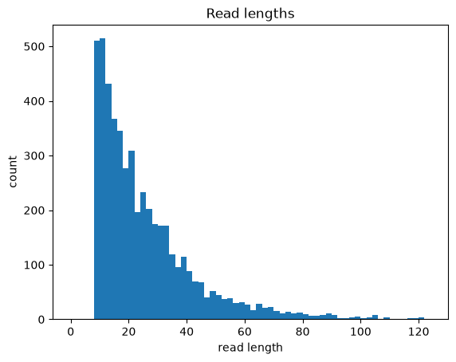
- **Result:** from the Part 1 analysis cell (the cell that starts `# located: (strand index, start, length)`):
  - **Strand index vs. read length:** every strand's column shows the same spread of lengths.
    
  - **Strand index vs. start position:** every strand's column shows the same spread of start positions.
    
  - **Correlation check** (`corr_with_perm_test`, N = 4367 located reads, 10,000 shuffles):

    | Pair | r | permutation p |
    |---|---|---|
    | strand index vs. read length | −0.0025 | 0.864 |
    | strand index vs. start position | +0.0150 | 0.329 |

  - ⚠️ **Not from the lecture notes:** the correlation coefficient r = Cov/(σₓσᵧ) and the permutation test are general statistics.
- **Conclusion:** breakage behaves the same no matter which strand it happens on. The channel treats every test strand the same way.
  - Both correlations are effectively zero, and shuffled data does as well or better most of the time. That's consistent with the scatter plots.
  - Covariance and "uncorrelated" are covered in *(Notes §2.5.2 Covariance and Sums, p. 39)*. The notes stress that uncorrelated is weaker than independent: r only rules out a *linear* trend.
- **What it means:** P(break | strand index) = P(break). Strand identity is independent of where breaks happen *(Notes §2.2.1, p. 24; §2.2.2 Independence, p. 25)*. So break statistics from all strands can be **pooled** for Q1 and Q2.

### 2026-11-14 · Part 1, Step 1: Reads per strand look uniform, except strand 67
- **Setup:** the same run and the same analysis cell as the entry above. Located reads are counted per strand: N = 4367 located reads over 100 strands. To check for lookalike strands, I rebuilt the strands from `random.Random(0)`. **Channel: live server** (`Channel()`).
- **Result:** min 1, max 63, mean 43.7, std 8.7, and every strand had at least one located read.
  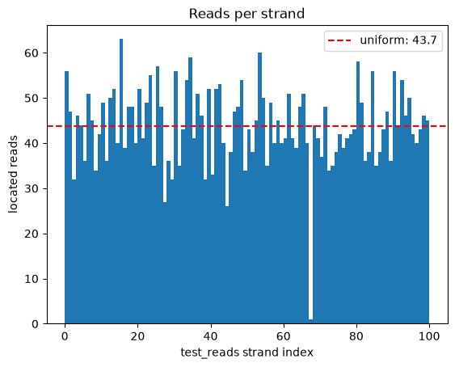
  - **Baseline:** if strands were picked uniformly, each count would be roughly binomial with variance np(1−p) *(Notes §2.5.2, Prop. 2.5.9, p. 39)*. That gives std ≈ √(4367 · 0.01 · 0.99) ≈ 6.6.
  - **Outlier:** one strand has just **1 located read**. Every other strand has 26 or more. `counts.argmin()` confirms it is exactly **strand 67**.
  - The outlier drives most of the extra spread. Rough estimate: without it, the std is about 7.6, close to the 6.6 baseline.
  - **Lookalike check:** strands 66–68 have normal base composition. None is a duplicate of another or contained in another. The longest substring each shares with any other strand is only 9–11 bases.
- **Conclusion:** uniform picking can't plausibly explain strand 67's count. "Its reads were ambiguous because it looks like another strand" is unlikely.
- **Still open:** three possible explanations, not yet tested:
  1. The channel rarely *picks* that strand.
  2. The strand is picked normally, but its reads can't be located (errors in the reads, or very short pieces).
  3. Something about its *content* (for example, a fragile pattern) makes it break into pieces too small to locate, which links to Q2.

### 2026-11-14 · Part 1, Step 1: Shuffle test, the dip follows strand 67's content
- **Setup** (the cell that starts `# Shuffle test`): the same 100 strands, shuffled with `random.Random(1)`. Strand 67 moved to position 45. 5000 new reads from `Channel()`; 4413 located. **Channel: live server** (`Channel()`).
- **Result:**
  

  | | located reads |
  |---|---|
  | strand 67 at its new position (45) | **0** |
  | the strand now at old position 67 | 43 (normal) |
  | all strands: min / max / mean / std | 0 / 61 / 44.1 / 7.6 |

  - Strand 67 is the lowest again, and the only strand never located.
  - The other strands look roughly uniform. The std of 7.6 is close to the ≈ 6.6 binomial baseline *(Notes §2.5.2, Prop. 2.5.9, p. 39)*.
- **Conclusion:** the problem goes with **strand 67's sequence**, not its position in the list. Explanation (1) from the reads-per-strand entry, "the position is rarely picked," is ruled out.
- **Still open:** which of the other two explanations holds:
  - (2) its reads come back but can't be located, for example because they contain errors, vs.
  - (3) something in its content, such as a fragile pattern, breaks it into pieces too short to locate, or the strand is otherwise lost.

### 2026-11-14 · Part 1, Step 1: Strand 67 sent alone returns nothing
- **Setup** (the cell that starts `# Send the original strand 67 ALONE`): strand 67 sent **alone** with a single direct request, so every read must come from it. Strand 66 alone is the control. **Channel: live server**, through a direct `requests.post` to `SERVER_URL` instead of `channel.reads`. Strand 67:

  ```dna
  CGAGACCTGGAACGGTAGAGGCTATCTTTGTCTGATTCGGCACCTATGGGTAAAGGTCTCAAGATGGTCGTATGGGACTCCATCACGAGCCAGTAGAAGAATTTGGACGCATAAAACGTT
  ```
- **Result:** the server returns **no reads at all**: `{"reads": []}` with HTTP 200, for requests of both 20 and 1000 reads. Strand 66 alone returned 20 reads normally.
- **Conclusion:** strand 67 is **lost entirely**, not misread. Its reads aren't "unlocatable"; they don't exist. That rules out explanation (2) from the shuffle test.
  - One read was located for strand 67 in the first run. Either the strand is very occasionally read, or that read was a short piece that also happened to match strand 67 by chance.
- **Practical note:** `Channel.reads` loops until it has `n` reads, so it **hangs forever** on a strand set that yields nothing. Use a single direct request (the `solo_test` helper in the split-test cell) when testing suspicious strands.
- **Still open (Q2):** what in strand 67's sequence makes the channel lose it?

### 2026-11-14 · Part 1, Step 1: Split test, both halves of strand 67 survive
- **Setup** (the cell that starts `# Split strand 67 into two halves`): each half of strand 67 sent alone, 1000 reads each, with strand 66's halves as a control. **Channel: live server**, through `solo_test`, which posts directly to `SERVER_URL`. The cut is before base 60:

  ```dna
  @cut 60
  CGAGACCTGGAACGGTAGAGGCTATCTTTGTCTGATTCGGCACCTATGGGTAAAGGTCTCAAGATGGTCGTATGGGACTCCATCACGAGCCAGTAGAAGAATTTGGACGCATAAAACGTT
  ```
- **Result:**

  | piece (60 bases) | reads | exact | mean length | full-length reads |
  |---|---|---|---|---|
  | strand 67, bases 0–59 | 1000 | 900 | 21.2 | 10 |
  | strand 67, bases 60–119 | 1000 | 896 | 22.6 | 35 |
  | strand 66, bases 0–59 (control) | 1000 | 873 | 27.5 | 44 |
  | strand 66, bases 60–119 (control) | 1000 | 905 | 18.6 | 3 |

- **Conclusion:** **both halves of strand 67 come back normally.** Neither half alone triggers the loss.
  - The test didn't detect "shatters everywhere," because the halves' read lengths look like the control.
- **Side observation:** full-length reads vary a lot between 60-base pieces of the *same* length: 3 to 44 out of 1000. That hints that how often a piece survives whole depends on its content. This is relevant to Q2 and Q3.
- **Still open:** why neither half triggers the loss. Possible reasons:
  - (a) the cause **straddles the cut at base 60**, or
  - (b) it needs pieces from **both halves together**, for example something that depends on the whole strand.

### 2026-11-14 · Part 1, Step 1: Middle-third test, strand 67's middle survives too
- **Setup** (the cell that starts `# Middle third (bases 40-79) of strand 67`): bases 40–79, which span the split test's cut at base 60, sent alone, 1000 reads each. The same section of strand 66 is the control. **Channel: live server**, through `solo_test`.
- **Result:**

  | piece (40 bases) | reads | exact | mean length | full-length reads |
  |---|---|---|---|---|
  | strand 67, bases 40–79 | 1000 | 921 | 18.3 | 21 |
  | strand 66, bases 40–79 (control) | 1000 | 912 | 18.9 | 62 |

- **Conclusion:** the middle third of strand 67 also survives. This rules out (a) from the split test. All three windows tested (0–59, 60–119, 40–79) come back normally, so a short local "bad spot" is now unlikely.

### 2026-11-14 · Part 1, Step 1: Strand 67's sequence features are ordinary
- **Setup:** four sequence features, computed for all 100 test strands. The check isn't saved in a notebook cell. **Channel: none.** This is a calculation on the sequences; nothing was sent.
  - ⚠️ **Not from the lecture notes:** repeats, reverse-complement self-matches, homopolymer runs and GC content are general sequence-analysis checks.
- **Result:** strand 67 is **typical** on all four:

  | feature | strand 67 | others: min / median / max |
  |---|---|---|
  | longest repeat inside the strand | 6 | 4 / 6 / 8 |
  | longest reverse-complement self-match | 7 | 5 / 6 / 14 |
  | longest run of one base | 4 | 3 / 4 / 7 |
  | number of G or C | 58 | 44 / 60 / 71 |

- **What it means:** working hypothesis, not yet tested: the loss is a property of the **whole, exact strand**, not of any short pattern in it. For example, the channel might drop a small fraction (~1 in 100) of strands outright, picked by something tied to the exact sequence. The notebook's "Doing better" list warns that "some may be lost entirely."
- **Next (to do):**
  1. Change **one base** of strand 67 at a few positions. If any single change brings it back, the loss is tied to the exact sequence.
  2. Trim a few bases off each end (bases 0–114 and 5–119).
  3. Send a fresh batch of random strands and count how many vanish, to estimate the loss rate.

### 2026-11-14 · Part 1, Step 1: Single-base scan, almost any change brings strand 67 back
- **Setup** (the cell that starts `# Single-base scan`): for each position 0–119, change **only that base** of strand 67 to the next base in ACGT order (A→C, C→G, G→T, T→A). Send each mutant alone, 100 reads each. Unchanged strand 67 is included as a control: 0 reads, as before. **Channel: live server**, through `solo_test`. The follow-up on bases 7, 67 and 72 also went to the live server, but from outside the notebook.
- **Result:** **117 of 120** single-base changes bring strand 67 back, with 100 of 100 reads returned. Only the changes at positions **7, 67 and 72** leave it lost.
  
  - **Follow-up on those three:** all three are T→A changes. At each, I also tried the other two bases. The table gives reads returned out of 100:

    | position | context | →A | →C | →G |
    |---|---|---|---|---|
    | 7 | GACC**T**GGAA | 0 | 100 | 100 |
    | 67 | ATGG**T**CGTA | 0 | 100 | 100 |
    | 72 | CGTA**T**GGGA | 0 | 100 | 100 |

  - The other 26 T→A changes in the scan *did* bring the strand back. So "T→A never helps" isn't the rule.
- **Conclusion:** strand 67 isn't lost because of one fragile spot. The loss depends on the **exact strand as a whole**, and almost any single change undoes it. This supports the working hypothesis from the sequence-features entry.
  - The three holdouts suggest the rule isn't purely random per sequence. It may be something like a whole-strand score with a cut-off, where a few changes don't move the score enough. That's a guess, not tested.
- **Next (to do):** estimate how often strands are lost. Send a large batch of fresh random strands, each alone or in small groups, and count how many return 0 reads. That rate matters for how much redundancy a design needs *(Notes §3.3 Error Correction, p. 57)*.

### 2026-11-14 · Part 1, Step 1: Reads contain errors
- **Setup:** no new experiment. This entry collects the read errors seen in the strand 66 control reads and in the split and middle-third tests. **Channel: live server**, since all of those reads came from it.
- **Result:**
  - **Example:** one strand-66 read had a single C→T substitution:

    ```dna
    strand 66: TGATCCTACT
    read:      TGATCTTACT
    ```
  - **Rate:** in the split and middle-third tests, about **10% of reads are not exact** substrings of the piece sent (873–921 of 1000 are exact) in every piece.
- **Conclusion:** read errors are common, not rare.
- **What it means:** errors are part of why not every read was located in the first run. This is the noisy-channel setting *(Notes §3.3.1 Noisy Channels, p. 57)*.

### 2026-11-14 · Part 1, Step 1: Trimming test, deleting one end base brings strand 67 back
- **Setup** (the cell that starts `# Trimming test`): strand 67 shortened from each end. "Front" deletes the first *k* bases (`s67[k:]`), and "back" deletes the last *k* bases (`s67[:-k]`), for *k* = 1–10. Each shortened strand was sent alone with `solo_test`, 1000 reads each. Unchanged strand 67 was the control: 0 of 1000 reads. **Channel: live server**, through `solo_test`.
- **Result:** every shortened strand came back with **1000 of 1000 reads**, from both ends, starting at a single deleted base.
  

  | bases deleted | front: reads (of 1000) | bases removed (front) | back: reads (of 1000) | bases removed (back) |
  |---|---|---|---|---|
  | 0 (control) | 0 | none | 0 | none |
  | 1 | 1000 | `C` | 1000 | `T` |
  | 2 | 1000 | `CG` | 1000 | `TT` |
  | 3 | 1000 | `CGA` | 1000 | `GTT` |
  | 4 | 1000 | `CGAG` | 1000 | `CGTT` |
  | 5 | 1000 | `CGAGA` | 1000 | `ACGTT` |
  | 6 | 1000 | `CGAGAC` | 1000 | `AACGTT` |
  | 7 | 1000 | `CGAGACC` | 1000 | `AAACGTT` |
  | 8 | 1000 | `CGAGACCT` | 1000 | `AAAACGTT` |
  | 9 | 1000 | `CGAGACCTG` | 1000 | `TAAAACGTT` |
  | 10 | 1000 | `CGAGACCTGG` | 1000 | `ATAAAACGTT` |

- **Conclusion:** deleting a single base from either end (`C` at the front or `T` at the back) is enough to bring strand 67 back. Nothing near either end has to be removed. This agrees with "Single-base scan, almost any change brings strand 67 back": the channel loses only the exact 120-base strand, and almost any edit undoes it.
- **Still open:** what about the exact whole strand triggers the loss. The three T→A changes that stay lost (bases 7, 67, 72) are still the only clue.

### 2026-11-14 · Part 1, Step 1: Extension test, 77 of 80 longer strands survive, 3 new ones are lost
- **Setup** (the cell that starts `# Extension test`): *k* copies of one base added to strand 67, for each base A, C, G, T and *k* = 1–10. "Front" is `b*k + s67`; "back" is `s67 + b*k`. That makes 80 strands, each sent alone with `solo_test`, 1000 reads each. Unchanged strand 67 was the control: 0 of 1000 reads. **Channel: live server**, through `solo_test`.
- **Result:** **77 of 80** extended strands came back with 1000 of 1000 reads. All 40 front extensions came back. Three back extensions returned **0 of 1000**:
  

  | added at the back | new length | reads (of 1000) |
  |---|---|---|
  | `CCC` | 123 | 0 |
  | `GGGGG` | 125 | 0 |
  | `TTTTTTTTT` | 129 | 0 |

  - Every other back extension returned 1000, including `CC`, `CCCC`, `GGGG`, `GGGGGG`, `TTTTTTTT` and `TTTTTTTTTT`.
  - My own run of the same cell, just before yours, gave identical numbers. So each of the three has returned 0 to two separate 1000-read requests, and all three are added to Appendix B.
- **Conclusion:** adding bases usually brings strand 67 back, just as deleting or changing one does. But a few of the new sequences are lost too. They follow no visible rule: different bases, different lengths, and neighbours one base longer or shorter survive.
- **Side observation:** across the edits tested so far, a similar small fraction of new sequences is lost:
  - 3 of 120 single-base changes
  - 0 of 20 trimmed strands
  - 3 of 80 extensions
  - 1 of the original 100 random strands

  Together that's 7 of 321 sequences, about 2%.
- **Still open:** whether the loss is effectively random per exact sequence, with each sequence lost with some fixed small probability. The rate seems similar whether the sequence is random or a near-copy of a lost one, which fits that idea. It's a hint, not a test.
- **Next (to do):** send a large batch of fresh random strands, each alone, and count how many return 0 reads. That estimates the loss rate directly, and the design needs that number for redundancy *(Notes §3.3 Error Correction, p. 57)*.

### 2026-11-14 · Part 1, Step 1: Tail test, the lost-strand tails don't kill other strands
- **Setup** (the cell that starts `# Tail test`): 400 new random strands of length 120 from `random.Random(2)`, in four groups of 100:
  - ending in `CCC`, `GGGGG` or `TTTTTTTTT`, the three tails that made extended strand 67 vanish in "Extension test, 77 of 80 longer strands survive, 3 new ones are lost";
  - a control group with no fixed tail.

  The base just before each tail is forced to differ from it, so each tail is a run of exactly that length (`…ACCC`, never `…CCCC`). Each strand was sent alone with `solo_test`, 1000 reads each. **Channel: live server**, through `solo_test`.
- **Result:** every group lost only a few strands, about as many as the control:
  

  | group (100 strands, 120 bases) | lost (0 of 1000 reads) | reads per surviving strand |
  |---|---|---|
  | ends in `CCC` | 3 | 1000 every time |
  | ends in `GGGGG` | 2 | 1000 every time |
  | ends in `TTTTTTTTT` | 4 | 1000 every time |
  | no tail (control) | 1 | 1000 every time |

  - My own run of the same cell, just before yours, lost the same 10 strands. So each has returned 0 to two separate 1000-read requests, and all 10 are added to Appendix B as rows 8–17.
- **Conclusion:** the tails `CCC`, `GGGGG` and `TTTTTTTTT` are **not** generally fatal. Strand 67 plus one of them was lost, but random strands ending in them are lost about as rarely as strands with no fixed tail. With 100 strands per group, the spread (1–4 lost) is within what chance alone gives.
- **Side observations:**
  - **Loss is all or nothing.** All 390 surviving strands returned exactly 1000 of 1000 reads. A strand is either dropped completely or comes back fully.
  - **The overall loss rate is about 2.5%:** 10 of 400 here. That's close to the 7 of 321 (about 2%) from the strand 67 edits, and 1 of 100 in the starter run.
- **Still open:** what decides which exact sequences are dropped. Nothing found so far in the content predicts it, so it behaves like a random ~2–3% chance per exact sequence.
- **Next (to do):** fold this loss rate into the design. With *p* ≈ 0.025 per strand, a message of *n* strands loses about *np* of them on average, so the design needs redundancy across strands *(Notes §3.3 Error Correction, p. 57)*. ⚠️ **Not from the lecture notes:** the ~2.5% rate is this project's own measurement.

### 2026-11-14 · Part 1, Step 1: Repeat test, all 17 lost strands return 0 reads in 255 of 255 requests
- **Setup** (the cell that starts `# Repeat test`): every strand in Appendix B (rows 1–17), copied into the cell from the appendix, sent **alone** 15 times each with `solo_test`, 1000 reads per request. That's 255 requests. No survivors were included as controls. **Channel: live server**, through `solo_test`.
- **Result:** **255 of 255 requests returned 0 reads.** No strand returned a read even once.
  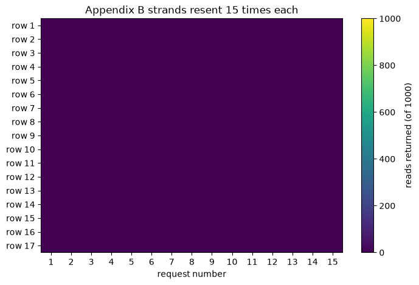

  | Appendix B rows | strands | requests each | requests with 0 reads |
  |---|---|---|---|
  | 1–4 (strand 67 and its T→A changes) | 4 | 15 | 60 of 60 |
  | 5–7 (strand 67 with tails added) | 3 | 15 | 45 of 45 |
  | 8–17 (random strands from the tail test) | 10 | 15 | 150 of 150 |

  - My own run of the same cell, just before yours, also gave 255 of 255. So each strand has now returned 0 reads in at least 32 requests in a row.
- **Conclusion:** strongly supports Hypothesis 1, that loss is deterministic (see section 5, "Hypotheses"). If each request instead lost a strand with a fresh 2.5% chance, 15 losses in a row would have probability 0.025¹⁵ ≈ 10⁻²⁴ for each strand.
- **Still open:** the other half of the prediction, that surviving strands *always* come back, wasn't tested here. The tail test's two runs, where the same 390 strands survived both times, cover it partly.
- **Next (to do):** the remaining tests listed under Hypothesis 1: survivors repeated, a later day, mixed batches, and the stray starter read.

### 2026-11-14 · Part 1, Step 1: Batch test, the 17 lost strands sent together return 0 of 17000 reads
- **Setup** (the block that starts `# Batch test`, at the end of the repeat-test cell): all 17 Appendix B strands (rows 1–17) sent **together** as one batch, asking for 1000 reads per strand, 17000 in total. The server caps a request at 5000 reads, so the batch went out as 4 direct posts (5000, 5000, 5000 and 2000 reads), each tried once. There were no survivors in the batch. **Channel: live server**, through direct posts to `SERVER_URL`.
- **Result:** **0 of 17000 requested reads came back.** All 4 requests returned an empty list.

  | request | reads asked for | reads returned |
  |---|---|---|
  | 1 | 5000 | 0 |
  | 2 | 5000 | 0 |
  | 3 | 5000 | 0 |
  | 4 | 2000 | 0 |

  - This block drew no plot. The heatmap in the same cell belongs to the repeat test.
- **Conclusion:** the strands are lost together just as they are lost alone. Sending them in a group doesn't rescue any of them, which fits the idea that loss is a property of each exact sequence and not of how it is sent. Supports Hypothesis 1.
- **Side observation:** the repeat test in the same cell ran again before this block and again gave 255 of 255 empty requests, with no row switching.
- **Still open:** this batch held *only* lost strands, so it doesn't settle caveat 4 under Hypothesis 1. The open question is whether a lost strand also vanishes when it sits among strands that do come back.
- **Next (to do):** the mixed-batch test. Send the 17 lost strands together with known survivors, ask for many reads, and use `locate` to check that none of the 17 is ever located.

### 2026-11-14 · Part 1, Step 1: Survivor repeat test, 30 surviving strands return reads in 450 of 450 requests
- **Setup** (the cell that starts `# Survivor repeat test`): survivors are the original `test_strands` (100 strands of length 120 from `random.Random(0)`) with at least one located read in the starter run. The starter cell had just been re-run: 5000 new reads, 4380 located, and **99 of 100** strands had a located read. From those 99, 30 were picked with `random.Random(1)`: strands 0, 1, 2, 3, 8, 12, 13, 15, 17, 26, 29, 32, 34, 40, 48, 49, 55, 57, 60, 62, 63, 70, 73, 75, 76, 78, 84, 86, 90 and 93. Each was sent **alone** 15 times with `solo_test`, 1000 reads per request, for 450 requests in all. **Channel: live server**, through `solo_test`.
- **Result:** **450 of 450 requests returned reads, each exactly 1000 of 1000.** No strand returned 0 reads even once.
  
- **Conclusion:** this is the other half of Hypothesis 1's prediction: surviving strands *always* come back, and they come back in full. Supports Hypothesis 1.
  - If every request instead dropped a strand with a fresh 2.5% chance, about 450 × 0.025 ≈ 11 of these requests would have come back empty. The chance of none would be 0.975⁴⁵⁰ ≈ 1 × 10⁻⁵, treating requests as independent *(Notes §2.2.2 Independence, p. 25)*.
  - Together with the repeat test (0 reads in 255 of 255 requests for lost strands), each of the 47 strands tested has given the same outcome every time.
- **Side observation:** one starter strand had no located read in the re-run of the starter experiment. That's probably strand 67, but the saved output doesn't name it. This bears on test 4 under Hypothesis 1 (the stray starter read), but doesn't settle it: the first run located 1 read to strand 67, and this run apparently located none.
- **Still open:** survivors were only tested alone. Whether they still come back in a batch with lost strands is the mixed-batch test.
- **Next (to do):** the mixed-batch test, and the same checks on a later day.

### 2026-11-14 · Part 1, Step 1: Length test, 14 of 500 random strands of length 30–300 return 0 reads
- **Setup** (the cell that starts `# Length test`): 50 new random strands at each length n = 30, 60, 90, …, 300, which makes 500 strands, from `random.Random(3)`. Each strand was sent **alone once** with `solo_test`, 1000 reads per request. **Channel: live server**, through `solo_test`.
- **Result:** **14 of 500 strands returned 0 reads** (2.8%). Every other strand returned 1000 of 1000.
  

  | length | 30 | 60 | 90 | 120 | 150 | 180 | 210 | 240 | 270 | 300 |
  |---|---|---|---|---|---|---|---|---|---|---|
  | 0 reads (of 50) | 1 | 0 | 1 | 1 | 1 | 2 | 1 | 3 | 3 | 1 |

  - **Shorter half vs. longer half:** 4 of 250 strands of length 30–150 returned 0 reads, against 10 of 250 of length 180–300.
  - **Mean length:** 199 for the 14 lost strands, 165 for all 500. In 100,000 random reshuffles of which strands count as lost, the mean was at least 199 in 7.3% of them (one-sided p = 0.073, two-sided 0.145).
  - ⚠️ **Not from the lecture notes:** the permutation test is a general statistics method.
  - The 14 sequences are in the cell's saved output.
- **Conclusion:** strands of every length tested, from 30 to 300, can be lost. Loss isn't special to length 120.
  - The overall rate, 14 of 500 (2.8%), is close to the 2.5% from the tail test.
  - There's a **hint** that longer strands are lost more often, but it isn't significant at this sample size. With about 1.4 lost strands expected per length, a count of 3 of 50 happens about 16% of the time by chance alone, under a binomial with p = 0.028 *(Notes §2.4.1 Bernoulli and Binomial, p. 33)*.
  - This doesn't bear on Hypothesis 1 directly, because each strand was sent only once.
- **Practical note:**
  - **Wrong plot title:** the cell was run with `n_per_len = 50`, but its plot title still said "10 random strands per length". The saved plot and its file name carry that wrong title. The cell now builds the title from `n_per_len`.
  - **Not confirmed:** the 14 strands were each sent only once, so none meets Appendix B's rule for a confirmed deletion. They aren't in Appendix B, and they're held out of the bank of tested strands (Appendix C) until confirmed. The 486 that returned reads are in the bank.
- **Still open:** whether the loss rate rises with length. That matters for choosing the strand length *(Notes §2.4.2 Geometric, p. 34)*, along with how often a read covers a whole strand (Q3).
- **Next (to do):**
  - Re-send the 14 strands alone to confirm them for Appendix B and the bank.
  - To test the length trend, use more strands at a few lengths far apart (for example 30 and 300). Telling 1.6% from 4% apart needs several hundred strands per group.
  - The reads from this run are still in `len_reads` and can be used for Q3 without sending anything new.

### 2026-11-14 · Part 1, Step 1: Retest, all 14 length-test strands return 0 reads again
- **Setup** (the cell that starts `# Retest`): the 14 strands that returned 0 reads in "Length test, 14 of 500 random strands of length 30–300 return 0 reads", each sent **alone once more** with `solo_test`, 1000 reads per request. Their sequences are copied into the cell from the length test's saved output. **Channel: live server**, through `solo_test`.
- **Result:** **14 of 14 returned 0 of 1000 reads again.** None came back.

  | length | 30 | 90 | 120 | 150 | 180 | 210 | 240 | 270 | 300 |
  |---|---|---|---|---|---|---|---|---|---|
  | strands retested | 1 | 1 | 1 | 1 | 2 | 1 | 3 | 3 | 1 |
  | 0 reads again | 1 | 1 | 1 | 1 | 2 | 1 | 3 | 3 | 1 |

  - The cell draws no plot.
- **Conclusion:** all 14 now meet Appendix B's rule for a confirmed deletion. They're added to Appendix B as rows 18–31 and to the bank of tested strands (Appendix C) as `deleted: True`, which brings the confirmed total to 31. Supports Hypothesis 1: a strand that was lost once was lost again, at every length from 30 to 300. Every lost strand tested so far has stayed lost.
  - **Loss rate:** with these confirmed, the 1000 independently random strands tested (starter, tail test, length test) give 25 of 1000 deleted, or 2.5%.
- **Still open:** these 14 have only two requests each, against at least 32 for rows 1–17.
- **Next (to do):** the mixed-batch test, the same checks on a later day, and a larger test of the length trend.

### 2026-11-14 · Part 1, Step 1: Long length test, strands up to 1000 bases are accepted, 6 of 200 return 0 reads
- **Setup** (the cell that starts `# Long length test`): the length test again at longer lengths, 50 new random strands at each of 500, 700, 900 and 1000 bases, which makes 200 strands, from `random.Random(4)`. Each strand was sent **alone once**, 1000 reads per request, through a new helper, `solo_status`, which posts directly and records a server refusal separately from 0 reads. **Channel: live server**, through direct posts to `SERVER_URL`.
  - The server's `/api/health` lists `max_strand_length` as 1000, so 1000 is right at the stated limit.
- **Result:** **the server accepted all 200 strands**, none rejected. **6 of 200 returned 0 reads** (3.0%); every other strand returned 1000 of 1000.
  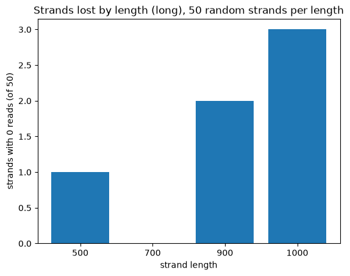

  | length | 500 | 700 | 900 | 1000 |
  |---|---|---|---|---|
  | rejected by the server (of 50) | 0 | 0 | 0 | 0 |
  | 0 reads (of 50) | 1 | 0 | 2 | 3 |

  - The 6 that returned 0 reads are random strand 25 at length 500, strands 27 and 31 at length 900, and strands 6, 17 and 34 at length 1000 (0-based, in order of generation). Their sequences are in the cell's saved output.
- **Conclusion:** strands of up to 1000 bases are accepted and come back in full, and strands this long are lost at about the same rate as short ones.
  - **Length 1000 is accepted.** This test doesn't show what happens above 1000, since nothing longer was sent.
  - **The loss rate stays near 2.5%.** Including the length test, 20 of 700 random strands of length 30–1000 returned 0 reads to a single request (2.9%).
  - **No clear length trend.** 4 of 250 strands of length 30–150 were lost, 10 of 250 of length 180–300, and 6 of 200 of length 500–1000. The middle group's 4% isn't followed by a higher rate at the longest lengths, so the hint from the length test isn't borne out. With 1–3 losses per group of 50, these counts can't tell rates of 2% and 4% apart *(Notes §2.4.1 Bernoulli and Binomial, p. 33)*.
- **Practical note:** the 6 strands were sent only once, so none meets Appendix B's rule for a confirmed deletion. They're held out of the bank of tested strands (Appendix C) and Appendix B until retested. The 194 that returned reads are in the bank.
- **Still open:**
  - Whether the server refuses strands longer than 1000, and with what error.
  - Whether the loss rate depends on length at all.
- **Next (to do):**
  - Re-send the 6 strands alone to confirm them.
  - The reads from this run are kept in `long_results`, and can be used for Q3 (how often a read covers a whole strand of length L) at lengths up to 1000.

### 2026-11-14 · Part 1, Step 1: Long retest, all 6 long strands return 0 reads again
- **Setup** (the cell that starts `# Long retest`): the 6 strands that returned 0 reads in "Long length test, strands up to 1000 bases are accepted, 6 of 200 return 0 reads", each sent **alone once more** with `solo_status`, 1000 reads per request. Their sequences are copied into the cell from the long length test's saved output. **Channel: live server**, through direct posts to `SERVER_URL`.
- **Result:** **6 of 6 returned 0 of 1000 reads again.** None came back, and the server refused none.

  | length | 500 | 900 | 1000 |
  |---|---|---|---|
  | strands retested | 1 | 2 | 3 |
  | 0 reads again | 1 | 2 | 3 |

  - The cell draws no plot.
- **Conclusion:** all 6 now meet Appendix B's rule for a confirmed deletion. They're added to Appendix B as rows 32–37 and to the bank of tested strands (Appendix C) as `deleted: True`, which brings the confirmed total to 37. Supports Hypothesis 1: every strand that was lost once has been lost again, now at lengths up to 1000.
  - **Loss rate:** the 1200 independently random strands tested (starter, tail test, length test, long length test) give 31 of 1200 deleted, 2.6%. Hypothesis 1's Statement is updated to this sample.
- **Still open:** rows 18–37 have only two requests each, against at least 32 for rows 1–17.
- **Next (to do):** the mixed-batch test, and the same checks on a later day.

### 2026-11-14 · Part 1, Step 1: Mixed-batch test, 20 deleted strands stay lost among 400 survivors
- **Setup** (the cell that starts `# Mixed-batch test`):
  - **Deleted strands:** 20 confirmed deleted strands picked from the bank of tested strands (Appendix C) with `random.Random(5)`. One was taken at each of the 15 distinct lengths among the 37, plus 5 more at random. Their lengths were 30, 90, 120 (×6), 123, 125, 129, 150, 180, 210, 240, 270, 300, 500, 900 and 1000, which is 4967 bases in all.
  - **Random strands:** 400 new random strands of length 30–1000 (actual range 32–1000), also from `random.Random(5)`, which is 207,507 bases in all.
  - **Batches:** the server caps one request at 100,000 bases (`max_total_bases` in `/api/health`), so all 420 strands couldn't go in one request. The 400 random strands were split into 3 batches of 184, 180 and 36, and **all 20 deleted strands went into every batch**. That made batches of 204, 200 and 56 strands, with 99,433, 99,383 and 23,592 bases.
  - **Reads:** 5000 per batch, one direct post each, 15,000 reads in all. **Channel: live server**, through direct posts to `SERVER_URL`.
- **Result:** **no read of 20 bases or more fits only a deleted strand.** All 3 batches returned their 5000 reads.
  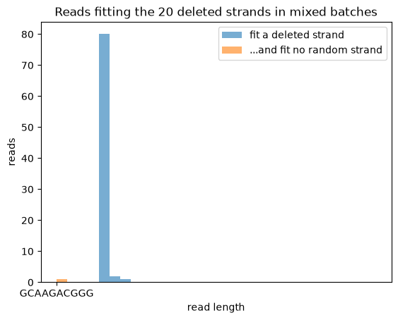

  | | reads |
  |---|---|
  | all reads returned | 15,000 |
  | fit inside a deleted strand | 83 |
  | ...and fit no random strand in the same batch | 1 (10 bases, in the 500-base strand) |
  | ...and are 20 bases or longer | **0** |

  - **The 83 fitting reads are short chance matches.** A read of *k* bases fits somewhere in the 4967 deleted bases by chance with probability about 4967 / 4^*k*: about 8% at 8 bases, 0.5% at 10 bases, and 5 × 10⁻⁹ at 20 bases. 82 of the 83 also fit a random strand in the same batch, so they most likely came from that strand. The one left over is 10 bases long, which is also within chance.
  - **What the 20 strands would have produced if they came back:** if reads are spread evenly over strands, about 2,800 of the 15,000 reads would come from them: 20/204, 20/200 and 20/56 of each batch's 5000. If reads are spread in proportion to bases, it's about 1,550. Either way, the chance that none of them is a long, uniquely fitting read is negligible.
  - **Control:** 385 of 400 random strands had at least one located read. 15 had none, against about 10 expected to be deleted at the 2.5% rate. With roughly 25 reads per strand in the two large batches, a few more can miss out by chance.
- **Conclusion:** confirmed deleted strands are still lost when sent among strands that come back, at every length tested from 30 to 1000. Each of the 20 was tested in 3 separate mixed batches. This settles caveat 4 and test 3 under Hypothesis 1. Supports Hypothesis 1.
- **Practical note:** the cell didn't print which 15 random strands had no located read, and the bank needs that list. A follow-up cell that sends nothing (the one that starts `# Mixed-batch follow-up`) prints them from the session's variables.
- **Still open:** the same checks on a later day, which is caveat 3 and test 2 under Hypothesis 1.
- **Next (to do):**
  - Run the follow-up cell, then add the 385 strands with located reads to the bank.
  - Send the 15 strands with no located read alone, twice, to confirm or clear them.

### 2026-11-14 · Part 1, Step 1: Mixed-batch follow-up, all 15 strands with no located read are deleted
- **Setup** (the cell that starts `# Mixed-batch follow-up`): the 15 random strands from "Mixed-batch test, 20 deleted strands stay lost among 400 survivors" that got no located read. They're listed from the session's variables, then each is sent **alone twice** with `solo_status`, 1000 reads per request, which is 30 requests. **Channel: live server**, through direct posts to `SERVER_URL`.
  - The listing part was run once before without being saved, so only this run's output is in the notebook.
- **Result:** **15 of 15 returned 0 of 1000 reads in both requests.** None came back, none returned reads only once, and the server refused none.

  | outcome (two solo requests each) | strands |
  |---|---|
  | 0 reads both times (confirmed deleted) | **15** |
  | reads both times | 0 |
  | 0 once, reads once | 0 |
  | refused by the server | 0 |

  - Their lengths are 310, 323, 340, 404, 446, 466, 473, 506, 523, 527, 712, 899, 922, 927 and 949. Their indices in the list of 400 are 39, 41, 85, 115, 131, 164, 193, 205, 217, 254, 298, 355, 358, 390 and 395.
  - The cell draws no plot.
- **Conclusion:** every strand that went missing in the mixed batch is deleted, and every strand that came back in it is a survivor. The batch result and the solo results agree on all 400. Supports Hypothesis 1.
  - The 15 are added to Appendix B as rows 38–52, and all 400 are added to the bank of tested strands (Appendix C): 15 as `True`, 385 as `False`. That brings the confirmed total to 52.
  - **Loss rate:** 15 of these 400 were deleted (3.75%), a little above the earlier rate. The independently random strands now give 46 of 1600 deleted, 2.9% (95% interval 2.1%–3.8%). Hypothesis 1's Statement is updated to match.
  - **Side observation:** none of these 15 is shorter than 310 bases, though 27% of the 400 were. That's a cut-off picked after seeing the data, so it can't be used as a test. A test fixed in advance, comparing the mean length of the 15 lost strands (582) with all 400 (519), gives one-sided p = 0.19 over 100,000 reshufflings. That's no evidence of a length effect. ⚠️ **Not from the lecture notes:** the permutation test is general statistics.
- **Practical note:** "no located read in a mixed batch" picked out the deleted strands exactly here, with about 25 reads per strand. That could make large batches a cheap first screen for deleted strands, with solo sends only for the strands that look lost.
- **Still open:**
  - Whether the loss rate depends on length.
  - The same checks on a later day.
- **Next (to do):** the later-day check, which is caveat 3 and test 2 under Hypothesis 1.

### 2026-11-14 · Part 1, Step 1: Breakage-context test, 20 strands break the same alone, in a batch of 20 and among 480 others
- **Setup** (the cell that starts `# Breakage-context test`):
  - **The 20 strands:** surviving strands from the two length tests, each already sent alone with 1000 of 1000 reads returned. One was picked at each of the 14 available lengths, plus 6 more at random, with `random.Random(6)`. Their lengths are 30, 30, 60, 90, 120, 150, 150, 180, 180, 210, 210, 240, 270, 270, 300, 500, 500, 700, 900 and 1000, which is 6090 bases. None is a near-copy of another.
  - **Three contexts:**
    1. **Alone:** each strand sent by itself, 1000 reads each, 20,000 reads.
    2. **Batch of 20:** the 20 together, 4 × 5000 = 20,000 reads.
    3. **With 480 others:** the 20 plus 480 new random strands of length 30–1000 (`random.Random(7)`, 245,742 bases). The server caps a request at 100,000 bases, so the 480 were split into 3 sub-batches of 184, 179 and 117, each sent with all 20. That's batches of 204, 199 and 137 strands, not one batch of 500. 8 × 5000 reads per sub-batch, 120,000 reads in all.
  - **Placing reads:** a read is placed on one of the 20 if it occurs in that strand exactly once and in no other strand of the same request. Each placed read is stored as (strand, start, length), and every placed read is saved to `breakage_test.json`. To keep the contexts comparable (Hypothesis 2, caveat 1), comparisons use only reads of 15 bases or more.
  - **Channel: live server**, through direct posts to `SERVER_URL`.
- **Result:** each strand's reads look the same in all three contexts.
  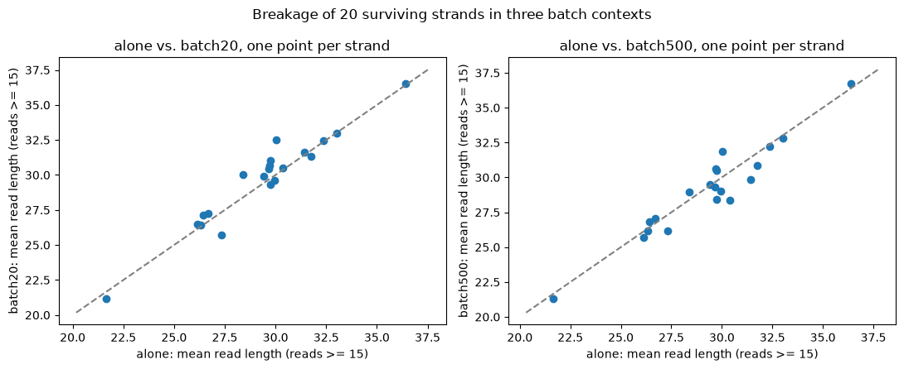
  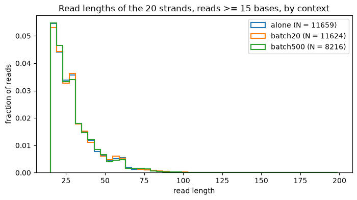

  | context | reads returned | placed on the 20 | placed, 15+ bases | mean length, 15+ bases | full-length reads |
  |---|---|---|---|---|---|
  | alone | 20,000 | 17,631 | 11,659 | 29.53 | 561 |
  | batch of 20 | 20,000 | 17,661 | 11,624 | 29.89 | 537 |
  | with 480 others | 120,000 | 11,970 | 8,216 | 29.33 | 396 |

  - **Per strand:** for each strand and each batch context, the difference in mean read length from "alone" was divided by its standard error, giving a *z*-score. If context has no effect, the 20 *z*-scores should look like draws from a standard Gaussian, with mean 0 and standard deviation 1 *(Notes §7.2.6 The Central Limit Theorem, p. 134)*. They do:

    | comparison with "alone" | read length: mean *z*, sd | \|*z*\| > 1.96 | start position: mean *z*, sd | \|*z*\| > 1.96 |
    |---|---|---|---|---|
    | batch of 20 | +0.35, 1.06 | 2 of 20 | +0.13, 1.03 | 1 of 20 |
    | with 480 others | −0.27, 0.98 | 1 of 20 | +0.08, 1.19 | 2 of 20 |

  - **Whole distributions:** a two-sample test of each strand's full distribution of read lengths, and separately of start positions, against "alone" gave p < 0.05 for 2 of 20 strands in each of the four comparisons. About 1 of 20 is expected by chance, and 2 or more of 20 happens about 26% of the time (binomial with p = 0.05, *Notes §2.4.1 Bernoulli and Binomial, p. 33*). No strand was flagged in every comparison.
  - ⚠️ **Not from the lecture notes:** the *z*-score with an estimated standard error, the Kolmogorov–Smirnov statistic and the permutation p-values (2000 reshufflings per test) are general statistics. The tests were run on `breakage_test.json` after the cell, not in the notebook.
- **Conclusion:** a surviving strand breaks the same way alone, in a batch of 20, and in batches of about 200 random strands. Its read lengths, start positions and full-length reads don't measurably change. The differences that do appear are the size sampling noise predicts. Supports Hypothesis 2.
  - **What it can and can't rule out:** a shift in mean read length larger than roughly 1 base (about 3%) would have shown up for a typical strand. A smaller effect, or one that only appears in batches much larger than about 200 strands or 100,000 bases, isn't ruled out. The server's base cap prevents testing bigger batches anyway.
- **Side observation (pick rate, out of scope for Hypothesis 2):** in the batch of 20, the 20 strands got similar numbers of placed reads, 813 to 959, even though their lengths ran from 30 to 1000. That's a hint that strands are picked equally often, not in proportion to their length. Among the 480 others, each got about 550–680 placed reads. That's close to what equal picking predicts, 40,000 reads per sub-batch spread over about 200 strands. This is the starting point for the pick-rate investigation.
- **Practical note:** the 480 random strands aren't in the bank of tested strands. The cell only placed reads on the 20, so nothing shows which of the 480 came back and which were deleted. They can be rebuilt from `random.Random(7)` if needed.
- **Next (to do):** the pick-rate investigation.

### 2026-11-14 · Part 1, Step 1: Same-length breakage-context test, at L = 100 and L = 1000 strands break the same in every context, with at most a ~1% shift
- **Setup** (the cell that starts `# Same-length breakage-context test`): the breakage-context test repeated with **every strand the same length**, once for L = 100 and once for L = 1000. Contexts, read placement and the 15-base cut-off are as in "Breakage-context test, 20 strands break the same alone, in a batch of 20 and among 480 others".
  - **The 20 strands, L = 100:** the bank had no strand of length 100. So 24 new random strands (`random.Random(8)`) were each sent alone, and that solo send is also the "alone" context. 23 returned reads and 1 returned 0 reads. The first 20 that came back are the originals.
  - **The 20 strands, L = 1000:** picked with `random.Random(10)` from the 47 surviving length-1000 strands of the long length test, each already sent alone with 1000 of 1000 reads returned.
  - **Companions:** 480 new random strands of length L (`random.Random(9)` for 100, `random.Random(11)` for 1000).
  - **Requests:** the context with 480 companions is limited by the server's 100,000-base cap:

    | | L = 100 | L = 1000 |
    |---|---|---|
    | alone | 20 × 1000 reads | 20 × 1000 reads |
    | batch of 20 | 4 × 5000 reads | 4 × 5000 reads |
    | with 480 companions | **all 500 in one request** (50,000 bases), 50 × 5000 = 250,000 reads | 6 batches of the 20 + 80 companions (100 strands, 100,000 bases), 2 × 5000 each, 60,000 reads |

    At L = 1000, a batch of 500 is impossible; 100 strands is the most the cap allows.
  - **Saved data:** every placed read, and the number of located reads for every companion, is saved to `breakage_test_L100.json` and `breakage_test_L1000.json`. **Channel: live server**, through direct posts to `SERVER_URL`.
- **Result:**
  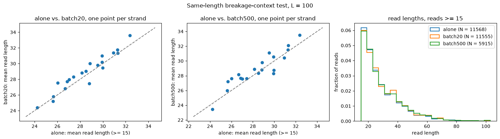
  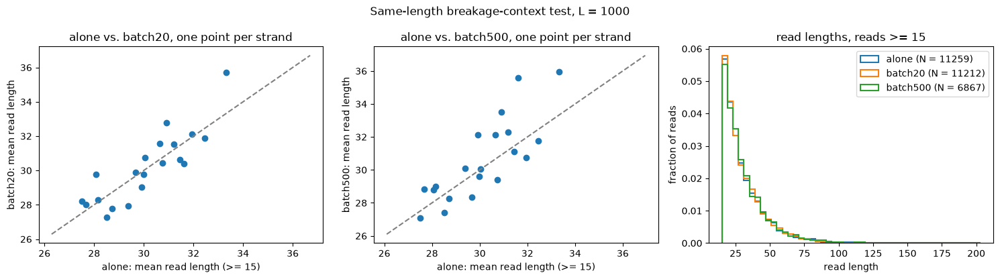

  | | context | placed on the 20, 15+ bases | mean length, 15+ bases | full-length reads |
  |---|---|---|---|---|
  | L = 100 | alone | 11,568 | 28.45 | 12 |
  | | batch of 20 | 11,555 | 28.85 | 10 |
  | | batch of 500 | 5,915 | 28.92 | 12 |
  | L = 1000 | alone | 11,259 | 30.11 | 0 |
  | | batch of 20 | 11,212 | 30.21 | 0 |
  | | batches of 100 | 6,867 | 30.60 | 0 |

  - **Per strand:** as in the earlier test, each strand's difference in mean read length from "alone" was turned into a *z*-score. With no effect, the scores should have mean 0 and sd 1 *(Notes §7.2.6 The Central Limit Theorem, p. 134)*.

    | | comparison with "alone" | read length: mean *z*, sd | \|*z*\| > 1.96 | start position: mean *z*, sd | \|*z*\| > 1.96 |
    |---|---|---|---|---|---|
    | L = 100 | batch of 20 | **+0.55**, 0.87 | 1 of 20 | −0.19, 0.83 | 2 of 20 |
    | | batch of 500 | +0.43, 0.98 | 0 of 20 | +0.14, 1.00 | 1 of 20 |
    | L = 1000 | batch of 20 | +0.06, 1.11 | 0 of 20 | +0.07, 0.73 | 1 of 20 |
    | | batches of 100 | +0.38, 1.26 | 2 of 20 | +0.05, 0.98 | 2 of 20 |

  - **Whole distributions:** the two-sample test of each strand's read lengths and start positions against "alone" gave p < 0.05 for 0 to 3 of 20 strands per comparison. 3 or more of 20 happens about 7.5% of the time by chance *(Notes §2.4.1 Bernoulli and Binomial, p. 33)*. Read lengths at L = 1000 in batches of 100 had the smallest p, 0.0005, for strand 15: mean 35.6 against 31.6 alone, from 296 reads.
  - ⚠️ **Not from the lecture notes:** the *z*-scores, the Kolmogorov–Smirnov statistic and the permutation p-values are general statistics, run on the saved JSON files after the cell.
- **Conclusion:** at both lengths, start positions don't depend on context at all. Read lengths are the same to within about 1%. That supports Hypothesis 2, with one hint of a small effect:
  - **A possible slight lengthening in batches.** At L = 100, in the batch of 20, 17 of 20 strands had slightly longer mean reads than alone. The mean *z* was +0.55, which is unlikely by chance alone: a *t*-statistic of 2.8, two-sided p ≈ 0.01. The pooled shift is +0.4 bases, from 28.45 to 28.85 (1.4%). ⚠️ **Not from the lecture notes:** the one-sample *t*-statistic.
  - **But it isn't consistent.** In the batch of 500 at the same length, the shift was +0.43 *z*. At L = 1000 it was +0.06 and +0.38. In the earlier mixed-length test it was +0.35 and −0.27. Six comparisons were made, so one p ≈ 0.01 is less striking than it looks: at least one that small happens by chance about 6% of the time.
  - **And it's confounded with time.** The "alone" sends always ran first, so a slow drift in the server over the run would look the same as a batch effect.
  - Either way, a shift this size, about 0.4 of a base in a mean of about 29, is too small to matter for the design.
- **Side observations:**
  - **Pick rate (out of scope for Hypothesis 2):** in the single batch of 500 at L = 100, each of the 20 originals got 396–489 placed reads from 250,000 reads. Equal picking gives 500 reads per strand, and placement keeps about 88% of reads, which predicts about 440. That's another hint of equal picking.
  - **Whole-strand reads (Q3):** at L = 100, 10–12 reads per context covered a whole strand, out of about 17,800 placed. At L = 1000, none did.
  - **Deletions:** 1 of the 24 length-100 candidates returned 0 reads alone, in one request. Among companions, 8 of 480 at L = 100 and 13 of 480 at L = 1000 got no located read. At the 2.9% rate about 14 per 480 are expected to be deleted. None of these 22 is confirmed.
- **Practical note:** the cell's first version would have sent 100 requests of 5000 reads at L = 100 instead of 50. It counted strands that *could* fit under the base cap, not the 500 sent. An offline dry run with a simulated channel caught it before the cell was run.
- **Still open:** whether the ~1% lengthening in batches is real. Testing it would need the contexts interleaved in time, not run one after another.
- **Next (to do):**
  - Send the 22 unconfirmed strands alone twice each.
  - The pick-rate investigation.

### 2026-11-14 · Part 1, Step 1: Same-length solo retest, all 22 flagged strands are deleted
- **Setup** (the cell that starts `# Same-length solo retest`): the 22 strands flagged in "Same-length breakage-context test, at L = 100 and L = 1000 strands break the same in every context, with at most a ~1% shift", each sent **alone twice** with `solo_status`, 1000 reads per request, 44 requests. **Channel: live server**, through direct posts to `SERVER_URL`. The 22 were:
  - **1 length-100 candidate** that returned 0 reads to its one solo request. Its sequence was copied into the cell from that cell's output.
  - **21 companions** with no located read: 8 of length 100, from the single batch of 500, and 13 of length 1000, from the batches of 100. They're read from `breakage_test_L100.json` and `breakage_test_L1000.json`.
- **Result:** **22 of 22 returned 0 of 1000 reads in both requests.** None came back, none returned reads only once, and the server refused none. The cell draws no plot.

  | flagged by | length | strands | 0 reads both times |
  |---|---|---|---|
  | one solo request with 0 reads | 100 | 1 | 1 |
  | no located read in a batch of 500 | 100 | 8 | 8 |
  | no located read in a batch of 100 | 1000 | 13 | 13 |

- **Conclusion:** all 22 are confirmed deleted. They're added to Appendix B as rows 53–74 and to the bank of tested strands (Appendix C) as `True`, which brings the confirmed total to 74. Supports Hypothesis 1: every flagged strand stayed lost.
  - **Screening:** as in the mixed-batch follow-up, every strand with no located read in a batch was deleted. That's now 36 of 36 across both tests, with about 25 to 500 reads per strand.
  - **Loss rate:** the 984 random strands of this test had 22 deleted (2.2%): 9 of 504 at length 100 (1.8%) and 13 of 480 at length 1000 (2.7%). Pooled with the earlier random strands, 68 of 2584 are deleted, 2.6% (95% interval 2.1%–3.3%). Hypothesis 1's Statement is updated.
  - **Length:** 1.8% at length 100 and 2.7% at length 1000 differ by less than chance can explain at these sample sizes. That's in line with the length tests, which found no clear trend.
- **Correction (2026-11-14):** 5 more of this test's companions were later found to be deleted ("Low-count retest, all 5 low-count companions are deleted"). The test's rate is 27 of 984 (2.7%), not 22 of 984: 13 of 504 at length 100 (2.6%) and 14 of 480 at length 1000 (2.9%). The pooled rate is 73 of 2584 (2.8%). "Every strand with no located read was deleted" still holds, but the reverse doesn't: a few deleted strands do get located reads.
- **Next (to do):** the pick-rate investigation, and the later-day check for Hypothesis 1.

### 2026-11-14 · Part 1, Step 1: Low-count retest, all 5 low-count companions are deleted
- **Setup** (the cell that starts `# Low-count retest`): 5 companions from "Same-length breakage-context test, at L = 100 and L = 1000 strands break the same in every context, with at most a ~1% shift". They got only 1–3 located reads in their batch, against at least 341 (L = 100) or 54 (L = 1000) for every other live companion. They were found while re-analysing the saved reads for Hypothesis 3. Before this test they were in the bank as `False`. Each was sent **alone twice** with `solo_status`, 1000 reads per request, 10 requests. Sequences were read from the saved JSON files by companion number. **Channel: live server**, through direct posts to `SERVER_URL`.
- **Result:** **5 of 5 returned 0 of 1000 reads in both requests.** The cell draws no plot.

  | L | companion | located reads in its batch | solo request 1 | solo request 2 |
  |---|---|---|---|---|
  | 100 | 119 | 1 | 0 | 0 |
  | 100 | 149 | 1 | 0 | 0 |
  | 100 | 310 | 3 | 0 | 0 |
  | 100 | 471 | 2 | 0 | 0 |
  | 1000 | 167 | 2 | 0 | 0 |

- **Conclusion:** all 5 are deleted. Their 1–3 batch "reads" were chance matches: short reads from other strands that happened to fit them uniquely. Supports Hypothesis 1, because there's no partial loss, and Hypothesis 3, because these were never real survivors with a very low pick rate.
  - **Records corrected:** their bank entries changed from `False` to `True`, and they're added to Appendix B as rows 75–79, for 79 confirmed in all. "Same-length solo retest, all 22 flagged strands are deleted" gets a dated correction to its loss rate.
  - **Loss rate:** 73 of 2584 independently random strands are deleted, 2.8% (95% interval 2.2%–3.5%). Hypothesis 1's Statement is updated.
- **Practical note:** screening a batch for deleted strands should flag strands with **far fewer** located reads than the batch's typical count, not only those with none. The 385 survivors from the mixed-batch test were screened by "no located read" only, and their counts weren't saved. So a few deleted strands may still be among them as `False` (see Appendix C).
- **Next (to do):** the designed pick-rate test for Hypothesis 3, and the later-day check for Hypothesis 1.

### 2026-11-14 · Part 1, Step 1: Reverse-complement test, deletion is decided on the strand as sent, not its reverse complement
- **Setup** (the cell that starts `# Reverse-complement test`): the reverse complement of each strand (reversed, with A↔T and C↔G swapped) was sent alone, 1000 reads. Any that returned 0 reads got a second solo request. ⚠️ **Not from the lecture notes:** the reverse complement is general biology.
  - **Test group:** the reverse complements of all 79 confirmed deleted strands in the bank.
  - **Control group:** the reverse complements of 79 confirmed survivors, picked with `random.Random(12)` from the length-test strands that came back in full when sent alone.
  - Lengths in both groups were 30–1000. None of the 158 was already in the bank, and none equals its own reverse complement. Results were saved to `rc_test.json`. **Channel: live server**, through direct posts to `SERVER_URL`.
- **Result:** **the reverse complements of deleted strands came back.** Only 2 of 79 were deleted, against 1 of 79 in the control group.

  | group | sent | returned reads | 0 reads twice | refused |
  |---|---|---|---|---|
  | reverse complements of deleted strands | 79 | 77 | **2** | 0 |
  | reverse complements of survivors | 79 | 78 | **1** | 0 |

  - The 2 deleted in the test group are the reverse complements of Appendix B rows 35 and 65, both 1000 bases long. The one in the control group is 240 bases long.
  - No strand returned 0 and then reads. The cell draws no plot.
- **Conclusion:** the server decides deletion on each strand **as sent**. It doesn't treat a strand and its reverse complement as the same molecule. If it did, all 79 in the test group would have been deleted and none of the control group. Instead both groups are near the 2.8% base rate: about 2.2 deleted are expected in each, and 2 or more in 79 happens about 65% of the time. Supports Hypothesis 4, and rules out the "canonical form" version of it.
  - The 3 deleted reverse complements are confirmed by two solo requests each. They're added to Appendix B as rows 80–82, and all 158 are added to the bank (3 `True`, 155 `False`), bringing the confirmed total to 82.
  - Supports Hypothesis 1 as well: no strand switched between its two requests.
- **Next (to do):** the neighbours-at-scale test under Hypothesis 4, the designed pick-rate test for Hypothesis 3, and the later-day check.

### 2026-11-15 · Part 1, Step 1: Break-context survey, 913,300 breaks recorded from 2892 surviving strands
- **Setup** (the cell that starts `# Break-context survey`): every surviving strand in the bank, 2892 strands of length 30–1000 and about 1.09 million bases, sent **alone**, 200 reads each. Any strand that returned 0 reads got a second request. **Channel: live server**, through `solo_status`.
  - **What's recorded:** each read is placed on its strand only if it occurs there exactly once. Each placed read shows up to two breaks, one at its start (unless it starts at base 0) and one at its end (unless it ends at the last base). For each break the cell records:
    - its position *p*, between bases *p*−1 and *p*;
    - `before5` and `after5`, the 5 bases on each side (fewer within 5 bases of an end);
    - the length of the segment on the read's side. That's `len_after` for a break at the read's start and `len_before` for one at its end. The other segment wasn't returned, so its length is blank.
  - **Saved data:** every break is in `break_data.csv`, one row per break, about 31 MB. Per-strand counts are in `break_summary.json`.
  - **Gaps in the data:** reads shorter than 8 bases are never returned, so very short segments are missing. Reads with errors are skipped.
- **Result:**

  | | count |
  |---|---|
  | strands sent | 2892 |
  | reads returned | 578,200 |
  | reads placed (exactly once in their strand) | 513,090 (88.7%) |
  | reads skipped (errors or fit twice) | 65,110 |
  | full-length reads (no break) | 2,829 |
  | **breaks recorded** | **913,300** |
  | ...at a read's start (`len_after` known) | 455,954 |
  | ...at a read's end (`len_before` known) | 457,346 |
  | strands that returned 0 reads twice | 1 |

  - The cell draws no plot. This entry records the data. The analysis of where strands break and what sits around the breaks (Q2) comes next.
- **Conclusion:** the survey gives a large data set for Q2: the 5 bases on each side of 913,300 breaks, and one segment length for each.
  - **One more deleted strand:** bank strand 1724, 225 bases long, is random strand 292 from the mixed-batch test. It returned 0 of 200 reads twice. In the mixed-batch test it had some located reads, which must have been chance matches, so it went into the bank as `False`. That's the gap the low-count retest warned about. It's now `True` and Appendix B row 83, bringing the confirmed total to 83. The loss rate is 74 of 2584 (2.9%).
  - **Every other survivor came back,** 2891 of 2891 with all 200 reads. Every `False` in the bank now has a solo send behind it. Supports Hypothesis 1.
- **Practical note:**
  - **Connection timeouts:** the first run stopped after 1300 strands with a timeout. The cell saves its progress every 50 strands, so it resumed from strand 1301 without repeating or losing data. Retries with waits of 10–60 s were then added. In the second run they handled two more timeouts without stopping.
  - **Speed:** the run took about 8 minutes for 1592 strands, about 0.3 s per request.
- **Next (to do):** analyse `break_data.csv` for Q2: whether the chance of a break depends on the bases around it, and how many bases matter.

### 2026-11-15 · Part 1, Step 1: Break pairs, strands break about 10 times more often right after a C or G than after an A or T
- **Setup** (the cell that starts `# Break pairs`): for each of the 913,300 breaks in `break_data.csv` ("Break-context survey, 913,300 breaks recorded from 2892 surviving strands"), the base just before the break (last base of `before5`) and the base just after it (first base of `after5`) were taken, and all 4 × 4 = 16 combinations counted. No server requests.
  - **Baseline:** some base pairs are more common in the strands than others. So each pair's count is compared with what it would be if breaks fell evenly on every junction within a strand: strand *s* contributes (breaks seen on *s*) × (fraction of *s*'s junctions that are that pair). A ratio of observed to expected of 1 means the pair breaks no more or less often than its frequency predicts. ⚠️ **Not from the lecture notes:** the observed/expected ratio is a general data-analysis technique.
- **Result:**
  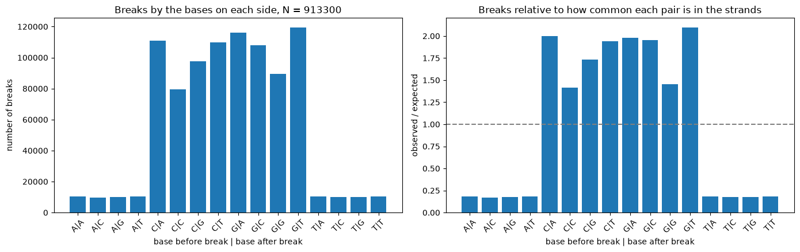

  | before \| after | A | C | G | T |
  |---|---|---|---|---|
  | **A** | 10,557 (0.18) | 9,636 (0.17) | 10,126 (0.18) | 10,563 (0.18) |
  | **C** | 111,030 (2.00) | 79,689 (1.42) | 97,757 (1.73) | 109,788 (1.94) |
  | **G** | 116,118 (1.98) | 107,986 (1.96) | 89,454 (1.46) | 119,593 (2.10) |
  | **T** | 10,359 (0.18) | 10,007 (0.18) | 10,053 (0.18) | 10,584 (0.18) |

  Each cell is the number of breaks, with observed/expected in brackets. Rows are the base before the break; columns are the base after it.
  - **The base before the break dominates:** 91% of breaks come right after a C or a G (831,415 of 913,300). Relative to how often each pair occurs, a junction after C or G breaks about **10 times** as often as one after A or T: average observed/expected 1.82 against 0.18.
  - **After A or T, the next base doesn't matter:** all 8 ratios are 0.17–0.19.
  - **After C or G, a repeated base breaks less:** C|C (1.42) and G|G (1.46) are below the other six C or G pairs (1.73–2.10).
  - **Not an artefact of how breaks are seen:** breaks at a read's start and at a read's end give the same split of the base before them. A: 4.6% and 4.3%, C: 43.7% and 43.6%, G: 47.2% and 47.7%, T: 4.6% and 4.4%.
- **Conclusion:** for Q2, **yes**, the chance of a break depends strongly on the nearby bases, above all on the base just before the junction. In conditional-probability terms *(Notes §2.2.1, p. 24)*, P(break | C or G before) is about 10 times P(break | A or T before). There's a smaller effect from the base after, seen only after C or G: a repeat of the same base lowers the rate.
  - This also changes the "Strand index" finding from Step 1. Breaks behave the same on every strand *on average*, but not at every position: where they fall depends on the local sequence.
- **Still open (Q2, "on how many bases?"):**
  - whether the 2nd and 3rd bases on each side still matter once the base right before the break is known;
  - whether the 5 bases on each side, as recorded, explain more than one base does.
- **Next (to do):** repeat the comparison conditioned on the base before the break, using the 2nd base before it and the 2nd and 3rd bases after it.
- **Correction (2026-11-15):** the conclusion above is right as an average, but it names the wrong cause. The next entry, "Two-base context, strands break about 38 times more often right after CC or GG than anywhere else", shows that a single C or G before a junction doesn't raise its break rate at all. Only **CC** or **GG** does. The 10-fold effect here is the average of those junctions with ordinary ones.
- **Correction (2026-11-15):** "After C or G, a repeated base breaks less" (C|C and G|G) is an observation artefact, not a channel effect. Reads shorter than 8 bases are never returned, so a likely break just *after* a junction hides breaks at that junction from reads that start there. See "Three-base context, the 3rd base out has no real effect; apparent run effects are an artefact of the 8-base minimum". Measured from read-end breaks, which this can't distort, the base after a C or G changes the rate by at most about 3%.

### 2026-11-15 · Part 1, Step 1: Two-base context, strands break about 38 times more often right after CC or GG than anywhere else
- **Setup** (the cell that starts `# Two-base context`): the two bases on each side of every break in `break_data.csv`, written b2 b1 | a1 a2, where b1 is the base just before the break and a1 the base just after it. Breaks within 2 bases of a strand's end are left out, which leaves 908,514 breaks. The baseline is the same as in "Break pairs, strands break about 10 times more often right after a C or G than after an A or T": each context's count is compared with what it would be if breaks fell evenly on every junction within a strand. Noise levels are binomial standard errors, about 0.002 to 0.011 here. ⚠️ **Not from the lecture notes:** the observed/expected ratio and the standard error used for the noise level are general data-analysis techniques. No server requests.
- **Result:**
  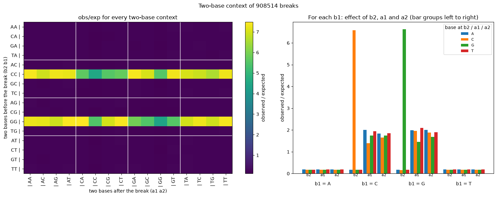

  | two bases before the break (b2 b1) | observed / expected | breaks |
  |---|---|---|
  | **C C** | **6.59** | 366,970 |
  | **G G** | **6.63** | 402,316 |
  | the other 14 pairs (AA, CA, …, AC, GC, TC, AG, CG, TG, …, TT) | 0.16–0.18 | 9,163–10,551 each |

  - **The two bases before the break set the rate.** 84.7% of breaks (769,286 of 908,514) come right after **CC** or **GG**. Those junctions break about **38 times** as often as any other: 6.6 against about 0.17.
  - **One C or G isn't enough.** After AC, GC, TC, AG, CG or TG, the ratio is 0.13–0.19, the same as after A or T. In the b1 × b2 table, C followed by C gives 6.59, while C followed by A, G or T gives 0.17.
  - **The base right after the break, given CC or GG before it:** a base that extends the run lowers the rate by about a quarter. CC|C is 5.34 against 6.81–7.21 for CC|A, CC|G, CC|T. GG|G is 5.31 against 6.87–7.20. After any other pair, a1 changes the ratio by at most 0.14 to 0.19.
  - **The 2nd base after the break:** differences of at most 1.2-fold.
  - **Run length:** a 3rd base before the break that extends the run, CCC| or GGG|, gives about 5.4 against about 7 for the other three bases. That was checked while writing the cell, in a separate run on the same data.
- **Conclusion:** for Q2, a break depends on **two bases**: the rate is high right after **CC** or **GG** and low everywhere else. A third base that makes a run of three Cs or Gs, on either side of the junction, lowers it by about a quarter. This supersedes the single-base result of the previous entry, which now has a correction. In conditional-probability terms *(Notes §2.2.1, p. 24)*, P(break | CC or GG just before) is about 38 times P(break | any other pair just before).
- **Still open:**
  - The absolute break probability per junction for each context, not just the ratio. That's needed to model read lengths for Q1 and Q3.
  - Why runs of three break a little less at each junction.
- **Next (to do):** turn the ratios into a per-junction break probability, using the segment lengths in `break_data.csv`.
- **Correction (2026-11-15):** the "smaller effect" results above are observation artefacts, not channel effects: the base after CC or GG that extends the run (CC|C, GG|G at about 5.3), and a 3rd base before that extends it (CCC|, about 5.4). So is the "still open" question of why runs of three break less. The cause is the 8-base minimum read length. A likely break just before a junction hides that junction's breaks from reads that end there, and a likely break just after it hides them from reads that start there. Measured from the kind of break each side can't distort, these effects shrink to at most about 3%. See "Three-base context, the 3rd base out has no real effect; apparent run effects are an artefact of the 8-base minimum". The main result, about 6.6 after CC or GG against about 0.17 elsewhere, holds in both kinds of break (6.63 and 6.56).

### 2026-11-15 · Part 1, Step 1: Three-base context, the 3rd base out has no real effect; apparent run effects are an artefact of the 8-base minimum
- **Setup** (the cell that starts `# Three-base context, b1 = C or G`): breaks in `break_data.csv` with the base just before them (b1) a C or G and at least 3 bases on each side, written b3 b2 b1 | a1 a2 a3. That's 410,895 breaks at a read's start and 410,162 at a read's end. For each pair b2 b1 ending in C or G, the cell asks whether b3 (the 3rd base before) or a3 (the 3rd base after) changes the rate. Each row's four values are shown relative to the row's overall observed/expected, so 1.00 means no effect. A chi-square test checks whether a row differs by more than counting noise, with a cut-off of p < 0.05/8 because 8 rows are tested at once. No server requests.
  - **Why the two kinds of break are kept apart:** reads shorter than 8 bases are never returned. A break at a read's end is only seen if the read before it isn't cut short, so a likely break site just *before* a junction hides that junction's breaks from read-end data. Likewise, a likely site just *after* it hides them from read-start data. So effects of bases before the break are measured from read-start breaks, and effects of bases after it from read-end breaks. The other kind is shown alongside to make the artefact visible.
  - ⚠️ **Not from the lecture notes:** the observed/expected ratio, the chi-square test of homogeneity and the Bonferroni cut-off are general statistics.
- **Result:**
  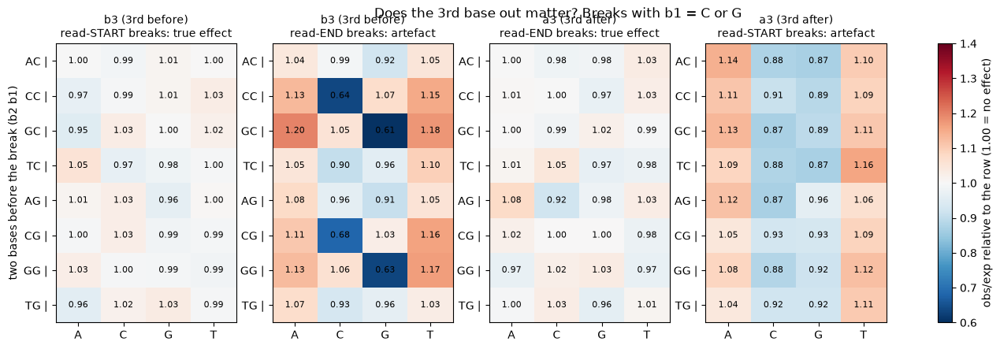

  | effect of | measured from | rows CC and GG: range of the 4 values | other 6 rows |
  |---|---|---|---|
  | b3 (3rd before) | read-start breaks (true effect) | 0.97–1.03 | 0.95–1.05, none beyond noise |
  | b3 (3rd before) | read-end breaks (artefact) | CCC\| 0.64, GGG\| 0.63, others 1.06–1.15 | e.g. GGC\| 0.61, CCG\| 0.68 |
  | a3 (3rd after) | read-end breaks (true effect) | 0.97–1.03 | 0.92–1.08 |
  | a3 (3rd after) | read-start breaks (artefact) | C or G 0.88–0.91, A or T 1.08–1.12 | similar |
  | a1 (right after) | read-end breaks (true effect) | 0.97–1.02 | 0.93–1.06 |
  | a1 (right after) | read-start breaks (artefact) | CC\|C 0.63, GG\|G 0.61 | same base as b1: 0.60–0.64 |

  - In the undistorted data, the CC and GG rows still differ "beyond noise" for b3 and a3. That's only because they hold about 180,000–200,000 breaks each. The differences themselves are no bigger than ±3%.
  - The distorted values follow the artefact's prediction: a 3rd base that creates another CC or GG site next to the junction lowers the visible rate. That happens for b3 in read-end data, and for a1 and a3 in read-start data.
- **Conclusion:** for Q2's "on how many bases?", **two**. The break rate at a junction is set by the two bases before it: about 38 times higher right after CC or GG than anywhere else. The 3rd base on either side, and the base right after the junction, change it by at most about 3%. That's small against the CC/GG effect, and could itself be a smaller leftover of the artefact from sites further away. This corrects the run effects reported in "Break pairs, strands break about 10 times more often right after a C or G than after an A or T" and "Two-base context, strands break about 38 times more often right after CC or GG than anywhere else". Both now have dated corrections.
- **Practical note:** any analysis of `break_data.csv` that looks at the bases around a break must allow for this artefact. Use read-start breaks for the bases before a break and read-end breaks for the bases after it, or model the 8-base minimum directly.
- **Next (to do):** estimate the per-junction break probability after CC/GG and elsewhere from the segment lengths, allowing for the 8-base minimum.

### 2026-11-15 · Part 1, Step 1: Per-junction break probability, about 0.42 right after CC or GG and about 0.011 after any other pair
- **Setup** (the cell that starts `# Break probability per junction, by the two bases BEFORE it`): the 513,090 placed reads of the break survey, rebuilt as (start, end) from `break_data.csv` and `break_summary.json`, on 2891 strands. The rebuild matches the survey's placed-read count exactly. No server requests.
  - **Model:** each copy of a strand breaks at each junction independently, with a probability p that depends on the two bases before the junction (b2 b1). Each read is one piece of at least 8 bases from one copy. Each junction is then a Bernoulli trial *(Notes §2.4.1 Bernoulli and Binomial, p. 33)*, independent of the others *(Notes §2.2.2 Independence, p. 25)*.
  - **Estimate from the read-end side:** take the reads that cover the 8 bases just before junction j. p = (reads that end at j) / (reads that end at j + reads that run past j). Requiring those 8 bases makes both kinds of read at least 8 bases long whatever happens at j, which removes the 8-base-minimum artefact from "Three-base context, the 3rd base out has no real effect; apparent run effects are an artefact of the 8-base minimum".
  - **Estimate from the read-start side:** the mirror image, using reads that cover the 8 bases just after j. It uses different reads, so it's an independent check. Counts are pooled over all junctions with the same b2 b1.
  - **Correction:** the channel model returns one piece per copy, so a copy that broke at j has each of its pieces picked a little less often, and the raw estimate is too low. On simulated data with known p it was about 15% low. The cell simulates the survey under the model with the estimated p's (same strands, same number of placed reads, `np.random.default_rng(0)`), runs the same estimate on the simulated reads and rescales, for 3 rounds. On simulated data with known p this recovered the true values within noise.
  - ⚠️ **Not from the lecture notes:** the windowed estimator, the simulation-based correction and the binomial standard error (which treats reads as independent) are general data-analysis techniques.
- **Result:**
  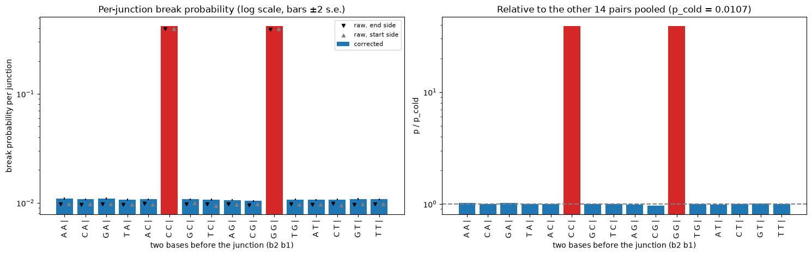

  | two bases before the junction (b2 b1) | junction observations | p, read-end side | p, read-start side | p corrected (1 s.e.) | p / p_cold |
  |---|---|---|---|---|---|
  | **C C** | 936,835 | 0.39391 | 0.39421 | **0.41768** (0.00054) | **38.88** |
  | **G G** | 1,026,299 | 0.39298 | 0.39407 | **0.41844** (0.00051) | **38.95** |
  | the other 14 pairs | 946,447–1,086,420 each | 0.00953–0.00992 | 0.00945–0.01002 | 0.01040–0.01096 (0.00010–0.00011) | 0.97–1.02 |

  - CC and GG pooled: **p_hot = 0.4181**. The other 14 pairs pooled: **p_cold = 0.01074**. Ratio **38.9**.
  - The read-end and read-start estimates agree within 3.4% for every pair.
  - The correction raised p by 6–12%. It settled within 3 rounds: CC 0.4194, 0.4176, 0.4177.
- **How this relates to the observed/expected ratios of "Two-base context, strands break about 38 times more often right after CC or GG than anywhere else":** observed/expected compares each pair with the average junction, while p is an absolute probability. CC and GG make up 12.0% of the junction observations here. The average p over all junctions is then 0.120 × 0.4181 + 0.880 × 0.01074 ≈ 0.060. Dividing gives 0.4181 / 0.060 ≈ 7.0 for CC/GG and 0.01074 / 0.060 ≈ 0.18 for the other pairs, close to the 6.6 and 0.17 seen there. The ratio between hot and cold is the same in both: 38.9 here, about 38 there.
- **Conclusion:** for Q2, a junction right after **CC** or **GG** breaks with probability about **0.42**, and a junction after any other pair with about **0.011**. The other 14 pairs are equal within ±3%, and CC and GG are equal to each other. This confirms the two-base result with a method that doesn't depend on the 8-base artefact, and it answers the "Still open" item of the two-base entry. In conditional-probability terms *(Notes §2.2.1, p. 24)*, P(break at a junction | CC or GG before it) ≈ 0.42 and P(break | any other pair) ≈ 0.011.
- **Still open:**
  - The correction assumes the live channel picks one piece per copy, uniformly, as `LocalChannel` does. A channel that picks pieces another way, for example by length, would change the absolute values. The ratio of about 39 would barely change.
  - About 11% of reads were skipped in the survey because they had errors or fit more than one place on the strand. Longer reads are more likely to contain an error, so reads that run past a junction are slightly under-counted, which may push p up a little. Not corrected.
  - Whether the model, with these two probabilities, reproduces the observed read-length distribution and the full-length read count (2829 of 513,090 placed reads).
- **Next (to do):** simulate the survey with p_hot = 0.418 and p_cold = 0.0107 and compare the simulated read lengths and full-length counts with the live data. That tests both the model and the correction.
- **Update (2026-11-15):** "G-run test, breaks at neighbouring hot junctions are independent, but the live channel doesn't pick pieces the way the model does" suggests the correction step overshoots. On designed strands, the live data shows no sign of the one-piece-per-copy picking bias that the correction assumes. If that holds, the raw estimates are the right ones: 0.394 after CC or GG and about 0.0097 elsewhere, with the ratio of about 39 unchanged. Not yet settled; see that entry's **Next**.

### 2026-11-15 · Part 1, Step 1: Four-base context, the two bases after a junction don't change its break probability
- **Setup** (the cell that starts `# Break probability per junction, by the two bases before AND the two bases after it`): the same 513,090 placed reads on 2891 strands, model, windowed estimator and correction as "Per-junction break probability, about 0.42 right after CC or GG and about 0.011 after any other pair". The difference: one p for each of the 256 contexts b2 b1 | a1 a2, the two bases before and the two after the junction. Junctions need two bases on each side, so the last junction of each strand is left out. There are 39,607 to 90,848 junction observations per context. The correction's simulation uses `np.random.default_rng(1)`, 3 rounds. The noise level of a corrected p is √2 times the binomial standard error, because the simulation is as large as the data and adds its own noise. Within each b2 b1 row, a chi-square test (15 degrees of freedom) asks whether the 16 values differ by more than noise, with a cut-off of p < 0.05/16. No server requests.
  - ⚠️ **Not from the lecture notes:** the windowed estimator, the simulation-based correction, the standard errors and the chi-square test are general data-analysis techniques. Junctions are treated as independent Bernoulli trials *(Notes §2.4.1 Bernoulli and Binomial, p. 33; §2.2.2 Independence, p. 25)*.
- **Result:**
  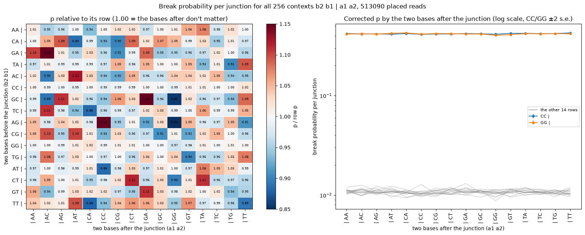

  | b2 b1 | row p | 16 values of a1 a2: min–max | max/min | chi-square p-value | a1 effect (rel.) | a2 effect (rel.) |
  |---|---|---|---|---|---|---|
  | **C C** | 0.4190 | 0.4135–0.4266 | 1.032 | 0.16 | 0.995–1.008 | 0.995–1.005 |
  | **G G** | 0.4178 | 0.4048–0.4267 | 1.054 | 2.0e-04 (beyond noise) | 0.986–1.008 | 0.995–1.006 |
  | the other 14 pairs | 0.0105–0.0111 | 0.0088–0.0131 | 1.149–1.456 | 0.017–0.97, none beyond noise | 0.946–1.052 | 0.938–1.046 |

  - All 32 CC\|xx and GG\|xx contexts lie between 0.4048 and 0.4267. All 224 other contexts lie between 0.00878 and 0.01307.
  - **Cold rows:** spreads of 1.15–1.46 look large, but each cold context has only a few hundred breaks, so the noise level is about 5%. No cold row passes the cut-off. The single effects of a1 and a2 stay within ±6%.
  - **The GG row is the only one beyond noise.** Its lowest values are GG\|GG at 0.4048 (s.e. 0.0033) and GG\|GT at 0.4094 (0.0030), against a row value of 0.4178. That's a 3% dip. The CC row's lowest is CC\|CC at 0.4135, which is within noise. In the raw estimates, before correction, GG\|GG is not low: 0.3972 from the read-end side and 0.3964 from the read-start side, against 0.3844–0.4038 across the row. So the dip comes from the correction. Contexts like GG\|GG have extra hot sites right after the junction, which changes how many pieces a copy breaks into. That's exactly what the correction models, so a small mismatch between the model and the live channel would show up there.
- **Conclusion:** for Q2, the two bases **after** a junction don't change its break probability. Within each pair before the junction, the 16 choices of a1 a2 agree within noise: about ±3% around 0.42 for CC and GG, and within counting noise around 0.011 for the rest. The only effect beyond noise is a 3% dip at GG\|GG, which appears only after the correction, so it may be a modelling leftover rather than a channel effect. This measures a2 directly for the first time, free of the 8-base artefact. It confirms the earlier inference that the 1.2-fold a2 differences in "Two-base context, strands break about 38 times more often right after CC or GG than anywhere else" were the artefact. Together with "Three-base context, the 3rd base out has no real effect; apparent run effects are an artefact of the 8-base minimum", the break probability depends only on the two bases **before** the junction.
- **Still open:** whether the 3% GG\|GG dip is real. The model check in the previous entry's **Next** (simulate with two probabilities and compare read lengths and full-length counts) would show whether the correction fits the live channel.

### 2026-11-15 · Part 1, Step 1: G-run test, breaks at neighbouring hot junctions are independent, but the live channel doesn't pick pieces the way the model does
- **Setup** (the cell that starts `# G-run test`): 500 new random strands of length 200, `random.Random(13)`, in 5 groups of 100. Outside a central run, no strand has CC or GG anywhere, so every junction there is cold. The run in the middle is k Gs, for k = 0 (control, no run), 2, 3, 6 or 10, which gives k − 1 hot junctions. The bases on either side of the run are never G. Each strand was sent alone once, 200 reads. Strands that returned 0 reads were sent alone twice more, 1000 reads each. Results are saved in `run_test.json`.
  - **Crossing fraction:** of the reads covering the 8 bases before the run, the fraction that run past it. The span runs from the cold junction just before the run to the cold junction just after it. The 8-base margin keeps the 8-base minimum from biasing the count.
  - **Conditional p by position:** at each hot junction of the run, (reads ending there) / (reads ending there + reads running past it), among the same reads. That's P(break here | no break earlier in the run). The mirror image from the read-start side gives P(break here | no break later in the run).
  - **Comparison:** a simulation of the same strands with the same number of placed reads, under the model of "Per-junction break probability, about 0.42 right after CC or GG and about 0.011 after any other pair": independent junctions, p_hot = 0.4181, p_cold = 0.01074, one piece of at least 8 bases picked per copy (`np.random.default_rng(2)`). A dry run on a fake independent channel, before sending, showed the simulation is needed: the piece-picking effect alone moves the crossing fractions 15–30% above the simple formula, and makes the conditional p drift along the run.
  - ⚠️ **Not from the lecture notes:** the windowed estimator, the simulation comparison and the binomial standard errors (which treat reads as independent) are general data-analysis techniques. Independence and the chain rule: *(Notes §2.2.2 Independence, p. 25; §2.2.3 The Chain Rule, p. 26)*.
- **Result:**
  

  | k | hot junctions | strands with reads | reads counted | crossing, live (1 s.e.) | crossing, simulated (1 s.e.) | live / sim | gap in s.e. |
  |---|---|---|---|---|---|---|---|
  | 0 | 0 | 96 | 4056 | 0.9887 (0.0017) | 0.9930 (0.0011) | 0.996 | −2.1 |
  | 2 | 1 | 96 | 3946 | 0.6123 (0.0078) | 0.6720 (0.0067) | 0.911 | −5.8 |
  | 3 | 2 | 96 | 3984 | 0.3685 (0.0076) | 0.4332 (0.0073) | 0.851 | −6.1 |
  | 6 | 5 | 98 | 3999 | 0.0820 (0.0043) | 0.0955 (0.0045) | 0.859 | −2.2 |
  | 10 | 9 | 95 | 3900 | 0.0110 (0.0017) | 0.0104 (0.0016) | 1.059 | +0.3 |

  - **Factor per extra hot junction, live:** 0.602 (k = 2 → 3), 0.606 (3 → 6), 0.606 (6 → 10). The simulation gives 0.645, 0.604 and 0.575, and the simple formula 1 − 0.418 = 0.582.
  - **Conditional p along the run, live, read-end side:** about 0.39–0.42 at every hot junction with enough reads. For k = 3: 0.388, 0.386. For k = 6: 0.404, 0.400, 0.413, 0.399, 0.340, the last from 500 reads. For k = 10: 0.402, 0.411, 0.397, 0.421, 0.388, 0.400, 0.374, 0.339, 0.403, the last three from 72–174 reads.
  - **Conditional p along the run, simulated:** it drifts. For k = 3: 0.346, 0.327. For k = 6: 0.399 down to 0.340.
  - **Read-start side:** the same picture. Live is mostly 0.37–0.42, except values from fewer than 200 reads.
  - **Deletions:** 19 of 500 strands returned 0 reads to all three requests: 4 in each of the control, GG and GGG groups, 2 in the G×6 group and 5 in the G×10 group. Every other strand returned all 200 of 200 reads. The 19 are Appendix B rows 84–102.
- **Conclusion:**
  - **Hot junctions in a row break independently.** Each extra hot junction multiplies the crossing fraction by the same factor, about 0.60, whether it's the 2nd or the 9th in the run. The live conditional p stays flat at about 0.40 along runs of up to 9 hot junctions. If breaks clustered, the factor would rise along the run and p would fall. If they repelled, the opposite. Neither happens. So for a run like GGGG, the chance of no break is a product of the per-junction terms *(Notes §2.2.3 The Chain Rule, p. 26)*, and the "independence" caveat raised for the GGGG calculation is resolved.
  - **The live channel doesn't pick pieces the way the model (and `LocalChannel`) does.** Live crosses runs 9–15% less often than the simulation for k = 2, 3 and 6 (5.8, 6.1 and 2.2 standard errors). The simulation's drift in conditional p, which comes from picking one piece per copy, isn't in the live data. The live data looks like what independent junctions with p ≈ 0.40 and **no** piece-picking bias would give. Then the uncorrected estimates are the right ones: about 0.394 after CC or GG and about 0.0097 elsewhere. The correction in "Per-junction break probability, about 0.42 right after CC or GG and about 0.011 after any other pair" (to 0.418 and 0.0107) would overshoot by about 6%, and the GG\|GG dip in "Four-base context, the two bases after a junction don't change its break probability", which appeared only after correction, would be a leftover of it. This is a strong hint, not yet proven: the direct test is to simulate the break survey under "no picking bias" and check it matches the live read lengths and full-length counts.
  - **Deletion:** 19 of 500 (3.8%, exact 95% interval 2.3%–5.9%), spread over all five groups with no relation to the run. That supports Hypotheses 1 and 4. These strands were drawn without CC or GG outside the run, so they're kept apart from Hypothesis 1's rate of 74 of 2584. If the true rate were 2.9%, 19 or more of 500 would happen about 13% of the time.
- **Side observation:** the 0.39–0.40 per hot junction measured here on designed strands agrees with the raw survey estimate of 0.394 on random strands. That's a second, independent measurement of the hot-junction break probability.
- **Still open:** how the live channel picks the read from a broken copy. Uniformly from all pieces of all copies pooled, rather than one piece per copy, would remove the bias. That needs testing.
- **Next (to do):** simulate the break survey under both picking models, one piece per copy and all pieces pooled, and compare each with the live read lengths and the 2829 full-length reads. Whichever matches tells us which estimates, raw or corrected, to use.

### 2026-11-15 · Part 1, Step 1: C-run test, C runs break exactly like G runs
- **Setup** (the cell that starts `# C-run test`): the design and analysis of "G-run test, breaks at neighbouring hot junctions are independent, but the live channel doesn't pick pieces the way the model does", with runs of C instead of G.
  - **Strands:** 500 new random strands of length 200, `random.Random(14)`, in 5 groups of 100: no run, or a central run of 2, 3, 6 or 10 Cs. There's no CC or GG outside the run, and the bases next to it are never C.
  - **Sending:** each strand alone once, 200 reads. Strands that returned 0 reads were sent alone twice more, 1000 reads each. Results are saved in `run_test_C.json`.
  - **Comparison:** the same one-piece-per-copy simulation with independent junctions (p_hot = 0.4181, p_cold = 0.01074, `np.random.default_rng(3)`), and the G-run test's live results, recomputed from `run_test.json`.
  - ⚠️ **Not from the lecture notes:** the windowed estimator, the simulation comparison and the binomial standard errors (which treat reads as independent) are general data-analysis techniques.
- **Result:**
  

  | k | hot junctions | reads counted | crossing, C runs (1 s.e.) | crossing, G runs (1 s.e.) | C − G in s.e. | C runs, simulated (1 s.e.) | C live − sim in s.e. |
  |---|---|---|---|---|---|---|---|
  | 0 | 0 | 4229 | 0.9882 (0.0017) | 0.9887 (0.0017) | −0.2 | 0.9939 (0.0011) | −2.8 |
  | 2 | 1 | 4095 | 0.5968 (0.0077) | 0.6123 (0.0078) | −1.4 | 0.6623 (0.0069) | −6.3 |
  | 3 | 2 | 3972 | 0.3719 (0.0077) | 0.3685 (0.0076) | +0.3 | 0.4222 (0.0073) | −4.7 |
  | 6 | 5 | 3872 | 0.0826 (0.0044) | 0.0820 (0.0043) | +0.1 | 0.0952 (0.0046) | −2.0 |
  | 10 | 9 | 4012 | 0.0085 (0.0014) | 0.0110 (0.0017) | −1.2 | 0.0120 (0.0017) | −1.6 |

  - **Factor per extra hot junction, live C runs:** 0.623 (k = 2 → 3), 0.606 (3 → 6), 0.566 (6 → 10). For G runs it was 0.602, 0.606 and 0.606.
  - **Conditional p along the run, live, read-end side:** flat at about 0.37–0.41 where there are 500 or more reads. For k = 6: 0.399, 0.390, 0.393, 0.386, 0.380. For k = 10, the first five: 0.400, 0.399, 0.406, 0.402, 0.376. The simulation drifts again: for k = 6, 0.392 down to 0.320. The read-start side is the same: about 0.37–0.45 live.
  - **Deletions:** 17 of 500 strands returned 0 reads to all three requests: 1 in the control group, 4 in each run group. Every other strand returned all 200 of 200 reads. The 17 are Appendix B rows 103–119.
- **Conclusion:**
  - **C runs and G runs break the same.** The crossing fractions agree within noise in all five groups: at most 1.4 standard errors apart, with no consistent direction. The factor per extra hot junction is again about 0.60, and the conditional p is again flat at about 0.38–0.41. This supports Hypothesis 5 for CC as well as GG, and with it independence along C runs.
  - **The live channel again falls below the one-piece-per-copy simulation,** by 10–13% for k = 2, 3 and 6 (6.3, 4.7 and 2.0 standard errors). The simulation's drift in conditional p is again missing from the live data. So the G-run result wasn't a fluke: two independent sets of 500 strands show the same mismatch.
  - **The control groups point the same way.** With no run, the live crossing fraction is 0.9882 (C test) and 0.9887 (G test), against 0.9939 and 0.9930 in the simulation. Both are about 2–3 standard errors below. The no-bias prediction for the same span, 1 − 0.0097 = 0.990 using the raw cold estimate, fits the live values. That's a small effect, but it's on cold junctions only, so it doesn't depend on the hot-junction numbers.
  - **Deletion:** 17 of 500 (3.4%, exact 95% interval 2.0%–5.4%). Together with the G-run test, 36 of 1000 (3.6%, 2.5%–4.9%). If the true rate were 2.9%, 36 or more of 1000 would happen about 10% of the time. Supports Hypotheses 1 and 4.
- **Still open:** how the live channel picks a read from a broken copy. Both run tests now point to no one-piece-per-copy bias, which would make the raw per-junction estimates (0.394 and about 0.0097) the right ones.
- **Next (to do):** the picking-model simulation of the break survey (Hypothesis 5, test 1).

### Where things stand after Step 1
- **Channel:** every result in Step 1 comes from the **live server** (`Channel()` or direct posts to `SERVER_URL`). `LocalChannel` was used only to check that new code ran, and none of its output is logged. The sequence-features check sent nothing.
- **Established:**
  - Break lengths and start positions don't depend on which strand a read comes from, so they can be pooled.
  - Strand 67 is lost entirely: sent alone, it returns no reads.
  - The loss goes with the exact whole strand. Each window tested alone (0–59, 60–119, 40–79) comes back, and 117 of 120 single-base changes bring the strand back. Deleting one base from either end brings it back too, and so do 77 of 80 extensions.
  - Some edited versions of strand 67 are lost as well, with no visible pattern: 7 of 321 sequences tested so far, about 2%.
  - Loss isn't special to strand 67. 10 of 400 fresh random strands were lost too (about 2.5%), and the tails that killed extended strand 67 don't raise the rate. Loss is all or nothing: every surviving strand returned all its requested reads.
  - About 10% of reads are not exact substrings of what was sent.
- **Changed:** "all test strands are treated the same" holds for the *shape* of breakage: lengths and start positions. It does **not** hold for whether a strand comes back at all, because strand 67 is lost entirely.
- **Hypothesis proposed:** whether a strand is lost is deterministic. It is now **Hypothesis 1** in section 5, "Hypotheses", which holds its statement, evidence, caveats and tests.
- **Still open:**
  - Whether position within a strand matters (Q1's "reads that touch the end" question).
  - The loss rate, more precisely. About 2.5% so far: 10 of 400 fresh random strands, and 17 confirmed lost strands overall.

### 2026-11-23 · Part 3, Step 1: v5 fails live because reads carry substitution errors, about 0.5% per base, not because strands are lost
- **Setup:** `solution.py` v5 (300-base strands with no CC or GG, Huffman-compressed text; see "Solution walkthrough and history"). `evaluate(SAMPLE, Channel())` gave **4 strands, 1200 bases: density 2.973, accuracy 0.4664, SCORE 0.0000** (and 0.0000, accuracy 0.0000, on `LocalChannel(seed=1)`). The diagnosis cell (first line `# v5 diagnosis: the live evaluate run recovered only 47% of SAMPLE`) then sent the same 4 strands together for 1784 reads (4 per character, as `evaluate` does), and each strand **alone**, in two direct requests of 1000 reads each, and saved every read to `run_v5_diag.json`. The cell `v5-read-errors` analyses that file without new requests. **Channel: live server** (`Channel()`). The 4 strands are in the bank of tested strands.
- **Result, no strand is lost:** every strand returned 1000 of 1000 reads alone, in both requests. Together, 297, 285, 279 and 277 reads fitted strands 0–3 exactly, and 646 of 1784 fitted none exactly.
- **Result, full-length reads come back at the predicted rate:** 84 of 1784 reads (4.7%) were 300 bases long. Simulating Hypothesis 5 with p = 0.0097–0.0104 per cold junction predicts 4.3–5.5% if the channel returns one piece per broken copy, and 1.2–1.5% if every piece of every copy is equally likely.
- **Result, but most full-length reads have errors:** only 12 of the 84 match their strand exactly (5, 2, 1 and 4 for strands 0–3).

  | mismatches to the nearest strand | 0 | 1 | 2 | 3 | 4 | 5 |
  |---|---|---|---|---|---|---|
  | 300-base reads (N = 84) | 12 | 34 | 23 | 9 | 5 | 1 |

  - **Rate:** 132 of 25,200 bases in the full-length reads are wrong (0.0052). In the 8000 solo reads it's 3987 of 809,719 bases (0.0049).
  - **Kind:** substitutions only. All 8000 solo reads fit their strand with a few mismatches, with no insertion or deletion needed. All 12 kinds occur: A>C 18, A>G 18, T>G 15, T>C 15, T>A 13, A>T 11, G>T 9, C>T 8, G>A 8, C>A 8, G>C 5, C>G 4.
  - **Position:** spread along the strand: 11, 12, 18, 16, 11, 14, 11, 20, 9, 10 errors in bases 0–29, 30–59, …, 270–299.
- **Result, per-position voting fixes it:** a majority vote at each position over each strand's full-length reads gives **0 mismatches** for all 4 strands (16, 24, 20 and 24 reads; 5, 2, 1 and 4 of them error-free).
- **Conclusion:**
  - v5's `decode` voted on whole reads. With about 0.5% errors per base, only about 0.995³⁰⁰ ≈ 22% of 300-base reads are error-free (observed 12 of 84). So the whole-read vote mostly chose erroneous copies, and errors in the index created phantom strands ("284" and "1002").
  - Neither deletion nor too few full reads is the cause.
  - Voting position by position *(Notes §3.3.2, p. 59)* over reads grouped by Hamming distance *(Notes §3.3.2, p. 58)* recovers every strand. This is v6 of `solution.py`, which decoded these reads exactly before its scrambling step was added.
  - Supports Hypothesis 5: the full-length share matches the predicted break rate. The match favours the one-piece-per-copy picking model (caveat 1), but this is one run of 4 strands, so it's a hint.
  - ⚠️ **Not from the lecture notes:** the error rate and its type are our own measurements, and the picking-model predictions come from our own simulation.
- **Side observation:** this explains the roughly 11% of break-survey reads that "had errors or fit more than one place" (Hypothesis 5, caveat 5). At about 0.5% per base, a 25-base read has an error with chance 1 − 0.995²⁵ ≈ 12%.
- **Practical note:** `Channel().reads` loops forever if the server returns nothing, so the solo sends use one direct request each.
- **Next (to do):** run `evaluate` on the live channel with v6. Its strands are new (scrambled), so they go into the bank of tested strands.

### 2026-11-23 · Part 3, Step 1: Baseline strands, 2 of 113 are deleted
- **Setup:** the 113 strands the baseline (`example_solution.py`) makes for `SAMPLE`: 22 bases each, a 6-base index and a 16-base payload. They went to the live channel in the notebook's first `evaluate(SAMPLE, Channel())` run but were never banked (Appendix A). The cell `baseline-bank-test` sent all 113 together in one request of 5000 reads and counted reads that fit each strand exactly. The cell `baseline-lowcount` then sent the two strands with far fewer reads than the rest alone, two direct requests of 1000 reads each. **Channel: live server.** Everything is saved in `baseline_bank_test.json`.
- **Result:** in the batch, every strand had at least 1 placed read: min 1, median 45, max 83 (N = 5000 reads). The two lowest, strands 34 (1 read) and 78 (8 reads), returned **0 reads to both solo requests**, so they're deleted (Appendix B rows 120–121). The next lowest, strands 85, 43 and 87 (26, 29 and 31 reads), weren't checked alone.
- **Conclusion:**
  - 2 of 113 (1.8%) are deleted, in line with the 2.9% rate of Hypothesis 1.
  - 22 bases is the shortest length at which a deletion has been seen (earlier tests used 30–1000), which supports Hypothesis 4's "length doesn't matter".
  - The screening lesson from the low-count retest held again: strand 34's one batch read was a chance match, so "at least one read in a batch" isn't enough to call a strand alive.
- **Side observation:** 3 strands (34, 78 and 85) had no full-length exact read in 5000, and 7 had 2 or fewer. Strand 85 isn't deleted but has 9 hot junctions in 22 bases, so it almost never survives whole. Deleted or never-whole strands lose their 4 payload bytes in the baseline's `decode`, which likely explains part of its 0.92 live accuracy.
- **Practical note:** a batch screen with "0 placed reads" would have missed both deletions here, because each picked up chance matches; the low-count check caught them.

### 2026-11-23 · Part 3, Step 1: v6 decodes the sample perfectly on the live channel, score 2.9733
- **Setup:** `solution.py` v6: 300-base strands with no CC or GG, Huffman-compressed text, bits scrambled per strand, and `decode` grouping full-length reads by Hamming distance and voting per position. The notebook's `evaluate` cell: `SAMPLE` (446 characters), 4 reads per character (1784 reads). **Channel:** `LocalChannel(seed=1)` and the live server (`Channel()`). The 4 strands are in the bank of tested strands.
- **Result:**

  | channel | strands | bases | density | accuracy | score |
  |---|---|---|---|---|---|
  | `LocalChannel(seed=1)` | 4 | 1200 | 2.973 | 0.0000 | 0.0000 |
  | live server | 4 | 1200 | 2.973 | **1.0000** | **2.9733** |
  | baseline on the live server, for comparison | 113 | 2486 | 1.435 | 0.9215 | 0.8658 |

- **Conclusion:**
  - Per-position voting fixes v5's failure ([Step 36](index.html#step-36)): every character of the sample came back, at about twice the baseline's density.
  - The score is 3.4 times the baseline's.
  - `LocalChannel` scores 0 because it breaks every junction with probability 0.03, so a 300-base strand almost never survives whole there. It doesn't model the live channel's cold junctions (about 0.01, Hypothesis 5).
  - This is one run on one passage. None of the 4 strands happened to be deleted (about 2.9% each), and a deleted strand would cost about a quarter of the text.
  - ⚠️ **Not from the lecture notes:** the score is the project's own definition.
- **Next (to do):**
  - Run several live runs and other passages, to see how often a strand is lost and how the score varies.
  - Add redundancy against deleted strands, for example a parity strand *(Notes §3.3.3 Parity Checks, p. 59)*.

